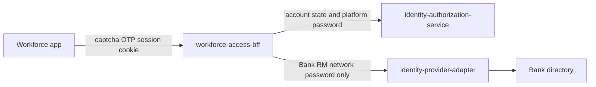
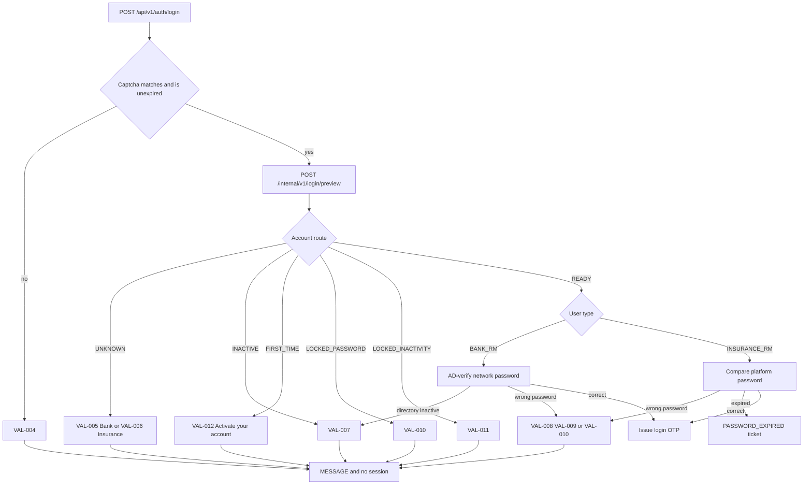
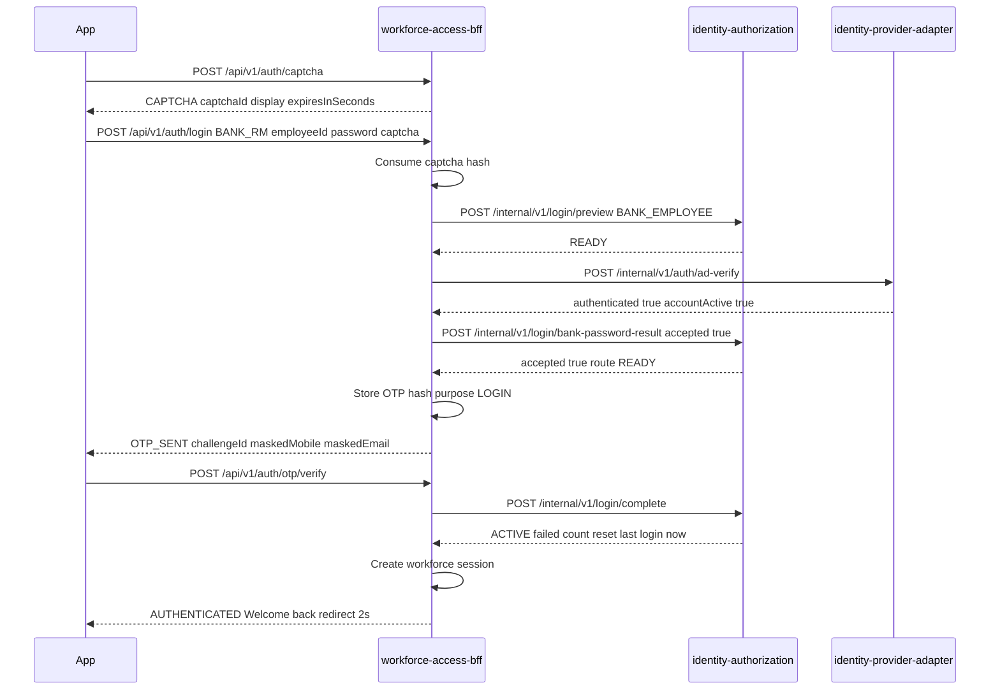
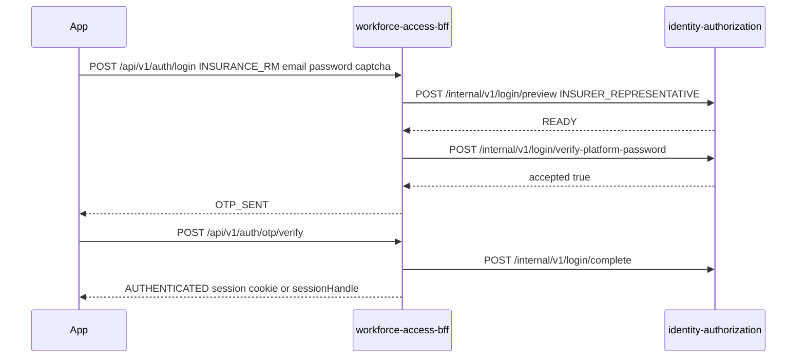
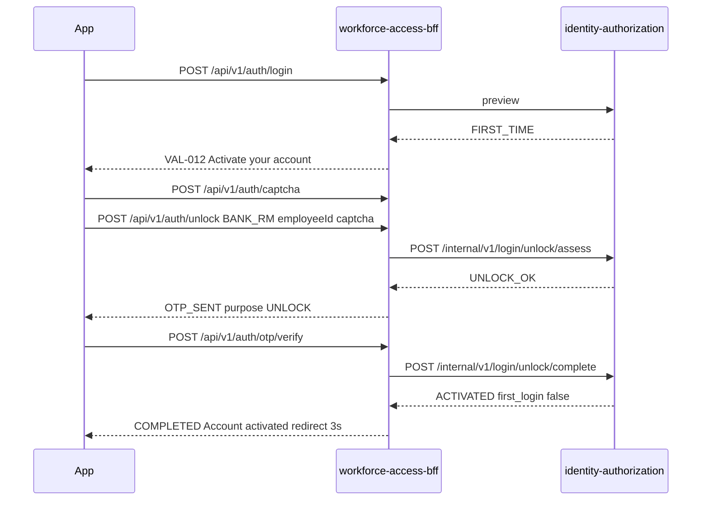
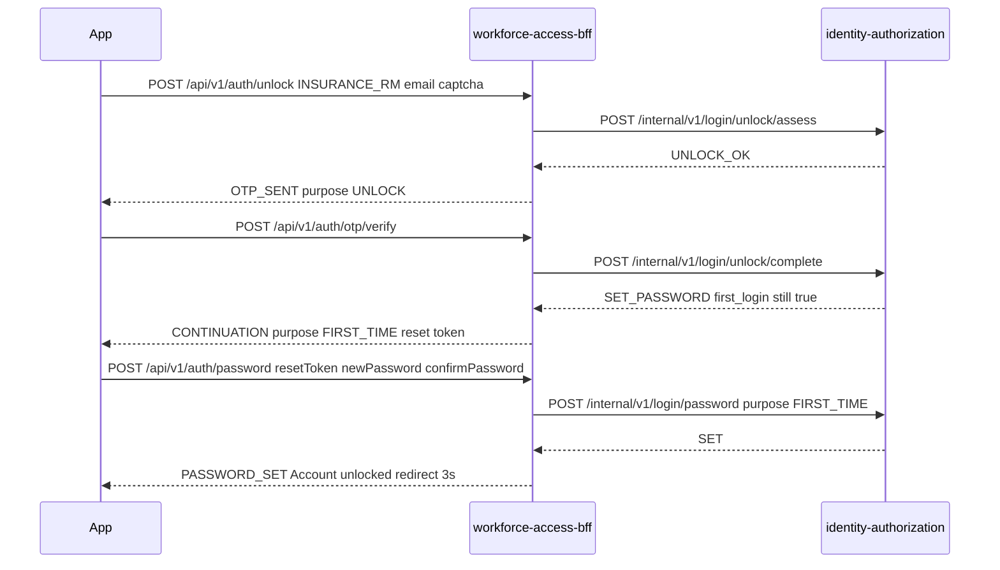
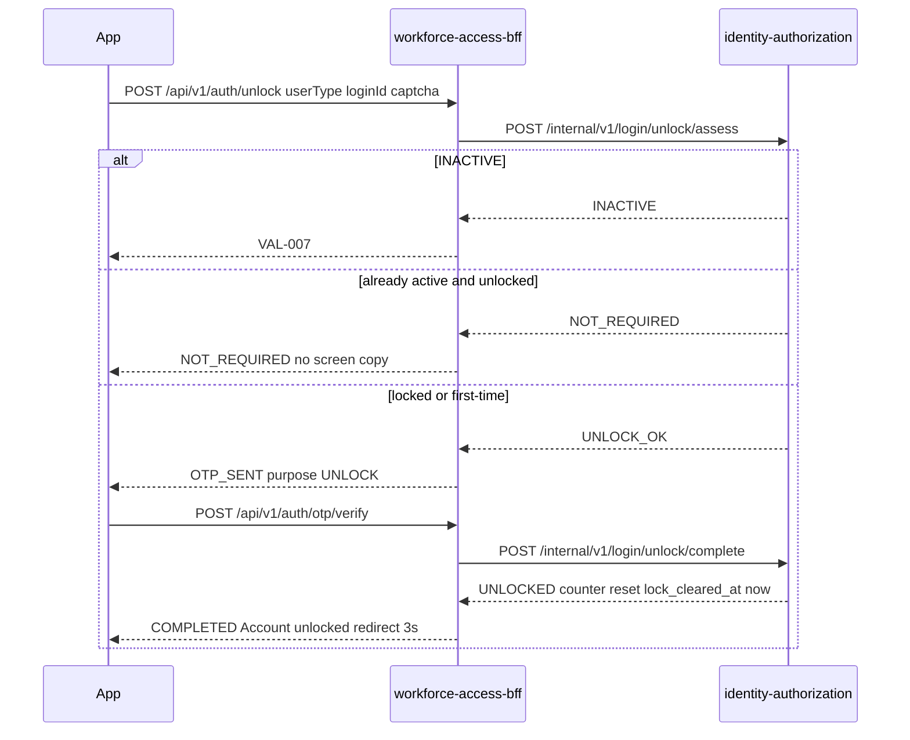
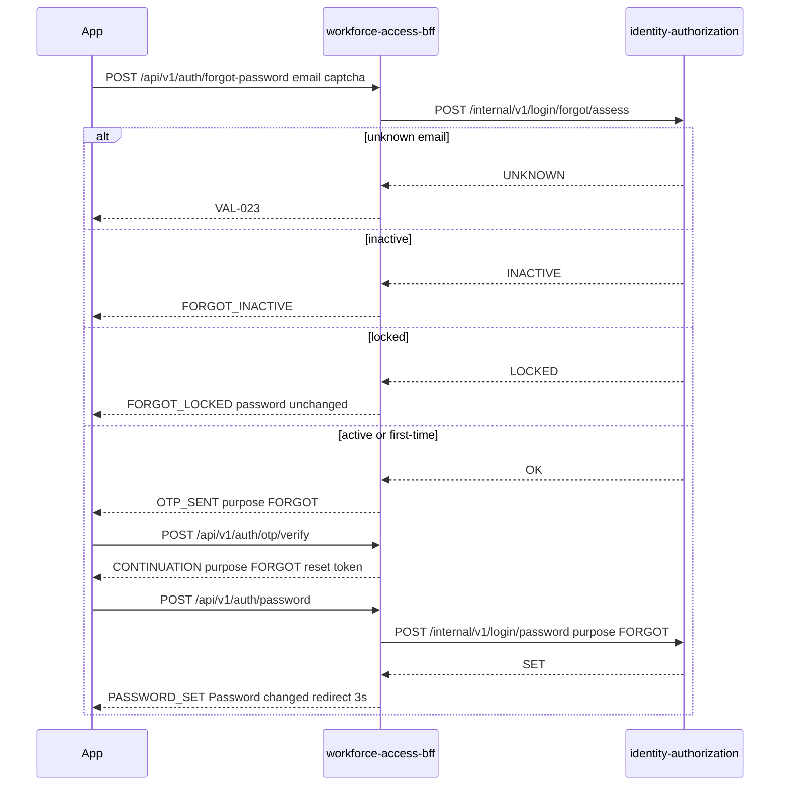
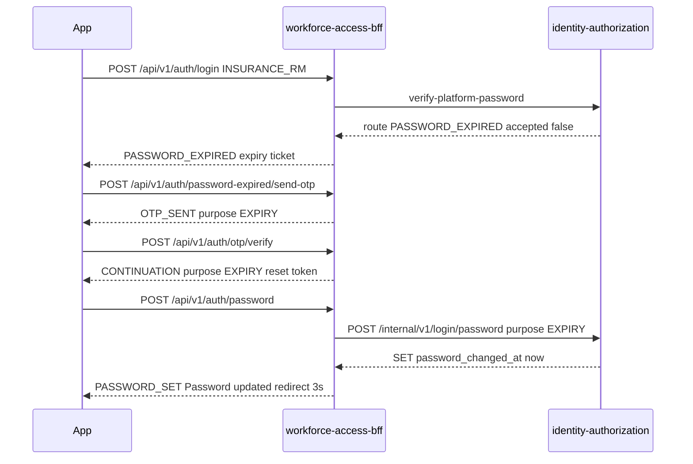

# Login BRD v3.1 — API flows

**Work item:** `SUG-20261023-e2e` · **Behaviour:** [Login BRD v3.1](../../au-bank-insurance-platform/requirements/brd-detailed/Login_Module_BRD_Detailed_CONTEXT.md)
**Code:** `LoginJourneyController`, `LoginJourneyService`, `PlatformLoginService`
**Status:** describes the journey on this branch. Not a Security sign-off. NIP-APP is not in this repository.

`SUG-20261028-1lg`: IAM-001 immediate-session login and `/auth/sign-in` are retired. NIP password
login is this journey on `POST /api/v1/auth/login`. `UC-02` partner OIDC begins at
`POST /api/v1/auth/partner/authorization`.

Two workforce users use the journey below.

| BRD user | API `userType` | Login ID | Password checked by |
|---|---|---|---|
| Bank RM | `BANK_RM` | Employee ID | Bank AD-verify. The platform does not store it. |
| Insurance RM | `INSURANCE_RM` | Corporate email | Platform PBKDF2 hash on `identity-authorization-service` |

The app calls only `workforce-access-bff` (`/api/v1/auth/**`). The BFF calls `identity-authorization-service` with `X-Internal-Service-Key`. Bank sign-in also calls `identity-provider-adapter-service` `POST /internal/v1/auth/ad-verify`. Captcha and OTP live in the BFF process. They are not written to the database.

Every mutating call on `/api/v1/auth/**` still requires the CSRF cookie `WORKFORCE-XSRF` echoed in `X-XSRF-TOKEN`. `GET /api/v1/auth/csrf` reads that token. The paths are `permitAll` until a session exists.

---

## 1. Are the BRD APIs present?

| BRD step | API | Present |
|---|---|---|
| Captcha, including refresh | `POST /api/v1/auth/captcha` | Yes. Returns the text. No image vendor. |
| Sign in, both user types | `POST /api/v1/auth/login` | Yes |
| Login OTP verify | `POST /api/v1/auth/otp/verify` | Yes. One operation for every OTP purpose. |
| Resend OTP | `POST /api/v1/auth/otp/resend` | Yes |
| Unlock User, both user types | `POST /api/v1/auth/unlock` | Yes |
| Insurance RM Forgot Password | `POST /api/v1/auth/forgot-password` | Yes. Email only. No Bank RM operation. |
| Send OTP after expiry | `POST /api/v1/auth/password-expired/send-otp` | Yes |
| Set / reset platform password | `POST /api/v1/auth/password` | Yes. One operation. The continuation token says first-time, forgot, or expiry. |
| Session after login OTP | `Set-Cookie: WORKFORCE_SESSION` or `sessionHandle` | Yes, and only then |
| Read session / logout | `GET /api/v1/auth/session`, `POST /api/v1/auth/logout` | Yes. Already present. Not a v3.1 screen. |
| Bank RM password create, reset, or change | none | Correctly absent |
| mPIN | none | Correctly absent |
| “Already active and unlocked” screen | unlock returns `NOT_REQUIRED` | Correctly no screen copy |
| Dedicated service-error screen | `VAL-024` message | Correctly no extra screen |

Forgot password and reset password are implemented for the Insurance RM. Reset is not a second URL. After the forgot OTP, `POST /api/v1/auth/password` saves the new hash. A locked Insurance RM is refused before that OTP, and a later set is refused with the hash unchanged.

What is not production delivery:

- The OTP is hashed in memory and is not sent by SMS or email. The response carries masked mobile and email, never the code. `WORKFORCE_LOGIN_OTP_CODE` is a test hook and refuses `prod` and `uat` boot.
- Captcha text is returned to the caller. Information Security has not named an image provider.
- Employee status is the platform `business_user` row plus AD-verify. There is no CBS call on this path.
- §19 audit events are not written to an audit service by these handlers.
- External Captcha image / SMS-email OTP gateway remain parked (`SUG-20261008-otp` remainder).

---

## 2. What each service does

| Held by the BFF | Held by identity-authorization |
|---|---|
| Captcha hash, 5 minutes, single use | `business_user` lookup by employee ID or email |
| OTP hash, 10 minutes, 5 attempts, 3 resends, 2-minute wait | `first_login`, failed-password count, lock reason `PASSWORD` or `INACTIVITY` |
| Expiry ticket and password-reset continuation, 10 minutes | Last successful login, `lock_cleared_at`, password hash, password-changed time, mobile |
| Workforce session after login OTP only | Route codes the BFF turns into design sentences |

A restart or a second pod drops captcha, OTP, and reset tokens. Password hashes and locks stay in the database.

Passwords and OTP codes are redacted from request `toString`. They are not logged.

---

## 3. Sign-in decision

Both users share this order. A failure at a step does not run the later steps. Captcha failure, unknown login ID, first-time routing, and lock routing do not increment the password counter.

Preview applies the inactivity rule before it returns a route. The baseline is the later of last successful login and `lock_cleared_at`. If that baseline plus 30 days is not after now, the account locks as `INACTIVITY`. First-time users and users who are already locked are not locked again. A user with neither timestamp is not inactivity-locked. Unlock does not write last successful login. Only `POST /internal/v1/login/complete`, after a login OTP, does.

Route order inside authorization: not active, unless pending and first-time, is `INACTIVE`; then first-time; then password lock; then inactivity lock; otherwise `READY`.

---

## 4. Bank RM normal login

Preconditions: an active `BANK_EMPLOYEE` row for that employee ID, `first_login` false, not locked. The network password is not stored here.

`WEB` receives `Set-Cookie: WORKFORCE_SESSION` (HttpOnly, Secure, SameSite Strict). `NATIVE` receives `sessionHandle` and no cookie. The body does not contain an OAuth token.

If AD says the directory account is inactive, the BFF returns `VAL-007` and does not record a password failure. If AD says the password is wrong, authorization increments the counter: 2 left is `VAL-008`, 1 left is `VAL-009`, the third failure locks `PASSWORD` and returns `VAL-010`. A later correct password while locked does not clear the lock and does not add another failure.

---

## 5. Insurance RM normal login

Same captcha and preview. The password hop is different. There is no AD call.

Unknown email is `VAL-006` and stops before the hash compare. Expiry is checked only after the hash matches, and it does not increment the failure counter. See section 9.

---

## 6. First-time Bank RM

Sign-in with `first_login` true returns `VAL-012` before AD-verify. The entered password is not counted and is not changed.

No session cookie. The user returns to sign-in and must pass section 4, including a login OTP. There is no set-password step.

---

## 7. First-time Insurance RM

Sign-in stops with `VAL-012` the same way. Unlock OTP does not activate the login. It opens set-password and leaves `first_login` true until the new password is saved.

`replacePasswordHash` stores PBKDF2, sets `first_login` false, and moves a `PENDING` Insurance RM to `ACTIVE`. No session. The next sign-in uses the new password and a login OTP.

---

## 8. Unlock after a lock

Used for both user types after three wrong passwords or 30 days inactive. The login page does not carry the login ID. Unlock asks for it again, plus a new captcha. No password field.

Bank copy tells the user to sign in with the existing network password. Insurance copy tells the user to sign in with the existing platform password. The hash is not changed. Last successful login is not changed, so the inactivity clock does not pretend the user logged in. `lock_cleared_at` stops the same preview from locking them again immediately.

---

## 9. Forgot password and reset

Insurance RM only. The screen is email plus captcha. The sign-in password is not sent and not checked. Bank RM has no endpoint.

A lock is not cleared. The user unlocks first, then signs in, or unlocks and only then uses forgot if they still need a new password. If the account is locked at set-password time, authorization returns `LOCKED_UNCHANGED` and the BFF shows the same unlock-first sentence.

Success does not create a session. The user signs in with the new password and a login OTP.

---

## 10. Insurance RM password expiry

Checked only after a correct platform password, and only when `password_changed_at` plus 60 days is not after now. A null `password_changed_at` is not treated as expired. The failure counter does not move.

OTP is not sent until the user calls send-otp. No session until a later normal login.

---

## 11. OTP verify and resend

One verify and one resend for purposes `LOGIN`, `UNLOCK`, `FORGOT`, and `EXPIRY`. The stored value is `salt$hash`. Compare is constant-time. The code is not in the response.

| Call | Result |
|---|---|
| Six digits match, inside 10 minutes | Consume the challenge. Login completes a session. Unlock completes activation or lock removal. Forgot and expiry return a one-time reset token. |
| Wrong digits, attempts left | `VAL-014`. Attempts are not reset by resend. |
| Fifth wrong digit | `VAL-016`. Challenge deleted. Account stays as it was. |
| Missing or expired challenge, including a second verify | `VAL-015` |
| Resend before 2 minutes | `WAIT` and `resendAvailableInSeconds`. The current code is kept. |
| Resend allowed | New code, previous hash discarded, `OTP_SENT` |
| Fourth resend | `VAL-017`. Challenge deleted. |

A reset token is single use, 10 minutes, and is rejected when the purpose is still the expiry ticket. Set-password will not accept the ticket from the expired-password screen; the user must verify the OTP first.

---

## 12. Set-password validation

`POST /api/v1/auth/password` runs this order and returns the first failure. The checklist the user sees while typing is a client concern. The server checks at submit.

| Order | Rule | Response |
|---|---|---|
| 1 | New and confirm differ, or either is missing | `VAL-019` Both passwords must match |
| 2 | Value is exactly `123456` | `DEFAULT` Not a default password |
| 3 | Shorter than 8 or longer than 16 | `LENGTH` |
| 4 | Any whitespace | `SPACE` |
| 5 | Contains the full registered email, ignoring case | `EMAIL` |
| 6 | Missing uppercase, lowercase, digit, or a non-letter non-digit | `UPPER`, `LOWER`, `NUMBER`, or `SPECIAL` |
| 7 | Matches the current hash | `VAL-020` |
| — | Forgot purpose while locked | `FORGOT_LOCKED`, hash unchanged |

Storage is `pbkdf2$iterations$salt$hash` (PBKDF2-HMAC-SHA256, 120000 iterations). The plaintext is not stored or logged.

---

## 13. Message catalogue the API returns

`outcome` is `MESSAGE` unless the table says otherwise. Field errors name `captcha`, `loginId`, `email`, `otp`, `password`, `newPassword`, or `confirmPassword`.

| Code | When |
|---|---|
| `VAL-004` | Captcha missing, expired, already used, or wrong |
| `VAL-005` | Bank employee ID is not a `business_user` |
| `VAL-006` | Insurance email is not a `business_user` on sign-in or unlock |
| `VAL-007` | Not active, or Bank AD says the directory account is inactive |
| `VAL-008` / `VAL-009` | Wrong password, 2 or 1 attempts left |
| `VAL-010` | Third wrong password, or a password attempt while password-locked |
| `VAL-011` | Inactivity lock |
| `VAL-012` | First login. Stop before the password check. |
| `VAL-014` / `VAL-015` / `VAL-016` | Wrong, expired, or fifth OTP |
| `VAL-017` | Resend limit |
| `VAL-019` / `VAL-020` | Confirm mismatch, or same as the previous password |
| `VAL-023` | Forgot password email not found |
| `VAL-024` | Authorization or adapter call failed. No dedicated screen. |
| `FORGOT_LOCKED` / `FORGOT_INACTIVE` | Forgot password while locked or inactive |
| `NOT_REQUIRED` | Unlock when the account is already active, not first-time, and not locked |
| `AUTHENTICATED` | Login OTP succeeded. Session created. |
| `COMPLETED` | Unlock finished. No session. |
| `PASSWORD_SET` | Platform password saved. No session. |
| `PASSWORD_EXPIRED` | Correct Insurance password is past 60 days. |
| `OTP_SENT` / `WAIT` / `CONTINUATION` / `CAPTCHA` | Challenge plumbing |

Blank-field sentences from older copy are not returned. A missing JSON field fails Jakarta validation before the journey runs.

---

## 14. Partner OIDC (not the BRD password form)

IAM-001 immediate-session login (`identitySource=BANK_AD` on `/auth/login`) is retired
(`SUG-20261028-1lg`). A body that still sends `identitySource` / `employeeId` without the BRD
fields returns `422 VALIDATION_ERROR`. Partner Keycloak OIDC begins at
`POST /api/v1/auth/partner/authorization`; `GET /api/v1/auth/callback` finishes it (`UC-02`).
That partner is not the BRD Insurance RM / FLS toggle.

---

## 15. Defaults

| Setting | Value |
|---|---|
| Captcha TTL | 5 minutes |
| OTP TTL | 10 minutes |
| Resend wait | 2 minutes |
| OTP attempts | 5 |
| Resends | 3 |
| Continuation TTL | 10 minutes |
| Password failures | 3 |
| Inactivity | 30 days |
| Platform password expiry | 60 days |
| Login success redirect in the body | 2 seconds |
| Recovery success redirect in the body | 3 seconds |
