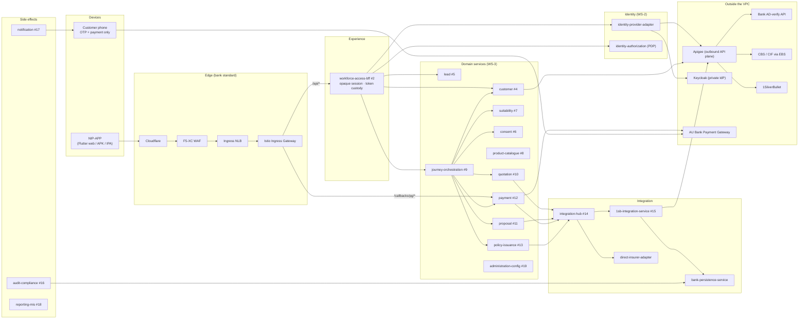

# Platform API reference — every service, every hop, every scenario

This is the developer portal for the AU Bank Insurance Distribution Platform APIs. It explains
what each API does, which service it calls next, which database it touches, and what happens
step by step behind each request.

**Audience:** backend, Flutter and QA engineers building R0 (one RM sells one Life policy,
Term or Savings/ULIP, to one existing bank customer).
**Status:** `AI-DRAFTED` reference, compiled on 2026-10-21 from the code on `main` and the ratified
design documents. It does not replace them. If this portal disagrees with an ADR, the
[R0 HLD](../../architecture/R0-HLD.md), the [R0 solution architecture](../ws3-platform/03-solution-architecture-r0.md)
or the code, **those win**. Raise the difference as a defect against this portal.
**Origin:** `SUG-20261021-apr` (owner-directed, `ADMIT-BYPASS`, see the
[suggestion register](../../governance/registers/SUGGESTION-REGISTER.md#sug-20261021-apr--linked-developer-api-reference-portal)).

---

> **Before you build:** read the [readiness review (2026-10-21)](./READINESS-REVIEW.md) — per-service
> scorecard, open design decisions and the gate that still blocks S11.

## 1. How to read this portal

The portal has five kinds of page. Start wherever your question is.

| You want to know… | Open | Example |
|---|---|---|
| What happens, end to end, when a user does X | [Scenarios](#5-scenarios--what-happens-behind-the-scenes) | "What happens when an RM logs in?" |
| Every endpoint one service exposes, with contract, validation and errors | [Service pages](#3-service-catalogue) | "What does `POST /internal/v1/leads` validate?" |
| How service A talks to service B (protocol, auth, timeout, failure) | [Interaction pages](#4-interactions--how-services-talk-to-each-other) | "How does the BFF call the identity adapter?" |
| Which database, schema, table or cache a service uses | [Data pages](#6-data--where-every-byte-lives) | "Where does a quote live before payment?" |
| The rules every API follows (headers, errors, idempotency) | [Conventions](#2-conventions-every-api-follows) | "Which header carries the session?" |

### 1.1 Status labels — read these before you write code

The platform is part built, part designed. Every API on every page carries one label.
**Do not assume an endpoint exists because it appears here.**

| Label | Meaning | What you may do with it |
|---|---|---|
| **IMPLEMENTED** | The endpoint is in the code on `main` today | Call it; the documented behaviour is what the code does |
| **IMPLEMENTED-PARTIAL** | The endpoint exists, but part of its target behaviour is stubbed or missing | Call it; read the "Gap" note for what is still fake |
| **CONTRACTED** | A ratified or AI-drafted contract (OpenAPI, LLD, HLD §5) exists; the code does not | Build to it; the request and response shapes are the target |
| **PROPOSED** | This portal drafted the shape from the domain model and the DDL so the team has something concrete; no Board has ratified it | Use for planning and discussion only; confirm with the owner before building |
| **DEFERRED** | A valid contract that is deliberately out of R0 | Do not build in R0 |

The same rule applies to datastores. The physical design is AI-drafted (`DB-DEC-0001`..`0004`),
and most schemas are not yet applied. Where a page says a service "writes table X", it is the
target design unless the page says the table is live.

### 1.2 The picture in one diagram

Three rules explain most of the diagram:

1. **NIP-APP talks only to the BFF.** It never holds an OAuth token, never calls a domain service,
   never calls 1SB, never touches a database ([HLD §5](../../architecture/R0-HLD.md#5-api-details)).
2. **No domain service calls a provider adapter.** Provider traffic is always
   *domain service → Integration Hub → adapter → Apigee → provider* (`IF-1`).
3. **Every service owns its own schema and credential.** Nobody reads another service's tables.
   Cross-context facts travel as opaque ULIDs by API call or by event
   ([store ownership](./data/store-ownership.md)).

---

## 2. Conventions every API follows

| Page | Covers |
|---|---|
| [Headers, session and service-to-service auth](./conventions/headers-session-and-auth.md) | Session cookie vs `X-Session-Handle` vs bearer handle, CSRF, `X-Correlation-Id`, `X-Actor-Id`, `X-Internal-Service-Key`, mesh mTLS |
| [Error model and error codes](./conventions/error-model.md) | RFC 7807 `problem+json`, the ten categories, the full code → HTTP table, `incidentId`, origin propagation, the BFF redaction boundary |
| [Idempotency, timeouts and retries](./conventions/idempotency-timeouts-retries.md) | `Idempotency-Key`, where it is stored, seam budgets S-01…S-26, resilience per dependency class |
| [Ports, environments and run modes](./conventions/ports-environments-run-modes.md) | Local ports, stub vs http modes, environment variables, base URLs |

---

## 3. Service catalogue

Each page lists every endpoint the service exposes, then the outbound calls it makes and the
data it owns.

### 3.1 Experience and identity

| Service | Context | Code status | Owns data in | Page |
|---|---|---|---|---|
| `workforce-access-bff` | #2 NIP BFF | **Implemented** (auth, lead, customer, reference data) | Valkey session vault only | [BFF](./services/workforce-access-bff.md) |
| `identity-provider-adapter-service` | #3 (WS-2) | **Implemented** (AD-verify + Keycloak) | None (Keycloak owns its realm DB) | [IdP adapter](./services/identity-provider-adapter-service.md) |
| `identity-authorization-service` | #3 PDP | **Implemented** (resolve, decide, admin-created partner users — `D-027`) | Aurora `identity` | [Authorization / PDP](./services/identity-authorization-service.md) |

### 3.2 Shared platform (every LOB uses these)

| Service | Context | Code status | Owns data in | Page |
|---|---|---|---|---|
| `customer-service` | #4 Customer | **Implemented-partial** (CBS search/get via Apigee; no snapshot store yet) | Aurora `customer` (target) | [Customer](./services/customer-service.md) |
| `lead-service` | #5 Lead | **Implemented-partial** (create, list, get, onboarding, assign, close; `lead_lms.lead` persisted) | Aurora `lead_lms` | [Lead](./services/lead-service.md) |
| `consent-service` | #6 Consent | Skeleton | Aurora `consent` | [Consent](./services/consent-service.md) |
| `suitability-service` | #7 Suitability | Skeleton | Aurora `suitability` | [Suitability](./services/suitability-service.md) |
| `product-catalogue-service` | #8 Catalogue | Skeleton | Aurora `catalogue` + Valkey `catalogue:` | [Product catalogue](./services/product-catalogue-service.md) |
| `journey-orchestration-service` | #9 Journey | Skeleton | Aurora `journey` | [Journey orchestration](./services/journey-orchestration-service.md) |
| `payment-service` | #12 Payment | Skeleton | Aurora `payment` | [Payment](./services/payment-service.md) |
| `policy-issuance-service` | #13 Policy | Skeleton | Aurora `policy` + S3 PDFs | [Policy issuance](./services/policy-issuance-service.md) |
| `audit-compliance-service` | #16 Audit | Skeleton | None — writes via `bank-persistence-service` | [Audit & compliance](./services/audit-compliance-service.md) |
| `notification-service` | #17 Notification | Skeleton | None at R0 | [Notification](./services/notification-service.md) |
| `reporting-mis-service` | #18 MIS | Skeleton | Isolated reader / S3 extract | [Reporting & MIS](./services/reporting-mis-service.md) |
| `administration-config-service` | #19 Config | Skeleton | Aurora `administration` | [Administration & configuration](./services/administration-config-service.md) |

### 3.3 Life execution cell

| Service | Context | Code status | Owns data in | Page |
|---|---|---|---|---|
| `quotation-service` | #10 Quotation | Skeleton | DynamoDB working item → Aurora `quotation` after payment | [Quotation](./services/quotation-service.md) |
| `proposal-service` | #11 Proposal & UW | Skeleton | DynamoDB working item → Aurora `proposal` after payment | [Proposal](./services/proposal-service.md) |

### 3.4 Integration

| Service | Context | Code status | Owns data in | Page |
|---|---|---|---|---|
| `integration-hub-service` | #14 Hub | Skeleton | None (routing from configuration) | [Integration Hub](./services/integration-hub-service.md) |
| `1sb-integration-service` | #15 1SB adapter | **Implemented** (quote, proposal, payment URL, status, masters, ULIP funds) | **No datasource** — calls `bank-persistence-service` | [1SB adapter](./services/1sb-integration-service.md) |
| `direct-insurer-adapter-service` | direct adapter seam | Skeleton, out of R0 | None | [Direct insurer adapter](./services/direct-insurer-adapter-service.md) |
| `bank-persistence-service` | platform job store | **Implemented** (jobs, offers, poll attempts, raw payloads, payment sessions, audit events) | Aurora `bank_persistence` + S3 | [Bank persistence](./services/bank-persistence-service.md) |

---

## 4. Interactions — how services talk to each other

One page per hop. Each names the protocol, authentication, timeout, retry, idempotency and what
the caller does when the far side fails.

| Hop | Seam | Style | Page |
|---|---|---|---|
| NIP-APP → BFF (through the edge) | S-01 | Sync | [Edge to BFF](./interactions/edge-to-bff.md) |
| BFF ↔ Valkey session vault | S-25 | Sync | [BFF session vault](./interactions/bff-session-vault.md) |
| BFF → identity-provider-adapter → AD-verify / Keycloak | S-26 | Sync | [BFF to IdP adapter](./interactions/bff-to-identity-provider-adapter.md) |
| BFF → identity-authorization (resolve + PDP) | S-02 | Sync, 300 ms, fail closed | [BFF to PDP](./interactions/bff-to-identity-authorization.md) |
| BFF → customer-service → Apigee → CBS | S-04 / S-05 | Sync | [Customer to CBS via Apigee](./interactions/customer-to-cbs-via-apigee.md) |
| BFF → lead-service | S-20 | Sync | [BFF to Lead](./interactions/bff-to-lead.md) |
| BFF → journey-orchestration → owning services | S-03 … S-16 | Sync command, local commit | [Journey orchestration pattern](./interactions/journey-orchestration-pattern.md) |
| Quotation / Proposal / Payment / Policy → Integration Hub → adapters | S-09 … S-16 | Async-poll / sync | [Domain to Integration Hub](./interactions/domain-to-integration-hub.md) |
| 1SB adapter → Apigee → 1SilverBullet | S-10 / S-11 | Async-poll | [1SB adapter to 1SB](./interactions/onesb-adapter-to-1sb.md) |
| 1SB adapter → bank-persistence-service | — | Sync HTTP | [Adapter to persistence](./interactions/onesb-adapter-to-persistence.md) |
| Payment ↔ AU Bank PG (session, callback, settlement) | S-13 / S-14 / S-15 | Sync + callback + batch | [Payment and the PG](./interactions/payment-to-payment-gateway.md) |
| Any service → outbox → MSK → consumers | S-17 / S-18 / S-23 / S-24 | Async event | [Outbox and events](./interactions/outbox-and-events.md) |
| Any service → configuration resolution | S-21 | Sync, cached, fail closed | [Configuration resolution](./interactions/configuration-resolution.md) |

---

## 5. Scenarios — what happens behind the scenes

Each scenario is a single user action followed hop by hop: the request, the validation at each
layer, every service and database touched, the response, and every error the user can see.
Read them in order the first time — they follow one sale.

| # | Scenario | Starts with | Page |
|---|---|---|---|
| 01 | Bank RM logs in with employee id and password (AD-verify) | `POST /api/v1/auth/login` | [Bank RM login](./scenarios/01-bank-rm-login.md) |
| 02 | Partner (insurer rep) logs in through Keycloak | `POST /api/v1/auth/login` → `/callback` | [Partner login](./scenarios/02-partner-login-keycloak.md) |
| 03 | Every authenticated call, session read, logout, expiry | `GET /api/v1/auth/session` · `POST /logout` | [Session lifecycle](./scenarios/03-session-lifecycle-and-logout.md) |
| 04 | RM searches for an existing bank customer | `GET /api/v1/customers:search` | [Customer search](./scenarios/04-customer-search.md) |
| 05 | RM creates (or resumes) a lead | `POST /api/v1/leads` | [Lead creation and dedupe](./scenarios/05-lead-creation-and-dedupe.md) |
| 06 | Start Onboarding, exception check and lead assignment to a certified SP | `POST /api/v1/leads/{id}/assignment` | [Lead assignment](./scenarios/06-lead-onboarding-and-assignment.md) |
| 07 | Journey starts; need analysis and suitability (C1 gate) | `POST /journeys/{id}/suitability` | [Suitability](./scenarios/07-journey-start-and-suitability.md) |
| 08 | Customer consent by OTP on the customer's phone (C2 gate) | `POST /journeys/{id}/consent/challenge` | [Consent](./scenarios/08-consent-otp.md) |
| 09 | Pre-quote reference data: masters, eligibility criteria, product UI data, ULIP funds | Hub reads | [Pre-quote reference data](./scenarios/09-pre-quote-reference-data.md) |
| 10 | Multi-quote: request, poll, partial success, select an offer | `POST /journeys/{id}/quotes` | [Multi-quote](./scenarios/10-multi-quote-and-selection.md) |
| 11 | Proposal: form schema, submit, underwriting tracking | `POST /journeys/{id}/proposals` | [Proposal and underwriting](./scenarios/11-proposal-and-underwriting.md) |
| 12 | Payment link to the customer's device, callback, reconciliation | `POST /journeys/{id}/payments` | [Payment](./scenarios/12-payment-and-reconciliation.md) |
| 13 | Policy issuance and the four-part `SOLD` | `PaymentReconciled` event | [Policy issuance and SOLD](./scenarios/13-policy-issuance-and-sold.md) |
| 14 | Keeping provider state in sync: polling, status refresh, requirements | adapter poller | [Provider sync](./scenarios/14-provider-status-sync.md) |
| 15 | When things fail: compensation, `UNCERTAIN`, manual intervention | any | [Failure and compensation](./scenarios/15-failure-and-compensation.md) |

---

## 6. Data — where every byte lives

| Page | Covers |
|---|---|
| [Store ownership](./data/store-ownership.md) | Service → Aurora schema → database role → tables; Valkey prefixes; S3 prefixes; which data is in DynamoDB (only pre-payment quote / proposal working state, `DB-DEC-0005`); who may never open a database |
| [Payload storage and transactions](./data/payload-storage-and-transactions.md) | Raw provider payloads (encrypted, 7 years), JSON-until-payment working envelopes, the transaction boundary of every write, outbox rows, idempotency rows, retention and archive |

---

## 7. Known disagreements between sources

These are recorded so nobody "fixes" the wrong one. Owners named; this portal does not decide.

| # | Topic | Older source says | Newer decision says | Portal follows | Owner |
|---|---|---|---|---|---|
| K-1 | DynamoDB in R0 | HLD Boundary 8: journey, quote jobs and audit in DynamoDB · `DB-DEC-0003`: no DynamoDB at all | **Resolved 2026-10-21 by owner decision `DB-DEC-0005`:** DynamoDB for pre-payment quote and proposal working state only; structured Aurora after `RECONCILED`; journey and audit stay Aurora | `DB-DEC-0005` | Mahesh (decided) |
| K-2 | Public login path | HLD §5.1: `POST /sessions`, `DELETE /sessions/current`, `GET /me` | Code: `POST /api/v1/auth/login`, `POST /api/v1/auth/logout`, `GET /api/v1/auth/session` | Code (implemented) | Mahesh (Board 1) |
| K-3 | Bank AD path | `05-EXTERNAL-CALL-CATALOGUE` §1: AD reached by Keycloak only | 2026-09-14 human direction + `IAM-001`: AD-verify is a bank API called by `identity-provider-adapter-service` via Apigee private | Newer (AD-verify) | Deepali / Mahesh |
| K-4 | 1SB egress allowlist | External call catalogue: our NAT EIPs | `ADR-020`: 1SB allowlists **Apigee** egress IPs | Newer (Apigee) | Mahesh |
| K-5 | Idempotency store in the 1SB adapter | 1SB architecture §7.4: Redis, 24 h | Platform standard: owning service's database, never the cache. Code today: in-memory (`InMemoryIdempotencyStore`); multi-instance store is parked (Phase 5.4) | Code today, platform standard as target | Amit / Aarti |
| K-6 | Lead create response | HLD §5.1: returns `leadId` **and** `journeyId` | Lead LLD 12 + code: create is Save only (`state NEW`); code sets `journeyId` = `leadId` as an inert placeholder until Journey #9 mints a real id | Code + LLD 12 | Mahesh / Rajal |
| K-7 | 1SB proposal submit status | 1SB architecture §5.2: `202 Accepted` | Code: `201 Created` with `{proposalJobId, status}` | Code | Amit |
| K-9 | Suitability on the Term path | Suitability BRD `BR-SUIT-002`: Term skips the Savings/ULIP question set; "a separate Term question set will be documented later" | C1 / `INV-QUO-01`: no quote without an assessment | **Resolved 2026-10-21 by owner decision `D-022` (rule pack v1.1 §2.3):** every product class has its own question set and matrix; Term uses the protection set (no horizon / risk questions); C1 applies to all | Mahesh (decided); bank Compliance content sign-off outstanding |
| K-8 | Customer search internals | Contract 09: lead-first, `customers:resolve` + `customers:lookup` | Code: BFF calls `GET /internal/v1/customers/search` (CBS directly, no lead-first step yet) | Both shown; contract is the target | Mahesh / Amit |

---

## 8. Source documents this portal is compiled from

| Area | Source |
|---|---|
| R0 architecture and seams | [R0 HLD](../../architecture/R0-HLD.md) · [R0 solution architecture](../ws3-platform/03-solution-architecture-r0.md) · [R0 for developers](../../architecture/R0-E2E-FOR-DEVELOPERS.md) |
| Domain, states, invariants, events | [Domain model and invariants](../ws3-platform/01-domain-model-and-invariants.md) · [Information model](../ws3-platform/02-information-model.md) |
| Public BFF contracts | [BFF lead-phase API LLD](../ws3-platform/07-nip-bff-lead-phase-api-lld.md) · [BFF OpenAPI](../ws3-platform/nip-bff-lead-phase.openapi.yaml) · [Customer search contract](../ws3-platform/09-nip-bff-customer-search-contract.md) |
| Lead module | [Lead HLD](../ws3-platform/10-lead-module-hld.md) · [Lead sequences](../ws3-platform/11-lead-module-sequences.md) · [Lead API LLD](../ws3-platform/12-lead-module-api-lld.md) · [Lead internal OpenAPI](../ws3-platform/lead-service-internal.openapi.yaml) |
| Identity | [Authentication & authorization](../authentication-authorization/README.md) |
| Data | [Data architecture](../data-architecture/README.md) · [Store segregation](../data-architecture/04-store-segregation-and-roadmap.md) · [Journey and working payload](../data-architecture/06-journey-orchestrator-and-working-payload.md) · [DDL](../data-architecture/schemas/README.md) |
| 1SB | [1SB service architecture](../../1sb-insurance-integration/architecture/1sb-integration-service-architecture.md) · [Replaceable middleware](../../1sb-insurance-integration/architecture/replaceable-middleware.md) · [Extracted 1SB schemas](../../1sb-insurance-integration/reference/extracted-schemas/README.md) |
| Errors, lifecycle, external calls | [Platform error contract](../../journey-execution/07-PLATFORM-ERROR-CONTRACT.md) · [Request lifecycle](../../journey-execution/01-REQUEST-LIFECYCLE-STANDARD.md) · [External call catalogue](../../journey-execution/05-EXTERNAL-CALL-CATALOGUE.md) |
| Decisions | [Architecture decision log](../architecture-review/08-architecture-decision-log.md) |
