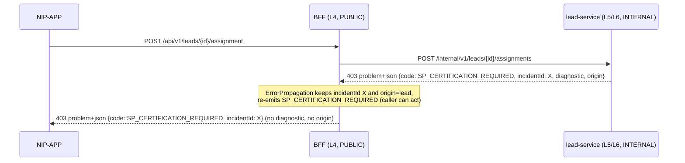

# Error model and error codes

[← API reference home](../README.md)

Every service returns errors in one shape, from one registry. A code's HTTP status, wording and
retryability are declared **once** in `ErrorCatalogue` (`libs/bank-common-error`) and are never
re-decided at a throw site (`ADR-017`, `EPIC-001`). Full rationale:
[Platform error contract](../../../journey-execution/07-PLATFORM-ERROR-CONTRACT.md).

---

## 1. Response shape

`Content-Type: application/problem+json` (RFC 7807, extended).

### 1.1 Public rendering — what NIP-APP receives from the BFF

```json
{
  "type": "about:blank",
  "title": "Suitability assessment required",
  "status": 403,
  "detail": "This quote needs a completed suitability assessment before it can be produced.",
  "code": "SUITABILITY_REQUIRED",
  "category": "COMPLIANCE_GATE",
  "retryable": false,
  "incidentId": "01JQ8F3K2M7Z9V4T",
  "correlationId": "b7c1e0f2-6a1c-4d0e-9a55-0f4f0f6f3a10",
  "service": "bff",
  "timestamp": "2026-10-21T09:41:22Z",
  "errors": [
    { "code": "MISSING_REQUIRED_FIELD", "field": "customerId", "message": "must not be blank" }
  ]
}
```

`title` and `detail` always come from the registry — never from an exception message and never
from an upstream body. That is why the same failure reads the same on every screen.

### 1.2 Diagnostic rendering — only between internal services and in logs

Internal hops (and every log line) additionally carry `origin`, `diagnostic.reason`,
`diagnostic.component`, `diagnostic.operation`, `upstream` and `causeChain`. **The BFF (layer L4) is
the redaction boundary**: it may hold a diagnostic, it must never emit one. `toPublic()` strips
`origin` and `diagnostic` and replaces the wording with the catalogue's safe text. Services with
`bank.error.boundary: PUBLIC` (the BFF) redact; `INTERNAL` services do not.

### 1.3 The two ids you will be asked for

| Id | Meaning | Where it comes from |
|---|---|---|
| `incidentId` | **This failure.** One per failure, preserved unchanged across every hop that propagates it | Generated at the point of first failure |
| `correlationId` | **This request.** Groups every log line of one request | `X-Correlation-Id` / MDC at the edge |

An RM reads out the `incidentId`; L1 support pastes it into the log platform.

---

## 2. Categories — how a caller must react

| Category | Typical HTTP | Retry? | Log level | Audited | Meaning |
|---|---|---|---|---|---|
| `VALIDATION` | 400 / 422 | After the caller fixes the input | WARN, no stack | No | The request is wrong |
| `AUTHENTICATION` | 401 | After re-login | WARN | Yes | Who you are is not established |
| `AUTHORIZATION` | 403 | No | WARN | Yes | Who you are is known and not permitted |
| `NOT_FOUND` | 404 / 422 | No | WARN | No | Does not exist **for this caller** (foreign records are absent, not 403) |
| `CONFLICT` | 409 | Sometimes | WARN | Varies | State disagrees — idempotency, transition, expiry |
| `COMPLIANCE_GATE` | 403 / 409 / 422 | After the RM acts | WARN | **Compliance event** | A regulator-mandated refusal; the refusal is evidence |
| `UPSTREAM` | 502 / 503 / 504 | Usually | ERROR | No | A dependency failed |
| `CONFIG` | 422 / 503 | No | ERROR | No | The platform cannot resolve its own configuration; fail closed |
| `RATE_LIMIT` | 429 | Yes, on `Retry-After` | WARN | No | Throttled |
| `INTERNAL` | 500 | No | ERROR + stack | No | Our defect; always alertable |

---

## 3. Every registered code

Source: `ErrorCatalogue.platformDefinitions()` on `main`. A module may add codes through
`ErrorDefinitionProvider` but may never redefine one.

### 3.1 Request and validation

| Code | HTTP | Category | Raised by (today) |
|---|---|---|---|
| `VALIDATION_ERROR` | 422 | VALIDATION | Any service on bean-validation failure (`MethodArgumentNotValidException`); field errors carry `MISSING_REQUIRED_FIELD` per field. 1SB adapter on quote validation |
| `INVALID_REQUEST` | 422 | VALIDATION | Unparseable JSON body (any service); `lead` list with `owner≠me`; `customer` search with bad `by` |
| `MISSING_REQUIRED_FIELD` | 422 | VALIDATION | `lead` create/assign; `customer` search/get |
| `SCHEMA_INVALID` | 400 | VALIDATION | BFF auth paths (bad login body, bad return URI, unknown state/completion code, missing session handle on `/auth/session`); IdP adapter AD-verify input |
| `MISSING_IDEMPOTENCY_KEY` | 400 | VALIDATION | 1SB adapter `IdempotencyFilter` on mutating `/v1/**` |
| `UNSUPPORTED_LOB` | 422 | VALIDATION | `lead` create (lob ≠ `LIFE`, product class not `TERM`/`SAVINGS`/`ULIP`); 1SB quote validation |
| `LOB_REQUIRED` | 422 | VALIDATION | Target: any LOB-partitioned API |
| `AGENT_ATTRIBUTION_MISSING` | 422 | VALIDATION | 1SB proposal submit without resolvable agent |
| `PAYLOAD_TOO_LARGE` | 413 | VALIDATION | Edge / body-size limit |
| `OPPORTUNITY_REQUIRED` | 422 | VALIDATION | Target: on-platform create without `leadId` (`INV-LED-06`) |
| `INVALID_OFFER_REFERENCE` | 422 | VALIDATION | Target: proposal on an unselected offer (`INV-PRP-02`) |

### 3.2 Authentication (sessions and login)

| Code | HTTP | Raised by |
|---|---|---|
| `UNAUTHORIZED` | 401 | IdP adapter: internal caller without the right `X-Internal-Service-Key` |
| `SESSION_INVALID` | 401 | BFF: protected path with no session handle |
| `SESSION_EXPIRED` | 401 | BFF: handle unknown, expired, deleted or undecryptable |
| `SESSION_REVOKED` | 401 | Target: server-side revocation |
| `AUTHENTICATION_FAILED` | 401 | BFF: AD rejected credentials; business identity not `ACTIVE`/`BANK_EMPLOYEE`; partner identity not active |
| `STEP_UP_REQUIRED` | 401 | Target (OTP step-up, parked `SUG-20261008-otp`) |
| `INVALID_STATE` | 400 | Target name for an unknown/expired OIDC `state` (code today raises `SCHEMA_INVALID`) |
| `CODE_ALREADY_CONSUMED` | 400 | Target name for a reused native completion code (code today raises `SCHEMA_INVALID`) |
| `RETURN_LOCATION_NOT_ALLOWED` | 400 | Target name for a non-allow-listed `returnUri` (code today raises `SCHEMA_INVALID`) |

### 3.3 Authorization (PDP and actor rules)

| Code | HTTP | Raised by |
|---|---|---|
| `FORBIDDEN` | 403 | Generic deny |
| `CSRF_REJECTED` | 403 | BFF cookie-borne mutation without a valid `X-XSRF-TOKEN` |
| `DEFAULT_DENY` | 403 | PDP: no grant matched |
| `EXPLICIT_DENY` | 403 | PDP: a `DENY` entitlement matched |
| `ACCOUNT_SUSPENDED` | 403 | PDP: subject not `ACTIVE` / outside validity window |
| `ORIGINATION_RM_ONLY` | 403 | Target: non-permitted actor creates a lead (`INV-LED-04`; Lead LLD names it `ORIGINATION_ACTOR_DENIED`) |
| `ASSIST_ONLY_ACTOR` | 403 | Target: partner rep attempts a regulated action (`INV-ACT-02`) |
| `CROSS_INSURER_DENIED` | 403 | PDP: partner rep touching another insurer's resource |
| `OUT_OF_BRANCH_SCOPE` | 403 | PDP: resource branch outside the subject's branches |
| `BREAK_GLASS_INVALID` | 403 | Target |
| `AUTHORIZATION_UNAVAILABLE` | 403 | PDP timeout / unreachable → **fail closed** (`S-02`) |
| `SERVICE_IDENTITY_REJECTED` | 403 | Target: mesh identity not allowed on this hop |
| `CUSTOMER_NOT_IN_BOOK` | 422 | Target: lead for a customer outside the SP's book (`INV-LED-05`) |

### 3.4 Compliance gates

| Code | HTTP | Gate |
|---|---|---|
| `SP_CERTIFICATION_REQUIRED` | 403 | `lead` assign: assignee lacks valid SP certification (code today, fixture port); `INV-ACT-01` everywhere in target |
| `RM_NOT_CERTIFIED` | 422 | `INV-LED-03` / `INV-LED-10` |
| `SUITABILITY_REQUIRED` | 403 | **C1** — no quote without a valid, unexpired, `ELIGIBLE` assessment (`INV-QUO-01`) |
| `CONSENT_REQUIRED` | 403 | **C2** — no proposal submit without a `GRANTED`, unexpired consent (`INV-PRP-01`) |
| `ATTRIBUTION_NOT_CALLER_SUPPLIED` | 422 | **C3** — caller sent `distributorId` / agent attribution (`INV-DIS-01`) |
| `PAYMENT_DEVICE_ISOLATION` | 403 | **C4** — attempt to issue a payment link into an RM session (`INV-PAY-01`; HLD calls it `PAYMENT_DEVICE_VIOLATION`) |
| `PAYMENT_NOT_RECONCILED` | 409 | No policy before `RECONCILED` (`INV-POL-01`) |

### 3.5 Conflict and state

| Code | HTTP | Raised by |
|---|---|---|
| `CONFLICT` | 409 | `lead` create: unfinished lead exists for creator + customer + product class; `lead` assign: exception hold active |
| `IDEMPOTENCY_CONFLICT` | 409 | Same `Idempotency-Key`, different body (HLD calls it `IDEMPOTENCY_KEY_CONFLICT`) |
| `REQUEST_IN_PROGRESS` | 409 | Same key, first request still running |
| `ILLEGAL_TRANSITION` | 409 | `lead` onboarding `BLOCK`; assign before onboarding / after BI; close of a qualified lead; any aggregate state machine |
| `QUOTE_EXPIRED` | 409 | Select outside the validity window (`INV-QUO-04`) |
| `PROPOSAL_NOT_PAYABLE` | 409 | Payment on a proposal not `UW_APPROVED` |
| `ASSESSMENT_IMMUTABLE` | 409 | Edit of a `COMPLETED` suitability (`INV-SUI-01`) |
| `WITHDRAWAL_NOT_PERMITTED` | 409 | Withdraw at/after `AWAITING_PAYMENT` (`INV-PRP-04`) |
| `PAYMENT_ALREADY_IN_PROGRESS` | 409 | Second non-terminal payment for a proposal (`INV-PAY-02`) |
| `PAYMENT_STATE_UNCERTAIN` | 409 | New attempt while prior is `AUTHORISED`/`UNCERTAIN` (`INV-PAY-04`) |
| `PREMIUM_MISMATCH` | 422 | Payment amount ≠ selected premium + tax (`INV-PAY-03`) |

### 3.6 Not found

| Code | HTTP | Raised by |
|---|---|---|
| `RESOURCE_NOT_FOUND` | 404 | `lead` get outside the caller's book ("absent from this book"); `customer` get; 1SB quote/proposal job id; BFF unknown branch/vertical |

### 3.7 Upstream and configuration

| Code | HTTP | Raised by |
|---|---|---|
| `IDENTITY_PROVIDER_UNAVAILABLE` | 503 | BFF cannot reach IdP adapter or PDP; IdP adapter cannot reach AD-verify / gets an unparseable answer |
| `UPSTREAM_UNAVAILABLE` | 503 | `customer` → CBS 5xx, or CBS rejected a re-minted Apigee token |
| `UPSTREAM_BAD_RESPONSE` | 502 | `customer` → CBS non-5xx, non-401/404 status |
| `UPSTREAM_AUTH_FAILURE` | 502 | Provider rejected our credentials |
| `UPSTREAM_TIMEOUT` | 504 | Provider timeout |
| `UPSTREAM_BUSINESS_ERROR` | 422 | Provider business refusal (origin preserved) |
| `QUOTE_TIMEOUT` | 504 | Quote poll budget exhausted (job itself shows `TIMEOUT`) |
| `PROPOSAL_REJECTED` | 422 | Insurer rejected proposal submission |
| `CONFIG_VERSION_REQUIRED` | 422 | Record created without the governing config version (`INV-CFG-03`) |
| `CONFIGURATION_UNRESOLVABLE` | 422 | Configuration cannot be resolved → fail closed (`S-21`) |
| `RATE_LIMITED` | 429 | Edge / per-principal limit |
| `INTERNAL_ERROR` | 500 | Our defect |

### 3.8 Codes named in LLDs but not yet in the registry

Lead LLD 12 §5 names `ORIGINATION_ACTOR_DENIED`, `ASSIGNEE_SP_REQUIRED`, `VALIDATION_BLOCKED`,
`EXCEPTION_HOLD_ACTIVE`, `LOB_NOT_CERTIFIED`, `LEAD_DUPLICATE_UNFINISHED` and `REASSIGN_AFTER_BI`.
The lead-service code currently raises the nearest registered code instead
(`CONFLICT`, `ILLEGAL_TRANSITION`, `SP_CERTIFICATION_REQUIRED`). Adding them is a registry change
(`ErrorDefinitionProvider` in `lead-service`), not a free-text code at a throw site.

---

## 4. Propagation — when service B fails inside service A's request

When A calls B and B refuses, A must (07 §5):

1. Parse B's `problem+json`. Never pass B's body through and never log it as A's message.
2. Keep `incidentId` from B — one incident across the whole chain.
3. Set `origin` to B's origin if present, else `{B.service, B.code, B.layer}` — first origin wins.
4. Map by category:
   - B `UPSTREAM` / `INTERNAL` / `CONFIG` → A emits `UPSTREAM_UNAVAILABLE` or `UPSTREAM_BAD_RESPONSE`.
   - B `VALIDATION` / `CONFLICT` / `COMPLIANCE_GATE` / … → A propagates **the same code** when its caller can act on it, else `UPSTREAM_BUSINESS_ERROR` with origin preserved.
5. A's public rendering uses A's safe wording; the origin travels only in A's diagnostic.

In code this is `ErrorPropagation.from(problemJsonReader.read(body, status)).receivedBy(...).calling(downstream, operation)`,
used by every BFF client (`IdentityProviderClient`, `IdentityAuthorizationClient`,
`HttpLeadGateway`, `HttpCustomerGateway`). A transport failure (no response at all) becomes
`IDENTITY_PROVIDER_UNAVAILABLE` for the identity clients.

**Never** re-wrap a dependency failure as `INTERNAL_ERROR` — that destroys the only signal saying
whose defect it is.



---

## 5. Rules for engineers

| Do | Don't |
|---|---|
| `throw serviceErrors.error(ErrorCodes.X).component(..).operation(..).reason(..).build()` | Hand-write a status, title or retry flag |
| Put engineer detail in `reason` | Put anything non-public in `detail` |
| Return foreign or out-of-book records as absent (`404`/empty list) | Return `403` that confirms an id exists (`INV-LED-07`) |
| Log client-caused categories at WARN without stack | Log validation refusals at ERROR |
| Add new codes via `ErrorDefinitionProvider` | Invent a code string at a throw site |
| Keep PAN, mobile, CIF, DOB out of every message | Echo `q` or any identifier into `reason` |

## 6. Sources

- `libs/bank-common-error/src/main/java/com/bank/common/error/ErrorCatalogue.java` · `PlatformErrorHandler.java` · `ServiceErrorResponse.java` · `ErrorPropagation.java`
- `services/workforce-access-bff/src/main/java/com/bank/workforce/bff/api/BffExceptionHandler.java`
- [07 Platform error contract](../../../journey-execution/07-PLATFORM-ERROR-CONTRACT.md) · [04 Error and degraded-state catalogue](../../../journey-execution/04-ERROR-AND-DEGRADED-STATE-CATALOGUE.md) · [HLD §5.4](../../../architecture/R0-HLD.md#54-typical-error-codes-stable)
