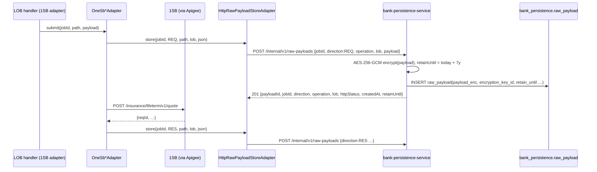

# Payload storage and transactions

[← API reference home](../README.md) · [Store ownership](./store-ownership.md)

This page answers four questions developers ask on the first day:

1. Where do we keep the **raw request/response** we exchange with 1SB and insurers?
2. Where does a **quote or proposal** live while the customer is still deciding — and when does it
   become structured rows?
3. What is the **transaction boundary** of each write, and how do we stay consistent across
   services without two-phase commit?
4. How long is each kind of data **kept**, and what is archived?

---

## 1. Four kinds of payload, four homes

| Kind | Example | Home | Encrypted | Mutable | Retention |
|---|---|---|---|---|---|
| **Raw provider payload** — the exact JSON sent to / received from 1SB | 1SB quote request, quote poll response, proposal submit, payment-URL response | `bank_persistence.raw_payload` (`payload_enc BYTEA`) via `bank-persistence-service` | **Yes** — AES-256-GCM, server-side, fresh 96-bit IV per row, key id `raw-payload-key-v1` | No (INSERT-only role) | `retain_until` = created + **7 years** (`RAW_PAYLOAD_RETENTION_YEARS`) |
| **Adapter job metadata** — the bank's handle on an async provider call | `integration_job`, `integration_job_offer`, `job_poll_attempt`, `payment_session` | `bank_persistence` | No (holds ids, statuses, premiums — not PII) | Status columns update | 7 years (job records) |
| **Working envelope** — the bank's quote/proposal while the sale is open | Offers from 3 insurers inside one quote; proposal form answers | `quotation.quote_working` / `proposal.proposal_working` (`payload_enc BYTEA` + control columns) | **Yes** — application-level, decrypted only in the owning service | Yes, until `materialized_at` is set | `RET-WORKING` (default 90 days, configurable) unless payment reconciles |
| **Structured evidence** — what a regulator or finance can query | `consent.consent`, `suitability.*`, `payment.payment`, `policy.policy`, structured `quote`/`offer`/`proposal` after payment | Owning schema, normal columns (PII columns `*_enc`) | PII columns only | Mostly INSERT-only | `RET-7Y` / `RET-7Y-IMMUTABLE` |

**Never** store a raw provider payload in application logs, in OpenSearch, in Valkey, or in a
domain table's plain columns. Provider vocabulary must not leak upward (`INV-ACL-01`).

---

## 2. Raw provider payloads (implemented)

### 2.1 Write path



Captured today by `OneSbQuoteAdapter` (submit request, submit response, poll response),
`OneSbProposalAdapter` (submit request and response) and `OneSbPaymentAdapter`
(payment-URL request and response). `operation` is the 1SB path, e.g.
`/insurance/lifeterm/v1/quote`.

> **Behaviour to know.** `HttpRawPayloadStoreAdapter.store` is **best-effort**: if the persistence
> call fails it logs a warning (job id, direction, operation — never the body) and the provider call
> continues. A missing raw payload therefore does not fail a quote. If your feature depends on the
> raw payload being present (dispute evidence), raise it with WS-1 rather than assuming it.

### 2.2 Read path

| Call | Returns | Who may call |
|---|---|---|
| `GET /internal/v1/raw-payloads?jobId={jobId}` | Metadata only (`payloadId`, direction, operation, lob, httpStatus, createdAt, retainUntil). **Never plaintext** | Support tooling, adapter |
| `GET /internal/v1/raw-payloads/{payloadId}` | Decrypted `payload` | Compliance / dispute tooling only. Normal application code reads job metadata, not payloads |

### 2.3 Table

| Column | Type | Note |
|---|---|---|
| `payload_id` | `VARCHAR(36)` PK | UUID minted by persistence |
| `job_id` | `VARCHAR(36)` | Logical link to `integration_job` |
| `direction` | `VARCHAR(3)` | `REQ` · `RES` |
| `operation` | `VARCHAR(100)` | Provider path / operation |
| `lob` | `VARCHAR(20)` | `TERM`, `SAVING`, `ULIP`, … or `UNKNOWN` |
| `payload_enc` | `BYTEA` | IV ‖ ciphertext ‖ GCM tag |
| `encryption_key_id` | `VARCHAR(50)` | For key rotation |
| `http_status` | `SMALLINT` | Provider HTTP status when known |
| `created_at` | timestamptz | |
| `retain_until` | `DATE` | Purge only by `job_retention`, never by application code |

---

## 3. Working envelopes — JSON until payment (designed, `DB-DEC-0004`)

### 3.1 Why

A quote fans out to several insurers and changes until the customer picks one; a proposal form is
a dynamic, insurer-specific schema. Neither is evidence until money moves. So the bank keeps the
whole quote (all offers) and the whole proposal (all answers) as **one encrypted envelope row**
while the sale is open, and only writes structured, queryable rows after the payment is
`RECONCILED`. Abandoned journeys never produce structured rows and age out.

### 3.2 Shape of `quotation.quote_working`

Control columns sit beside the envelope so gates and Payment never need to decrypt it:

| Column group | Columns | Read by |
|---|---|---|
| Identity | `quote_id`, `lead_id`, `journey_id`, `customer_id`, `lob`, `mode`, `category` | Quotation |
| Gate references | `suitability_id`, `consent_id` | Checked **before** INSERT (C1) |
| State | `state`, `valid_until`, `provider`, `provider_job_id` | Quote state machine; correlation to the adapter job |
| Selection (written atomically on select) | `selected_offer_id`, `selected_premium_amount`, `selected_tax_amount`, `selected_sum_assured`, `selected_insurer_code`, `selected_product_code` | Payment reads these **through the Quotation API** for `INV-PAY-03` |
| Envelope | `payload_enc`, `encryption_key_id`, `payload_schema_version` | Quotation only |
| Lifecycle | `materialized_at`, `retain_until`, `config_version_ref`, `version` | Retention job; optimistic lock |

Envelope v1 (illustrative; the schema version is mandatory):

```text
{ requestedCover, mode, category,
  members: <inside enc only>,
  offers: [ { offerId, insurerCode, productCode, productName, premiumAmount, taxAmount,
              sumAssured, frequency, coverTerm, ppt, outOfBound, offerState, errorSummary } ],
  selectedOfferId }
```

`proposal.proposal_working` follows the same pattern: control columns `quote_id`, `offer_id`,
`consent_id`, `application_number`, `state`, `underwriting_state`, `schema_id`, `schema_version`;
the envelope holds form answers, UW requirements, document refs, nominee (always inside the
envelope — `INV-PRP-05`).

### 3.3 Materialisation after `RECONCILED`

```mermaid
sequenceDiagram
    participant PAY as payment-service
    participant BUS as outbox → MSK
    participant QS as quotation-service
    participant PS as proposal-service
    participant JO as journey-orchestration

    PAY->>PAY: match pgTxnId + amount → state RECONCILED<br/>(same txn: outbox PaymentReconciled)
    PAY-->>BUS: PaymentReconciled {paymentId, settlementRef}
    BUS-->>JO: stage → PAYMENT_SETTLED
    BUS-->>QS: lock quote_working WHERE materialized_at IS NULL
    QS->>QS: INSERT quotation.quote + one offer per envelope offer<br/>(selected = SELECTED, rest NOT_SELECTED); set materialized_at
    BUS-->>PS: lock proposal_working
    PS->>PS: INSERT proposal.proposal + uw_requirement + uw_document_ref; set materialized_at
```

After `materialized_at` is set, a trigger (`fn_freeze_working_payload`) refuses any update to the
envelope or its control columns. Consumers are idempotent: a replayed `PaymentReconciled` finds
`materialized_at` already set and does nothing.

### 3.4 Why Postgres and not DynamoDB or plaintext JSONB

| Option | Verdict | Reason |
|---|---|---|
| Aurora `BYTEA` envelope + control columns | **Taken** | Same cluster and credential model; idempotency and outbox in the same transaction; TOAST handles large envelopes |
| DynamoDB document per quote | Rejected | Second system of record; no uniqueness or CHECK constraints; no R0 volume evidence |
| Postgres `JSONB` in plain text | Rejected | Members, nominee and form PII would become queryable (`DR-PII-01`) |
| JSON on the journey row | Rejected | Journey holds stage + references only (`INV-JRN-02`) |

Payment is **never** a working envelope: amount, state, `pg_txn_id` and `RECONCILED` must be
queryable and constrained from the first write because they gate issuance.

---

## 4. Transaction boundaries

### 4.1 Inside one service: one local ACID transaction

Every command that changes state writes, in **one** Postgres transaction in its own schema:

```text
BEGIN
  INSERT/UPDATE   business row(s)                 e.g. quote_working (control cols + payload_enc)
  INSERT          idempotency_record               key, request_hash, response_ref
  INSERT          outbox_event                     event_type, payload (ids + state, no PII)
COMMIT
```

- Concurrency: `SELECT … FOR UPDATE` or the `version` column (optimistic lock).
- The service decrypts the envelope **in process**, applies the change, re-encrypts, and writes
  the row. There is no SQL `jsonb_set` on an envelope.
- Atomic select (`INV-QUO-05`): `selected_*` columns and `payload_enc` change in the same transaction,
  so the JSON and the columns cannot disagree.

### 4.2 Across services: no 2PC — callee commits, then caller commits

```text
journey-orchestration                         quotation-service
  1 lock journey row (version)
  2 check the stage transition is legal
  3 HTTP RequestQuote(Idempotency-Key = journey:{id}:quote) ─────►  4 BEGIN … INSERT quote_working,
                                                                       idempotency, outbox … COMMIT
                                               ◄───────────────────  5 201 {quoteId}
  6 BEGIN
      UPDATE journey stage + version
      UPSERT journey_ref (quoteId)
      INSERT journey_transition
      INSERT outbox_event
      INSERT idempotency_record
    COMMIT
```

If step 6 fails after step 4 committed, the orchestrator simply retries the command: the callee
sees the same `Idempotency-Key`, returns the same `quoteId`, and the journey upserts the same
reference. **No compensating write into another service's schema, ever.**

### 4.3 Provider calls: the job store is the transaction log

The 1SB adapter has no database. Its "transaction" is a sequence of idempotent HTTP writes to
`bank-persistence-service`:

| Step | Write | Survives a crash because |
|---|---|---|
| 1 | `POST /internal/v1/jobs` → `integration_job` `PENDING` (+ unique `idempotency_key`) | The job exists before any provider call |
| 2 | `POST /internal/v1/raw-payloads` (REQ) | Best effort |
| 3 | Provider submit (no automatic retry) | — |
| 4 | `PATCH /internal/v1/jobs/{id}/status` → `RUNNING` + `externalReqId` | The provider reference is recorded; recovery is by polling it |
| 5 | Poll loop: `POST …/poll-attempts` each try; `POST …/offers` per offer; `PATCH …/status` → `COMPLETED` / `PARTIAL` / `FAILED` / `TIMEOUT` | Each attempt is a row |

---

## 5. Events and the outbox

Every owning schema that publishes has an `outbox_event` table. A separate `outbox-publisher`
reads unpublished rows, publishes to MSK, and sets `published_at`. Consumers dedupe on `eventId`.
Payload rule: **identifiers, state and attribution only — never PII**, and money only as amount +
currency where reconciliation needs it. Full detail and the event catalogue:
[Outbox and events](../interactions/outbox-and-events.md).

---

## 6. Retention and archive

| Path | What stays in Aurora | Class | At `retain_until` |
|---|---|---|---|
| Journey never reached payment | Nothing after archive (lead attribution stub stays) | `RET-WORKING` (default 90 days) | `archived_at` set; optional S3 dump; `sp_purge_operational` deletes working envelopes and the journey tree |
| Reached payment, not `RECONCILED` | `payment.payment` + attempts | Payment `RET-7Y-IMMUTABLE`; working envelopes and journey `RET-WORKING` | Envelopes and journey archive; payment row stays |
| `RECONCILED` | Structured quote, offer, proposal, UW, payment, policy, journey header | `RET-7Y` / `RET-7Y-IMMUTABLE` / `RET-POLICY+7Y` | Envelope may age out; structured rows are never purged by the operational job |
| Consent and suitability | Always | `RET-7Y` / `RET-7Y-IMMUTABLE` | Not purged even for unconverted journeys (`OPEN-RET-UNCONVERTED-EVIDENCE`, Shailja) |
| Raw provider payloads | `bank_persistence.raw_payload` | 7 years | Purge job, with a deletion audit event |
| Audit events | `bank_persistence.audit_event` (INSERT-only) + S3 Object Lock archive | 7 years WORM | Object Lock prevents deletion before expiry |

`retain_until` is set by the owning service **from configuration**, never a hard-coded 7 in a CHECK.

## 7. Sources

- `services/bank-persistence-service/…/RawPayloadController.java` · `crypto/RawPayloadEncryptionService.java` · `JobController.java`
- `services/1sb-integration-service/…/adapter/persistence/HttpRawPayloadStoreAdapter.java` · `adapter/onesb/quote/OneSbQuoteAdapter.java`
- [06 Journey orchestrator and working payload](../../data-architecture/06-journey-orchestrator-and-working-payload.md) · [DB-DEC-0004](../../data-architecture/DB-DEC-0004-working-payload-until-payment.md) · [02 Operations and troubleshooting](../../data-architecture/02-operations-and-troubleshooting.md)
- [`08-quotation.sql`](../../data-architecture/schemas/08-quotation.sql) · [`09-proposal.sql`](../../data-architecture/schemas/09-proposal.sql) · [`02-bank_persistence.sql`](../../data-architecture/schemas/02-bank_persistence.sql)
