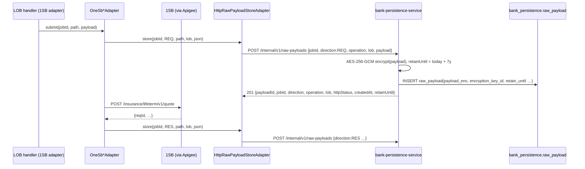
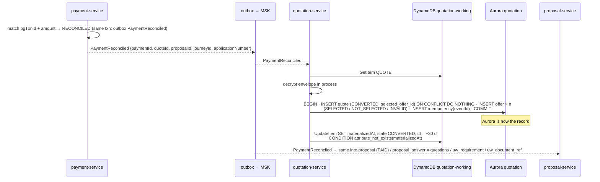

# Payload storage and transactions

[← API reference home](../README.md) · [Store ownership](./store-ownership.md)

This page answers four questions developers ask on the first day:

1. Where do we keep the **raw request/response** we exchange with 1SB and insurers?
2. Where does a **quote or proposal** live while the customer is still deciding (DynamoDB) — and when
   does it become structured Aurora rows?
3. What is the **transaction boundary** of each write, and how do we stay consistent across
   services without two-phase commit?
4. How long is each kind of data **kept**, and what is archived?

---

## 1. Four kinds of payload, four homes

| Kind | Example | Home | Encrypted | Mutable | Retention |
|---|---|---|---|---|---|
| **Raw provider payload** — the exact JSON sent to / received from 1SB | 1SB quote request, quote poll response, proposal submit, payment-URL response | `bank_persistence.raw_payload` (`payload_enc BYTEA`) via `bank-persistence-service` | **Yes** — AES-256-GCM, server-side, fresh 96-bit IV per row, key id `raw-payload-key-v1` | No (INSERT-only role) | `retain_until` = created + **7 years** (`RAW_PAYLOAD_RETENTION_YEARS`) |
| **Adapter job metadata** — the bank's handle on an async provider call | `integration_job`, `integration_job_offer`, `job_poll_attempt`, `payment_session` | `bank_persistence` | No (holds ids, statuses, premiums — not PII) | Status columns update | 7 years (job records) |
| **Working state** — the bank's quote/proposal while the sale is open | Offers from 3 insurers inside one quote; proposal form answers | **DynamoDB** `{env}-quotation-working` / `{env}-proposal-working` (`payloadEnc` + control attributes, `DB-DEC-0005`) | **Yes** — SSE-KMS plus client-side envelope encryption, decrypted only in the owning service | Yes, until `materializedAt` is set | DynamoDB TTL: `RET-WORKING` (default 90 days, configurable); TTL removed while a payment is in flight |
| **Structured evidence** — what a regulator or finance can query | `consent.consent`, `suitability.*`, `payment.payment`, `policy.policy`, structured `quote`/`offer`/`proposal` after payment | Owning schema, normal columns (PII columns `*_enc`) | PII columns only | Mostly INSERT-only | `RET-7Y` / `RET-7Y-IMMUTABLE` |

**Never** store a raw provider payload in application logs, in OpenSearch, in Valkey, or in a
domain table's plain columns. Provider vocabulary must not leak upward (`INV-ACL-01`).

---

## 2. Raw provider payloads (implemented)

### 2.1 Write path



Captured today by `OneSbQuoteAdapter` (submit request, submit response, poll response),
`OneSbProposalAdapter` (submit request and response) and `OneSbPaymentAdapter`
(payment-URL request and response). `operation` is the 1SB path, e.g.
`/insurance/lifeterm/v1/quote`.

> **Behaviour to know (`SUG-20261021-gap`).** Two strengths:
>
> - **`storeEvidence`** — the REQUEST of a proposal submission or a payment-link creation. Stored
>   **before** the 1SB call, retried once; if it still fails, the call is not made and the caller
>   gets `503 UPSTREAM_UNAVAILABLE` (nothing reached 1SB, so a retry is safe). A proposal job is
>   marked `FAILED` with reason `RAW_PAYLOAD_CAPTURE_FAILED`.
> - **`store`** — quote traffic and every RESPONSE. Best effort: a failure is logged at ERROR
>   (`RAW_PAYLOAD_CAPTURE_FAILED`, job id / direction / operation — never the body) and the flow
>   continues. Once 1SB has answered, failing the flow would only invite a duplicate submission.
>
> A call without a job id (e.g. a payment request with no `jobId`) has nothing to key evidence on and
> is not captured.

### 2.2 Read path

| Call | Returns | Who may call |
|---|---|---|
| `GET /internal/v1/raw-payloads?jobId={jobId}` | Metadata only (`payloadId`, direction, operation, lob, httpStatus, createdAt, retainUntil). **Never plaintext** | Support tooling, adapter |
| `GET /internal/v1/raw-payloads/{payloadId}` | Decrypted `payload` | Compliance / dispute tooling only. Normal application code reads job metadata, not payloads |

### 2.3 Table

| Column | Type | Note |
|---|---|---|
| `payload_id` | `VARCHAR(36)` PK | UUID minted by persistence |
| `job_id` | `VARCHAR(36)` | Logical link to `integration_job` |
| `direction` | `VARCHAR(3)` | `REQ` · `RES` |
| `operation` | `VARCHAR(100)` | Provider path / operation |
| `lob` | `VARCHAR(20)` | `TERM`, `SAVING`, `ULIP`, … or `UNKNOWN` |
| `payload_enc` | `BYTEA` | IV ‖ ciphertext ‖ GCM tag |
| `encryption_key_id` | `VARCHAR(50)` | For key rotation |
| `http_status` | `SMALLINT` | Provider HTTP status when known |
| `created_at` | timestamptz | |
| `retain_until` | `DATE` | Purge only by `job_retention`, never by application code |

---

## 3. Working state — DynamoDB until payment (`DB-DEC-0005`, owner decision 2026-10-21)

### 3.1 Why

A quote fans out to several insurers and changes until the customer picks one; a proposal form is
a dynamic, insurer-specific schema saved page by page. Neither is evidence until money moves, both
are read only by id, and most are abandoned. So the bank keeps the whole quote (all offers) and the
whole proposal (all answers) as **one DynamoDB item with an encrypted envelope** while the sale is
open, and writes **structured, relational rows in Aurora only after the payment is `RECONCILED`**.
Never-paid items expire by TTL. This keeps the high-churn working set off the shared Aurora
cluster, while every gate, every rupee and every piece of evidence stays relational.

| Store | What lives there | Owner |
|---|---|---|
| DynamoDB `{env}-quotation-working` | Working quote `QUOTE#{quoteId}/META`, its outbox items, idempotency items, one-open-quote-per-journey marker | `quotation-service` only |
| DynamoDB `{env}-proposal-working` | Working proposal `PROPOSAL#{proposalId}/META`, outbox, idempotency, open-proposal and application-number markers | `proposal-service` only |
| Aurora `quotation.quote` / `offer` | Structured quote after `RECONCILED` — the sold record: **every** offer shown (`SELECTED` / `NOT_SELECTED` / `INVALID`), `quote.selected_offer_id`, quote `CONVERTED` (`D-025`) | `quotation-service` |
| Aurora `proposal.proposal` / `proposal_answer` / `uw_requirement` / `uw_document_ref` | Structured proposal after `RECONCILED`; **every question asked and every answer** in `proposal_answer` (encrypted) | `proposal-service` |
| Aurora `proposal.proposal_status_history` | Post-payment proposal changes (`CONVERTED`, `ISSUANCE_FAILED`, `REFUND_REQUIRED`), append-only — never the frozen item, never an UPDATE (`D-025`) | `proposal-service` |
| Aurora `policy.policy_status_history` | Insurer decision progress polled from 1SB until `ISSUED` / `DECLINED` (`D-025`) | `policy-issuance-service` |

Full table design, item types, IAM: [`schemas/20-dynamodb-working-payload.md`](../../data-architecture/schemas/20-dynamodb-working-payload.md).

### 3.2 The working quote item

Plaintext **control attributes** sit beside the encrypted envelope so gates and Payment never decrypt:

| Attribute group | Attributes | Read by |
|---|---|---|
| Keys | `PK = QUOTE#{quoteId}`, `SK = META`, `GSI1PK = JOURNEY#{journeyId}` | Quotation |
| Identity | `quoteId`, `leadId`, `journeyId`, `customerId`, `lob`, `productClass`, `mode`, `category` | Quotation |
| Gate references | `suitabilityId`, `evaluationId`, `consentId` | Checked **before** the first write (C1): outcome for `productClass` in `SUITABILITY.GATE.allowedOutcomes` (D4); consent valid for `BEFORE_MULTI_QUOTE` incl. `CNS-QSH` (D5) |
| State | `state`, `validUntil`, `provider`, `providerJobId` | Quote state machine; adapter correlation |
| Selection (atomic with the envelope) | `selectedOfferId`, `selectedPremiumAmount`, `selectedTaxAmount`, `selectedSumAssured`, `selectedInsurerCode`, `selectedProductCode` | Payment, **through the Quotation API** (`INV-PAY-03`) |
| Envelope | `payloadEnc` (Binary, client-side encrypted with the service's KMS key), `encryptionKeyId`, `payloadSchemaVersion` | Quotation only |
| Lifecycle | `paymentInFlight`, `materializedAt`, `version`, `ttl`, `configVersionRef` | Optimistic lock, freeze, expiry |

Envelope v1 (inside `payloadEnc`):

```text
{ requestedCover, mode, category, members,
  offers: [ { offerId, insurerCode, productCode, productName, premiumAmount, taxAmount,
              sumAssured, frequency, coverTerm, ppt, outOfBound, offerState, errorSummary } ],
  selectedOfferId }
```

Envelope → column mapping at materialise (review §3.6):

| Envelope / API | Column | Note |
|---|---|---|
| `frequency` | `offer.premium_frequency` | |
| `ppt` | `offer.premium_paying_term` | |
| `coverTerm` | `offer.cover_term` | |
| `offerState = AVAILABLE` (API) | `offer.offer_state = QUOTED` → at materialise `SELECTED` / `NOT_SELECTED` | `AVAILABLE` is never stored |
| `offerState = INVALID` | `offer.offer_state = INVALID` | Premium / sum assured may be null; `ck_offer_positive` exempts `INVALID` |
| `selectedOfferId` | `quote.selected_offer_id` | |

The working proposal item follows the same pattern: control attributes `quoteId`, `offerId`,
`consentId`, `applicationNumber`, `state`, `underwritingState`, `schemaId`, `schemaVersion`,
`issuanceMode`, `configVersionRef` (both materialised to columns); the envelope holds form answers, UW requirements, document refs (bytes in S3), and
the nominee (always encrypted — `INV-PRP-05`). Item size budget 350 KB.

### 3.3 Materialisation into Aurora after `RECONCILED`



| Failure | Recovery |
|---|---|
| Crash after the Aurora commit, before the DynamoDB update | Event re-delivered; Aurora `ON CONFLICT` makes the insert a no-op; the DynamoDB update applies |
| Event lost | Daily sweep: every `RECONCILED` payment without a structured quote/proposal is re-driven |
| DynamoDB item already expired | Cannot happen while paying: Payment's read of the selected offer sets `paymentInFlight` and **removes `ttl`**; the sweep alerts if it ever does |

After `materializedAt` is set, every DynamoDB update carries
`ConditionExpression attribute_not_exists(materializedAt)`, so the working item is frozen.
The quote stays `SELECTED` through payment (Payment's `/selected` read requires it) and is
`CONVERTED` only at materialise. Any later proposal change is a `proposal_status_history` row.
TTL handling for `REJECTED` / `UNCERTAIN` / `RECONCILIATION_BREAK`:
[`schemas/20` §3.3](../../data-architecture/schemas/20-dynamodb-working-payload.md#33-payment-in-flight).

### 3.4 Options considered

| Option | Verdict | Reason |
|---|---|---|
| **DynamoDB item (control attributes + client-side-encrypted envelope)** | **Taken — `DB-DEC-0005`** | Owner decision. Single-key, document-shaped, high-churn, discard-mostly data; TTL ageing; keeps churn off Aurora |
| Aurora `BYTEA` envelope + control columns | Superseded (`DB-DEC-0004`) | Was the previous design |
| Plaintext JSON (Dynamo or `JSONB`) | Rejected | Members, nominee and form PII would be readable by anyone with table read (`DR-PII-01`) |
| JSON on the journey | Rejected | Journey holds stage + references only (`INV-JRN-02`) |
| Keep the DynamoDB item as the sold record | Rejected | Structured Aurora rows are the record after `RECONCILED`; support and MIS never read DynamoDB |

Payment is **never** a working document: amount, state, `pg_txn_id` and `RECONCILED` stay
structured in Aurora from the first write because they gate issuance.

---

## 4. Transaction boundaries

### 4.1 Inside one service: one local ACID transaction

Every command that changes state writes, in **one** transaction in its own store:

```text
Aurora services (journey, lead, consent, suitability, payment, policy, …):
BEGIN
  INSERT/UPDATE   business row(s)
  INSERT          idempotency_record               key, request_hash, response_ref
  INSERT          outbox_event                     event_type, payload (ids + state, no PII)
COMMIT

Quotation / Proposal before payment (DynamoDB, DB-DEC-0005):
TransactWriteItems [
  Put/Update  QUOTE#{id}/META        CONDITION version = :v AND attribute_not_exists(materializedAt)
  Put         IDEM#{key}/IDEM        CONDITION attribute_not_exists(PK)
  Put         QUOTE#{id}/OUTBOX#{e}  (published from the table stream)
  Put/Delete  JOURNEY#{jid}/OPEN_QUOTE marker
]
```

- Concurrency: `SELECT … FOR UPDATE` / `version` column in Aurora; conditional writes on
  `version` in DynamoDB (optimistic lock). Gates, selection and materialise use strongly
  consistent reads.
- The service decrypts the envelope **in process**, applies the change, re-encrypts, and writes
  the item. Nobody queries inside an envelope.
- Atomic select (`INV-QUO-05`): `selected*` attributes and `payloadEnc` change in the same
  conditional update, so the JSON and the attributes cannot disagree.
- **No transaction spans DynamoDB and Aurora.** Materialise commits Aurora first, then marks
  DynamoDB; idempotent re-delivery repairs a crash in between.

### 4.2 Across services: no 2PC — callee commits, then caller commits

```text
journey-orchestration                         quotation-service
  1 lock journey row (version)
  2 check the stage transition is legal
  3 HTTP RequestQuote(Idempotency-Key = journey:{id}:quote) ─────►  4 TransactWriteItems QUOTE#…/META,
                                                                       idempotency, outbox … COMMIT
                                               ◄───────────────────  5 201 {quoteId}
  6 BEGIN
      UPDATE journey stage + version
      UPSERT journey_ref (quoteId)
      INSERT journey_transition
      INSERT outbox_event
      INSERT idempotency_record
    COMMIT
```

If step 6 fails after step 4 committed, the orchestrator simply retries the command: the callee
sees the same `Idempotency-Key`, returns the same `quoteId`, and the journey upserts the same
reference. **No compensating write into another service's schema, ever.**

### 4.3 Provider calls: the job store is the transaction log

The 1SB adapter has no database. Its "transaction" is a sequence of idempotent HTTP writes to
`bank-persistence-service`:

| Step | Write | Survives a crash because |
|---|---|---|
| 1 | `POST /internal/v1/jobs` → `integration_job` `PENDING` (+ unique `idempotency_key`) | The job exists before any provider call |
| 2 | `POST /internal/v1/raw-payloads` (REQ) | Quote: best effort. Proposal / payment: **required** — no evidence, no provider call |
| 3 | Provider submit (no automatic retry) | — |
| 4 | `PATCH /internal/v1/jobs/{id}/status` → `RUNNING` + `externalReqId` | The provider reference is recorded; recovery is by polling it |
| 5 | Poll loop: `POST …/poll-attempts` each try; `POST …/offers` per offer; `PATCH …/status` → `COMPLETED` / `PARTIAL` / `FAILED` / `TIMEOUT` | Each attempt is a row |

---

## 5. Events and the outbox

Every owning Postgres schema that publishes has an `outbox_event` table in the
[`ADR-025`](../../architecture-review/ADR-025-event-specification-and-publisher.md) shape:
`outbox_id` (ULID), `aggregate_type`, `aggregate_id`, `event_type`, `schema_version`, `payload`
(event-envelope/v1), `created_at`, `published_at`, `attempts`, `last_error`, `parked_at`. The
`JdbcOutboxRelay` claims rows with `FOR UPDATE SKIP LOCKED`, publishes, sets `published_at`, and
parks a row after 10 failures. Consent, policy, catalogue, customer and administration now have one
(DDL updated 2026-10-21). Quotation / proposal publish from DynamoDB `OUTBOX#` items with a
5-minute sweeper. Consumers dedupe on `eventId` (`processed_event` or the owner's idempotency table).
Payload rule: **identifiers, state and attribution only — never PII**, and money only as amount +
currency where reconciliation needs it. Full detail and the event catalogue:
[Outbox and events](../interactions/outbox-and-events.md).

---

## 6. Retention and archive

| Path | What stays in Aurora | Class | At `retain_until` |
|---|---|---|---|
| Journey never reached payment | Nothing after archive (lead attribution stub stays) | `RET-WORKING` (default 90 days) | DynamoDB TTL deletes the working quote/proposal items (stream can archive to S3); `sp_purge_operational` deletes the unconverted journey tree |
| Reached payment, not `RECONCILED` | `payment.payment` + attempts | Payment `RET-7Y-IMMUTABLE`; working items and journey `RET-WORKING` | Payment end event restores the DynamoDB `ttl`; items expire; payment row stays |
| `RECONCILED` | Structured quote, offer, proposal, UW, payment, policy, journey header | `RET-7Y` / `RET-7Y-IMMUTABLE` / `RET-POLICY+7Y` | DynamoDB item expires 30 days after materialise; structured Aurora rows are never purged by the operational job |
| Consent and suitability | Always | `RET-7Y` / `RET-7Y-IMMUTABLE` | Not purged even for unconverted journeys (`OPEN-RET-UNCONVERTED-EVIDENCE`, Shailja) |
| Raw provider payloads | `bank_persistence.raw_payload` | 7 years | Purge job, with a deletion audit event |
| Audit events | `bank_persistence.audit_event` (INSERT-only) + S3 Object Lock archive today; Aurora schema `audit` (hash-chained) if [`ADR-026`](../../architecture-review/ADR-026-audit-store-and-transport.md) — **proposed** — is accepted | 7 years WORM | Object Lock prevents deletion before expiry |

`retain_until` is set by the owning service **from configuration**, never a hard-coded 7 in a CHECK. Since 2026-10-21 it exists on every evidence table: consent, suitability evaluation / caution ack, quote, proposal, payment, policy and policy status history (plus lead, journey, bank_persistence).

## 7. Sources

- `services/bank-persistence-service/…/RawPayloadController.java` · `crypto/RawPayloadEncryptionService.java` · `JobController.java`
- `services/1sb-integration-service/…/adapter/persistence/HttpRawPayloadStoreAdapter.java` · `adapter/onesb/quote/OneSbQuoteAdapter.java`
- [DB-DEC-0005](../../data-architecture/DB-DEC-0005-dynamodb-working-payload.md) · [DynamoDB table design](../../data-architecture/schemas/20-dynamodb-working-payload.md) · [06 Journey orchestrator and working payload](../../data-architecture/06-journey-orchestrator-and-working-payload.md) · [DB-DEC-0004](../../data-architecture/DB-DEC-0004-working-payload-until-payment.md) · [02 Operations and troubleshooting](../../data-architecture/02-operations-and-troubleshooting.md)
- [`08-quotation.sql`](../../data-architecture/schemas/08-quotation.sql) · [`09-proposal.sql`](../../data-architecture/schemas/09-proposal.sql) · [`02-bank_persistence.sql`](../../data-architecture/schemas/02-bank_persistence.sql)
