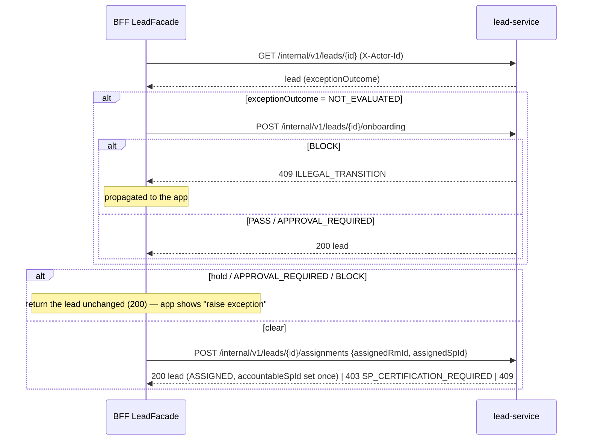

# BFF → lead-service (seam S-20)

[← API reference home](../README.md)

| | |
|---|---|
| **From → to** | `workforce-access-bff` (`HttpLeadGateway`, `LeadFacade`) → `lead-service` `/internal/v1/leads` |
| **Style** | Synchronous; target 2 s |
| **Principal** | `X-Actor-Id: <session.businessUserId>` on **every** call — the only source of the actor |
| **Idempotency** | Contract: client `Idempotency-Key` on create; not enforced yet. Duplicate business create is blocked by the unfinished-lead rule |
| **Mode switch** | `LEAD_DOWNSTREAM_MODE=stub` (default, in-BFF stub) or `http` |
| **Code status** | **IMPLEMENTED** |

## 1. Mapping

| Public BFF | Internal lead-service | Notes |
|---|---|---|
| `GET /api/v1/workspace/pipeline` | `GET /internal/v1/leads?owner=me` | Book = creator / assigned RM / assigned SP |
| `GET /api/v1/customers/{id}/active-leads?productClass` | `GET /internal/v1/leads?owner=me` | Filtered **in the BFF** to customer, product class, non-terminal; first 20 |
| `POST /api/v1/leads` | `POST /internal/v1/leads` | Save only |
| `GET /api/v1/leads/{id}` | `GET /internal/v1/leads/{id}` | Absent → 404 |
| `POST /api/v1/leads/{id}/assignment` | `GET …/{id}` → (if `NOT_EVALUATED`) `POST …/{id}/onboarding` → (if clear) `POST …/{id}/assignments` | Orchestrated in `LeadFacade.assign` |

## 2. Assignment orchestration (`D-019`)

## 3. Error propagation

Lead's problem+json is parsed by `ProblemJsonReader`; `ErrorPropagation` keeps the incident id and
`origin = lead`, and the BFF re-emits the same code when the RM can act on it (`CONFLICT`,
`ILLEGAL_TRANSITION`, `SP_CERTIFICATION_REQUIRED`, `RESOURCE_NOT_FOUND`, `UNSUPPORTED_LOB`).
Note: unlike the identity clients, the lead gateway does not catch a pure transport failure
(`RestClientException` with no response); a lead-service outage therefore surfaces as the BFF's
generic failure rather than a typed `503` — a known gap against S-20.

## 4. Sources

- `services/workforce-access-bff/src/main/java/com/bank/workforce/bff/lead/HttpLeadGateway.java` · `application/LeadFacade.java`
- [lead-service](../services/lead-service.md) · [Lead API LLD §3](../../ws3-platform/12-lead-module-api-lld.md)
