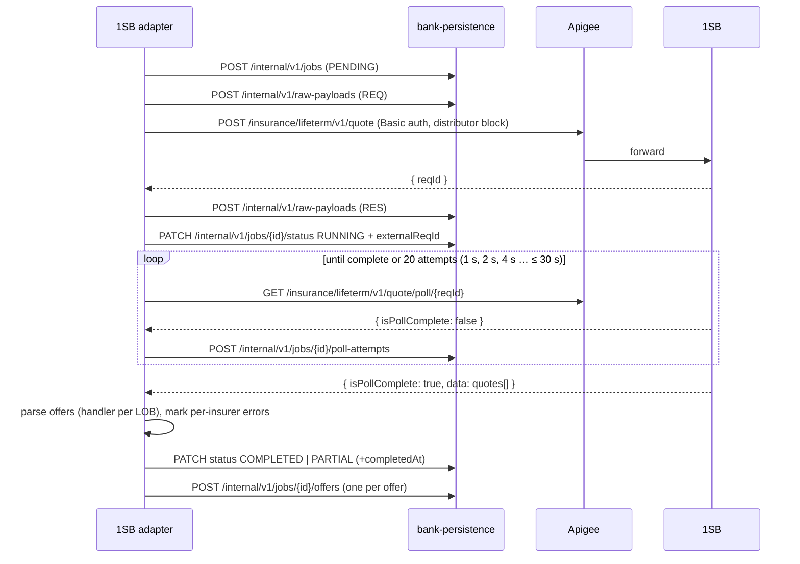

# 1SB adapter → Apigee → 1SilverBullet (seams S-10 / S-11)

[← API reference home](../README.md)

| | |
|---|---|
| **From → to** | `1sb-integration-service` (`adapter.onesb.*`) → Apigee (outbound API plane) → 1SB |
| **Style** | Submit = synchronous call that returns a `reqId`; result = **polled** |
| **Auth** | `Authorization: Basic base64(apiKey:apiSecret)` from `bank-common-secrets` (`PROPERTIES` local · `ENV` UAT · `AWS_SECRETS_MANAGER` prod); `distributorId` injected from the same secret source on every request; startup fails if any is missing |
| **Budgets** | Connect 3 s · read 30 s (`onesb.client.*`); poll 1 s × 2 → 30 s cap, 20 attempts; breaker 5 failures / 30 s |
| **Code status** | **IMPLEMENTED** |

## 1. Network path and allowlisting

```text
1sb-integration-service pod → TGW → (Network Firewall: domain allowlist, mTLS NOT decrypted)
  → Apigee (bank-owned) → 1SB origin
1SB allowlists APIGEE's egress IPs — never our NAT EIPs (ADR-020; do not publish spoke EIPs)
```

`ONESB_BASE_URL` defaults to the 1SB **demo** host for local work; UAT/prod point it at the Apigee
proxy. Inbound webhooks from 1SB: **none** — R0 polls.

## 2. The submit-then-poll protocol



| Rule | Why |
|---|---|
| **Never retry a submit** | 1SB may already have processed it; a duplicate quote or proposal is the failure. Recover by polling `reqId` |
| Poll on a dedicated executor | API threads never wait on 1SB |
| Partial success is success | Some insurers fail, some quote → `PARTIAL` with both |
| Exhaustion | `TIMEOUT` with reason `POLL_TIMEOUT`; unexpected exception → `FAILED` (`POLL_ERROR`) |

## 3. Translation at the edge

| Bank side (in) | 1SB side (out) |
|---|---|
| `lob: TERM` / `SAVING` / `ULIP` | lifeterm / lifesave path family |
| `members[].gender`, `tobacco`, occupation … (bank enums) | 1SB master codes (`entityIds`) resolved inside the adapter |
| `distribution.agentId` / `rmEmployeeId` | `agentID` (mapped), `agentType`, `channelType` |
| (nothing) | `distributorID` from secrets |
| `jobId` | `reqId` (stored as `external_req_id`, never returned) |
| 1SB `applicationStatus` + sub-status | `BankApplicationStatus` (`UW_REQUIREMENTS`, `ISSUED`, …) |

## 4. Sources

- `services/1sb-integration-service/src/main/java/com/bank/insurance/onesb/adapter/onesb/**` · `src/main/resources/application.yml`
- [1SB architecture §6–§8](../../../1sb-insurance-integration/architecture/1sb-integration-service-architecture.md) · [Term quote field guide](../../../1sb-insurance-integration/field-guides/term-quote.md) · [ADR log (ADR-010, ADR-020)](../../architecture-review/08-architecture-decision-log.md)
