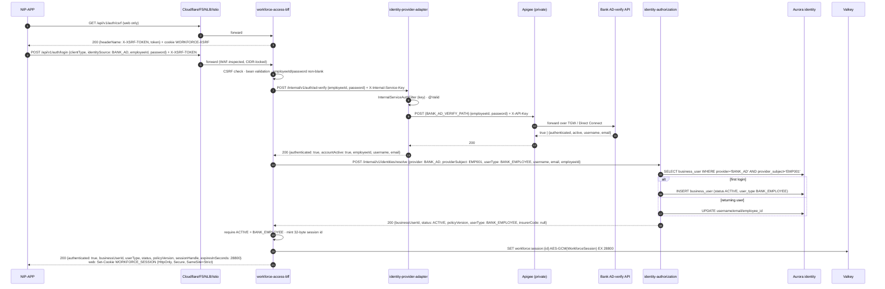

# Scenario 01 — A bank RM logs in (employee id + password, AD-verify)

[← API reference home](../README.md) · Next: [02 Partner login](./02-partner-login-keycloak.md)

**Status: IMPLEMENTED** end to end in code (`IAM-001`). Local runs use the AD-verify stub; UAT/prod
call the bank's AD-verify API through Apigee.

**In one sentence:** the app posts the RM's credentials to the BFF; the BFF validates them, asks the
identity adapter to verify them with bank AD, asks the authorization service which platform user
this is (creating them on first login), stores an encrypted session in Valkey, and returns an
**opaque session handle** (cookie on web, header value on native) — never a token.

---

## 1. Actors and components

| # | Component | Role in this scenario | Data it touches |
|---|---|---|---|
| 1 | NIP-APP | Login screen; holds only the opaque handle afterwards | Secure storage (native) / cookie jar (web) |
| 2 | Cloudflare → F5-XC → NLB → Istio | Edge, WAF, path `/api/*` → BFF | — |
| 3 | `workforce-access-bff` | Validates, orchestrates, mints the session | Valkey `workforce:session:*` |
| 4 | `identity-provider-adapter-service` | Talks to bank AD-verify | — |
| 5 | Apigee (private target) | Bank outbound API plane | — |
| 6 | Bank AD-verify API | Says true/false: valid credentials of an **active** employee | Bank AD |
| 7 | `identity-authorization-service` | Maps the employee to a platform `businessUserId` | Aurora `identity.business_user` |
| 8 | ElastiCache Valkey | Session vault | `workforce:session:{id}` |

## 2. Sequence



## 3. The request

```http
POST /api/v1/auth/login HTTP/1.1
Host: uat-insurance.aubank.in
Content-Type: application/json
X-XSRF-TOKEN: 3f2c…            (web only)
X-Correlation-Id: 4a1d6e0c-…    (contracted)

{ "clientType": "WEB", "identitySource": "BANK_AD", "employeeId": "EMP001", "password": "••••••" }
```

## 4. Validation, layer by layer

| Layer | Check | Failure |
|---|---|---|
| Edge (F5-XC) | WAF rules, body size, rate limit | Blocked at the edge |
| BFF security | `/api/v1/auth/**` is `permitAll`; CSRF required for a cookie-borne browser POST | `403 CSRF_REJECTED` |
| BFF bean validation | `clientType`, `identitySource` not null and valid enums | `422 VALIDATION_ERROR` |
| BFF `LoginService` | `employeeId` non-blank (trimmed); `password` non-blank | `400 SCHEMA_INVALID` |
| Adapter filter | `X-Internal-Service-Key` matches | `401 UNAUTHORIZED` (configuration fault) |
| Adapter validation | `employeeId`, `password` `@NotBlank` | `422` / `400` |
| AD-verify | Credentials valid **and** account active | `{authenticated:false}` → BFF `401 AUTHENTICATION_FAILED` |
| PDP resolve | Business user exists or is a bank employee (JIT create) | — |
| BFF | `status = ACTIVE` and `userType = BANK_EMPLOYEE` (a `SUSPENDED` / `DISABLED` user is refused even though AD said yes) | `401 AUTHENTICATION_FAILED` |

## 5. The response

Web:

```http
HTTP/1.1 200 OK
Set-Cookie: WORKFORCE_SESSION=Qm9…; Path=/; Max-Age=28800; Secure; HttpOnly; SameSite=Strict
Content-Type: application/json

{ "authenticated": true, "businessUserId": "7f0c2a6e-2d0b-4b8e-9a7d-3c1f5e2b9a10",
  "userType": "BANK_EMPLOYEE", "status": "ACTIVE", "policyVersion": 1,
  "sessionHandle": null, "expiresInSeconds": 28800 }
```

Native: no cookie; `"sessionHandle": "Qm9…"`. The app stores it in secure storage and sends
`X-Session-Handle: Qm9…` on every later call.

**What is never in the response:** an access token, refresh token, id token, the password, the AD
response, or any internal error detail.

## 6. Errors the app must handle

| HTTP | `code` | Meaning for the user | App action |
|---|---|---|---|
| 401 | `AUTHENTICATION_FAILED` | Wrong id/password, AD account inactive, or platform user not active | "Invalid credentials or account not active"; do **not** say which |
| 422 | `VALIDATION_ERROR` | Malformed request (client bug) | Fix the client |
| 400 | `SCHEMA_INVALID` | Missing employee id / password | Inline field error |
| 403 | `CSRF_REJECTED` | Missing/stale CSRF token (web) | Re-fetch `/auth/csrf`, retry once |
| 503 | `IDENTITY_PROVIDER_UNAVAILABLE` | AD-verify, Apigee, adapter or PDP down | "Login is temporarily unavailable"; show `incidentId` |

## 7. Data written

| Store | What | When |
|---|---|---|
| Aurora `identity.business_user` | New row on first login (`provider=BANK_AD`, `provider_subject=<employeeId>`, `status=ACTIVE`); profile refresh on later logins | Every login |
| Valkey `workforce:session:{id}` | Encrypted `WorkforceSession` (no provider tokens for AD logins) | Every successful login, TTL 8 h |
| Logs | `"Bank AD login created a workforce session"` — no id, no password | Success |
| Audit | **Not yet.** Retaining auth events per policy is gate criterion `A.5` (OPEN) | — |

## 8. Behind the scenes — the tricky bits

1. **The password never persists.** It lives for one request in the BFF and the adapter; both
   request records redact themselves in `toString()`; the AD-verify adapter logs only "accepted" /
   "rejected" / status codes.
2. **AD says *who*, the PDP says *what*.** A brand-new employee becomes an `ACTIVE` business user
   with **no roles**; every later authorization decision is `DEFAULT_DENY` until roles and SP
   certification are granted (WS-2 provisioning).
3. **Session = random key into an encrypted vault.** Decrypt failures of any kind look identical
   (`401 SESSION_EXPIRED`) so the vault cannot be probed.
4. **Stub safety.** `BANK_AD_VERIFY_MODE=stub` refuses to start under the `prod` profile. Local
   users: `EMP001` (active) and `EMP002` (inactive — use it to see the 401).
5. **Not yet built from the Login BRD:** captcha, OTP to mobile + email, lockout after 3 failures
   or 30 days inactivity, unlock (`SUG-20261008-otp`, parked).

## 9. Try it locally

```bash
docker compose -f docker-compose.identity.yml up --build      # BFF :8084, adapter :8082, PDP :8083, Redis, Keycloak
# use the token from the JSON body (Spring Security masks it), not the raw cookie value
TOKEN=$(curl -s -c jar http://localhost:8084/api/v1/auth/csrf | python3 -c 'import sys,json; print(json.load(sys.stdin)["token"])')
curl -s -b jar -c jar -H 'Content-Type: application/json' \
     -H "X-XSRF-TOKEN: $TOKEN" \
     -d '{"clientType":"WEB","identitySource":"BANK_AD","employeeId":"EMP001","password":"local-stub-password"}' \
     http://localhost:8084/api/v1/auth/login
curl -s -b jar http://localhost:8084/api/v1/auth/session
```

## 10. Pages for each hop

[Edge to BFF](../interactions/edge-to-bff.md) · [BFF to IdP adapter](../interactions/bff-to-identity-provider-adapter.md) ·
[BFF to PDP](../interactions/bff-to-identity-authorization.md) · [Session vault](../interactions/bff-session-vault.md) ·
[BFF service](../services/workforce-access-bff.md#22-post-apiv1authlogin) · [IdP adapter](../services/identity-provider-adapter-service.md) ·
[Authorization service](../services/identity-authorization-service.md)
