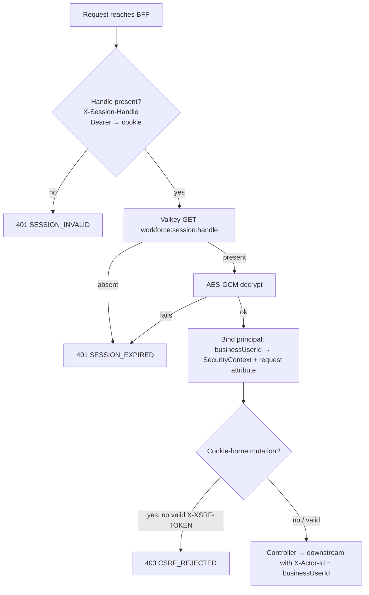

# Scenario 03 — Every authenticated call, session read, logout and expiry

[← API reference home](../README.md) · Prev: [02](./02-partner-login-keycloak.md) · Next: [04](./04-customer-search.md)

**Status: IMPLEMENTED.**

## 1. What happens on every `/api/v1/**` call (except `/auth/**`)



Cost per call: one Valkey round trip + one AES-GCM decrypt. No IdP call and no PDP call for the
session check itself; lead create and assign additionally ask the PDP (300 ms, fail closed) — see
[BFF to PDP](../interactions/bff-to-identity-authorization.md).

## 2. `GET /api/v1/auth/session` — who am I

Reads the vault and returns `businessUserId`, `username`, `userType`, `status`, `policyVersion`,
`insurerCode`. Missing or expired handle → `400 SCHEMA_INVALID` (auth-path mapping). The app calls
it on start-up to decide between the login screen and the workspace.

## 3. Logout

```mermaid
sequenceDiagram
    participant App
    participant BFF
    participant KV as Valkey
    participant IDPA as identity-provider-adapter
    participant KC as Keycloak
    App->>BFF: POST /api/v1/auth/logout (handle; X-XSRF-TOKEN on web)
    BFF->>KV: GET workforce:session:{h}
    BFF->>KV: DEL workforce:session:{h}   ← local session is gone first
    opt partner session with refresh token
        BFF->>IDPA: POST /internal/v1/auth/revoke {refreshToken}
        IDPA->>KC: revoke (token_type_hint=refresh_token)
        Note over BFF: revoke failure is logged (provider subject only), logout still succeeds
    end
    BFF-->>App: 204 + Set-Cookie WORKFORCE_SESSION=; Max-Age=0
```

## 4. Expiry and limits

| Item | Value | Note |
|---|---|---|
| Session TTL | 8 h absolute from login | No sliding renewal today |
| Pending partner login | 5 min | |
| Native completion code | 1 min, single use | |
| Provider token refresh | Adapter supports `/auth/refresh`; BFF does not call it yet | Partner sessions end with the BFF TTL |
| Idle timeout, lockout, OTP step-up, Insurance RM Forgot Password, 60-day expiry | Parked (`SUG-20261008-otp`) | Login BRD v3.1 remainder. Design text is the user-visible copy. |

After expiry the next call returns `401 SESSION_EXPIRED`; the app returns to login. Any in-flight
mutation should be retried after re-login **with the same `Idempotency-Key`**.

## 5. Pages

[BFF §2.6–§2.7](../services/workforce-access-bff.md#26-get-apiv1authsession) · [Session vault](../interactions/bff-session-vault.md) · [Headers and session](../conventions/headers-session-and-auth.md)
