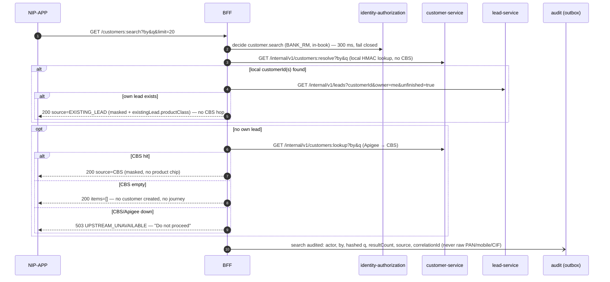

# Scenario 04 — The RM searches for an existing bank customer

[← API reference home](../README.md) · Prev: [03](./03-session-lifecycle-and-logout.md) · Next: [05](./05-lead-creation-and-dedupe.md)

**Screen:** `SCR-03` "Select customer to begin". **Status:** IMPLEMENTED-PARTIAL — BFF → customer →
Apigee → CBS works today; the contracted **lead-first** orchestration, local resolve, PDP check,
masking extras and search audit are not built yet.

**Business rule:** given a Customer ID, PAN or registered mobile, show whether this person is
already on a lead in **this RM's** book; if not, show the CBS identity so a lead can start. **Never
invent a customer. Never proceed when CBS is down and no local lead exists.**

## 1. The request

```http
GET /api/v1/customers:search?by=CUSTOMER_ID&q=560098111 HTTP/1.1
X-Session-Handle: Qm9…            (or cookie)
X-Correlation-Id: 8d2f…
```

| Param | Rule |
|---|---|
| `by` | `CUSTOMER_ID` \| `PAN` \| `MOBILE` (no name, no account number on this screen) |
| `q` | CIF `[A-Za-z0-9]{1,20}` · PAN uppercased `^[A-Z]{5}[0-9]{4}[A-Z]$` · mobile 10 digits starting 6–9 (or `+91…`) — **never logged, never echoed** |
| `countryCode` | for `MOBILE` (`IN` in R0) |
| `limit` / `page` | ≤ 20 per page, ≤ 5 pages (contract) |

## 2. What happens today (code)

```mermaid
sequenceDiagram
    autonumber
    participant App as NIP-APP
    participant BFF as BFF
    participant KV as Valkey
    participant CS as customer-service
    participant AT as Apigee token
    participant AX as Apigee private proxy
    participant CBS as CBS / EBS
    App->>BFF: GET /api/v1/customers:search?by&q
    BFF->>KV: session lookup (401 if invalid)
    BFF->>CS: GET /internal/v1/customers/search?by&q&countryCode
    CS->>CS: X-Actor-Id present? (422 MISSING_REQUIRED_FIELD) — BFF does not send it yet
    CS->>CS: by ∈ {CUSTOMER_ID, MOBILE, PAN}? q non-blank? q format per by? (422 VALIDATION_ERROR, field q)
    CS->>AT: client-credentials token (cached, single-flight)
    CS->>AX: GET /customers/search?by&q  Bearer token (connect 3 s / read 3 s)
    AX->>CBS: inquiry
    alt 5xx or connect failure
        CS->>AX: retry once (S-05)
    end
    CBS-->>CS: {items:[{customerId, displayName, initials, maskedCif, maskedMobile, eligibility, source}]}
    CS-->>BFF: 200 {items} (CBS empty or 404 → 200 {items: []}; transport failure → 503 UPSTREAM_UNAVAILABLE)
    BFF-->>App: 200 {items}
```

Since 2026-10-22 customer-service itself enforces the `q` formats above, the S-05 budget
(3 s / 3 s, one retry on 5xx / connect) and requires `X-Actor-Id`
([customer-service §2.1](../services/customer-service.md#21-get-internalv1customerssearch)).
The BFF's customer gateway must start sending `X-Actor-Id` — until it does, BFF → customer-service
search answers `422`.

## 3. What the contract adds (target, contract 09)



## 4. Response (contract)

```json
{
  "query": { "by": "CUSTOMER_ID", "resultCount": 1, "source": "EXISTING_LEAD" },
  "items": [ {
      "customerId": "01JQX4K7R8M2N3P4Q5S6T7V8X1", "fullName": "Abhishek Kummar", "initials": "AK",
      "maskedCif": "XXXXX0433", "maskedMobile": "+91 933****412", "maskedEmail": "abh*****@gmail.com",
      "eligibility": "ETB", "source": "EXISTING_LEAD",
      "existingLead": { "leadId": "01JQ…", "productClass": "ULIP", "lob": "LIFE", "state": "ASSIGNED",
                        "journeyId": "01JQ…", "updatedAt": "2026-09-23T09:42:00Z" },
      "existingLeadCount": 1 } ],
  "page": { "page": 0, "size": 20, "hasMore": false }
}
```

Never on the wire: full CIF, PAN (even masked), DOB, address, income, another RM's lead id, CBS raw
payload, Apigee headers. A non-ETB match returns `eligibility: NOT_ETB` and the app disables
Continue.

## 5. Errors

| HTTP | Code | Cause | App |
|---|---|---|---|
| 401 | `SESSION_INVALID` / `SESSION_EXPIRED` | No / dead session | Login |
| 422 | `INVALID_REQUEST` / `MISSING_REQUIRED_FIELD` (code) · `400 VALIDATION_ERROR` field `by`/`q` (contract) | Bad key or value | Inline error |
| 403 | `DEFAULT_DENY` etc. (target) | Not permitted | Message |
| 503 | `UPSTREAM_UNAVAILABLE` | CBS / Apigee down and no own lead | "Customer records are unavailable right now. Do not proceed." |
| 502 | `UPSTREAM_BAD_RESPONSE` | Unexpected CBS status | Retry later |

## 6. Data touched

| Store | Today | Target |
|---|---|---|
| Valkey | session read | session read |
| Aurora `customer` | — | HMAC lookup (resolve); normalised `customer` row from CBS hit |
| Aurora `lead_lms` | — | read own unfinished leads |
| Audit | — | `CUSTOMER_SEARCHED` with hashed `q` |

**Search creates nothing.** It does not create a customer, a lead or a journey (`AC-CUST-010-2`).

## 7. Pages

[BFF §3.2](../services/workforce-access-bff.md#32-get-apiv1customerssearch) · [customer-service](../services/customer-service.md) · [Customer to CBS via Apigee](../interactions/customer-to-cbs-via-apigee.md) · [Customer search contract](../../ws3-platform/09-nip-bff-customer-search-contract.md)
