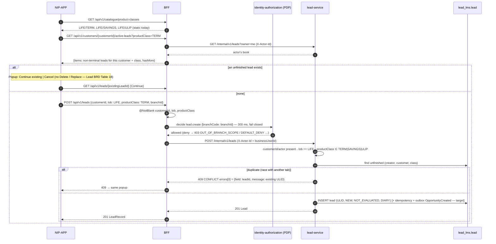

# Scenario 05 — The RM creates (or resumes) a lead

[← API reference home](../README.md) · Prev: [04](./04-customer-search.md) · Next: [06](./06-lead-onboarding-and-assignment.md)

**Screens:** `SCR-05` product class → create. **Status:** IMPLEMENTED-PARTIAL (persisted in `lead_lms.lead`; BFF asks the PDP for
`lead.create`; no idempotency key enforcement; no outbox yet).

**Canonical order (`D-019`):** search → pick product class → **dedupe** → **Save** (this scenario)
→ Start Onboarding (exception rules) → assign SP → suitability. **Save never runs exception rules
and does not require an SP assignee.**

## 1. Sequence



## 2. Request and response

```http
POST /api/v1/leads
Idempotency-Key: 6c0e…   (contract)
X-XSRF-TOKEN: …          (web)

{ "customerId": "CUST-0433", "lob": "LIFE", "productClass": "TERM", "branchId": "BR-MUM-001" }
```

```json
{ "leadId": "01JQX4K7R8M2N3P4Q5S6T7V8W9", "customerId": "CUST-0433", "lob": "LIFE", "productClass": "TERM",
  "branchId": "BR-MUM-001", "state": "NEW", "dashboardStage": "NEW", "assignedRmId": null, "assignedSpId": null,
  "exceptionHold": false, "exceptionOutcome": "NOT_EVALUATED", "exceptionRequired": false,
  "journeyId": "01JQX4K7R8M2N3P4Q5S6T7V8W9", "createdAt": "…", "updatedAt": "…" }
```

## 3. Validation summary

| Where | Rule | Error |
|---|---|---|
| BFF | `customerId`, `lob`, `productClass` non-blank | `422 VALIDATION_ERROR` |
| Lead | `lob = LIFE` (R0) | `422 UNSUPPORTED_LOB` |
| Lead | product class `TERM` / `SAVINGS` / `ULIP` | `422 UNSUPPORTED_LOB` |
| Lead | no unfinished lead for creator + customer + class | `409 CONFLICT`, `errors[0].field = leadId`, `errors[0].message` = the existing lead's ULID (Continue target); a race past the check hits `ux_lead_dedupe_open` → `409 CONFLICT` |
| Target | actor allowed to originate (`INV-LED-04`; PDP `lead.create`) | `403 ORIGINATION_RM_ONLY` |
| Target | customer in the accountable SP's ETB book (`INV-LED-05`) | `422 CUSTOMER_NOT_IN_BOOK` |
| Target | `distributorId` / insurer / plan in body | `422 ATTRIBUTION_NOT_CALLER_SUPPLIED` / rejected |
| Target | `Idempotency-Key` reused with a different body | `409 IDEMPOTENCY_CONFLICT` |

## 4. Data written (target)

One `lead_lms` transaction: `lead` (+ `config_versions`, `expires_at`; today `expires_at` is set
only when `lead.expiry-days` is configured — unset by default, the value is OPEN-D4 — and
`config_versions` is not yet written), `idempotency_record`,
`outbox_event OpportunityCreated` → Journey, Audit, Reporting. The lead is **not** a customer
record: it stores `customer_id` only.

## 5. Pages

[BFF §3.4–§3.6](../services/workforce-access-bff.md#35-post-apiv1leads) · [lead-service §3.1](../services/lead-service.md#31-post-internalv1leads--save) · [BFF to Lead](../interactions/bff-to-lead.md) · [Lead sequences §2](../../ws3-platform/11-lead-module-sequences.md)
