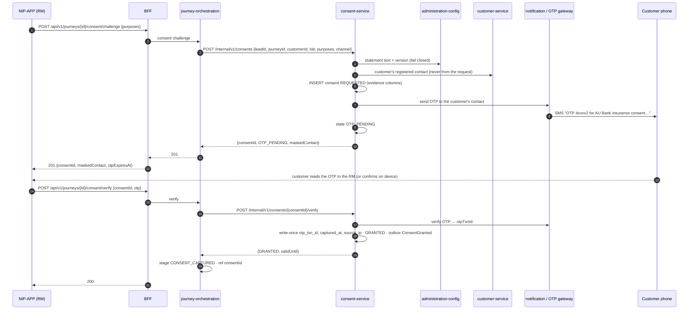

# Scenario 08 — Customer consent by OTP on the customer's phone (C2)

[← API reference home](../README.md) · Prev: [07](./07-journey-start-and-suitability.md) · Next: [09](./09-pre-quote-reference-data.md)

**Status: CONTRACTED / PROPOSED** (consent-service is a skeleton). The customer is **not** a
platform user in R0: their phone appears only for this OTP and, later, for payment.

## 1. Sequence

## 2. Rules

| Rule | Enforced by | Error |
|---|---|---|
| OTP goes only to the customer's registered contact | Consent resolves it from Customer #4 | — (no API accepts a phone number) |
| `GRANTED` only from `OTP_PENDING` with a verified txn id | Consent aggregate (`INV-CNS-02`) | `409 ILLEGAL_TRANSITION` |
| Evidence is write-once | INSERT-only columns (`INV-CNS-01`) | Store rejects |
| Wrong / expired OTP | Consent | `422 VALIDATION_ERROR`; attempts counted |
| Re-consent | New consent row, new statement version | — |
| Consent outlives an abandoned sale | Retained `RET-7Y-IMMUTABLE` (F-02) | — |
| Proposal submit later re-checks C2 at the point of use | Proposal service | `403 CONSENT_REQUIRED` |

## 3. Data written

`consent.consent` (purposes, statement text + version, encrypted CIF and contact, OTP txn id,
captured time, source IP, state, `valid_until`, `config_version_ref`), `idempotency_record`;
journey stage + `journey_ref (consentId)`; audit event `ConsentGranted`. OTP values are never
stored or logged.

## 4. Pages

[Consent service](../services/consent-service.md) · [Notification](../services/notification-service.md) · [Outbox and events](../interactions/outbox-and-events.md)
