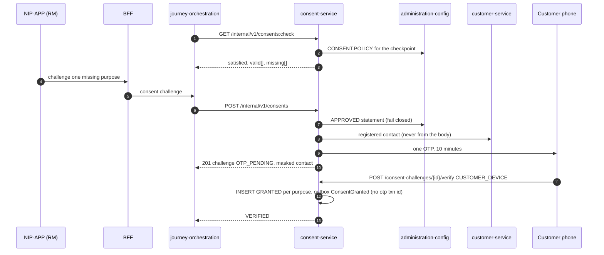

# Scenario 08 — Customer consent by OTP on the customer's phone (C2)

[← API reference home](../README.md) · Prev: [07](./07-journey-start-and-suitability.md) · Next: [09](./09-pre-quote-reference-data.md)

**Status: IMPLEMENTED** against the consent OpenAPI. The customer is **not** a
platform user in R0: their phone appears only for this OTP and, later, for payment.
`RM_RELAYED` is refused (C2). One challenge does not grant both `CNS-DP` and `CNS-SOL` (C3).

## 1. Sequence

## 2. Rules

| Rule | Enforced by | Error |
|---|---|---|
| OTP goes only to the customer's registered contact | Consent resolves it from Customer #4 | — (no API accepts a phone number) |
| `RM_RELAYED` | Policy `verificationModes` (C2) | `403 FORBIDDEN` |
| `CNS-DP` and `CNS-SOL` in one challenge | `separateActions` (C3) | `422 VALIDATION_ERROR` |
| Statement not `APPROVED` | C7 | `403 CONSENT_STATEMENT_NOT_APPROVED` |
| `GRANTED` only from `OTP_PENDING` with a verified code | Challenge (`INV-CNS-02`) | `409 ILLEGAL_TRANSITION` |
| Evidence is append-only | New row per state (`INV-CNS-01`) | No update API on evidence |
| Wrong / expired OTP | Consent | `422` with `attemptsRemaining`; `409 OTP_EXPIRED`; 4th call `429` |
| Re-consent | New chain plus a `SUPERSEDED` row on the old one | — |
| Proposal submit later re-checks at the point of use | Proposal service | `403 CONSENT_REQUIRED` |

## 3. Data written

`consent.consent_record` (one purpose per row, statement text and hash, encrypted contact, no CIF),
`consent.consent_challenge`, `idempotency_record`, `outbox_event`. OTP values are never stored or
logged. The outbox event does not carry the OTP transaction id.

## 4. Pages

[Consent service](../services/consent-service.md) · [Notification](../services/notification-service.md) · [Outbox and events](../interactions/outbox-and-events.md)
