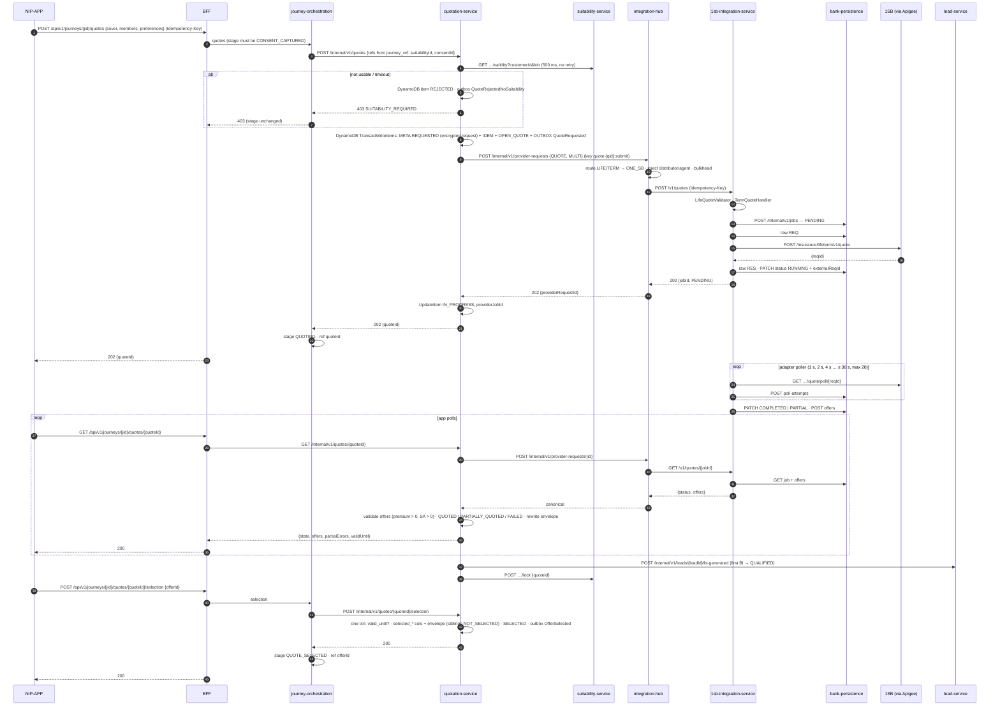

# Scenario 10 — Multi-quote: request, poll, partial success, select an offer

[← API reference home](../README.md) · Prev: [09](./09-pre-quote-reference-data.md) · Next: [11](./11-proposal-and-underwriting.md)

**Status:** the **provider half is IMPLEMENTED** (1SB adapter: job, submit, poll, offers,
persistence). The platform half (BFF route → Journey → Quotation → Hub) is **CONTRACTED /
PROPOSED**.

**"Multi-quote"** = `mode: MULTI`: one bank quote fans out to every eligible insurer in the
matrix through 1SB, and the RM compares the offers. `mode: SINGLE` pins one product (`selection`).

## 1. End-to-end sequence



## 2. Request (BFF, contract)

Money fields are **decimal strings** (OpenAPI `Money`). Figures below are the suitability worked
example (`SUIT-TC-REF-01`) — illustrative, not bank pricing policy
([MISSING-PRICES.md](../../contracts/MISSING-PRICES.md)).

```json
{
  "mode": "MULTI",
  "category": "SUM_ASSURED",
  "requestedCover": "25600000.00",
  "members": [ { "role": "LIFE_ASSURED", "dob": "1988-04-12", "gender": "MALE", "tobacco": false,
                 "annualIncome": "1200000.00", "pincode": "400001" } ],
  "preferences": { "paymentFrequency": "YEARLY" }
}
```

No `suitabilityId`, `consentId`, `distributorId` or agent id in the body — Journey supplies the
references, the Hub supplies attribution.

## 3. Sample poll body when `state = QUOTED`

Insurer premiums arrive at quote time via Hub / 1SB (not bank-seeded). Example shape after
validation (`premium > 0`, `sumAssured > 0`):

```json
{
  "quoteId": "01HZXEXAMPLE00000000000001",
  "state": "QUOTED",
  "offers": [
    {
      "offerId": "01HZXEXAMPLE00000000000002",
      "insurerCode": "INS01",
      "productCode": "TERM-BASIC-01",
      "premiumAmount": "25000.00",
      "taxAmount": "4500.00",
      "sumAssured": "25600000.00",
      "premiumFrequency": "YEARLY",
      "offerState": "AVAILABLE",
      "outOfBound": false
    },
    {
      "offerId": "01HZXEXAMPLE00000000000003",
      "insurerCode": "INS02",
      "productCode": "TERM-PLUS-01",
      "premiumAmount": "27500.00",
      "taxAmount": "4950.00",
      "sumAssured": "25600000.00",
      "premiumFrequency": "YEARLY",
      "offerState": "AVAILABLE",
      "outOfBound": false
    }
  ],
  "validUntil": "2026-11-08T18:30:00+05:30"
}
```

Amount payable on the selected offer = `premiumAmount + taxAmount` (here `"29500.00"` for INS01).

## 4. Poll response states the app must render

| `state` | Meaning | App |
|---|---|---|
| `IN_PROGRESS` | Insurers still answering | Keep polling (back off: 1 s → 5 s) |
| `QUOTED` | All insurers answered | Show offers |
| `PARTIALLY_QUOTED` | Some offers + some insurer failures | Show offers **and** which insurers failed — this is success |
| `FAILED` | Zero valid offers | Offer re-quote |
| `TIMED_OUT` | Poll budget exhausted | Offer re-quote (journey may go `ABANDONED`) |
| `REJECTED` | Suitability gate refused | Go back to suitability |
| `EXPIRED` | Validity window passed | Re-quote |

## 5. Where every byte goes

| Data | Store |
|---|---|
| Bank quote (request + all offers) | DynamoDB `{env}-quotation-working`, item `QUOTE#{quoteId}/META`: `payloadEnc` (encrypted) + control attributes (`DB-DEC-0005`) |
| Adapter job, offers, poll attempts | `bank_persistence.integration_job`, `integration_job_offer`, `job_poll_attempt` |
| Exact 1SB request / response JSON | `bank_persistence.raw_payload` (AES-GCM, 7 years) |
| Journey stage and `quoteId` / `offerId` | `journey.journey`, `journey_ref`, `journey_transition` |
| Lead BI flag | `lead_lms.lead` (`bi_generated`, `reporting_class = ELIGIBLE`, `QUALIFIED`) |
| Evidence | Outbox → MSK → audit: `QuoteRequested`, `QuoteCompleted`, `OfferSelected` (+ adapter `QUOTE_CREATED`) |
| Structured `quote` / `offer` | Aurora `quotation`, **only after** `PaymentReconciled` (materialisation) |

## 6. Errors

`403 SUITABILITY_REQUIRED` · `409 QUOTE_EXPIRED` (select too late) · `409 ILLEGAL_TRANSITION` (wrong
stage) · `422 VALIDATION_ERROR` / `UNSUPPORTED_LOB` (adapter field rules) · `409
IDEMPOTENCY_CONFLICT` · `503 UPSTREAM_UNAVAILABLE` (Hub / provider breaker open) · `504
QUOTE_TIMEOUT`.

## 7. Pages

[Quotation](../services/quotation-service.md) · [Integration Hub](../services/integration-hub-service.md) · [1SB adapter](../services/1sb-integration-service.md) · [Domain to Hub](../interactions/domain-to-integration-hub.md) · [1SB adapter to 1SB](../interactions/onesb-adapter-to-1sb.md) · [Payload storage](../data/payload-storage-and-transactions.md)
