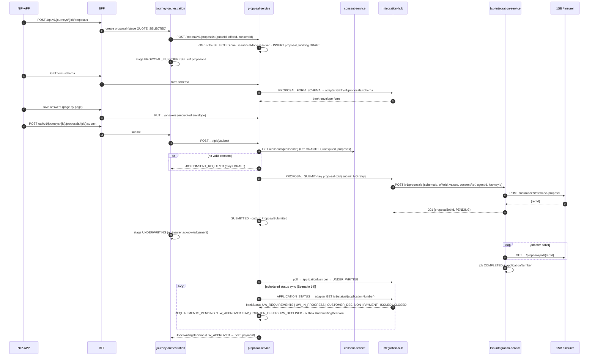

# Scenario 11 — Proposal: form, submit, underwriting tracking

[← API reference home](../README.md) · Prev: [10](./10-multi-quote-and-selection.md) · Next: [12](./12-payment-and-reconciliation.md)

**Status:** adapter half **IMPLEMENTED** (schema, submit, poll, status). Proposal service, Journey
and Hub **CONTRACTED / PROPOSED**.

## 1. Sequence

## 2. Rules

| Rule | Where | Error |
|---|---|---|
| Proposal only on the selected offer of a selected quote | Proposal (`INV-PRP-02`) | `422 INVALID_OFFER_REFERENCE` |
| `issuanceMode` ∈ `STP`/`NON_STP`/`INSTA`; no mode bypasses gates | Proposal (`INV-PRP-06`) | `422 ISSUANCE_MODE_INVALID` |
| Consent re-checked **at submit** | Proposal (`INV-PRP-01`, C2) | `403 CONSENT_REQUIRED` |
| Quote expired while drafting | Proposal stays `DRAFT`; journey back to `QUOTING` (F-03) | `409 QUOTE_EXPIRED` |
| **Never resubmit blind** | Hub / adapter | Poll; exhaustion → `SUBMISSION_FAILED` + ops task (F-04) |
| Agent attribution mandatory on submit | Hub / adapter | `422 AGENT_ATTRIBUTION_MISSING` |
| PII form values only in encrypted stores | Proposal envelope, adapter raw payload (`INV-PRP-05`) | — |
| UW is the insurer's decision | Proposal only tracks | — |
| Withdraw not allowed at/after `AWAITING_PAYMENT` | `INV-PRP-04` | `409 WITHDRAWAL_NOT_PERMITTED` |

## 3. Where data goes

`proposal.proposal_working` (form answers, nominee, requirements — encrypted; control columns
`application_number`, `state`, `underwriting_state`, `schema_id`); adapter job + raw payloads in
`bank_persistence`; journey refs `proposalId`, `applicationNumber`; outbox `ProposalSubmitted`,
`UnderwritingDecision`. Structured `proposal`, `uw_requirement`, `uw_document_ref` appear only after
payment reconciles.

## 4. Pages

[Proposal](../services/proposal-service.md) · [1SB adapter §3.4–§3.6](../services/1sb-integration-service.md#34-get-v1proposalsschema) · [Provider sync](./14-provider-status-sync.md)
