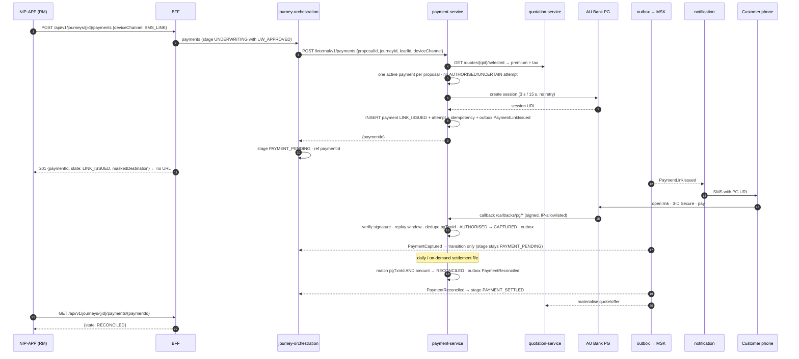

# Scenario 12 — Payment link to the customer's device, callback, reconciliation

[← API reference home](../README.md) · Prev: [11](./11-proposal-and-underwriting.md) · Next: [13](./13-policy-issuance-and-sold.md)

**Status: CONTRACTED / PROPOSED** (payment-service is a skeleton). Control **C4**: the premium is
paid only on the **customer's own device** through the **AU Bank Payment Gateway**.

## 1. Sequence

## 2. Sample amounts (illustrative)

Payment never accepts an amount from the caller. After `GET /quotes/{qid}/selected` (or
payment-hold), the hold returns e.g.:

| Field | Example (INR) | Source |
|---|---|---|
| `premiumAmount` | `"25000.00"` | Selected offer |
| `taxAmount` | `"4500.00"` | Selected offer |
| **Amount payable / PG session** | `"29500.00"` | `premiumAmount + taxAmount` to the paise |
| `sumAssured` | `"25600000.00"` | Selected offer (control attribute) |

Figures follow `SUIT-TC-REF-01` ([MISSING-PRICES.md](../../contracts/MISSING-PRICES.md)). A PG
callback whose amount ≠ `"29500.00"` is `422 PREMIUM_MISMATCH`.

## 3. The four money rules developers break

| Rule | Why |
|---|---|
| No endpoint ever returns the payment URL to the RM | Otherwise an RM could pay with a customer's card on a bank device (mis-selling hole C4) |
| Amount comes from Quotation, never from the request | `INV-PAY-03` — to the paise; mismatch → `422 PREMIUM_MISMATCH` + financial alert |
| A lost callback means `UNCERTAIN`, not paid or unpaid | `F-08`; new attempts blocked (`409 PAYMENT_STATE_UNCERTAIN`) until reconciliation |
| Issuance waits for `RECONCILED`, not `CAPTURED` | `INV-POL-01`; a reconciliation break never auto-resolves (`F-07`) |

## 4. Errors

`409 PROPOSAL_NOT_PAYABLE` · `409 PAYMENT_ALREADY_IN_PROGRESS` · `409 PAYMENT_STATE_UNCERTAIN` ·
`422 PREMIUM_MISMATCH` · `403 PAYMENT_DEVICE_ISOLATION` · PG reject → payment `REJECTED`, proposal
stays `AWAITING_PAYMENT` · callback bad signature → `401` + security event.

## 5. Data

`payment.payment` (structured from the first write; `link_issued_to_enc` holds the customer contact,
encrypted), `payment_attempt` (append-only), `outbox_event`, `idempotency_record`; journey stage +
`paymentId`. **No cardholder data anywhere on the platform.** Retention `RET-7Y-IMMUTABLE`.

## 6. Pages

[Payment service](../services/payment-service.md) · [Payment and the PG](../interactions/payment-to-payment-gateway.md) · [Failure and compensation](./15-failure-and-compensation.md)
