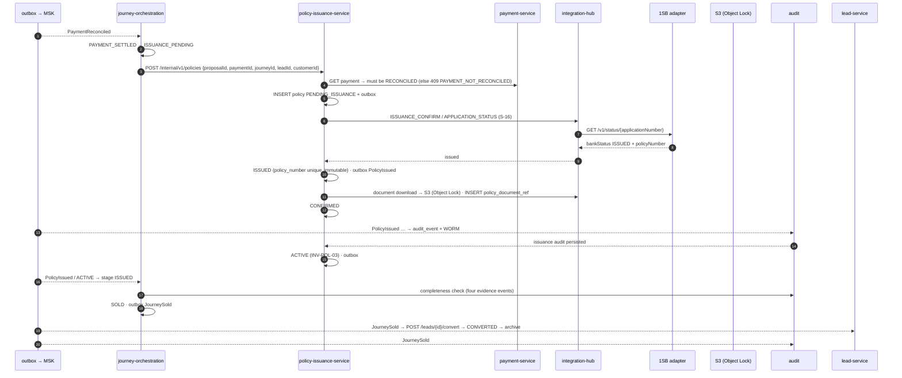

# Scenario 13 — Policy issuance and the four-part `SOLD`

[← API reference home](../README.md) · Prev: [12](./12-payment-and-reconciliation.md) · Next: [14](./14-provider-status-sync.md)

**Status: CONTRACTED / PROPOSED.** Triggered by events, not by an RM click.

**`SOLD` requires all four** (`INV-JRN-05`): policy `ACTIVE` · payment `RECONCILED` · issuance
confirmed by the insurer · all required audit events persisted. A sale is never inferred from a
quote, a proposal or a payment alone.

## 1. Sequence

## 2. Failure exits

| Failure | Path |
|---|---|
| Insurer rejects issuance | `ISSUANCE_REJECTED`, `PolicyIssuanceFailed` → journey `COMPENSATING` → bounded retry → `REFUND_REQUIRED` + maker-checked refund (F-05) |
| Insurer silent | `CONFIRMATION_OVERDUE` → re-check → `ISSUANCE_DISPUTED` (F-06) |
| Audit write lagging | Journey stays `ISSUED` until the evidence lands (F-10) — never `SOLD` on a topic ack |

## 3. Pages

[Policy issuance](../services/policy-issuance-service.md) · [Journey](../services/journey-orchestration-service.md) · [Audit](../services/audit-compliance-service.md) · [Outbox and events](../interactions/outbox-and-events.md)
