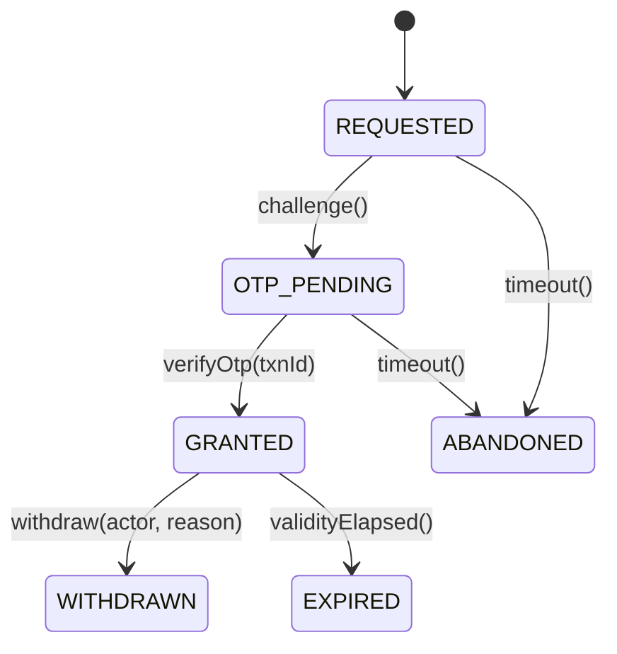

# consent-service — Consent (#6)

[← API reference home](../README.md)

| | |
|---|---|
| **Role** | Holds the **C2 hard gate**: *no proposal is submitted without an unexpired consent grant verified by an OTP on the customer's own device* (`INV-PRP-01`). Consent is a **grant with write-once evidence**: statement text and version, purpose set, CIF, OTP transaction id, timestamp, source IP. Withdrawal adds state; it never edits evidence |
| **Module** | `services/consent-service` · port 8092 · `service-id: consent` · layer L5 · INTERNAL |
| **Base path** | `/internal/v1/consents` (HLD §5.3) |
| **Callers** | Journey (S-06, 2 s, fail closed) via BFF `consent/challenge` and `consent/verify` · Proposal (gate read at submit) |
| **Calls out** | administration-config (statement text + version per purpose, S-21) · notification-service (OTP to the **customer's** registered contact) or an OTP gateway |
| **Owns data** | Aurora schema **`consent`** · role `app_consent` · INSERT-only evidence |
| **Code status** | **SKELETON**. Endpoints CONTRACTED (HLD §5.3: `POST /consents`, `POST …/{id}/verify`, `GET …/{id}`); bodies **PROPOSED** from the domain model and DDL |
| **Contract** | [`contracts/consent-service/openapi.yaml`](../../contracts/consent-service/openapi.yaml) + [LLD](../../contracts/consent-service/LLD.md) — authoritative (ADR-027), supersedes §1–§4 below. **D5 (2026-10-21):** consent is checked/captured **after suitability, before multi-quote** via `GET /internal/v1/consents:check?customerId&checkpoint`; purposes and validity (90 days default) come from rule set `CONSENT.POLICY`; one row per purpose, append-only (withdrawal = new row); bound to `customerId` (ULID), no CIF. Compliance (Shailja) must confirm the DPDP position and CNS-R13 (RM-relayed OTP) |

---

## 1. API index

| Method | Path | Status | Caller | Purpose |
|---|---|---|---|---|
| `POST` | `/internal/v1/consents` | CONTRACTED · body PROPOSED | Journey | Create grant in `REQUESTED`, send OTP → `OTP_PENDING` |
| `POST` | `/internal/v1/consents/{consentId}/verify` | CONTRACTED · body PROPOSED | Journey | Bind verified `otpTxnId` → `GRANTED` |
| `GET` | `/internal/v1/consents/{consentId}` | CONTRACTED | Journey, Proposal | State, purposes, validity (no contact data) |
| `POST` | `/internal/v1/consents/{consentId}/withdraw` | PROPOSED | BFF / ops | `GRANTED` → `WITHDRAWN` with actor + reason |

---

## 2. State model



`GRANTED` is the **only** state that satisfies a downstream precondition. Re-consent creates a
**new** consent with a new statement version — never `GRANTED → GRANTED`.

---

## 3. Endpoints (PROPOSED shapes)

### 3.1 `POST /internal/v1/consents` — challenge

Headers `X-Actor-Id`, `Idempotency-Key` (`journey:{journeyId}:consent:{purposeSetHash}`).

```json
{ "leadId": "01JQ…", "journeyId": "01JQ…", "customerId": "CUST-0433", "lob": "LIFE",
  "purposes": ["DATA_PROCESSING", "INSURER_SHARING", "PROPOSAL_SUBMISSION"], "channel": "SMS" }
```

Behind the scenes:

1. Resolve statement text + version for the purposes and `lob` (fail closed).
2. Resolve the **customer's registered contact from Customer #4** (never from the request body —
   the RM cannot redirect the OTP to their own phone).
3. `INSERT consent` (`REQUESTED`) with `statement_text`, `statement_version`, `purpose[]`,
   `cif_enc`, `contact_used_enc`, `valid_until` (config).
4. Request the OTP to the customer device (Notification, S-18 is OTP-only in R0) → `OTP_PENDING`.

Response `201 { "consentId": "01JS…", "state": "OTP_PENDING", "otpExpiresAt": "…", "maskedContact": "+91 98*****210" }`.
The OTP value is never returned.

### 3.2 `POST /internal/v1/consents/{consentId}/verify`

The customer reads the OTP from their phone to the RM, or confirms on their device; the RM session
posts the verification (HLD §5.2).

```json
{ "otp": "******", "otpTxnId": "OTP-7781" }
```

Behind the scenes: state must be `OTP_PENDING` (else `409 ILLEGAL_TRANSITION`, `INV-CNS-02`);
verify with the OTP provider; on success write `otp_txn_id`, `captured_at`, `source_ip`, state
`GRANTED` — **write-once** columns (`INV-CNS-01`, enforced by the store); outbox
`ConsentGranted {consentId, customerId, statementVersion, otpTxnId}` → Journey, Audit.
Wrong OTP → `422 VALIDATION_ERROR` (attempt counted; lockout per configuration).
Response `200 { "consentId", "state": "GRANTED", "validUntil" }`.

### 3.3 `GET /internal/v1/consents/{consentId}`

`200 { consentId, customerId, lob, purposes[], statementVersion, state, validUntil, capturedAt }`.
Proposal's C2 check: `state = GRANTED`, same customer, purposes cover the proposal set, `now <
validUntil` — else `403 CONSENT_REQUIRED` and the proposal stays `DRAFT`.

---

## 4. Data — schema `consent`

| Column | Rule |
|---|---|
| `consent_id`, `lead_id`, `journey_id`, `customer_id`, `lob` | ids |
| `cif_enc`, `contact_used_enc`, `encryption_key_id` | ⚑ encrypted |
| `purpose[]`, `statement_text`, `statement_version` | evidence, immutable |
| `channel`, `otp_txn_id`, `captured_at`, `source_ip` | evidence, immutable |
| `state`, `withdrawn_at`, `withdrawn_by`, `withdrawal_reason`, `valid_until` | lifecycle |
| `config_version_ref` | `INV-CFG-03` |

Retention `RET-7Y-IMMUTABLE` — consent is **not** purged even if the sale never happens
(`F-02`). DDL [`05-consent.sql`](../../data-architecture/schemas/05-consent.sql).

## 5. Sources

- [R0 HLD §5.2–§5.3](../../../architecture/R0-HLD.md#52-customer-device--not-a-platform-api) · [Domain model §4.2, §6](../../ws3-platform/01-domain-model-and-invariants.md) · [Information model](../../ws3-platform/02-information-model.md) · `services/consent-service/README.md`
