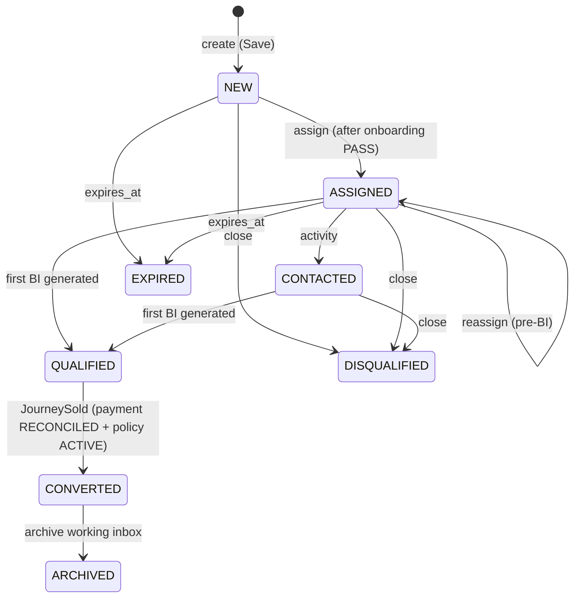

# lead-service — Lead (#5)

[← API reference home](../README.md)

| | |
|---|---|
| **Role** | The **single on-platform way in** to a sale. A Lead records *why* we are contacting this customer, for which `lob` / product class, who created it, and who the **accountable Specified Person** is. Owns the pre-BI working states, exception-hold state and assignment history. It is **not** a customer directory (no PAN / CIF here) and it never stores an insurer status |
| **Module** | `services/lead-service` · port 8091 · `service-id: lead` · layer L5 · INTERNAL |
| **Base path** | `/internal/v1/leads` — cluster-private |
| **Callers** | BFF (all RM actions) · target: Quotation (`bi-generated`), Journey (`convert` on `JourneySold`), AUBIMA exception engine (`exception-hold`) |
| **Calls out** | `SpCertificationPort` (fixture today; IRDAI / bank SP register is parked, `SUG-20261007-ird`) · target: PDP, exception / validation engine |
| **Owns data** | Target: Aurora schema **`lead_lms`** (`lead`, `lead_assignment`, `lead_meeting`, `lead_follow_up`, `idempotency_record`, `outbox_event`) · role `app_lead_lms`. **Implemented for `lead`:** `JdbcLeadRepository` on `lead_lms.lead` (Flyway `V2__lead_lms_lead.sql`, optimistic lock on `version`; a lost race is `409 CONFLICT`). `lead.store=memory` keeps the old in-memory repository for throw-away runs. Assignment history, meetings, follow-ups, idempotency and outbox tables are still target |
| **Code status** | **IMPLEMENTED-PARTIAL** — create, list, get, onboarding, assign, close. Exception rules are a deterministic stub; BI, convert, archive, activity status, evaluate and exception-hold are CONTRACTED |
| **Contracts** | [Lead API LLD](../../ws3-platform/12-lead-module-api-lld.md) · [internal OpenAPI](../../ws3-platform/lead-service-internal.openapi.yaml) · [sequences](../../ws3-platform/11-lead-module-sequences.md) · [flows and algorithms](../../ws3-platform/13-lead-module-flows-and-algorithms.md) |

Every endpoint requires header **`X-Actor-Id`** (set by the BFF from the session). The actor's
**book** — leads where they are creator, assigned RM or assigned SP — is the visibility boundary.
A lead outside the book is **absent** (`404`), never `403` (`INV-LED-07`).

---

## 1. API index

| Method | Path | Status | Caller | Purpose |
|---|---|---|---|---|
| `POST` | `/internal/v1/leads` | IMPLEMENTED | BFF | Save a new lead (no exception evaluation) |
| `GET` | `/internal/v1/leads?owner=me&customerId&productClass&unfinished` | IMPLEMENTED | BFF | Actor's book, filtered |
| `GET` | `/internal/v1/leads/{leadId}` | IMPLEMENTED | BFF | Read one lead (book-scoped) |
| `POST` | `/internal/v1/leads/{leadId}/onboarding` | IMPLEMENTED (OpenAPI path: `/{leadId}:start-onboarding`) | BFF | Start Onboarding → exception outcome |
| `POST` | `/internal/v1/leads/{leadId}/assignments` | IMPLEMENTED | BFF | Assign certified SP RM; sets `accountableSpId` once |
| `POST` | `/internal/v1/leads/{leadId}/close` | IMPLEMENTED | BFF | Close pre-BI lead → `DISQUALIFIED` |
| `POST` | `/internal/v1/leads:evaluate` | CONTRACTED | BFF (diagnostic) | Run exception rules without changing hold state |
| `POST` | `/internal/v1/leads/{leadId}/activity-status` | CONTRACTED | BFF | Set RM disposition pre-BI |
| `POST` | `/internal/v1/leads/{leadId}/bi-generated` | CONTRACTED | Quotation | First BI → `QUALIFIED`, `ELIGIBLE` |
| `POST` | `/internal/v1/leads/{leadId}/convert` | CONTRACTED | Journey on `JourneySold` | `QUALIFIED` → `CONVERTED` (once) |
| `POST` | `/internal/v1/leads/{leadId}/archive` | CONTRACTED | Journey / job | Leave the working inbox; ids stay resolvable |
| `POST` | `/internal/v1/leads/{leadId}/exception-hold` | CONTRACTED | AUBIMA exception engine | Release or reject a held lead |
| `GET` | `/internal/v1/lead/info` | IMPLEMENTED | Ops | Service info |

---

## 2. State model



Side attributes: `exceptionOutcome` (`NOT_EVALUATED` → `PASS` | `BLOCK` | `APPROVAL_REQUIRED`),
`exceptionHold` (true on `APPROVAL_REQUIRED`), `biGenerated`, `reportingClass` (`DIARY` →
`ELIGIBLE` on first BI), `dashboardStage` (projection for the RM pipeline: `NEW`,
`QUOTE_GENERATED`, `POLICY_ISSUED`, `CLOSED` — post-quote labels come from Journey, not Lead).

---

## 3. Endpoints

### 3.1 `POST /internal/v1/leads` — Save

| Field | Type | Validation |
|---|---|---|
| `customerId` | string | `@NotBlank`; service re-checks → `422 MISSING_REQUIRED_FIELD` |
| `lob` | string | `@NotBlank`; must equal `LIFE` → else `422 UNSUPPORTED_LOB` |
| `productClass` | string | `@NotBlank`; must be `TERM` \| `SAVINGS` \| `ULIP` → else `422 UNSUPPORTED_LOB` |
| `branchId` | string | optional |
| header `X-Actor-Id` | string | required; becomes `createdByPrincipalId` |

Contracted extras (OpenAPI): `Idempotency-Key` header; `resumeExisting`; insurer / plan **not**
accepted on create (`BR-LEAD-005`); `distributorId` → `ATTRIBUTION_NOT_CALLER_SUPPLIED`.

Response `201`:

```json
{
  "leadId": "01JQX4K7R8M2N3P4Q5S6T7V8W9",
  "customerId": "CUST-0433",
  "lob": "LIFE",
  "productClass": "TERM",
  "branchId": "BR-MUM-001",
  "state": "NEW",
  "dashboardStage": "NEW",
  "assignedRmId": null,
  "assignedSpId": null,
  "accountableSpId": null,
  "exceptionHold": false,
  "exceptionOutcome": "NOT_EVALUATED",
  "exceptionRequired": false,
  "biGenerated": false,
  "reportingClass": "DIARY",
  "journeyId": "01JQX4K7R8M2N3P4Q5S6T7V8W9",
  "createdAt": "2026-10-21T09:12:00Z",
  "updatedAt": "2026-10-21T09:12:00Z"
}
```

`journeyId` equals `leadId` today — an inert placeholder until Journey #9 mints real ids.

**Behind the scenes**

1. Require `customerId` and actor.
2. `lob == LIFE`, parse product class.
3. **Dedupe (ALG-DEDUPE, `BR-DEDUPE`)**: find an *unfinished* lead (not BI-generated and not
   `DISQUALIFIED` / `CONVERTED` / `ARCHIVED` / `EXPIRED`) with the same **creator + customer +
   product class**. Found → `409 CONFLICT` ("unfinished lead exists…"). The app offers
   **Continue existing** or **Cancel** only — never replace or soft-delete (Lead BRD Table 18).
4. Mint a ULID; state `NEW`; outcome `NOT_EVALUATED`; save.
5. Target (same `lead_lms` transaction): `INSERT lead` + `idempotency_record` + `outbox_event
   OpportunityCreated {leadId, customerId, rmId, lob, accountableSpId}`.

**Save never evaluates exception rules** (Exception Handling BRD, `D-019`).

### 3.2 `GET /internal/v1/leads`

| Query | Default | Rule |
|---|---|---|
| `owner` | `me` | Anything else → `422 INVALID_REQUEST` |
| `customerId` | — | Exact filter |
| `productClass` | — | Exact filter |
| `unfinished` | `false` | `true` → only unfinished leads |

Response `{ "items": [Lead…], "nextCursor": null }`. Archived leads are excluded from the inbox
(`INV-LED-08`) — target behaviour; there is no archive job yet.

### 3.3 `GET /internal/v1/leads/{leadId}`

`200 Lead` or `404 RESOURCE_NOT_FOUND` ("lead is absent from this book") when unknown **or** not
visible to the actor.

### 3.4 `POST /internal/v1/leads/{leadId}/onboarding` — Start Onboarding

No body. Runs the exception / validation rules for the saved lead and records the outcome.

| Outcome | Effect | Response |
|---|---|---|
| `PASS` | `exceptionOutcome = PASS` | `200 Lead` — proceed to assignment |
| `APPROVAL_REQUIRED` | `exceptionHold = true` | `200 Lead` with `exceptionRequired = true` — raise an exception for approval in AUBIMA |
| `BLOCK` | Outcome saved, then refused | `409 ILLEGAL_TRANSITION` ("exception rules blocked onboarding"); lead exists, progression locked |

> **Stub today:** `LeadApplicationService.evaluate` returns `BLOCK` if the customer id contains
> `BLOCK`, `APPROVAL_REQUIRED` if it contains `HOLD`, else `PASS`. Real rules (CASA 30 days,
> policy-count thresholds) live in the AUBIMA Exception Handling configuration / DWH
> (`EH-INT-001`, `EH-INT-004`); Lead only consumes outcomes.

### 3.5 `POST /internal/v1/leads/{leadId}/assignments`

| Field | Validation |
|---|---|
| `assignedRmId` | `@NotBlank` — the certified SP-holding AU Bank RM |
| `assignedSpId` | optional |

Guards, in order:

| # | Check | Failure |
|---|---|---|
| 1 | Lead visible to actor | `404 RESOURCE_NOT_FOUND` |
| 2 | Not BI-generated (no reassignment after BI, `VAL-016`) | `409 ILLEGAL_TRANSITION` (LLD name `REASSIGN_AFTER_BI`) |
| 3 | Onboarding evaluated | `409 ILLEGAL_TRANSITION` ("start onboarding before assignment") |
| 4 | Not `BLOCK`, not on hold | `409 CONFLICT` (LLD name `EXCEPTION_HOLD_ACTIVE`) |
| 5 | `assignedRmId` present | `422 MISSING_REQUIRED_FIELD` |
| 6 | Assignee holds valid SP certification for the LOB (`INV-LED-03`, `INV-LED-10`) | `403 SP_CERTIFICATION_REQUIRED` |

Effect: `assignedRmId`, `assignedSpId` set; **`accountableSpId` written once** on the first
successful assignment and never changed by reassignment (`INV-ACT-03`); state → `ASSIGNED`.
Target: append `lead_assignment` history, optional `lead_meeting` (Online / In-person, date, time,
link), outbox `LeadAssigned` → Notification (thin in R0).

> **Fixture today:** only `SP-1001`, `SP-1002`, `SP-2001` are treated as certified
> (`FixtureSpCertification`, fail-closed). This is not IRDAI control evidence.

### 3.6 `POST /internal/v1/leads/{leadId}/close`

No body today (contract: `reasonCode`, `remarks` ≤ 250). Refused when the lead is `QUALIFIED` or
BI-generated (`409 ILLEGAL_TRANSITION` — eligible leads are not closed from the diary path).
Else → `DISQUALIFIED` (terminal, no reopen, `BR-CLOSE-001`).

### 3.7 Contracted endpoints

| Path | Body | Rule |
|---|---|---|
| `POST /leads:evaluate` | `{customerId, productClass, context}` | Same rules as onboarding, no state change |
| `POST /leads/{id}/activity-status` | `{status}` | Configurable disposition pre-BI; `CUSTOMER_NOT_INTERESTED` triggers close |
| `POST /leads/{id}/bi-generated` | `{biReference, occurredAt}` | Idempotent. First BI: `biGenerated = true`, `reportingClass = ELIGIBLE`, state → `QUALIFIED`. Later BIs link to the same lead (`BR-BI-003/005`) |
| `POST /leads/{id}/convert` | `{journeyId, policyId, paymentId}` | At most one converting journey (`INV-LED-02`, unique `converted_journey_id`); a second identical event is ignored, a different `journeyId` raises an integrity alert |
| `POST /leads/{id}/archive` | — | Leaves the inbox; attribution columns stay `RET-7Y` (`C-RET-1`) |
| `POST /leads/{id}/exception-hold` | `{action: RELEASE \| REJECT, ruleIds}` | From AUBIMA after approver decision |

---

## 4. Data — schema `lead_lms` (target)

| Table | Purpose / key columns |
|---|---|
| `lead` | `lead_id` CHAR(26) PK, `customer_id`, `state` (CHECK), `lob` (CHECK `LIFE`·`HEALTH`·`GENERAL`, immutable), `product_class` (CHECK `TERM`·`SAVINGS`·`ULIP`), `source` (`RM`·`IPR`), `created_by_actor_type`, `created_by_principal_id`, `assigned_sp_id`, `accountable_sp_id` + `accountable_sp_cert_ref` (required together), `exception_state`, `bi_generated`, `reporting_class`, `journey_id`, `converted_journey_id` (partial unique), `closed_reason`, `closed_remarks_enc`, `config_versions`, `expires_at`, `archived_at`, `retain_until`, `version` |
| `lead_assignment` | Append-only assignment history |
| `lead_meeting` | Optional meeting intent from the assignment screen |
| `lead_follow_up` | RM follow-ups |
| `idempotency_record`, `outbox_event` | Platform pattern |

Constraints worth knowing: `QUALIFIED` / `ELIGIBLE` require `bi_generated = true`; any progressing
state requires `accountable_sp_id`; `ARCHIVED` ⇔ `archived_at` set. DDL:
[`04-lead_lms.sql`](../../data-architecture/schemas/04-lead_lms.sql); ER:
[03 Lead and Suitability e2e](../../data-architecture/03-lead-suitability-e2e.md).

## 5. Events

| Event | When | Consumers |
|---|---|---|
| `OpportunityCreated` | Save | Journey, Audit, Reporting |
| `LeadQualified` | First BI | Journey, Audit, Reporting |
| (assignment) | Assign | Audit; Notification (thin) |
| consumes `JourneySold` | Sale complete | → convert + archive |

## 6. Sources

- `services/lead-service/src/main/java/com/bank/platform/lead/**`
- [Lead HLD](../../ws3-platform/10-lead-module-hld.md) · [Lead sequences](../../ws3-platform/11-lead-module-sequences.md) · [Lead API LLD](../../ws3-platform/12-lead-module-api-lld.md) · [Domain model §4.1 and §6.2](../../ws3-platform/01-domain-model-and-invariants.md)
