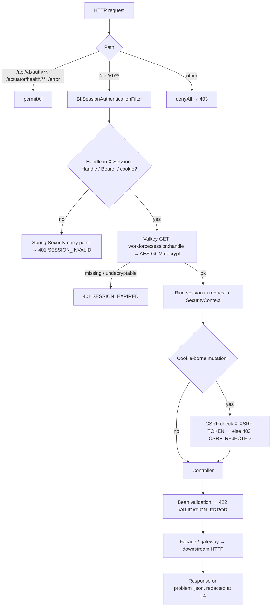

# workforce-access-bff — NIP BFF (#2)

[← API reference home](../README.md)

| | |
|---|---|
| **Role** | The **only** API NIP-APP calls. Token-hiding Backend-for-Frontend: holds provider tokens in an encrypted server-side vault and gives the app an opaque session handle. Aggregates domain calls into screen-shaped responses. The **redaction boundary** for errors |
| **Module** | `services/workforce-access-bff` · port 8084 · `service-id: bff` · layer L4 · boundary **PUBLIC** |
| **Public base path** | `/api/v1` behind Cloudflare → F5-XC → NLB → Istio Ingress (`/api/*`) |
| **Owns data** | Valkey session vault only (`workforce:pending:*`, `workforce:session:*`, `workforce:completion:*`). **No Aurora, no Dynamo** |
| **Calls** | [identity-provider-adapter](./identity-provider-adapter-service.md) · [identity-authorization](./identity-authorization-service.md) · [lead](./lead-service.md) · [customer](./customer-service.md) · target: [journey-orchestration](./journey-orchestration-service.md), [product-catalogue](./product-catalogue-service.md), [administration-config](./administration-config-service.md) |
| **Caller keys it presents** | `X-Internal-Service-Key` — `IDENTITY_ADAPTER_INTERNAL_SHARED_SECRET` to the IdP adapter; `IDENTITY_AUTHZ_BFF_INTERNAL_KEY` to identity-authorization (resolve and PDP decisions). The BFF is the **only** caller identity-authorization lets set `X-Actor-Id` (partner-user creator, and checker when configured), taken from the vault-resolved session |
| **Downstream budgets** | lead 500 ms / 2 s · customer 500 ms / 4 s · identity resolve 500 ms / 2 s · IdP adapter 1 s / **4.5 s** (was 6 s, beyond the 5 s edge; env `WORKFORCE_IDP_CONNECT_TIMEOUT` / `WORKFORCE_IDP_READ_TIMEOUT`; above the adapter's 3 s read, E8) · PDP 300 ms — see [timeouts](../conventions/idempotency-timeouts-retries.md#21-budgets-configured-in-code-today) |
| **Startup guard** | `ProductionSafetyGuard` refuses to start under `prod` / `uat` when `workforce.session.store=memory`, the session key is the all-zero development key, or `lead-mode` / `customer-mode` is `stub`; the message names each offending setting. `application-prod.yml` sets `redis` / `http` and takes the key from `WORKFORCE_SESSION_ENCRYPTION_KEY` with no default |
| **Never calls** | 1SB, the Integration Hub, any provider adapter, any database, Apigee |
| **Code status** | Auth, customer lookup, lead module and reference data **IMPLEMENTED**. Journey, quote, proposal, payment, policy routes **CONTRACTED** (HLD §5.1) |
| **Contract** | **Authoritative (ADR-027):** [`contracts/workforce-access-bff/openapi.yaml`](../../contracts/workforce-access-bff/openapi.yaml) · [LLD](../../contracts/workforce-access-bff/LLD.md). Where this page and the contract differ, the contract wins. Supersedes `ws3-platform/nip-bff-lead-phase.openapi.yaml`. Fix-pending: CSRF refusal as `403 CSRF_REJECTED` problem+json |

---

## 1. API index

### 1.1 Authentication and session (`/api/v1/auth/**`, no session required)

| Method | Path | Status | Purpose | Detail |
|---|---|---|---|---|
| `GET` | `/api/v1/auth/csrf` | IMPLEMENTED | Get the CSRF token (web) | [§2.1](#21-get-apiv1authcsrf) |
| `POST` | `/api/v1/auth/login` | IMPLEMENTED | Bank RM credential login (AD-verify) **or** start partner OIDC login | [§2.2](#22-post-apiv1authlogin) |
| `GET` | `/api/v1/auth/callback` | IMPLEMENTED | OIDC redirect target after Keycloak login | [§2.3](#23-get-apiv1authcallback) |
| `POST` | `/api/v1/auth/native-session` | IMPLEMENTED | Native app swaps one-time completion code for a session handle | [§2.4](#24-post-apiv1authnative-session) |
| `GET` | `/api/v1/auth/session` | IMPLEMENTED | Who am I (from the vault) | [§2.5](#25-get-apiv1authsession) |
| `POST` | `/api/v1/auth/logout` | IMPLEMENTED | Delete session; revoke provider refresh token | [§2.6](#26-post-apiv1authlogout) |

### 1.2 Workspace, customer and lead (`/api/v1/**`, session required)

| Method | Path | Status | Purpose | Detail |
|---|---|---|---|---|
| `GET` | `/api/v1/workspace/pipeline` | IMPLEMENTED | RM working inbox (own leads) | [§3.1](#31-get-apiv1workspacepipeline) |
| `GET` | `/api/v1/customers:search` | IMPLEMENTED-PARTIAL | ETB customer search by `CUSTOMER_ID` / `MOBILE` / `PAN` | [§3.2](#32-get-apiv1customerssearch) |
| `GET` | `/api/v1/customers/{customerId}` | IMPLEMENTED | Customer confirm card | [§3.3](#33-get-apiv1customerscustomerid) |
| `GET` | `/api/v1/customers/{customerId}/active-leads` | IMPLEMENTED | Duplicate check before create | [§3.4](#34-get-apiv1customerscustomeridactive-leads) |
| `POST` | `/api/v1/leads` | IMPLEMENTED-PARTIAL | Create (Save) a Life lead | [§3.5](#35-post-apiv1leads) |
| `GET` | `/api/v1/leads/{leadId}` | IMPLEMENTED | Read / resume a lead | [§3.6](#36-get-apiv1leadsleadid) |
| `POST` | `/api/v1/leads/{leadId}/assignment` | IMPLEMENTED | Start Onboarding (if needed) then assign to a certified SP RM | [§3.7](#37-post-apiv1leadsleadidassignment) |

### 1.3 Reference data and organisation (session required)

| Method | Path | Status | Purpose | Detail |
|---|---|---|---|---|
| `GET` | `/api/v1/country-codes` | IMPLEMENTED | Calling-code catalogue (R0: India) | [§4.1](#41-get-apiv1country-codes) |
| `POST` | `/api/v1/mobile-numbers:validate` | IMPLEMENTED | Validate a national mobile number | [§4.2](#42-post-apiv1mobile-numbersvalidate) |
| `GET` | `/api/v1/catalogue/product-classes` | IMPLEMENTED (static) | Selectable R0 product classes | [§4.3](#43-get-apiv1catalogueproduct-classes) |
| `GET` | `/api/v1/branches` | IMPLEMENTED (fixture) | Branch list | [§4.4](#44-organisation-directory) |
| `GET` | `/api/v1/branches/{branchId}/verticals` | IMPLEMENTED (fixture) | Verticals in a branch | [§4.4](#44-organisation-directory) |
| `GET` | `/api/v1/branches/{branchId}/specified-persons` | IMPLEMENTED (fixture) | SPs in a branch | [§4.4](#44-organisation-directory) |
| `GET` | `/api/v1/verticals/{verticalId}/relationship-managers` | IMPLEMENTED (fixture) | RMs in a vertical | [§4.4](#44-organisation-directory) |

### 1.4 Sale journey (CONTRACTED — HLD §5.1)

| Method | Path | Gate | Downstream | Scenario |
|---|---|---|---|---|
| `POST` | `/api/v1/leads/{leadId}:start-onboarding` | Exception rules | Lead | [06](../scenarios/06-lead-onboarding-and-assignment.md) |
| `POST` | `/api/v1/leads/{leadId}/close` | — | Lead | [06](../scenarios/06-lead-onboarding-and-assignment.md) |
| `GET` | `/api/v1/journeys/{journeyId}` | IPR gated | Journey | [07](../scenarios/07-journey-start-and-suitability.md) |
| `POST` | `/api/v1/journeys/{journeyId}/need-analysis` | SP re-check | Journey → Suitability | [07](../scenarios/07-journey-start-and-suitability.md) |
| `POST` | `/api/v1/journeys/{journeyId}/suitability` | **C1** | Journey → Suitability | [07](../scenarios/07-journey-start-and-suitability.md) |
| `POST` | `/api/v1/journeys/{journeyId}/consent/challenge` | **C2** | Journey → Consent → Notification | [08](../scenarios/08-consent-otp.md) |
| `POST` | `/api/v1/journeys/{journeyId}/consent/verify` | **C2** | Journey → Consent | [08](../scenarios/08-consent-otp.md) |
| `POST` | `/api/v1/journeys/{journeyId}/quotes` | C1 via S-08 | Journey → Quotation → Hub | [10](../scenarios/10-multi-quote-and-selection.md) |
| `GET` | `/api/v1/journeys/{journeyId}/quotes/{quoteId}` | — | Quotation | [10](../scenarios/10-multi-quote-and-selection.md) |
| `POST` | `/api/v1/journeys/{journeyId}/quotes/{quoteId}/selection` | Validity window | Journey → Quotation | [10](../scenarios/10-multi-quote-and-selection.md) |
| `POST` | `/api/v1/journeys/{journeyId}/proposals` | Selected offer | Journey → Proposal | [11](../scenarios/11-proposal-and-underwriting.md) |
| `POST` | `/api/v1/journeys/{journeyId}/proposals/{proposalId}/submit` | **C2** | Proposal → Hub | [11](../scenarios/11-proposal-and-underwriting.md) |
| `GET` | `/api/v1/journeys/{journeyId}/proposals/{proposalId}` | IPR gated | Proposal | [11](../scenarios/11-proposal-and-underwriting.md) |
| `POST` | `/api/v1/journeys/{journeyId}/payments` | **C4** | Journey → Payment | [12](../scenarios/12-payment-and-reconciliation.md) |
| `GET` | `/api/v1/journeys/{journeyId}/payments/{paymentId}` | — | Payment | [12](../scenarios/12-payment-and-reconciliation.md) |
| `GET` | `/api/v1/journeys/{journeyId}/policies/{policyId}` | IPR gated | Policy | [13](../scenarios/13-policy-issuance-and-sold.md) |
| `GET` | `/api/v1/catalogue/offerings` | `(lob, insurerId)` | Catalogue | [09](../scenarios/09-pre-quote-reference-data.md) |
| `GET` | `/api/v1/config/forms/{formId}` | S-21 | Administration-config | [09](../scenarios/09-pre-quote-reference-data.md) |

**Deliberately absent from the BFF:** any path that takes a card, account or PG credential; any
path that returns a payment URL into an RM session (`FF-14`); any path that accepts
`distributorId`; customer self-service; admin configuration writes (R1).

---

## 2. Authentication endpoints

Common to all: no session required; errors in [problem+json](../conventions/error-model.md);
`IllegalArgumentException` on these paths becomes `400 SCHEMA_INVALID`, `IllegalStateException`
becomes `401 AUTHENTICATION_FAILED` (`BffExceptionHandler`). The developer reason never reaches the
device.

### 2.1 `GET /api/v1/auth/csrf`

**Status:** IMPLEMENTED · **Caller:** Flutter web before any cookie-borne POST.

Response `200`:

```json
{ "headerName": "X-XSRF-TOKEN", "token": "3f2c…" }
```

Behind the scenes: Spring Security's `CookieCsrfTokenRepository` mints the token and sets cookie
`WORKFORCE-XSRF`. No downstream call, no store write.

### 2.2 `POST /api/v1/auth/login` (Login BRD v3.1)

**Status:** IMPLEMENTED · **Caller:** NIP-APP login screen · **Work item:** `SUG-20261028-1lg`

Single password-login entry for `BANK_RM` and `INSURANCE_RM`. Requires a prior
`POST /auth/captcha`. Does **not** mint a session — that happens only on
`POST /auth/otp/verify` after login OTP. IAM-001 immediate-session bodies
(`identitySource` / `employeeId` without BRD fields) return `422 VALIDATION_ERROR`.
`/auth/sign-in` is removed. Partner OIDC begins at
[`POST /auth/partner/authorization`](#23-post-apiv1authpartnerauthorization).

Canonical field catalogue, outcomes and sequences:
[LOGIN-BRD-V31-API-FLOWS.md](../../../journey-execution/flows/LOGIN-BRD-V31-API-FLOWS.md).
Contract: [openapi.yaml](../../contracts/workforce-access-bff/openapi.yaml).

#### Errors (login step)

| HTTP | Code | When |
|---|---|---|
| 422 | `VALIDATION_ERROR` | Missing BRD fields or unknown `userType` / `clientType` |
| 403 | `CSRF_REJECTED` | Web call without `X-XSRF-TOKEN` |
| 503 | `IDENTITY_PROVIDER_UNAVAILABLE` | IdP adapter, AD-verify or PDP unreachable / unparseable |
| (propagated) | e.g. `UNAUTHORIZED` → surfaced per category | Adapter rejected the BFF's internal key (misconfiguration) |

### 2.3 `POST /api/v1/auth/partner/authorization`

**Status:** IMPLEMENTED · **Caller:** NIP-APP partner login · **UC-02**

Starts Keycloak OIDC + PKCE. Not the Login BRD password form.

```json
{ "clientType": "WEB", "returnUri": "http://localhost:3000/auth/complete", "loginHint": "rep@insurer.example" }
```

Response `{ "authorizationUri": "https://…", "expiresInSeconds": 300 }`. Full walk-through:
[Scenario 02](../scenarios/02-partner-login-keycloak.md).

### 2.4 `GET /api/v1/auth/callback`

**Status:** IMPLEMENTED · **Caller:** Keycloak redirect (browser), never the app directly.

| Query | Required | Rule |
|---|---|---|
| `code` | yes | OIDC authorization code |
| `state` | yes | Must match a live `workforce:pending:{state}` (taken with `GETDEL` — single use) |

Behind the scenes: take pending login → `POST /internal/v1/auth/token-exchange` (code + verifier +
expected nonce) → `POST /internal/v1/identities/resolve` (provider `KEYCLOAK`, user type
`INSURER_REPRESENTATIVE`) → require `ACTIVE` (else revoke the refresh token and fail) → store
session **including encrypted provider tokens** → `WEB`: `302` to `returnUri` with session cookie;
`NATIVE`: mint a completion code (TTL 1 min) and `302` to `returnUri?code=<completionCode>`.

| HTTP | Code | When |
|---|---|---|
| 302 | — | Success |
| 400 | `SCHEMA_INVALID` | State unknown / expired / already used |
| 401 | `AUTHENTICATION_FAILED` | Business identity resolved but not `ACTIVE` (refresh token is revoked first) |
| 403 | `FORBIDDEN` (propagated from authz) | Partner has no provisioned business user yet — not created by a bank admin, or provisioning still pending ("Partner identity must be created and provisioned before first login"). Was an unmapped 500 until `SUG-20261021-gap` |
| 503 | `IDENTITY_PROVIDER_UNAVAILABLE` | Adapter or PDP down |

### 2.5 `POST /api/v1/auth/native-session`

**Status:** IMPLEMENTED. Request `{ "completionCode": "…" }` (`@NotBlank`). The code is taken from
`workforce:completion:{code}` with `GETDEL` (single use, 1 min). Response
`{ "sessionHandle": "…", "expiresInSeconds": 28800 }`. Unknown/expired/reused →
`400 SCHEMA_INVALID`.

### 2.6 `GET /api/v1/auth/session`

**Status:** IMPLEMENTED. Session from `X-Session-Handle`, else cookie. Response:

```json
{
  "businessUserId": "7f0c2a6e-…",
  "username": "EMP001",
  "userType": "BANK_EMPLOYEE",
  "status": "ACTIVE",
  "policyVersion": 1,
  "insurerCode": null
}
```

No downstream call: one Valkey `GET` + AES-GCM decrypt. Missing handle → `400 SCHEMA_INVALID`;
unknown/expired → `400 SCHEMA_INVALID` ("Session is invalid or expired"). This endpoint sits under
`/auth/**`, so it uses the auth-path mapping, not `401 SESSION_EXPIRED`.

### 2.7 `POST /api/v1/auth/logout`

**Status:** IMPLEMENTED. Reads the session, **deletes it from the vault first**, then (partner only)
calls `POST /internal/v1/auth/revoke` with the refresh token. A revoke failure is logged with the
provider subject and does not fail the logout. Response `204 No Content` with an expired cookie.
Full flow: [Scenario 03](../scenarios/03-session-lifecycle-and-logout.md).

---

## 3. Workspace, customer and lead endpoints

All require a valid session (`401 SESSION_INVALID` / `401 SESSION_EXPIRED` otherwise). The actor is
**always** `session.businessUserId` (fallback `username`), forwarded as `X-Actor-Id`. No body field
can change it.

> **PDP gate (S-02, `SUG-20261021-gap`).** Before forwarding `POST /api/v1/leads` and
> `POST /api/v1/leads/{leadId}/assignment`, the BFF's `PolicyDecisionClient` calls
> `POST /internal/v1/authorization/decisions` (`lead.create` with the body's `branchId`;
> `lead.assign` with the lead id). It has its **own** HTTP client with a **300 ms** connect + read
> budget (`workforce.authorization.decision-timeout`), no retry, and **fails closed**: timeout or
> transport error → `403 AUTHORIZATION_UNAVAILABLE`; a deny → the mapped code
> (`OUT_OF_BRANCH_SCOPE`, `DEFAULT_DENY`, … — see the [PDP page](./identity-authorization-service.md#22-post-internalv1authorizationdecisions)).
> A session without a `businessUserId` is `DEFAULT_DENY` without a call. Reads (pipeline, get,
> active-leads) still rely on lead-service's book scoping. Lead-service re-checks create and assign
> with the PDP itself (`INV-ACT-01`). `POST /api/v1/leads` forwards the app's `Idempotency-Key`;
> the assignment body also accepts `note` (≤ 250) and `meeting {type, date, time, link}`, passed
> through to lead-service.

### 3.1 `GET /api/v1/workspace/pipeline`

Response `200`: `{ "items": [LeadRecord…], "nextCursor": null }`. Downstream:
`GET /internal/v1/leads?owner=me` with `X-Actor-Id`. Lead-service returns only leads where the actor
is creator, assigned RM or assigned SP. Cursor pagination is contracted, not implemented.

`LeadRecord` (BFF projection of the lead):

| Field | Type | Meaning |
|---|---|---|
| `leadId` | ULID | Platform id |
| `customerId` | string | Customer #4 id |
| `lob` / `productClass` | `LIFE` / `TERM`·`SAVINGS`·`ULIP` | |
| `branchId` | string \| null | |
| `state` | `NEW`…`ARCHIVED` | Lead aggregate state |
| `dashboardStage` | `NEW`, `QUOTE_GENERATED`, `POLICY_ISSUED`, `CLOSED`, … | RM-facing projection (Lead owns only pre-BI labels) |
| `assignedRmId` / `assignedSpId` | string \| null | |
| `exceptionHold` / `exceptionOutcome` / `exceptionRequired` | bool / `NOT_EVALUATED`·`PASS`·`BLOCK`·`APPROVAL_REQUIRED` / bool | Start Onboarding result |
| `journeyId` | ULID | **Placeholder today:** lead-service sets it to the `leadId` (inert reference) until Journey #9 mints a real id |
| `createdAt` / `updatedAt` | instant | |

### 3.2 `GET /api/v1/customers:search`

| Query | Required | Rule (contract 09) | Code today |
|---|---|---|---|
| `by` | yes | `CUSTOMER_ID` \| `PAN` \| `MOBILE` | Passed through; customer-service rejects others with `422 INVALID_REQUEST` |
| `q` | yes | 1–80 chars; per-`by` format; **never logged, never echoed** | Passed through; blank → `422 MISSING_REQUIRED_FIELD` |
| `countryCode` | no | For `MOBILE` | Passed through |
| `page`, `limit` | no | Max 4 pages × 20 | Not implemented |

Code response `200`: `{ "items": [CustomerHit…] }` where `CustomerHit` =
`customerId, displayName, initials, maskedCif, maskedMobile, eligibility, source`.
Contract response adds `query{by,resultCount,source}`, `existingLead`, `existingLeadCount`, `page`.

Behind the scenes (code): `GET {customer}/internal/v1/customers/search?by&q&countryCode` →
Apigee token → CBS inquiry. **Contract target:** PDP `customer.search` → local resolve → lead-first
(`existingLead`) → else CBS lookup → masked projection → audit. Full detail and the gap:
[Scenario 04](../scenarios/04-customer-search.md).

| HTTP | Code | When |
|---|---|---|
| 422 | `INVALID_REQUEST` / `MISSING_REQUIRED_FIELD` | Bad `by`, blank `q` (propagated from customer) |
| 503 | `UPSTREAM_UNAVAILABLE` | CBS / Apigee down (**do not proceed**, `AC-EXC-10`) |
| 502 | `UPSTREAM_BAD_RESPONSE` | CBS answered with an unexpected status |

### 3.3 `GET /api/v1/customers/{customerId}`

Downstream `GET /internal/v1/customers/{customerId}`. `200 CustomerHit`; `404 RESOURCE_NOT_FOUND`
if CBS has no such customer. Never returns full CIF, PAN, DOB or address.

### 3.4 `GET /api/v1/customers/{customerId}/active-leads`

| Query | Required |
|---|---|
| `productClass` | yes (`@RequestParam`) |

Behind the scenes: `GET /internal/v1/leads?owner=me` then **filtered in the BFF** to the
customer, the product class and non-terminal states (`CONVERTED`, `DISQUALIFIED`, `EXPIRED`,
`ARCHIVED` excluded); first 20 returned. Response
`{ "items": [LeadRecord…], "hasMore": false }`.

### 3.5 `POST /api/v1/leads`

| Field | Type | Required | Validation |
|---|---|---|---|
| `customerId` | string | yes | `@NotBlank` (BFF) |
| `lob` | string | yes | `@NotBlank` (BFF); lead-service requires `LIFE` |
| `productClass` | string | yes | `@NotBlank` (BFF); lead-service requires `TERM` \| `SAVINGS` \| `ULIP` |
| `branchId` | string | no | |

```json
{ "customerId": "CUS01JQX4K7R8M2N3", "lob": "LIFE", "productClass": "TERM", "branchId": "BR-MUM-001" }
```

Response `201 Created` → `LeadRecord` with `state = NEW`, `exceptionOutcome = NOT_EVALUATED`,
`reportingClass = DIARY`, and `journeyId` equal to the `leadId` (inert placeholder until Journey #9
exists).

Behind the scenes: `POST {lead}/internal/v1/leads` with `X-Actor-Id`. Lead-service rejects a second
**unfinished** lead for the same creator + customer + product class (`409 CONFLICT`), mints a ULID,
stores it. **Save does not run exception rules** (that is Start Onboarding). Full flow:
[Scenario 05](../scenarios/05-lead-creation-and-dedupe.md).

| HTTP | Code | When |
|---|---|---|
| 422 | `VALIDATION_ERROR` | Missing field (BFF) |
| 422 | `UNSUPPORTED_LOB` | `lob ≠ LIFE` or bad product class (lead) |
| 409 | `CONFLICT` | Unfinished duplicate exists — app shows Continue / Cancel |
| 503 | — | Lead-service unreachable (transport error surfaces as an upstream failure) |

### 3.6 `GET /api/v1/leads/{leadId}`

Downstream `GET /internal/v1/leads/{leadId}` with `X-Actor-Id`. `404 RESOURCE_NOT_FOUND` when the
lead is outside the actor's book — **absent, never 403** (`INV-LED-07`).

### 3.7 `POST /api/v1/leads/{leadId}/assignment`

| Field | Type | Required |
|---|---|---|
| `assignedRmId` | string | yes (`@NotBlank`) |
| `assignedSpId` | string | no |

Behind the scenes (`LeadFacade.assign`, implements `D-019` ordering):

1. `GET /internal/v1/leads/{leadId}`.
2. If `exceptionOutcome = NOT_EVALUATED` → `POST /internal/v1/leads/{leadId}/onboarding`
   (Start Onboarding runs exception rules). A `BLOCK` outcome comes back as `409 ILLEGAL_TRANSITION`.
3. If the lead is now on hold (`APPROVAL_REQUIRED`, `exceptionHold`, `exceptionRequired`), **return
   the lead unchanged with `200`** — the app shows "exception approval needed".
4. Else `POST /internal/v1/leads/{leadId}/assignments` → lead-service checks SP certification
   (`SP_CERTIFICATION_REQUIRED` 403), refuses after BI, sets `ASSIGNED`, writes `accountableSpId`
   once.

Full flow: [Scenario 06](../scenarios/06-lead-onboarding-and-assignment.md).

---

## 4. Reference data endpoints

### 4.1 `GET /api/v1/country-codes`

`200`: `[ { "countryCode": "IN", "countryName": "India", "phoneCode": "+91", "nationality": "Indian", "minLength": 10, "maxLength": 10, "regex": "^[6-9]\\d{9}$" } ]`.
In-process (`CountryCodeCatalog`); R0 ships India only.

### 4.2 `POST /api/v1/mobile-numbers:validate`

Request `{ "countryCode": "IN", "nationalNumber": "9876543210" }` (both `@NotBlank`).
Response `{ "valid": true, "reason": null }` or `valid: false` with `reason` ∈
`UNKNOWN_COUNTRY`, `MISSING_NUMBER`, `LENGTH`, `PATTERN`. Always `200` — a failed check is data,
not an error.

### 4.3 `GET /api/v1/catalogue/product-classes`

`200`: `{ "items": [ {"lob":"LIFE","productClass":"TERM","name":"Term Life"}, {"lob":"LIFE","productClass":"SAVINGS","name":"Savings / ULIP-adjacent savings"}, {"lob":"LIFE","productClass":"ULIP","name":"ULIP"} ] }`.
**Static in the controller today**; target is BFF → product-catalogue-service (`SUG-20261007-srp`).

### 4.4 Organisation directory

Fixture data in `OrganisationDirectory` (bank HR mapping is the system of record; not integrated).

| Path | Response item | 404 when |
|---|---|---|
| `GET /branches` | `{branchId, branchName, branchCode}` | — |
| `GET /branches/{branchId}/verticals` | `{verticalId, verticalName, branchId}` | Unknown branch → `RESOURCE_NOT_FOUND` |
| `GET /branches/{branchId}/specified-persons` | `{empId, empName, branchId, verticalId}` | Unknown branch |
| `GET /verticals/{verticalId}/relationship-managers` | `{empId, empName, verticalId, branchId}` | Unknown vertical |

---

## 5. Request pipeline inside the BFF



## 6. Configuration

See [ports, environments and run modes](../conventions/ports-environments-run-modes.md#3-downstream-base-urls-bff).
Lead and customer gateways default to `stub`; set `LEAD_DOWNSTREAM_MODE=http` and
`CUSTOMER_DOWNSTREAM_MODE=http` to call the real services.

## 7. Sources

- `services/workforce-access-bff/src/main/java/com/bank/workforce/bff/api/*.java` · `application/LoginService.java` · `application/LeadFacade.java` · `client/*.java` · `session/*.java`
- [HLD §5.1](../../../architecture/R0-HLD.md#51-public--bff--2-nip-bff) · [BFF lead-phase LLD](../../ws3-platform/07-nip-bff-lead-phase-api-lld.md) · [BFF OpenAPI](../../ws3-platform/nip-bff-lead-phase.openapi.yaml) · [Customer search contract](../../ws3-platform/09-nip-bff-customer-search-contract.md)
