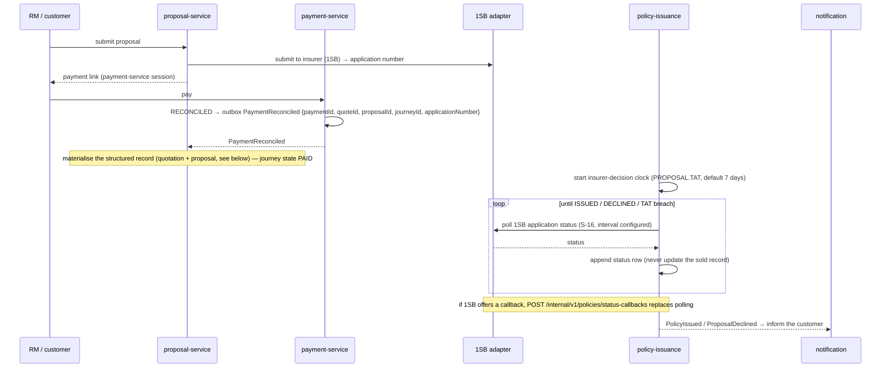

# Owner decisions 2026-10-21 — the nine open design decisions

[← Readiness review](../api-reference/READINESS-REVIEW.md) · Origin:
[`SUG-20261021-rul`](../../governance/registers/SUGGESTION-REGISTER.md#sug-20261021-rul--configuration-driven-rule-engine-and-the-nine-open-decisions)

Mahesh's direction in this session is the human owner ratification (`reviewer_type: HUMAN`,
`authority: repository_owner`). It does **not** create Compliance's E2 signature, bank approvals or
IRDAI confirmations; those are named per decision.

**Guiding rule (owner):** anything Compliance, Product or the bank may change tomorrow is
**configuration**, approved and published without a code release ([`ADR-024`](./ADR-024-configuration-driven-rule-engine.md)).

| # | Decision | Status | Record |
|---|---|---|---|
| D1 | Rules are versioned JSON rule sets evaluated by one engine; precedence, reason codes, thresholds, validity periods are configuration | **Accepted** | [`ADR-024`](./ADR-024-configuration-driven-rule-engine.md) |
| D2 | Lead exception rules = rule set `LEAD.EXCEPTION`, owned by lead-service, evaluated by the engine | **Accepted**; thresholds TBC | §D2 |
| D3 | `customerId` = platform ULID; CIF = core-banking business key | **Accepted** | §D3, `D-023` |
| D4 | Suitability outcome record and Savings/ULIP model | **Accepted** (record); Savings/ULIP content needs Compliance | §D4 |
| D5 | Consent after suitability, checked/captured before multi-quote, valid 90 days (configurable) | **Accepted** — Compliance must confirm DPDP position | §D5, `D-024` |
| D6 | Event envelope, topics, DLQ, publisher library | **Accepted** | [`ADR-025`](./ADR-025-event-specification-and-publisher.md) |
| D7 | Business audit as events into an append-only, hash-chained audit store + WORM archive | **Proposed** — awaits owner yes | [`ADR-026`](./ADR-026-audit-store-and-transport.md) |
| D8 | Payment → structured Postgres record, then appended statuses until issuance; IRDAI TAT tracked | **Accepted** | §D8, `D-025` |
| D9 | Checked-in OpenAPI per service is authoritative; conformance test | **Accepted** | [`ADR-027`](./ADR-027-openapi-contract-authority.md) |

---

## D2 — Lead exception engine

**The question was:** who evaluates `EH-BR-RULE-001…015`, and through which contract? It is not a
separate system: the rules are a configured set the Exception Handling BRD already defines
(§24.3 rule definitions, §24.5 messages with `@AGE`, `@Equifaxscore`, `@noofmonths` placeholders).

**Decision:** rule set `LEAD.EXCEPTION` (`ADR-024`), `hitPolicy: PRIORITY`,
`outcomeRank: [BLOCK, APPROVAL_REQUIRED, PASS]`, evaluated by lead-service at Start Onboarding
(`D-019`) and again at premium capture for rules 012–013. Each rule's action ("approval / block as
configured") and threshold are **parameters**; **a missing threshold evaluates to `BLOCK`** with
reason `EH-CONFIG-MISSING` (BRD §24.3 column I: "Block where required configuration is
unavailable"). Remarks are mandatory on approval / rejection (column J).

**What is missing — and is configuration, not a BRD gap:** the threshold values (maximum age,
minimum Equifax score, lapse window, cooling periods, CASA age, active-policy count, high-premium
limit) and the data sources behind `EH-INT-001…005` (CBS, Equifax, DWH, insurer policy data).
The seed rule set ships with these **unset**, so every lead routes to `BLOCK` until the BRD owner
enters values. **Owner action:** provide the threshold values (or confirm who owns them).

## D3 — Customer identity (`D-023`)

| Identifier | Owner | Where it appears |
|---|---|---|
| `customerId` — CHAR(26) ULID, primary key of `customer.customer` | customer-service mints it on first resolve | Every other context (lead, journey, suitability, consent, quote, proposal, payment, policy) — the only customer reference outside `customer` |
| `cif` — core-banking customer id | CBS | Only in `customer.customer` (encrypted, plus `cif_lookup_hash` HMAC, UNIQUE) and in calls to CBS / 1SB adapters |

Resolve is idempotent: the same CIF always maps to the same `customerId`. `lead.customer_id`
becomes `CHAR(26)`.

## D4 — Suitability outcome record and the Savings / ULIP model (explained)

**What the question meant.** Two documents describe suitability differently:

1. *Outcome shape.* The rule pack produces **one outcome per product class** —
   `SUITABLE | SUITABLE_WITH_CAUTION | NOT_SUITABLE | INSUFFICIENT_DATA` — so a customer can be
   suitable for Term and not for ULIP in the same evaluation. The database design and the quote gate
   (`INV-QUO-01`) instead store a single `ELIGIBLE / NOT_ELIGIBLE`. A developer cannot build both.
2. *How Savings / ULIP are decided.* The rule pack uses arithmetic plus conditions (horizon, risk
   attitude, objective, affordability — `SUIT-R13…R19`). The Suitability BRD describes an
   *insurer-wise grid* (look up the customer's profile in a matrix per insurer). They give
   different answers for the same customer (`OPEN-SUIT-06`).

**Decision.**
- The **per-class outcome record** is canonical: `suitability.evaluation` + `evaluation_outcome`
  (one row per product class: outcome, all reason codes in rule order, derived values) +
  `rule_set_id`/`version`. `INV-QUO-01` becomes: *a quote for class X requires an evaluation whose
  outcome for X is in `SUITABILITY.GATE.allowedOutcomes`* (configured; seed `SUITABLE`,
  `SUITABLE_WITH_CAUTION` with acknowledgement).
- **Both Savings/ULIP models are expressible as rule sets** (grid = `tables` + `lookup`;
  arithmetic = `derive` + conditions). R0 seeds the rule-pack model. If Compliance prefers the
  insurer grid, it is a new rule-set version — no code change.
- ULIP does not ask dependants or liabilities, so `protectionGap` is **not** derived for ULIP; the
  record makes derived values optional per class.

## D5 — Consent timing and validity (`D-024`)

**Owner direction:** consent is taken **after suitability, before multi-quote**. Before calling the
multi-quote API the platform checks for a valid consent for the customer; if one exists inside its
validity window (default **90 days**, configurable) quoting proceeds without asking again;
otherwise consent is captured first.

**Decision (all values in rule set `CONSENT.POLICY`):**

```json
"parameters": {
  "checkpoints": {
    "BEFORE_MULTI_QUOTE":       { "purposes": ["CNS-DP", "CNS-SOL", "CNS-QSH"], "validityDays": 90 },
    "BEFORE_PROPOSAL_SUBMIT":   { "purposes": ["CNS-SHR"], "validityDays": 30, "scope": "NAMED_INSURER" },
    "BEFORE_FIRST_COMMUNICATION": { "purposes": ["CNS-COM"], "validityDays": null }
  },
  "reuseAcrossJourneys": true,
  "bindTo": "customerId"
}
```

`CNS-QSH` (new) is the consent to share quote inputs with the insurers being quoted through 1SB.
Moving a purpose to an earlier checkpoint (e.g. `BEFORE_SUITABILITY`) or changing a validity period
is a rule-set version, not code. The journey asks consent-service
`GET /internal/v1/consents:check?customerId&checkpoint` and captures only what is missing.

> **For Compliance (cannot be decided here):** the suitability questionnaire collects personal data
> (income, dependants, liabilities). Under the DPDP Act 2023, processing personal data generally
> needs consent or a legitimate use, and the consent rule pack placed `CNS-DP`/`CNS-SOL` *before*
> the questionnaire for that reason. The owner's order moves them after it. Shailja must confirm
> this is permissible; if not, the fix is one configuration change (move `CNS-DP`/`CNS-SOL` to
> `BEFORE_SUITABILITY`).

## D8 — Payment, issuance tracking and the long-term record (`D-025`)

**Owner direction, as decided:**



**The structured record written at `PaymentReconciled` (Postgres, owning schemas):**

| Fact the owner listed | Table |
|---|---|
| All quotations shown to the customer | `quotation.quote` + every `quotation.offer` (selected = `SELECTED`, others `NOT_SELECTED`, invalid kept with `INVALID`) |
| Which one was selected | `quotation.quote.selected_offer_id` |
| The proposal form submitted | `proposal.proposal` |
| **Every question asked and every answer** | **new `proposal.proposal_answer`** — one row per question: `question_id`, `question_text` (as shown), `schema_version`, `answer_enc` (encrypted) — this replaces `form_values_ref` |
| Payment type and time | `payment.payment` (`method`, `paid_at`, `reconciled_at`) |
| Issuance status changes | **new `policy.policy_status_history`** (append-only): `APPLICATION_RECEIVED`, `UNDER_REVIEW`, `REQUIREMENT_RAISED`, `ISSUED`, `DECLINED`, `REFUNDED` |
| Policy issuance date, start date, closure / maturity date | `policy.policy` (`issued_at`, `risk_commencement_date`, `maturity_date`, `closed_at`) |

**Quote `CONVERTED` timing:** the quote stays `SELECTED` through payment and becomes `CONVERTED` at
materialise. **Ids on the payment event:** `PaymentReconciled` carries `paymentId`, `quoteId`,
`proposalId`, `journeyId`, `applicationNumber`; `payment.payment` gains `quote_id`, `proposal_id`.
**Post-payment proposal changes** go to `proposal.proposal_status_history` (append-only), not to the
frozen DynamoDB item or the INSERT-only `proposal` row.

**Turnaround time:** the IRDAI Master Circular on Protection of Policyholders' Interests (5 Sep
2024) requires the insurer to communicate its decision on a proposal **within 7 days** of receipt
(previously 15). The owner's recollection was 48–72 hours; the value is **`PROPOSAL.TAT.decisionDays`
= 7** in configuration, with an escalation at a configurable warning point, and Shailja confirms the
figure and its start event (proposal receipt vs payment).
