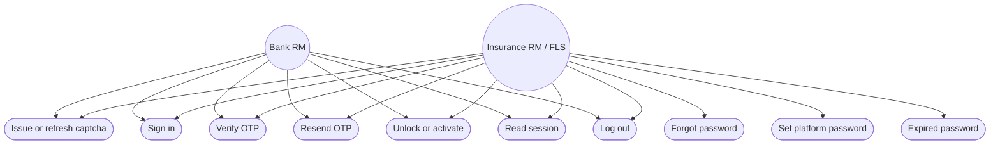
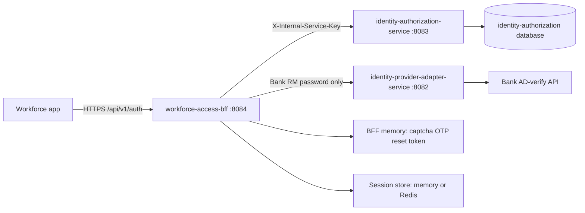
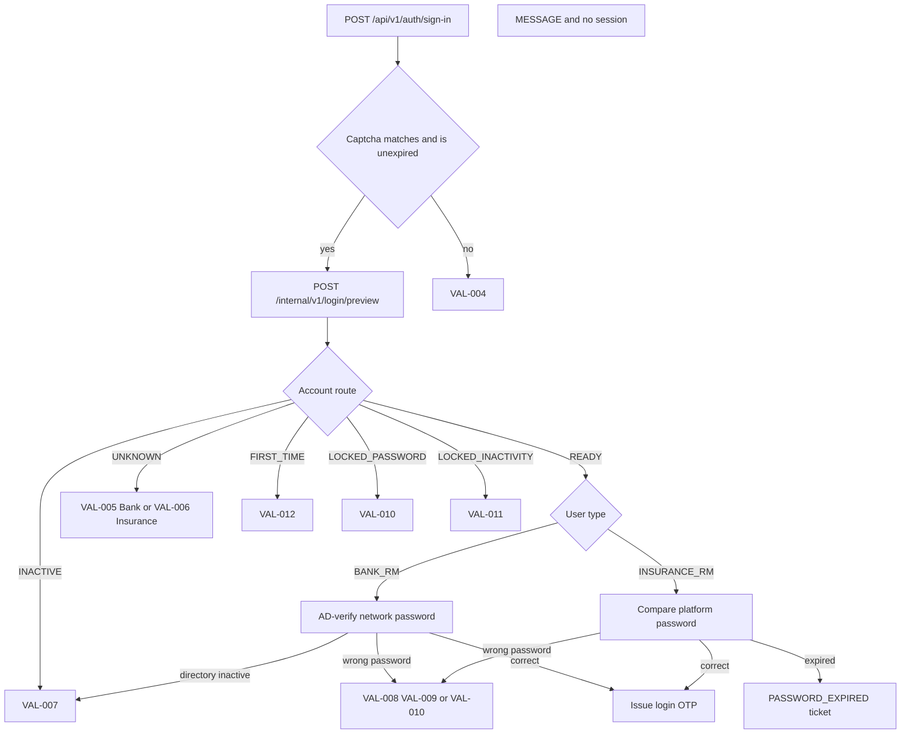
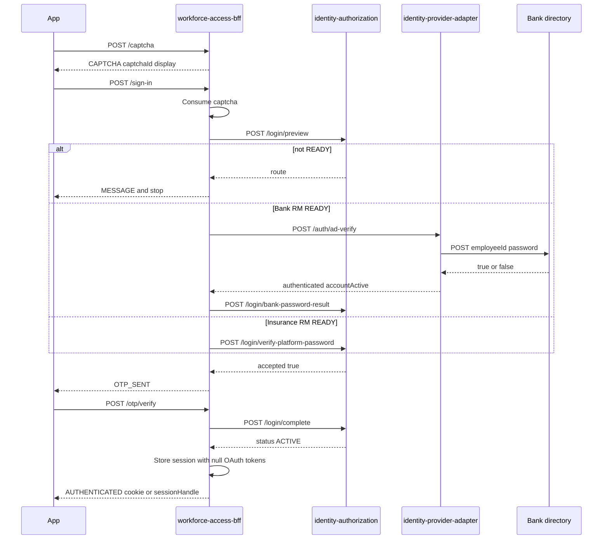
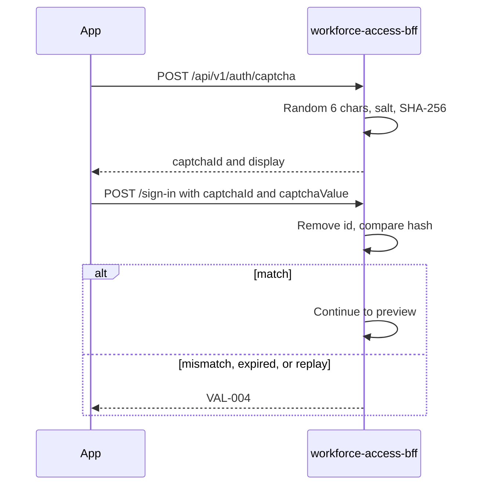
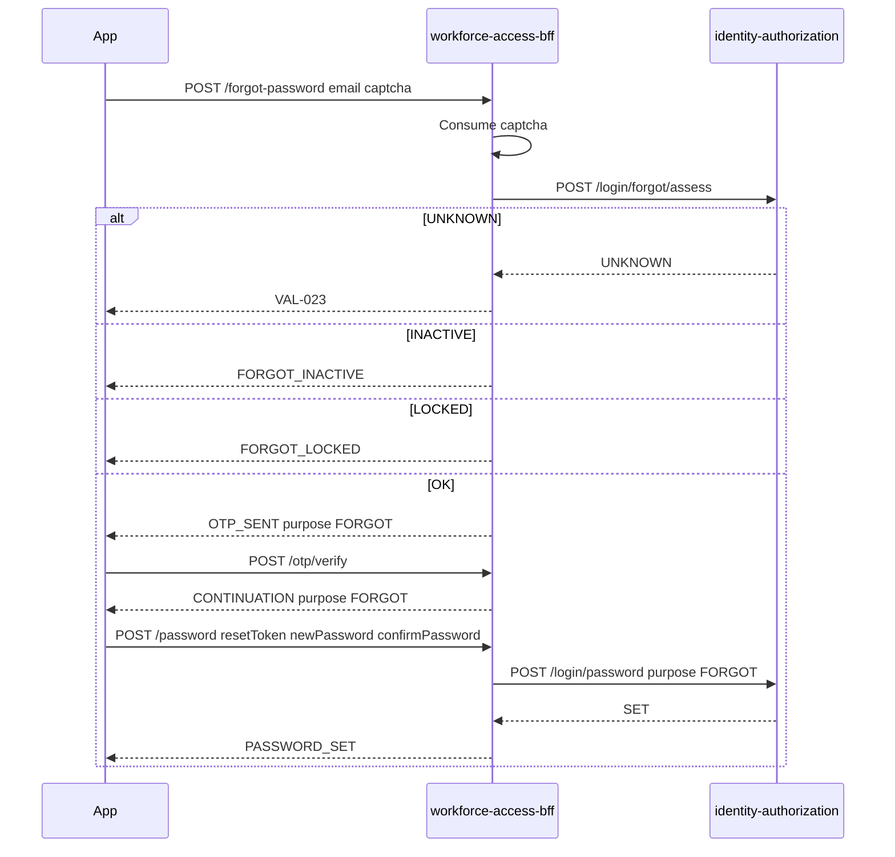
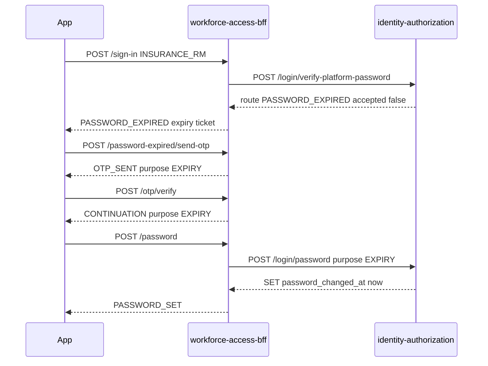
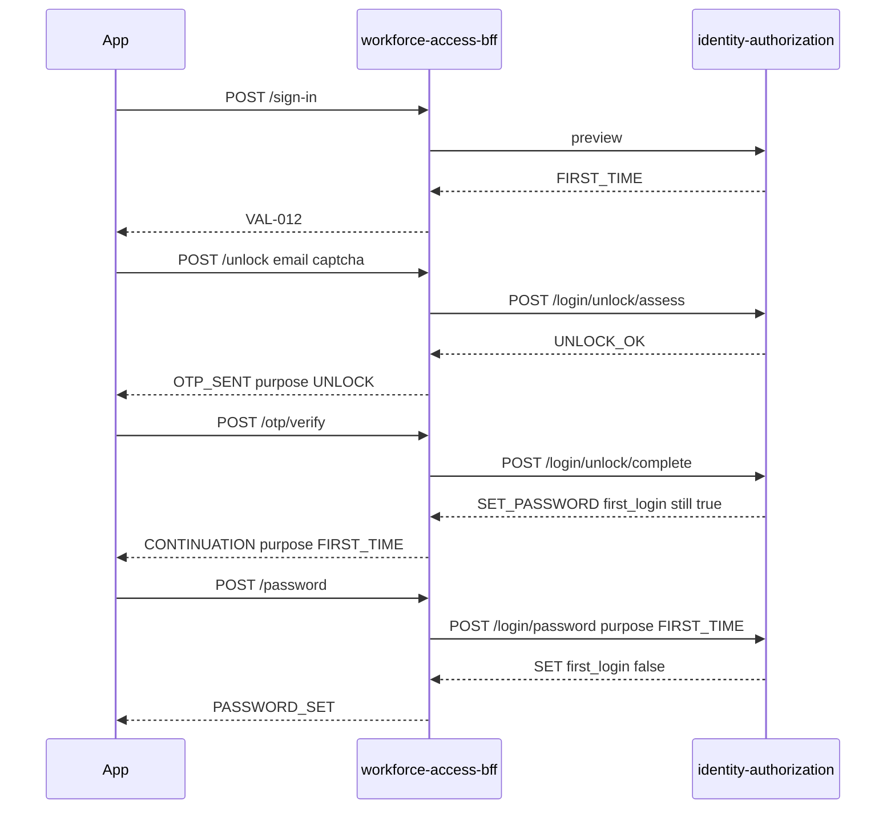
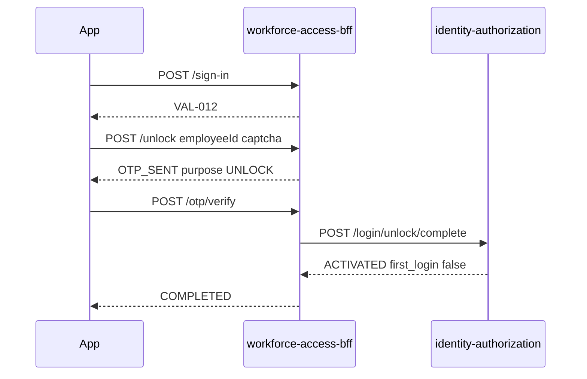
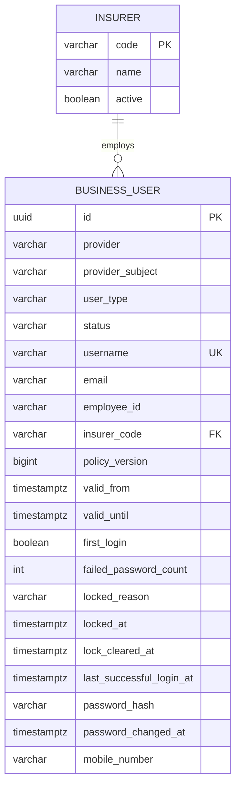

# Workforce authentication — team knowledge base

This page is the end-to-end description of how a Bank RM and an Insurance RM sign in, how captcha and OTP are checked, how an Insurance RM password is reset, which API the app calls, which service each call reaches, and which table holds the account. It describes the code on this branch. It is not a Security sign-off.

**Behaviour:** [Login BRD v3.1](../../au-bank-insurance-platform/requirements/brd-detailed/Login_Module_BRD_Detailed_CONTEXT.md)
**Shorter flow companion:** [LOGIN-BRD-V31-API-FLOWS.md](../../journey-execution/flows/LOGIN-BRD-V31-API-FLOWS.md)
**Work item:** `SUG-20261028-akb`
**As of:** 28 October 2026 (Asia/Calcutta)

Paste this file into Confluence. Each fenced `mermaid` block is a diagram: on Confluence Cloud, insert a Mermaid macro and paste the diagram body, or keep the fence if the space renders Mermaid inside a Markdown macro. Do not paste local passwords, internal service keys, or the dev OTP pin onto the page.

---

## 1. The one rule for the app

The workforce app calls only `workforce-access-bff` on port **8084**, under `/api/v1/auth/**`.

It never calls `identity-authorization-service` (8083), `identity-provider-adapter-service` (8082), Keycloak, or the bank directory. Those hops are internal. The app never receives an OAuth access token or refresh token.

There are two login ceremonies. Use the first one for the Login BRD screens.

| Ceremony | When the app uses it | Session created |
|---|---|---|
| Login BRD v3.1 | Bank RM and Insurance RM / FLS screens: captcha, password, OTP, unlock, forgot password, expiry | Only after a successful **login** OTP |
| IAM-001 `POST /api/v1/auth/login` | Older Bank RM path, and partner OIDC | Immediately after AD-verify, or after the OIDC callback. No captcha, no OTP |

Insurance RM and FLS are the same API user type: `INSURANCE_RM`.

---

## 2. Use cases



| Use case | Who | App API | Creates a session? |
|---|---|---|---|
| Issue or refresh captcha | Both | `POST /api/v1/auth/captcha` | No |
| Sign in | Both | `POST /api/v1/auth/sign-in` | No. Success is `OTP_SENT` |
| Verify OTP | Both | `POST /api/v1/auth/otp/verify` | Only when the OTP purpose is `LOGIN` |
| Resend OTP | Both | `POST /api/v1/auth/otp/resend` | No |
| Unlock or first-time activate | Both | `POST /api/v1/auth/unlock` then OTP | No |
| Forgot password | Insurance RM only | `POST /api/v1/auth/forgot-password` then OTP | No |
| Set or reset platform password | Insurance RM only | `POST /api/v1/auth/password` | No |
| Password expired | Insurance RM only | sign-in, then `POST /api/v1/auth/password-expired/send-otp`, then OTP, then set password | No |
| Read session | Both, after login OTP | `GET /api/v1/auth/session` | Already exists |
| Log out | Both | `POST /api/v1/auth/logout` | Ends it |

Bank RM has no forgot-password, no set-password, and no password-expiry API. The network password stays with the bank.

---

## 3. Who does what



| Concern | Owner | Stored where |
|---|---|---|
| Captcha, OTP, expiry ticket, reset token | BFF | This JVM only. A restart or a second pod drops them |
| Account status, lock, first login, failed-password count, last login | identity-authorization | `business_user` |
| Insurance RM platform password | identity-authorization | `business_user.password_hash` (PBKDF2). Plaintext is not stored |
| Bank RM network password | Bank directory | Not stored on this platform |
| Workforce session after login OTP | BFF | Memory, or Redis when `workforce.session.store=redis`. Not Postgres |
| Business roles and permissions | identity-authorization | `role`, `permission`, `user_role`, `entitlement`. Login does not read them |
| Partner OIDC tokens | BFF session, after `POST /auth/login` plus callback | Encrypted in the session store. Never sent to the app |

Every internal call from the BFF sends `X-Internal-Service-Key`. The authorization service accepts the BFF key and requires privilege `login.orchestrate` on the login routes. The adapter refuses `/internal/v1/**` without its own key. A missing or wrong key is HTTP 401, which the BFF turns into `VAL-024` for the journey.

Timeouts on the login path: BFF to authorization, connect 500 ms and read 2 s. BFF to the adapter, connect 1 s and read 4.5 s. Adapter to the bank directory, connect 1 s and read 3 s.

---

## 4. Call order the app should follow

Every `POST` under `/api/v1/auth/**` from a browser needs the CSRF cookie.

1. `GET /api/v1/auth/csrf`. Read `token`. Send it on later posts as `X-XSRF-TOKEN`. Spring also sets cookie `WORKFORCE-XSRF` (readable by script, so the page can copy it).
2. `POST /api/v1/auth/captcha` with an empty body. Keep `captchaId` and `display`.
3. Call the screen's API with that captcha. A captcha is single use. A wrong, expired, or replayed value needs a new captcha.
4. When the outcome is `OTP_SENT`, show the masked mobile and email. The code is not in the response. Submit `POST /api/v1/auth/otp/verify`.
5. A login OTP with outcome `AUTHENTICATED` is the only step that logs the user in.
6. Unlock, forgot password, and expiry end with a message or a reset token. They do not set `WORKFORCE_SESSION`.

`clientType` is `WEB` or `NATIVE`.

- `WEB`: the session is `Set-Cookie: WORKFORCE_SESSION` (HttpOnly, Secure, SameSite Strict, path `/`, max age 8 hours). The body has no `sessionHandle`.
- `NATIVE`: the body has `sessionHandle`. There is no session cookie. Later calls send `X-Session-Handle`. A request that already carries `X-Session-Handle` or `Authorization: Bearer` skips CSRF.

Send `X-Correlation-Id` when the caller has one. The platform echoes it. It is not a login credential.

`/api/v1/auth/**` is limited to 60 requests per minute per client. The key is the first `X-Forwarded-For` address, otherwise the socket address. Over the limit the response is the platform error `RATE_LIMITED`, not a journey message.

---

## 5. Public API contract

Base path: `/api/v1/auth`. Controller: `LoginJourneyController`. Session and CSRF: `AuthenticationController`.

Journey responses are HTTP 200. Null fields are omitted. `outcome` says what the screen does next.

A missing or blank JSON field fails earlier, as HTTP 400 `VALIDATION_ERROR`. That is not a `MESSAGE` body. Downstream failures that the journey catches are HTTP 200 `VAL-024`.

### 5.1 Shared response

| Field | When it is present |
|---|---|
| `outcome` | Always. See the catalogue below |
| `code`, `title`, `message`, `field` | `outcome=MESSAGE`, and some successes |
| `captchaId`, `display`, `expiresInSeconds` | `outcome=CAPTCHA` |
| `challengeId`, `maskedMobile`, `maskedEmail`, `expiresInSeconds`, `resendAvailableInSeconds`, `resendsRemaining`, `purpose` | `OTP_SENT` and `WAIT` |
| `continuationToken`, `purpose` | `CONTINUATION`, and `PASSWORD_EXPIRED` (the token is an expiry ticket, purpose `EXPIRY`) |
| `redirectAfterSeconds`, `authenticated`, `businessUserId`, `userType`, `status`, `policyVersion`, `sessionHandle` | `AUTHENTICATED` |
| `redirectAfterSeconds` | `COMPLETED` and `PASSWORD_SET` |

`outcome` values the app must branch on:

| outcome | Meaning |
|---|---|
| `CAPTCHA` | New captcha. Show `display` |
| `OTP_SENT` | Ask for the six-digit code |
| `WAIT` | Resend was too soon. Keep the current code |
| `CONTINUATION` | OTP for forgot, expiry, or first-time Insurance RM succeeded. Call set-password with `continuationToken` |
| `PASSWORD_EXPIRED` | Insurance password matched and is older than 60 days. Call send-otp with this ticket. Do not send it to set-password |
| `AUTHENTICATED` | Login OTP succeeded. Session exists |
| `COMPLETED` | Unlock or activation finished. No session |
| `PASSWORD_SET` | Platform password saved. No session |
| `NOT_REQUIRED` | Unlock was called for an account that is already active and unlocked |
| `MESSAGE` | A design sentence. Read `code` |

### 5.2 `POST /captcha`

No body.

```json
{
  "outcome": "CAPTCHA",
  "captchaId": "<url-safe token>",
  "display": "K7mQp2",
  "expiresInSeconds": 300
}
```

`display` is the text the user types. There is no image. Refresh is the same call; it does not cancel the previous id until that id expires or is consumed.

### 5.3 `POST /sign-in`

```json
{
  "clientType": "WEB",
  "userType": "BANK_RM",
  "loginId": "EMP001",
  "password": "<secret>",
  "captchaId": "<from captcha>",
  "captchaValue": "<display>"
}
```

| Field | Rule |
|---|---|
| `clientType` | Required. `WEB` or `NATIVE` |
| `userType` | Required. `BANK_RM` or `INSURANCE_RM` |
| `loginId` | Required. Employee ID for Bank RM. Corporate email for Insurance RM. Trimmed before lookup |
| `password` | Required. Not logged. `toString` omits it |
| `captchaId`, `captchaValue` | Required. Consumed before any account lookup |

Insurance RM uses the same shape with `userType=INSURANCE_RM` and the email in `loginId`.

Success:

```json
{
  "outcome": "OTP_SENT",
  "title": "Verify it's you",
  "challengeId": "<token>",
  "maskedMobile": "xx3210",
  "maskedEmail": "fl••••@example.test",
  "expiresInSeconds": 600,
  "resendAvailableInSeconds": 120,
  "resendsRemaining": 3,
  "purpose": "LOGIN",
  "businessUserId": "<uuid>",
  "userType": "INSURER_REPRESENTATIVE"
}
```

`userType` in the response is the platform value `BANK_EMPLOYEE` or `INSURER_REPRESENTATIVE`, not the request enum.

Expired Insurance password (hash matched, then expiry):

```json
{
  "outcome": "PASSWORD_EXPIRED",
  "title": "Your password has expired",
  "message": "Insurance Hub passwords expire every 60 days. Verify it's you with an OTP to set a new password.",
  "continuationToken": "<expiry ticket>",
  "purpose": "EXPIRY"
}
```

### 5.4 `POST /otp/verify`

```json
{ "challengeId": "<from OTP_SENT>", "otp": "123456" }
```

Both fields are required. The OTP is not logged.

| Purpose that was stored | Result |
|---|---|
| `LOGIN` | `AUTHENTICATED` and a session |
| `UNLOCK` | `COMPLETED`, or `CONTINUATION` purpose `FIRST_TIME` for a first-time Insurance RM |
| `FORGOT` | `CONTINUATION` purpose `FORGOT` |
| `EXPIRY` | `CONTINUATION` purpose `EXPIRY` |

`AUTHENTICATED` example, web (cookie is on the response, not in the JSON):

```json
{
  "outcome": "AUTHENTICATED",
  "title": "Welcome back, <firstName>",
  "message": "You're signed in. Taking you to your dashboard.",
  "redirectAfterSeconds": 2,
  "authenticated": true,
  "businessUserId": "<uuid>",
  "userType": "BANK_EMPLOYEE",
  "status": "ACTIVE",
  "policyVersion": 1
}
```

Native adds `sessionHandle` and does not set the cookie. The title uses the user's first name, or the username when the first name is blank.

### 5.5 `POST /otp/resend`

```json
{ "challengeId": "<same id>" }
```

Allowed resend returns `OTP_SENT` with the same `challengeId`, a new expiry, and `resendsRemaining` reduced by one. The previous code is discarded. Too soon returns `WAIT` with `resendAvailableInSeconds`. The fourth resend returns `VAL-017` and deletes the challenge.

### 5.6 `POST /unlock`

```json
{
  "clientType": "WEB",
  "userType": "BANK_RM",
  "loginId": "EMP001",
  "captchaId": "<id>",
  "captchaValue": "<display>"
}
```

No password field. The login page does not carry the id into this screen; the user types it again.

Success is `OTP_SENT` with `purpose=UNLOCK`. Already active and unlocked is `{"outcome":"NOT_REQUIRED"}` with no screen sentence.

### 5.7 `POST /forgot-password`

Insurance RM only. There is no Bank RM operation.

```json
{
  "clientType": "WEB",
  "email": "fls.rm@example.test",
  "captchaId": "<id>",
  "captchaValue": "<display>"
}
```

The sign-in password is not sent and is not checked. Success is `OTP_SENT` with `purpose=FORGOT`.

### 5.8 `POST /password-expired/send-otp`

```json
{ "expiryTicket": "<continuationToken from PASSWORD_EXPIRED>" }
```

The ticket is single use and must have purpose `EXPIRY_TICKET`. Success is `OTP_SENT` with `purpose=EXPIRY`. Any other token is consumed and answered as `VAL-024`.

### 5.9 `POST /password`

One operation for first-time setup, forgot password, and expiry. The token's purpose decides which.

```json
{
  "resetToken": "<continuationToken>",
  "newPassword": "<secret>",
  "confirmPassword": "<secret>"
}
```

Do not send the `PASSWORD_EXPIRED` ticket here. That ticket is rejected, and it is consumed. The user must verify the OTP first and use the `CONTINUATION` token.

Success bodies:

| Token purpose | title | message |
|---|---|---|
| `FIRST_TIME` | Account unlocked | Your new password is set. Sign in with your corporate email ID and new password. |
| `EXPIRY` | Password updated | Your new password is valid for the next 60 days. Sign in again to continue. |
| `FORGOT` and anything else accepted | Password changed | Your password has been updated. Sign in again with your new password. |

`redirectAfterSeconds` is 3. No session.

### 5.10 Session and the older login

| Method | Path | Role |
|---|---|---|
| `GET` | `/api/v1/auth/csrf` | `{ "headerName": "X-XSRF-TOKEN", "token": "<value>" }` |
| `GET` | `/api/v1/auth/session` | Current user. Cookie or `X-Session-Handle`. Missing session is 401 |
| `POST` | `/api/v1/auth/logout` | Ends the BFF session |
| `POST` | `/api/v1/auth/login` | IAM-001. `identitySource=BANK_AD` plus `employeeId` and `password` verifies AD and creates a session immediately. Any other source returns an authorization URI for partner OIDC |
| `GET` | `/api/v1/auth/callback` | Finishes partner OIDC. Not the BRD Insurance RM |
| `POST` | `/api/v1/auth/native-session` | Exchanges a native completion code from the OIDC redirect |

---

## 6. Message catalogue

`outcome` is `MESSAGE` unless the table says otherwise. `field` tells the screen which control to mark.

| code | field | When | Sentence |
|---|---|---|---|
| `VAL-004` | captcha | Missing, expired, already used, or wrong | Wrong captcha. Try again. |
| `VAL-005` | loginId | Bank employee ID is not a `business_user` | Invalid Employee ID. Please check and try again. |
| `VAL-006` | loginId | Insurance email is not a `business_user` on sign-in or unlock | We couldn't find a partner account with this email ID. |
| `VAL-007` | — | Status is not active, or Bank AD says the directory account is inactive | Your account is not active. Please contact support to get access to Insurance Hub. |
| `VAL-008` | password | Wrong password, 2 attempts left | Incorrect password. You have 2 attempts remaining. |
| `VAL-009` | password | Wrong password, 1 attempt left | Incorrect password. You have 1 attempt remaining. |
| `VAL-010` | — | Third wrong password, or a password attempt while password-locked | Your account has been locked. You entered an incorrect password 3 times. Please use Unlock User to verify with an OTP and continue. |
| `VAL-011` | — | Inactivity lock | Your account is locked due to inactivity. You haven't signed in for 30 days. Please use Unlock User to verify with an OTP and continue. |
| `VAL-012` | — | First login. Password is not checked | Activate your account. This is your first login to the Insurance Platform. Please use Unlock User to activate your account and continue. |
| `VAL-014` | otp | Wrong OTP, attempts left | Incorrect OTP. Please check and try again. |
| `VAL-015` | otp | OTP missing or expired, including a second verify after success | The OTP has expired. Please request a new OTP. |
| `VAL-016` | — | Fifth wrong OTP. Challenge deleted. Account unchanged | Too many incorrect attempts. Maximum attempts exceeded. Please restart the journey. Your account has not been locked. |
| `VAL-017` | — | Resend limit. Challenge deleted | Resend limit reached. Maximum resend limit reached. Please restart the journey to get a new OTP. |
| `VAL-019` | confirmPassword | New and confirm differ, or either is missing | Both passwords must match |
| `VAL-020` | newPassword | Same as the current platform password | New password must differ from the previous password. |
| `VAL-023` | email | Forgot-password email not found | We could not find an active Insurance RM account with this email ID. |
| `VAL-024` | — | Authorization or adapter call failed, or a continuation token was wrong | We are unable to process your request. Please try again later. |
| `FORGOT_LOCKED` | — | Forgot, or set-password, while locked | Your account is locked. Unlock it with an OTP first. Resetting your password won't unlock your account. |
| `FORGOT_INACTIVE` | — | Forgot while not active | We can't reset the password for this account. Please contact support. |
| `LENGTH` | newPassword | Shorter than 8 or longer than 16 | 8 to 16 characters |
| `UPPER` / `LOWER` / `NUMBER` / `SPECIAL` | newPassword | Missing that class | At least one uppercase letter / lowercase letter / number / special character |
| `SPACE` | newPassword | Any whitespace | No spaces |
| `EMAIL` | newPassword | Contains the registered email, ignoring case | Doesn't contain your email ID |
| `DEFAULT` | newPassword | Exactly `123456` | Not a default password (e.g. 123456) |

Blank-field sentences from older copy are not returned. A missing JSON field is HTTP 400 before these codes run.

---

## 7. Internal contracts

The app does not call these. Header on every call: `X-Internal-Service-Key`.

### 7.1 BFF → identity-authorization-service

Base: `/internal/v1`. Privilege: `login.orchestrate`.

| BFF method | Internal path | Body | What it decides |
|---|---|---|---|
| `preview` | `POST /login/preview` | `{ "userType": "BANK_EMPLOYEE" or "INSURER_REPRESENTATIVE", "loginId": "..." }` | Route before the password check |
| `recordBankPassword` | `POST /login/bank-password-result` | `{ "businessUserId": "<uuid>", "accepted": true or false }` | Count a Bank RM directory result. Does not see the password |
| `verifyPlatformPassword` | `POST /login/verify-platform-password` | `{ "businessUserId": "<uuid>", "password": "<secret>" }` | Compare the Insurance RM hash |
| `completeLogin` | `POST /login/complete` | `{ "businessUserId": "<uuid>" }` | After login OTP. Resets the failure count and writes last login |
| `assessUnlock` | `POST /login/unlock/assess` | same as preview | `UNLOCK_OK`, `NOT_REQUIRED`, `INACTIVE`, or `UNKNOWN` |
| `completeUnlock` | `POST /login/unlock/complete` | `{ "businessUserId": "<uuid>" }` | `ACTIVATED`, `UNLOCKED`, `SET_PASSWORD`, `NOT_REQUIRED`, or `INACTIVE` |
| `assessForgotPassword` | `POST /login/forgot/assess` | `{ "email": "<email>" }` | `OK`, `UNKNOWN`, `INACTIVE`, or `LOCKED` |
| `setPassword` | `POST /login/password` | `{ "businessUserId", "newPassword", "confirmPassword", "purpose" }` | `SET`, `LOCKED_UNCHANGED`, or a policy violation name |

`userType` on these bodies is the platform enum, not `BANK_RM`.

Account view fields the BFF keeps for the next step: `found`, `route`, `businessUserId`, `status`, `policyVersion`, `userType`, `insurerCode`, `firstName`, `username`, `maskedMobile`, `maskedEmail`, `attemptsRemaining`, `firstLogin`.

Password outcome: `{ "account": { ... }, "accepted": true or false }`.

### 7.2 BFF → identity-provider-adapter-service

Used on Bank RM sign-in only, and only after preview returned `READY`.

`POST /internal/v1/auth/ad-verify`

```json
{ "employeeId": "EMP001", "password": "<network password>" }
```

```json
{
  "authenticated": true,
  "accountActive": true,
  "employeeId": "EMP001",
  "username": "EMP001",
  "email": "emp001@example.test"
}
```

| `authenticated` | `accountActive` | Meaning for the BFF |
|---|---|---|
| true | true | Directory accepted an active employee. Authorization records `accepted=true`. No failure is counted |
| false | true | Wrong password or unknown to the directory. Authorization increments the failure counter |
| true or false | false | Directory says the account is inactive. BFF returns `VAL-007` and does **not** call `bank-password-result` |

HTTP 401 or 403 from the bank API is treated as a rejected password (`authenticated=false`, `accountActive=true`). Any other HTTP failure or a body that is not a boolean payload becomes `IDENTITY_PROVIDER_UNAVAILABLE`, and the BFF returns `VAL-024` without counting an attempt.

The adapter does not log the password. Stub mode is refused when the process is started with the `prod` profile. HTTP mode requires `identity.ad-verify.http.base-url`. The bank call is `POST {baseUrl}{path}` with `employeeId` and `password`. An API key header is added only when one is configured. The default path is `/ad/authenticate`. The accepted body shapes are a raw `true`/`false`, or JSON with `authenticated` / `success` / `isAuthenticated` and optional `accountActive` or `active`.

---

## 8. Validation on each service

A failure at a step does not run the later steps. Captcha failure, unknown login ID, first-time routing, and lock routing do not increment the password counter.



### 8.1 workforce-access-bff

Runs before any downstream call, in this order:

| Check | Result |
|---|---|
| More than 60 auth requests in the current minute for that client address | `RATE_LIMITED` |
| Browser POST without a matching CSRF token | Rejected by Spring Security before the controller |
| JSON field null or blank (`@NotNull`, `@NotBlank`) | HTTP 400 `VALIDATION_ERROR` |
| Captcha id absent, expired, or hash mismatch | `VAL-004`. The id is removed even when the value is wrong |
| OTP id absent | `VAL-015` |
| OTP past its expiry | `VAL-015` |
| OTP hash mismatch, under 5 failures | `VAL-014`. Resend does not reset the failure count |
| Fifth OTP mismatch | `VAL-016`. Challenge deleted. Account row unchanged |
| Resend before 2 minutes | `WAIT` |
| Resend when 3 resends were already used | `VAL-017`. Challenge deleted |
| Reset or expiry token missing, expired, or the wrong purpose | `VAL-024`. `takeContinuation` has already removed it |
| Downstream throw (`ServiceException` or `RestClientException`) | `VAL-024` |

Captcha compare and OTP compare use SHA-256 of `salt + ":" + value` and a constant-time compare of the encoded digest. The plaintext is not written to the store and is not logged.

### 8.2 identity-authorization-service

Lookup:

| Request user | Query |
|---|---|
| `BANK_EMPLOYEE` | `employee_id` and `user_type` |
| `INSURER_REPRESENTATIVE` | email, case-insensitive, and `user_type` |
| Forgot password | email, case-insensitive, Insurance RM only |

Route order inside `preview`, after the inactivity rule:

| Order | Condition | route |
|---|---|---|
| 1 | No row | `UNKNOWN` (`found=false`) |
| 2 | Status is not `ACTIVE`, unless status is `PENDING` and `first_login` is true | `INACTIVE` |
| 3 | `first_login` | `FIRST_TIME` |
| 4 | `locked_reason=PASSWORD` | `LOCKED_PASSWORD` |
| 5 | `locked_reason=INACTIVITY` | `LOCKED_INACTIVITY` |
| 6 | Otherwise | `READY` |

Inactivity, applied on preview, unlock assess, and forgot assess:

- Already locked, or `first_login`: do not lock again.
- Baseline is the later of `last_successful_login_at` and `lock_cleared_at`.
- If that baseline plus 30 days is not after now, set `locked_reason=INACTIVITY` and `locked_at`.
- A user with neither timestamp is not inactivity-locked.
- Unlock does not write `last_successful_login_at`. Only `POST /login/complete` does, and only after a login OTP.

Password counter, only when preview was `READY` and the secret was actually checked:

| Event | Counter |
|---|---|
| Bank directory inactive | Not incremented |
| Bank or platform password wrong, and not already locked | `failed_password_count` increases by 1 |
| Count reaches 3 | `locked_reason=PASSWORD`, `locked_at` set |
| Wrong password while already locked | Not incremented again. Still `VAL-010` |
| Correct password while locked or first-time | Not accepted. Lock is not cleared |
| Insurance hash matches and `password_changed_at` plus 60 days is not after now | `PASSWORD_EXPIRED`. Counter does not move. A null `password_changed_at` is not expired |
| Login OTP then `complete` | Count reset to 0, lock cleared, `last_successful_login_at` set |

Set-password policy, first failure wins. The checklist on the screen is a client concern. The server checks at submit.

| Order | Rule | result |
|---|---|---|
| — | Purpose `FORGOT` and the row is locked | `LOCKED_UNCHANGED`. Hash unchanged |
| 1 | New and confirm differ, or either is null | `MISMATCH` → `VAL-019` |
| 2 | Value is exactly `123456` | `DEFAULT` |
| 3 | Length outside 8 to 16 | `LENGTH` |
| 4 | Any whitespace | `SPACE` |
| 5 | Contains the full registered email, ignoring case | `EMAIL` |
| 6 | Missing uppercase, lowercase, digit, or a character that is none of those | `UPPER`, `LOWER`, `NUMBER`, or `SPECIAL` |
| 7 | Matches the current hash | `PREVIOUS` → `VAL-020` |

Storage format: `pbkdf2$120000$<base64 salt>$<base64 derived key>`. PBKDF2-HMAC-SHA256, 16-byte salt, 256-bit key, 120000 iterations. Compare is constant-time. A malformed stored value does not match.

`replacePasswordHash` writes the hash and `password_changed_at`, sets `first_login` false, and moves a `PENDING` Insurance RM to `ACTIVE`.

Unlock complete:

| Row | route | Row change |
|---|---|---|
| Not active and not `PENDING` | `INACTIVE` | None |
| Not first-time and not locked | `NOT_REQUIRED` | None |
| First-time Insurance RM | `SET_PASSWORD` | Status `ACTIVE`, failures cleared, `lock_cleared_at` now, `first_login` stays true |
| First-time Bank RM | `ACTIVATED` | `first_login` false, status `ACTIVE`, failures cleared |
| Locked | `UNLOCKED` | `locked_reason` and `locked_at` cleared, `failed_password_count` 0, `lock_cleared_at` now. Hash unchanged. Last login unchanged |

Forgot assess: unknown email → `UNKNOWN`. Not active and not `PENDING` → `INACTIVE`. Any `locked_reason` → `LOCKED`. Otherwise `OK`, including a first-time `PENDING` Insurance RM.

### 8.3 identity-provider-adapter-service

| Check | Result |
|---|---|
| Missing internal service key | HTTP 401 |
| Blank `employeeId` or `password` | HTTP 400 |
| Stub user id and password match, `active=true` | `authenticated=true`, `accountActive=true` |
| Stub user inactive | `accountActive=false` |
| Stub id unknown or password mismatch | `authenticated=false`, `accountActive=true` |
| `prod` profile with stub mode | Process refuses to start |
| HTTP mode without a base URL | Process refuses to start |

The password compare in stub mode is constant-time. Local stub employee ids live in `application.yml`. Do not copy those passwords into Confluence.

---

## 9. How a user becomes authenticated

Authentication means a workforce session exists. For this journey that happens in one place: `POST /otp/verify` when the stored purpose is `LOGIN`.



What the session contains: business user id, platform user type, status, policy version, insurer code, username, expiry 8 hours from creation. `accessToken`, `refreshToken`, and `idToken` are null. Later APIs on the BFF trust this session. They do not ask the user for the password again.

`GET /session` returns the business user id, username, user type, status, policy version, and insurer code.

Partner OIDC (`POST /login` with a non-`BANK_AD` source, then `GET /callback`) is a different ceremony. That session does hold provider tokens inside the BFF. The app still receives only the cookie or an opaque handle.

---

## 10. Captcha, generated and checked

Generation (`issueCaptcha`):

1. Draw 6 characters from `ABCDEFGHJKLMNPQRSTUVWXYZabcdefghijkmnopqrstuvwxyz23456789`. The alphabet omits `I`, `O`, `l`, `o`, `0`, and `1`.
2. Mint a 32-byte url-safe token as `captchaId`.
3. Mint a 16-byte salt.
4. Store `base64(salt) + "$" + base64(SHA-256(salt + ":" + display))` with expiry now plus 5 minutes.
5. Return the plaintext `display` once, in the response. The store never keeps it.

Validation (`consumeCaptcha`), on sign-in, unlock, and forgot password:

1. Remove the id. A second submit of the same id is `VAL-004`.
2. If the id was unknown or `now` is after `expiresAt`, `VAL-004`.
3. Split on the first `$`. Hash the submitted value with that salt.
4. Constant-time compare. Mismatch is `VAL-004`, and the id stays consumed.

There is no image, no audio, and no external captcha vendor. Information Security has not named one (`SUG-20261008-otp` / `SEC-009`). The text in the response is a development stand-in, not the production captcha control.



---

## 11. Password reset

Insurance RM only. Three ways to reach `POST /password`. None of them checks the old password on the forgot path. None of them creates a session.



A lock is not cleared by a password change. If the row is locked at set-password time, authorization returns `LOCKED_UNCHANGED` and the BFF shows the unlock-first sentence. The user unlocks first, then signs in, or unlocks and only then uses forgot password.

Expiry is a different entry. It runs only after a correct platform password on sign-in.



First-time Insurance RM does not set a password on the sign-in screen. Sign-in returns `VAL-012`. Unlock OTP returns `CONTINUATION` purpose `FIRST_TIME`. `POST /password` then saves the hash.



The next sign-in uses the new password and a login OTP.

Bank RM first login stops at activation. There is no set-password step.



The user then signs in with the existing network password and a login OTP.

Unlock after three wrong passwords or 30 days idle uses the same unlock API. Copy after success tells a Bank RM to use the existing network password, and an Insurance RM to use the existing platform password. `lock_cleared_at` stops the same preview from locking them for inactivity again immediately.

---

## 12. OTP

One verify and one resend for purposes `LOGIN`, `UNLOCK`, `FORGOT`, and `EXPIRY`.

| Setting | Value | Property |
|---|---|---|
| Code | 6 digits, `000000`–`999999` | Generated unless `workforce.login.otp-code` is set |
| Store | salt and SHA-256, same construction as captcha | In-memory |
| TTL | 10 minutes | `workforce.login.otp-ttl` |
| Resend wait | 2 minutes | `workforce.login.resend-delay` |
| Wrong tries | 5, then the challenge is deleted | `workforce.login.max-otp-attempts` |
| Resends | 3 successful resends, then the next call deletes it | `workforce.login.max-resends` |
| Delivery | Not sent | Response has masked mobile and email only |

`prod` and `uat` refuse to start when `WORKFORCE_LOGIN_OTP_CODE` is set. The dev profile may pin a code so a local journey can finish. That pin is a test hook. Do not publish it on Confluence.

The response never contains the code. A log line records the purpose only.

Expired OTP rows are eligible for deletion 60 seconds after `expiresAt`. Captcha rows are deleted when their expiry is past, on the next write.

---

## 13. Database design

Login state that must survive a restart lives in `identity-authorization-service`. Flyway migration `V1__identity_authorization_schema.sql` creates `business_user`. `V6__platform_login_account.sql` adds the login columns. `ddl-auto` is `validate`. Local and test use H2 in PostgreSQL mode. UAT and production use PostgreSQL.

Captcha, OTP, reset tokens, and the workforce session are not tables.



### 13.1 Columns the login journey reads and writes

| Column | Type | Login meaning |
|---|---|---|
| `id` | uuid PK | `businessUserId` on every internal call after lookup |
| `user_type` | varchar(40) | `BANK_EMPLOYEE` or `INSURER_REPRESENTATIVE` |
| `status` | varchar(24) | `PENDING`, `ACTIVE`, `SUSPENDED`, `DISABLED`, `EXPIRED` |
| `username` | varchar(255) unique | Shown when first name is blank. Also stored on the session |
| `email` | varchar(320) | Insurance RM login id. Also the email check inside the password policy |
| `employee_id` | varchar(128) | Bank RM login id |
| `first_name` | varchar(160) | Welcome title |
| `insurer_code` | varchar(64) FK | Copied onto the session. Null for a bank employee |
| `policy_version` | bigint | Copied onto the session. A later permission change bumps it |
| `first_login` | boolean, default false | Routes to `VAL-012` until activation or a saved platform password |
| `failed_password_count` | int, default 0 | Toward 3 |
| `locked_reason` | varchar(32) | Null, `PASSWORD`, or `INACTIVITY` |
| `locked_at` | timestamptz | When the lock was written |
| `lock_cleared_at` | timestamptz | Inactivity baseline after unlock. Not a login |
| `last_successful_login_at` | timestamptz | Written only by login complete |
| `password_hash` | varchar(255) | Insurance RM only. Bank RM stays null |
| `password_changed_at` | timestamptz | Start of the 60-day Insurance RM expiry |
| `mobile_number` | varchar(32) | Masked into `xx` plus the last four digits. Not a credential |

Check constraints: `user_type` is one of the two values above. `status` is one of the five values above. `locked_reason` is null or `PASSWORD` or `INACTIVITY`.

Lookup indexes: unique on `username`, and unique on `(provider, provider_subject)`. There is no index on `(employee_id, user_type)` or on `email`. Those are the login lookups.

### 13.2 Tables login does not touch

`insurer` and `branch` are reference data. `user_branch_assignment`, `organization_relationship`, `certification`, `role`, `permission`, `user_role`, `role_permission`, and `entitlement` are the authorization model. The PDP reads them on later business calls. A lapsed certificate does not block login.

`approval_request`, `bulk_import`, `bulk_import_row`, and `outbox_event` serve provisioning and maker-checker. They are not on the sign-in path.

### 13.3 Logical challenge store (not a database)

Held in `InMemoryChallengeStore` on the BFF process.

| Map | Key | Value | TTL |
|---|---|---|---|
| captcha | captcha id | `salt$hash`, expiry | 5 minutes |
| otp | challenge id | purpose, client type, held account, salt, hash, expiry, resend-not-before, failures, resends used | 10 minutes |
| continuation | token | purpose `EXPIRY_TICKET`, `FORGOT`, `EXPIRY`, or `FIRST_TIME`; client type; held account; expiry | 10 minutes |

The held account is the masked view from authorization: ids and masks, not the password and not the OTP.

### 13.4 Session store

`workforce.session.store` is `memory` by default, or Redis (`spring.data.redis`). The v3.1 login session is the `WorkforceSession` record with provider tokens null. Redis is a cache of that session, not the system of record for the account. Account lock and the password hash remain in Postgres even when the BFF restarts.

---

## 14. Defaults

| Setting | Value | Where |
|---|---|---|
| Captcha TTL | 5 minutes | `workforce.login.captcha-ttl` |
| OTP TTL | 10 minutes | `workforce.login.otp-ttl` |
| Resend wait | 2 minutes | `workforce.login.resend-delay` |
| OTP attempts | 5 | `workforce.login.max-otp-attempts` |
| Resends | 3 | `workforce.login.max-resends` |
| Continuation TTL | 10 minutes | `workforce.login.continuation-ttl` |
| Password failures | 3 | `identity.login.max-password-failures` |
| Inactivity | 30 days | `identity.login.inactivity-days` |
| Platform password expiry | 60 days | `identity.login.password-expiry-days` |
| Session TTL | 8 hours | `workforce.session.session-ttl` |
| Auth rate limit | 60 requests / minute / client | `AuthRateLimitFilter` |
| Login success redirect hint | 2 seconds | Response body only |
| Recovery success redirect hint | 3 seconds | Response body only |
| BFF port | 8084 | `server.port` |
| Authorization port | 8083 | `server.port` |
| Adapter port | 8082 | `server.port` |

---

## 15. What this page does not change

- `POST /api/v1/auth/login` with `identitySource=BANK_AD` still creates a session after AD-verify, with no captcha, no OTP, and no v3.1 lock counter. That path is [UC-01](../../journey-execution/flows/UC-01-rm-login.md).
- Partner login is still authorization-code plus PKCE through Keycloak. That partner is not the BRD Insurance RM. See [UC-02](../../journey-execution/flows/UC-02-partner-login.md).
- mPIN is not an API.
- Bank RM password create, reset, and change are not APIs.
- SMS, email, and an image captcha provider are not in this repository.
- Login handlers do not write the §19 audit events to the audit service.
- Employee status on this path is the `business_user` row plus AD-verify. There is no CBS call.
- The OpenAPI file names the v3.1 paths in a note under `/auth/login`. The request schemas in this page are taken from the Java records.
- Retail-customer authentication is out of scope for this workstream.
- This page does not select a production identity provider. Keycloak stays behind the adapter for partner OIDC. Bank RM passwords stay on the bank AD-verify API (`ADR-020`).

The service SSOT at [README.md](./README.md) still describes the IAM-001 and partner ceremonies in §5. Where that section and this page disagree about captcha and the Insurance RM platform password, this page matches the running journey and the Login BRD.

---

## 16. Source map

| Fact | Code |
|---|---|
| Public routes and request fields | `LoginJourneyController` |
| Journey order, captcha text, session after login OTP | `LoginJourneyService` |
| Design sentences | `LoginMessages` |
| Captcha and OTP hashes, attempt counts | `InMemoryChallengeStore`, `OtpDigest` |
| Account routes, lock, expiry, set-password | `PlatformLoginService` |
| Password rules | `PasswordPolicy` |
| PBKDF2 | `PasswordHasher` |
| Internal login routes and privilege | `IdentityAuthorizationController` |
| AD-verify | `IdentityProviderController`, `BankAdVerifyAdapter` |
| Schema | `V1__identity_authorization_schema.sql`, `V6__platform_login_account.sql` |
| CSRF, session cookie, rate limit | `BffSecurityConfig`, `AuthenticationController`, `AuthRateLimitFilter` |
