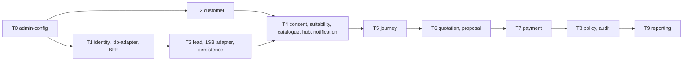

# Service contracts, LLDs and build briefs — index and build waves

**Status:** AI-DRAFTED 2026-10-22 under [`SUG-20261022-rdy`](../../governance/registers/SUGGESTION-REGISTER.md) (owner-directed), awaiting Mahesh (architecture) and Amit (delivery) review.

Every service has a checked-in **contract** (`openapi.yaml`, authoritative on the wire —
[ADR-027](../architecture-review/ADR-027-openapi-contract-authority.md)), an **LLD**, and a
**build brief** that tells one builder (developer or AI agent) what to build, in which order, what to
stub, and how to prove it. Start with the [build playbook](./BUILD-PLAYBOOK.md).

Shared: [events catalogue](./events/CATALOGUE.md) · [rule engine guide](./rule-engine/LLD.md) ·
[missing prices inventory](./MISSING-PRICES.md) ·
[design DDL](../data-architecture/schemas/README.md) ·
[owner decisions round 2](../architecture-review/DECISIONS-2026-10-22.md) (E1–E9, C1–C8) ·
[round 1](../architecture-review/DECISIONS-2026-10-21.md) (D1–D9) ·
[readiness review](../api-reference/READINESS-REVIEW.md)

## 1. Services

Maturity today is an **estimate** (contract operations coded × LLD gaps closed) at commit
`d1f3dd7`; it is not a measured figure. Target for every builder: 90–95 % per
[playbook §11](./BUILD-PLAYBOOK.md#11-definition-of-9095--mature--checklist).

| # | Service | Contract | LLD | Brief | Code today | Maturity today | Wave / tier |
|---|---|---|---|---|---|---|---|
| 1 | administration-config-service | [openapi](./administration-config-service/openapi.yaml) | [LLD](./administration-config-service/LLD.md) | [brief](./administration-config-service/BUILD-BRIEF.md) | Implemented (rule-set store) | ≈ 75 % | 1 · T0 |
| 2 | workforce-access-bff | [openapi](./workforce-access-bff/openapi.yaml) | [LLD](./workforce-access-bff/LLD.md) | [brief](./workforce-access-bff/BUILD-BRIEF.md) | Implemented (lead phase) | ≈ 75 % | 1 · T1 |
| 3 | identity-provider-adapter-service | [openapi](./identity-provider-adapter-service/openapi.yaml) | [LLD](./identity-provider-adapter-service/LLD.md) | [brief](./identity-provider-adapter-service/BUILD-BRIEF.md) | Implemented | ≈ 70 % | 1 · T1 |
| 4 | identity-authorization-service | [openapi](./identity-authorization-service/openapi.yaml) | [LLD](./identity-authorization-service/LLD.md) | [brief](./identity-authorization-service/BUILD-BRIEF.md) | Implemented; E5/E6 in flight | ≈ 65 % | 1 · T1 |
| 5 | customer-service | [openapi](./customer-service/openapi.yaml) | [LLD](./customer-service/LLD.md) | [brief](./customer-service/BUILD-BRIEF.md) | Partial (search, get) | ≈ 20 % | 1 · T2 |
| 6 | lead-service | [openapi](./lead-service/openapi.yaml) | [LLD](./lead-service/LLD.md) | [brief](./lead-service/BUILD-BRIEF.md) | Implemented; exception rules stubbed | ≈ 55 % | 1 · T3 |
| 7 | 1sb-integration-service | [openapi](./1sb-integration-service/openapi.yaml) | [LLD](./1sb-integration-service/LLD.md) | [brief](./1sb-integration-service/BUILD-BRIEF.md) | Implemented | ≈ 80 % | 1 · T3 |
| 8 | bank-persistence-service | [openapi](./bank-persistence-service/openapi.yaml) | [LLD](./bank-persistence-service/LLD.md) | [brief](./bank-persistence-service/BUILD-BRIEF.md) | Implemented | ≈ 80 % | 1 · T3 |
| 9 | consent-service | [openapi](./consent-service/openapi.yaml) | [LLD](./consent-service/LLD.md) | [brief](./consent-service/BUILD-BRIEF.md) | Skeleton | ≈ 5 % | 1 · T4 |
| 10 | suitability-service | [openapi](./suitability-service/openapi.yaml) | [LLD](./suitability-service/LLD.md) | [brief](./suitability-service/BUILD-BRIEF.md) | Skeleton (rule sets seeded) | ≈ 5 % | 1 · T4 |
| 11 | product-catalogue-service | [openapi](./product-catalogue-service/openapi.yaml) | [LLD](./product-catalogue-service/LLD.md) | [brief](./product-catalogue-service/BUILD-BRIEF.md) | Skeleton | ≈ 5 % | 1 · T4 |
| 12 | integration-hub-service | [openapi](./integration-hub-service/openapi.yaml) | [LLD](./integration-hub-service/LLD.md) | [brief](./integration-hub-service/BUILD-BRIEF.md) | Skeleton | ≈ 5 % | 1 · T4 |
| 13 | notification-service | [openapi](./notification-service/openapi.yaml) | [LLD](./notification-service/LLD.md) | [brief](./notification-service/BUILD-BRIEF.md) | Skeleton | ≈ 5 % | 1 · T4 |
| 14 | journey-orchestration-service | [openapi](./journey-orchestration-service/openapi.yaml) | [LLD](./journey-orchestration-service/LLD.md) | [brief](./journey-orchestration-service/BUILD-BRIEF.md) | Skeleton | ≈ 5 % | 1 · T5 |
| 15 | quotation-service | [openapi](./quotation-service/openapi.yaml) | [LLD](./quotation-service/LLD.md) | [brief](./quotation-service/BUILD-BRIEF.md) | Persistence + materialise built | ≈ 30 % | 1 · T6 |
| 16 | proposal-service | [openapi](./proposal-service/openapi.yaml) | [LLD](./proposal-service/LLD.md) | [brief](./proposal-service/BUILD-BRIEF.md) | Persistence + materialise built | ≈ 25 % | 1 · T6 |
| 17 | payment-service | [openapi](./payment-service/openapi.yaml) | [LLD](./payment-service/LLD.md) | [brief](./payment-service/BUILD-BRIEF.md) | Skeleton | ≈ 5 % | 1 · T7 |
| 18 | policy-issuance-service | [openapi](./policy-issuance-service/openapi.yaml) | [LLD](./policy-issuance-service/LLD.md) | [brief](./policy-issuance-service/BUILD-BRIEF.md) | Skeleton | ≈ 5 % | 1 · T8 |
| 19 | audit-compliance-service | [openapi](./audit-compliance-service/openapi.yaml) | [LLD](./audit-compliance-service/LLD.md) | [brief](./audit-compliance-service/BUILD-BRIEF.md) | Skeleton (ADR-026 now accepted) | ≈ 5 % | 1 · T8 |
| 20 | reporting-mis-service | [openapi](./reporting-mis-service/openapi.yaml) | [LLD](./reporting-mis-service/LLD.md) | [brief](./reporting-mis-service/BUILD-BRIEF.md) | Skeleton | ≈ 2 % | 1 (limited) · T9 |
| 21 | direct-insurer-adapter-service | [openapi](./direct-insurer-adapter-service/openapi.yaml) | [LLD](./direct-insurer-adapter-service/LLD.md) | [brief](./direct-insurer-adapter-service/BUILD-BRIEF.md) | Skeleton, deferred R1 | ≈ 2 % | 1 (port only) · R1 |

## 2. Waves and tiers

**Wave 0 — ready now (shared foundation).** `libs/bank-common-error`, `bank-common-events` (outbox
relay, idempotent consumer, Kafka adapter), `bank-rule-engine` (engine, resolver, eight seeds),
`bank-common-observability`, `bank-common-test`; all 21 contracts + LLDs; events catalogue and
schemas; design DDL. Gaps a builder will hit: `OpenApiConformance` helper not built (playbook §5);
several events and rule-set seeds named by LLDs are not yet in the catalogue / seeds (each brief
lists them).

**Wave 1 — all 21 services can start today, in parallel, with stubs** (playbook §9). No builder
waits for another. Two are limited by design:

- **reporting-mis-service** — only event intake, freshness and validation; the read-model store and
  report definitions are undecided, so it cannot reach 90 %.
- **direct-insurer-adapter-service** — only the shared adapter port with a fake insurer; no insurer
  or API exists (deferred to R1), so it cannot reach 90 %.

**Wave 2 — integration: replace stubs with real calls in tier order.** A tier needs the tiers above
it to be `BUILT` for its end-to-end tests; it never needs them to *start*.

| Tier | Services | Real upstreams needed for integration |
|---|---|---|
| T0 | administration-config | — |
| T1 | identity-authorization, identity-provider-adapter, workforce-access-bff | T0 (rule-set approval PDP later) |
| T2 | customer | T0, CBS (bank) |
| T3 | lead, 1sb-integration, bank-persistence | T0, T1 |
| T4 | consent, suitability, product-catalogue, integration-hub, notification | T0–T3 |
| T5 | journey-orchestration | T1–T4 |
| T6 | quotation → proposal | T4, T5 |
| T7 | payment | T6, PG (S10) |
| T8 | policy-issuance, audit-compliance | T6, T7; every producer for audit |
| T9 | reporting-mis | All producers + store decision |

## 3. What blocks starting vs what blocks go-live

**Nothing blocks starting** any of the 21 builds. The items below block **go-live** (S11 and
production); builders keep working around them with fail-closed behaviour and stubs.

| Blocker | Kind | Affects | Owner |
|---|---|---|---|
| **GAP-006 / GAP-007** human Compliance signature on the consent and suitability rule packs (C8, `DEC-20260816-06`, non-waivable) | Governance | consent, suitability, journey, quotation — the whole sale | Shailja |
| GATE-S08 approval; S09 infrastructure (Aurora, DynamoDB + streams, MSK topics, Valkey, S3 Object Lock) | Governance / infra | All | Mahesh; Shivanshi |
| Lead exception thresholds and data sources **unset** — every lead `BLOCK`s | Configuration | lead (and everything after it) | Exception BRD owner |
| Lead exception approval operation not contracted (E6 rules decided) | Contract | lead | Rajal + Mahesh |
| BFF has no routes for the sale journey | Contract | BFF, journey (RM app) | Mahesh |
| Consent statements and notification templates: wording unapproved (C7) and storage not contracted | Content / contract | consent, notification | Shailja; Mahesh |
| Customer-device OTP confirmation surface not designed (C2) | Design | consent, suitability acknowledgements | Mahesh + Rajal |
| Rule-set seeds still missing content: `JOURNEY.POLICY`, `AUDIT.SOLD.COMPLETENESS`, `NOTIFICATION.TEMPLATES`, quote validity, proposal issuance mode. `CATALOGUE.ELIGIBILITY` **seed exists** but band rows (`minSumAssured` / `maxSumAssured` …) are unset — every product `NOT_ELIGIBLE` until Rajal publishes ([MISSING-PRICES.md](./MISSING-PRICES.md)) | Configuration | journey, catalogue, audit, notification, quotation, proposal | Rule-engine owner; content approvers |
| Insurer-decision TAT owner under E1 + C4 (clock runs before payment) | Design | proposal, policy-issuance | Mahesh, Shailja |
| 1SB status callback availability (else polling at 4 h) | External | policy-issuance | Mahesh, 1SB |
| AU Bank PG contract (S10), CBS inquiry API, SMS / email gateway, AD-verify prod endpoint | External (bank) | payment, customer, notification, idp-adapter | Bank |
| `SOLD` completeness step list | Compliance | audit, journey | Shailja |
| Read-model store; report definitions | Decision | reporting | Mahesh; Rajal |
| Direct insurer admission | Decision | direct-insurer adapter (R1) | Mahesh / Rajal |

## 4. Cross-service gaps found while writing the briefs

| Gap | Where | Owner |
|---|---|---|
| Events named by LLDs but absent from the catalogue: `RuleSetPublished`, `CustomerSearched`/`Resolved`/`SnapshotTaken`, `ConsentExpired`, `SuitabilityGateRefused`/`DisclosureAcknowledged`/`Expired`/`Invalidated`/`Superseded`, `JourneyStarted`/`StageChanged`/`Halted`/`Abandoned`, `QuoteExpired`, `ProposalBlockedNoConsent`/`Expired`/`StatusChanged`, `PaymentUncertain`/`Rejected`/`RefundInitiated`/`Refunded`, `IssuanceTrackingStarted`, `PolicyClosed`, `ProductVersionPublished`, `NotificationSent`/`Failed` | Producer LLDs vs [catalogue](./events/CATALOGUE.md) | Events catalogue owner |
| Error codes named by contracts — **registered** in `bank-common-error` (`SUITABILITY_INCOMPLETE`, `JOURNEY_HALTED_CONSENT_WITHDRAWN`, `ISSUANCE_MODE_INVALID`, `OTP_*`, `CONSENT_SUBJECT_MISMATCH`); keep catalogue and OpenAPI in lockstep when adding more | consent, suitability, journey, proposal | bank-common-error owner |
| LLDs still written to round 1 (D5 consent timing, ADR-026 "proposed", TAT start at payment) | consent, journey, suitability, audit, policy LLDs | Contract owners |
| PDP action catalogue for the new services | identity-authorization | Deepali |
| `OpenApiConformance` shared test helper (ADR-027 §3) | `libs/bank-common-test` | Amit |
| Design DDL for `hub` and `notification` schemas (E3) | [schemas](../data-architecture/schemas/README.md) | Aarti |
