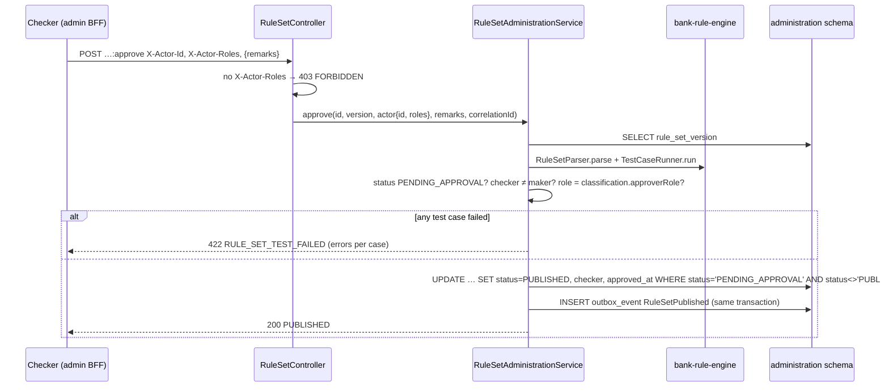

# administration-config-service — rule-set store LLD

**Status:** AI-DRAFTED from code (`services/administration-config-service`, `SUG-20261021-rul`),
awaiting Mahesh (architecture), Deepali (security: interim `X-Actor-Roles`) and Shailja (Compliance
approval flow) review.

Contract: [openapi.yaml](./openapi.yaml) · Engine and authoring guide: [rule-engine LLD](../rule-engine/LLD.md)
· Specification: [ADR-024](../../architecture-review/ADR-024-configuration-driven-rule-engine.md),
[ADR-025](../../architecture-review/ADR-025-event-specification-and-publisher.md) (outbox)
· Service page: [api-reference](../../api-reference/services/administration-config-service.md).

## 1. Purpose and ownership

Bounded context #19. This slice owns **rule sets** (`rule-set/v1`): it stores every version,
enforces maker-checker and test-case gating, publishes immutably, resolves the version in force for
deciding services, and announces publication with `RuleSetPublished`. Port 8104,
`service-id: admin-config`, layer L5, INTERNAL. Schema `administration`.

The older generic `configuration_record` / `GET /internal/v1/config:resolve` design on the service
page is **not** built; rule sets supersede it for every rule-shaped configuration (ADR-024). Other
configuration domains (forms, retention, role grants) remain open.

## 2. API summary

| Method | Path | Operation | Who |
|---|---|---|---|
| `POST` | `/internal/v1/rule-sets/{ruleSetId}/versions` | [createRuleSetDraft](./openapi.yaml) | maker |
| `GET` | `/internal/v1/rule-sets/{ruleSetId}/versions` | listRuleSetVersions | any internal |
| `GET` | `/internal/v1/rule-sets/{ruleSetId}/versions/{version}` | getRuleSetVersion | any internal (pinned journeys) |
| `PUT` | `/internal/v1/rule-sets/{ruleSetId}/versions/{version}` | replaceRuleSetDraft | maker |
| `POST` | `…/{version}:submit` | submitRuleSetVersion | maker |
| `POST` | `…/{version}:approve` | approveRuleSetVersion (= publish) | checker |
| `POST` | `…/{version}:reject` | rejectRuleSetVersion | checker |
| `POST` | `…/{version}:simulate` | simulateRuleSetVersion | author, checker |
| `GET` | `/internal/v1/rule-sets:resolve?domain&lob&productClass&asOf` | resolveRuleSet | deciding services (S-21) |

## 3. Operation flows

**Create draft.** (1) path id = document id, else `422 INVALID_REQUEST`; (2) `RuleSetParser.parse`
— any finding → `422 RULE_SET_INVALID`, one `errors[]` per finding; (3) store the **canonical**
document (sorted keys, normalised numbers) and its SHA-256 as DRAFT, `maker = X-Actor-Id`;
duplicate → `409 CONFLICT`.

**Replace draft.** DRAFT or REJECTED only (`409 ILLEGAL_TRANSITION` otherwise); id and version must
not change; status back to DRAFT, maker = actor, checker / remarks cleared.

**Submit.** DRAFT → PENDING_APPROVAL, guarded by prior status.

**Approve (publish).**

**Reject.** Same checker rules; remarks mandatory (`422 MISSING_REQUIRED_FIELD`); → REJECTED.

**Simulate.** Any status; evaluates `inputs` (if given) and runs every test case; writes nothing.

**Resolve.** Load PUBLISHED versions of `domain`; keep those in force at `asOf` (default now) whose
scope matches (`null` = any); pick most specific scope, then latest `effectiveFrom`, then latest
`approved_at` (`VersionResolution`). None → `422 CONFIGURATION_UNRESOLVABLE`. A newer version
supersedes an older one by its later `effectiveFrom` — the older row is never touched.

**Seed import (startup).** `SeedImportRunner` (`admin-config.seed-import.enabled`, default true)
inserts each `libs/bank-rule-engine` seed as DRAFT with maker `system:seed-import` when its
(ruleSetId, version) is absent. It never submits or publishes — content approval belongs to the
owner named in the seed's `governance` block.

## 4. Rule-engine usage

The service evaluates no business decision itself. It uses the engine to **validate** documents,
**run test cases** (publish gate, simulate) and **simulate** inputs. Hit policy per rule set is in
the document ([rule-engine LLD §4](../rule-engine/LLD.md#4-hit-policies-and-precedence)).

## 5. Validation rules

| Field / condition | Rule | Error code |
|---|---|---|
| `X-Actor-Id` | required on every write | 400 (Spring default, no envelope) |
| `X-Actor-Roles` | required on approve / reject | `FORBIDDEN` (403) |
| path `ruleSetId` | equals document `ruleSetId` | `INVALID_REQUEST` (422) |
| document | `RuleSetValidator` finds nothing | `RULE_SET_INVALID` (422) — **new** |
| (ruleSetId, version) | unique | `CONFLICT` (409) |
| status for the step | DRAFT for submit; DRAFT/REJECTED for edit; PENDING_APPROVAL for decide | `ILLEGAL_TRANSITION` (409) |
| checker | ≠ maker | `MAKER_CHECKER_VIOLATION` (403) — **new** |
| checker roles | contain `COMPLIANCE_APPROVER` / `PRODUCT_APPROVER` / `CONFIG_APPROVER` per classification | `FORBIDDEN` (403) |
| test cases | all pass at approve | `RULE_SET_TEST_FAILED` (422) — **new** |
| reject remarks | non-blank | `MISSING_REQUIRED_FIELD` (422) |
| resolve | a version in force exists | `CONFIGURATION_UNRESOLVABLE` (422 in the registry; ADR-024 says 503 — open item) |

The three new codes are contributed by `AdminConfigErrorDefinitions` through
`ErrorDefinitionProvider` (ServiceLoader), so the shared `ErrorCodes` is unchanged.

## 6. DTO → domain → table mapping

| DTO (`RuleSetVersion` response) | Domain (`RuleSetVersion.Snapshot`) | Column (`administration.rule_set_version`) |
|---|---|---|
| `id` | `id` (ULID) | `id CHAR(26)` PK |
| `ruleSetId`, `version` | same | `rule_set_id`, `version` — `UNIQUE (rule_set_id, version)` |
| `domain` | `domain` | `domain` |
| `scope.lob`, `scope.productClass` | `scopeLob`, `scopeProductClass` | `scope_lob`, `scope_product_class` (nullable = any) |
| `classification` | `RuleSet.Classification` | `classification` CHECK |
| `status` | `RuleSetVersionStatus` | `status` CHECK `DRAFT…RETIRED` |
| `document` | `document` (canonical JSON) | `document TEXT` |
| `documentSha256` | `documentSha256` | `document_sha256 CHAR(64)` |
| `effectiveFrom`, `effectiveTo` | same | `effective_from`, `effective_to` (CHECK to > from) |
| `maker`, `checker`, `approvedAt`, `decisionRemarks`, `createdAt` | same | same, CHECK published ⇒ checker set, ≠ maker |

Outbox: `administration.outbox_event (outbox_id CHAR(26), aggregate_type, aggregate_id, event_type,
payload TEXT, created_at, published_at, attempts, last_error, parked_at)`, index
`(published_at, created_at)` — ADR-025 point 3. Migrations: `V2__administration_rule_set_version.sql`;
`db/vendor/postgresql/V3` immutability trigger (H2 counterpart is a comment only).

## 7. Invariants and where they are enforced

| Invariant | Where |
|---|---|
| Published version immutable (`SUIT-R07`) | `RuleSetVersion` (no transition out of PUBLISHED); repository `WHERE status <> 'PUBLISHED'`; PostgreSQL trigger `trg_rule_set_version_immutable` (UPDATE and DELETE) |
| Maker ≠ checker | `RuleSetVersion.checkDecision`; table CHECK `ck_rsv_published_checked` |
| Approver role per classification | `RuleSetVersion.checkDecision` with `Classification.approverRole()` |
| No publish with a failing test case | `RuleSetAdministrationService.approve` |
| Concurrent decisions | UPDATE guarded by expected prior status → `409 ILLEGAL_TRANSITION` |
| No compiled-in default | resolve fails with `CONFIGURATION_UNRESOLVABLE`; client resolver fails closed |
| Seeds never auto-published | `SeedImportService` inserts DRAFT only |

## 8. Events

| Event | When | Envelope (`event-envelope/v1`) | `data` |
|---|---|---|---|
| `RuleSetPublished` (produced) | approve | `source: admin-config`, `aggregateType: RuleSet`, `aggregateId: ruleSetId`, `actor {id: checker, type: WORKFORCE, actingCapacity: CHECKER}`, `configVersionRef: ruleSetId@version`, `correlationId` from header | `ruleSetId, version, versionId, domain, scopeLob, scopeProductClass, classification, effectiveFrom, effectiveTo, documentSha256` — no PII |

Consumers (every deciding service) call `CachingRuleSetResolver.invalidate(ruleSetId)`. Topic per
ADR-025: `{env}.admin-config.rule-set.v1`. The event is not yet in the
[events catalogue](../events/CATALOGUE.md) (open item 4). Consumed: none.

## 9. Idempotency, timeouts, failure modes

| Topic | Behaviour |
|---|---|
| Idempotency | Create is idempotent on (ruleSetId, version) → repeat `409`; steps guarded by prior status |
| Callers' budget | 300 ms, no retry, fail closed (client in `libs/bank-rule-engine`) |
| L1 cache | TTL 60 s (configurable), bounded staleness if `RuleSetPublished` is lost |
| DB down | 5xx; callers fail closed |
| Relay | Not in this service; the shared `JdbcOutboxRelay` (`libs/bank-common-events`) drains `outbox_event` |

## 10. Open items

| # | Item | Owner |
|---|---|---|
| 1 | Replace `X-Actor-Roles` with a PDP decision `rule-set.approve` (and maker permission) | Deepali |
| 2 | `CONFIGURATION_UNRESOLVABLE` status: registry 422 vs ADR-024 503 | Mahesh |
| 3 | `RETIRED` has no endpoint; retirement today = publish a successor with a later `effectiveFrom` | Mahesh |
| 4 | Add `RuleSetPublished` and its schema to the events catalogue | Events owner |
| 5 | Admin UI / BFF route for authors and checkers (R0 W4) | Delivery |
| 6 | Seed content approvals (each seed's `governance.contentApprovers`) | Shailja, Rajal, Exception BRD owner, Mahesh |
