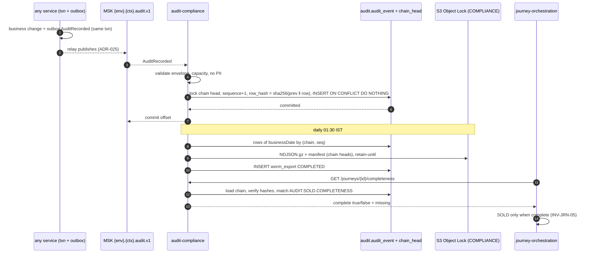

# audit-compliance-service — Low-level design

**Status:** AI-DRAFTED 2026-10-21 — **PROPOSED**, awaiting Mahesh's yes on
[ADR-026](../../architecture-review/ADR-026-audit-store-and-transport.md) (decision D7), then Shailja
(retention, required SOLD sequence) and Deepali (tamper evidence) review. Do not build before the
owner's yes.

[OpenAPI](./openapi.yaml) · [API reference page](../../api-reference/services/audit-compliance-service.md) ·
[ADR-025 events](../../architecture-review/ADR-025-event-specification-and-publisher.md) ·
[Scenario 13 — SOLD](../../api-reference/scenarios/13-policy-issuance-and-sold.md)

## 1. Purpose and ownership

Turns every regulated business action into **immutable, tamper-evident evidence**: who did what to
which customer's sale, in what capacity, and what the system decided (rule-set version). It answers
the `SOLD` completeness question (`INV-JRN-05`) and serves compliance evidence queries. Database
activity audit (pgaudit, Database Activity Streams, CloudTrail) stays as it is and is **not** this
service (ADR-026 §5).

| | |
|---|---|
| Module | `services/audit-compliance-service` · port 8101 · `service-id: audit` · L5 INTERNAL |
| Inputs | `AuditRecorded` events from every service's outbox (ADR-025), consumer group `audit-compliance` |
| Callers | journey-orchestration (completeness), BFF compliance routes, operations (export) |
| Owns (proposed) | Aurora schema `audit`: `audit_event` (INSERT-only), `chain_head`, `worm_export`; S3 bucket with Object Lock (compliance mode) |
| Replaces | `bank_persistence.audit_event` as the business record — retired after migration (§9) |

## 2. API summary

| Method | Path | Purpose |
|---|---|---|
| (consumer) | `AuditRecorded` on `{env}.{context}.audit.v1` | Ingest (§3) |
| `GET` | `/internal/v1/audit/journeys/{journeyId}/completeness` | `SOLD` precondition (§5) |
| `GET` | `/internal/v1/audit/journeys/{journeyId}/events` | Journey timeline |
| `GET` | `/internal/v1/audit/events?resourceType&resourceId&journeyId&actorId&action&from&to` | Evidence search |
| `GET` | `/internal/v1/audit/events/{eventId}` | One record with `prevHash` / `rowHash` |
| `POST` | `/internal/v1/audit/exports` | (Re-)run the WORM export for a date |
| `GET` | `/internal/v1/audit/exports/{exportId}` | Export status and manifest |

Topic naming follows ADR-025 (`{env}.{context}.{aggregate}.v{n}`); each producing context publishes
its `AuditRecorded` events on `{env}.{context}.audit.v1` and the consumer subscribes by pattern.
This topic choice is part of the proposal (A-5).

## 3. Ingest — consume, validate, chain, store

1. Receive; parse envelope `event-envelope/v1`; `eventType = AuditRecorded`.
2. Validate (table §6). Invalid → retry topic is pointless for a schema error → straight to DLQ
   `{env}.dlq.audit-compliance` + alert. The producer is fixed and replays from its outbox.
3. `chainId` = `journey:{journeyId}` when `journeyId` is present, else `source:{source}` (one chain
   per journey keeps completeness and verification local, and contention per journey).
4. One transaction:
   - `SELECT … FROM audit.chain_head WHERE chain_id = ? FOR UPDATE` (insert head with
     `prev_hash = 64 × '0'` on first use);
   - `sequence_no = last_seq + 1`; `row_hash = sha256(prev_hash ‖ canonical(row))` where
     `canonical` is RFC 8785 JSON of every stored column except `row_hash`;
   - `INSERT audit.audit_event … ON CONFLICT (event_id) DO NOTHING` — a duplicate is **success**
     and does not advance the head;
   - `UPDATE audit.chain_head` (the only updatable audit table; it holds no evidence).
5. Commit, **then** commit the consumer offset (the write is the completion condition, F-10).
6. Transient failures: retry topic 1 s, 10 s, 60 s, then DLQ = operations task; `SOLD` stays
   blocked for that journey because completeness reads the store, not the topic.

## 4. WORM export (daily)

1. Scheduler (cluster-singleton via ShedLock-style lease) runs at 01:30 IST for `businessDate =
   yesterday`; `POST /exports` re-runs a date idempotently.
2. Select rows with `recorded_at` in the date (all are > 1 day old by then), ordered by
   `(chain_id, sequence_no)`; write gzip NDJSON to `s3://…/audit/{yyyy}/{mm}/{dd}/{exportId}.ndjson.gz`.
3. Manifest `{exportId, businessDate, rowCount, objectSha256, chainHeads: {chainId: {sequenceNo, rowHash}}}`
   written next to it; `manifestSha256` stored in `audit.worm_export`.
4. `PutObject` with Object Lock **COMPLIANCE**, `retain-until` = max(`retain_until`) of the rows.
   `RET-7Y` = `occurred_at + 7 years`; `RET-POLICY+7Y` needs policy closure date, unknown at write —
   the lock is extended when `PolicyClosed` arrives (Object Lock allows extension, never reduction)
   — A-3 for Shailja.
5. Verify: re-read object, recompute hash, recompute each chain from the previous manifest's head;
   mismatch → export `FAILED` + security alert (no silent retry).

## 5. Completeness for `SOLD`

The required sequence is **configuration** (owner rule: anything Compliance may change is config).
Proposed rule set `AUDIT.SOLD.COMPLETENESS` (classification `COMPLIANCE`, approver Shailja), used
only for its `parameters`:

```json
"parameters": {
  "requiredSteps": [
    { "step": "SUITABILITY",      "action": "SUITABILITY_EVALUATED" },
    { "step": "CONSENT_QUOTE",    "action": "CONSENT_VERIFIED", "qualifier": "BEFORE_MULTI_QUOTE" },
    { "step": "QUOTE",            "action": "QUOTE_COMPLETED" },
    { "step": "SELECTION",        "action": "OFFER_SELECTED" },
    { "step": "CONSENT_PROPOSAL", "action": "CONSENT_VERIFIED", "qualifier": "BEFORE_PROPOSAL_SUBMIT" },
    { "step": "PROPOSAL",         "action": "PROPOSAL_SUBMITTED" },
    { "step": "PAYMENT",          "action": "PAYMENT_RECONCILED" },
    { "step": "ISSUANCE",         "action": "POLICY_ISSUED" }
  ]
}
```

Seed **derived** from `VR-104` / `INV-AUD-02` and the D5 / D8 sequences — not from a Compliance
list; scenario 13 says "four evidence events" without naming them. **Awaiting Shailja** (A-2).
`CONSENT_VERIFIED` is written on the journey even when an existing consent is reused (D5
`reuseAcrossJourneys`), so the evidence is per journey.

Flow: resolve the parameters (fail closed → `422 CONFIGURATION_UNRESOLVABLE`), load the journey
chain, verify hashes from sequence 1, match steps; `complete = missing.isEmpty() && chainVerified`.
Journey budget: 2 s, 1 retry; `503` → journey stays `ISSUED`.



## 6. Validation rules (ingest and queries)

| Field | Rule | On failure |
|---|---|---|
| `eventId` | ULID | DLQ |
| `eventType` | `AuditRecorded` | DLQ |
| `actor.id`, `actor.type` | present (`INV-ACT-04`) | DLQ |
| `actor.actingCapacity` | `SP_ACCOUNTABLE` / `ASSIST_ONLY` when actor is a human | DLQ |
| IPR actor | `actorInsurerId` and `assistedActorId` present | DLQ |
| `data` | valid against `AuditRecorded.v1.json` (`action`, `resourceType`, `resourceId`, `outcome ∈ SUCCESS/DENIED/FAILED`) | DLQ |
| `data` | allow-listed keys only (ids, states, rule-set refs); PII detector on values | DLQ + security alert |
| query selector | one of resource / journey / actor | `422 VALIDATION_ERROR` |
| query range | ≤ 31 days | `422 VALIDATION_ERROR` |
| export date | < today | `422 VALIDATION_ERROR` |

## 7. DTO → domain → table (PROPOSED DDL — new schema `audit`, DDL addition required)

| DTO / envelope | Domain | Column |
|---|---|---|
| `eventId` | `AuditRecord.id` | `audit.audit_event.event_id CHAR(26) UNIQUE` |
| — | `ChainPosition` | `chain_id`, `sequence_no` (`UNIQUE (chain_id, sequence_no)`) |
| `data.action`, `source`, `aggregateType/Id` | `AuditRecord` | `action`, `source`, `aggregate_type`, `aggregate_id` |
| `journeyId`, `leadId` | | `journey_id`, `lead_id` |
| `actor.*` | `Actor` | `actor_id`, `actor_type`, `acting_capacity` (`ck_audit_capacity`), `actor_insurer_id`, `assisted_actor_id` |
| `data.resourceType/Id`, `outcome`, `priorState`, `newState` | | `resource_type`, `resource_id`, `outcome`, `prior_state`, `new_state` |
| `configVersionRef` | | `config_version_ref` |
| `occurredAt` / ingest time | | `occurred_at` / `recorded_at` |
| `traceId`, `correlationId` | | `trace_id`, `correlation_id` |
| `data.consentRef`, `data.suitabilityRef`, `data.reasonCodes` | | `consent_ref`, `suitability_ref`, `reason_codes TEXT[]` |
| full `data` member as received | | `data JSONB` (schema [`AuditRecorded.v1.json`](../events/schemas/AuditRecorded.v1.json)) |
| — | `HashLink` | `prev_hash CHAR(64)`, `row_hash CHAR(64)` |
| — | `Retention` | `retain_until` |
| head | `ChainHead` | `audit.chain_head (chain_id PK, last_seq, last_hash)` |
| export | `WormExport` | `audit.worm_export (export_id PK, business_date UNIQUE, status, row_count, object_key, manifest_sha256, retain_until, completed_at)` |

Grants: `app_audit` has `INSERT, SELECT` on `audit_event`; `UPDATE`/`DELETE` revoked **and**
blocked by a `BEFORE UPDATE OR DELETE` trigger that raises (ADR-026 §2); `chain_head` and
`worm_export` are updatable by `app_audit` only.

## 8. Invariants

| Invariant | Enforced where |
|---|---|
| `INV-AUD-01` immutable, retained ≥ 7 years | Grants + trigger; Object Lock COMPLIANCE |
| Idempotent consume | `UNIQUE (event_id)`, `ON CONFLICT DO NOTHING` |
| Tamper evidence | Hash chain per `chain_id`; export manifest carries heads |
| `INV-JRN-05` no `SOLD` without evidence | Completeness reads the store, never the topic |
| No PII in evidence | Envelope rule (ADR-025) + ingest allow-list |

## 9. Events and migration

| Direction | Event | Notes |
|---|---|---|
| Consumed | `AuditRecorded` (every producer) | ADR-026 §1 |
| Consumed | `RuleSetPublished` (`AUDIT.SOLD.COMPLETENESS`) | Cache invalidation |
| Consumed | `PolicyClosed` (**NEW**, policy-issuance) | Extends `RET-POLICY+7Y` locks |
| Produced | `AuditRecorded` for evidence **reads** (`EVIDENCE_VIEWED`) and exports | Written to its own chain `source:audit` directly in the store transaction — no outbox loop |

Migration: the 1SB adapter keeps writing adapter evidence to `bank_persistence` (jobs, raw
payloads); its `AuditEventPublisher` moves to `AuditRecorded` events; existing
`bank_persistence.audit_event` rows are copied once into `audit` as chain `legacy:bank_persistence`
and the table is retired (A-4).

## 10. Failure modes

| Failure | Behaviour |
|---|---|
| Audit store down | Consumer pauses; producers' outboxes and topics buffer (7-day retention); journeys cannot reach `SOLD` |
| Chain verification fails | `complete = false`, `chainVerified = false`, security incident; never auto-repaired |
| Export fails | Retried next run; rows stay in Aurora; alert after 2 consecutive days |
| Poison event | DLQ + ops task |

## 11. Open items

| # | Item | Owner |
|---|---|---|
| A-1 | Accept ADR-026 (D7) | Mahesh |
| A-2 | Approve the required `SOLD` steps (§5) and add `AUDIT.SOLD.COMPLETENESS` to ADR-024 §7 | Shailja; Mahesh |
| A-3 | Retention classes and lock extension for `RET-POLICY+7Y` | Shailja |
| A-4 | DDL: new `audit` schema (`audit_event`, `chain_head`, `worm_export`), role `app_audit`; retire `bank_persistence.audit_event` | DBA |
| A-5 | Topic convention for `AuditRecorded` (`{env}.{context}.audit.v1`) and event `PolicyClosed` in the catalogue | Mahesh (ADR-025) |
| A-6 | Hash-chain design review (canonicalisation, per-journey chains) | Deepali |
