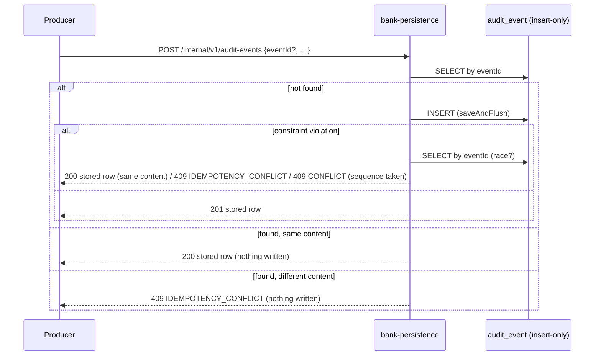

# bank-persistence-service — low-level design

**Status:** AI-DRAFTED from code (ADR-027), awaiting engineering, DBA and Shailja (compliance — audit evidence) review. Audit store design follows `ADR-026`, which is **proposed** (awaiting owner yes).

[Contract (authoritative)](./openapi.yaml) · [API portal page](../../api-reference/services/bank-persistence-service.md) ·
[Adapter to persistence](../../api-reference/interactions/onesb-adapter-to-persistence.md) ·
[ADR-026 (proposed)](../../architecture-review/ADR-026-audit-store-and-transport.md) ·
[ADR-027](../../architecture-review/ADR-027-openapi-contract-authority.md) ·
[Readiness review §3.6](../../api-reference/READINESS-REVIEW.md#36-dto--entity-mapping-and-invariants)

## 1. Purpose and ownership

The platform-common database owner for **provider integration state** — async jobs, offers, poll
attempts, encrypted raw provider payloads, adapter payment-URL sessions — and **audit event
ingestion**. It lets the 1SB adapter (and future adapters) stay stateless. It is not a home for
business contexts (`ARCH-004`, `DR-OWN-03`).

| Item | Value |
|---|---|
| Module | `services/bank-persistence-service`, port 8081, `service-id: persistence`, layer L7, INTERNAL |
| Owns data | Aurora schema `bank_persistence` (Flyway V1–V4 + vendor scripts), role `app_bank_persistence` (INSERT/SELECT on `audit_event`, `raw_payload`) |
| Callers | `1sb-integration-service`; audit producers (target); support tooling (reads) |
| Caller auth | `X-Internal-Service-Key` (`PERSISTENCE_INTERNAL_SHARED_SECRET`) — **fix-pending**, change in progress |
| Validation status | `400` (`bank.error.validation-status: 400`), not the platform 422 |

Source: `services/bank-persistence-service/src/main/java/com/bank/persistence/**`.

## 2. API summary

| Method | Path | Success | Refusals |
|---|---|---|---|
| POST | `/internal/v1/jobs` | 201 | 400; 500 (duplicate `idempotencyKey`) |
| GET | `/internal/v1/jobs/{jobId}` | 200 | 404 |
| PATCH | `/internal/v1/jobs/{jobId}/status` | 200 | 400, 404 |
| GET | `/internal/v1/jobs/{jobId}/offers` | 200 | 404 |
| POST | `/internal/v1/jobs/{jobId}/offers` | 201 | 400 (unparseable), 404 |
| GET | `/internal/v1/jobs/{jobId}/poll-attempts` | 200 | 404 |
| POST | `/internal/v1/jobs/{jobId}/poll-attempts` | 201 | 400, 404 |
| POST | `/internal/v1/raw-payloads` | 201 (metadata) | 400 |
| GET | `/internal/v1/raw-payloads?jobId` | 200 (metadata) | – |
| GET | `/internal/v1/raw-payloads/{payloadId}` | 200 (decrypted) | 404 |
| POST | `/internal/v1/payment-sessions` | 201 | 400 |
| GET | `/internal/v1/payment-sessions/{sessionId}` | 200 | 404 |
| POST | `/internal/v1/audit-events` | 201 new / **200 duplicate** (fix-pending) | 400; 409 `IDEMPOTENCY_CONFLICT` / `CONFLICT` |
| GET | `/internal/v1/audit-events?resourceId` | 200 | – |

Every operation: `401 UNAUTHORIZED` without a valid `X-Internal-Service-Key` (**fix-pending**).

## 3. Operation flows

### 3.1 Jobs, offers, poll attempts

Straight CRUD through Spring Data repositories. Create mints `jobId` (UUID), `PENDING`,
`external_provider = ONE_SB`, `version = 0`. Status patch overwrites `status` and writes the other
fields only when non-null; it does not check transitions (the adapter owns the job state machine).
Offer and poll-attempt writes first check the job exists (`404`).

### 3.2 Raw payloads

1. Bean validation (`direction` ∈ `REQ|RES`, etc.).
2. `RawPayloadEncryptionService.encrypt` (AES-256-GCM) → `payload_enc`, `encryption_key_id`.
3. `retain_until` = request value or today (UTC) + `raw-payload.retention.years` (default 7).
4. `201` with metadata only. Reads by job return metadata; only the by-id read decrypts.

### 3.3 Audit append (decided, fix-pending)

"Same content" compares every caller-supplied field; absent `eventTime` / `eventSchemaVersion`
match the stored value; times are compared at microsecond precision.

## 4. Validation rules

| Field | Rule | Error code |
|---|---|---|
| job `lob`, `jobType`, `createdByActor` | `@NotBlank` | `400 VALIDATION_ERROR` |
| job `idempotencyKey` | unique | `500` (unmapped constraint — open item) |
| status `status` | `@NotBlank` | `400 VALIDATION_ERROR` |
| poll `attemptNumber` | `@NotNull` (SMALLINT) | `400 VALIDATION_ERROR` |
| raw `jobId`, `operation`, `lob`, `payload` | `@NotBlank` | `400 VALIDATION_ERROR` |
| raw `direction` | `REQ` \| `RES` | `400 VALIDATION_ERROR` |
| session `applicationNumber`, `lob`, `paymentUrl`, `redirectUrl`, `status`, `createdByActor` | `@NotBlank` | `400 VALIDATION_ERROR` |
| audit `action`, `actorId`, `actorType`, `resourceType`, `resourceId`, `outcome` | `@NotBlank` + column sizes | `400 VALIDATION_ERROR` |
| audit `actingCapacity` | `SP_ACCOUNTABLE` \| `ASSIST_ONLY` | `400 VALIDATION_ERROR` |
| audit `eventSchemaVersion` ≥ 1, `sequenceNo` ≥ 0 | `@Min` | `400 VALIDATION_ERROR` |
| audit `(journeyId, sequenceNo)` | unique | `409 CONFLICT` |
| audit replay with different content | – | `409 IDEMPOTENCY_CONFLICT` |
| offer body | not validated | – |
| any body | parseable JSON | `400 INVALID_REQUEST` |

Rule-engine usage: none.

## 5. DTO → table mapping

| DTO | Table | Notes |
|---|---|---|
| `CreateJobRequest` / `JobResponse` | `integration_job` | `job_id VARCHAR(36)` PK, `idempotency_key` UNIQUE, `version` |
| `CreateOfferRequest` / `OfferResponse` | `integration_job_offer` | FK `job_id`; `funds_json` (V2) |
| `CreatePollAttemptRequest` / `PollAttemptResponse` | `job_poll_attempt` | `attempt_id BIGSERIAL` |
| `CreateRawPayloadRequest` → summary / full | `raw_payload` | `payload_enc BYTEA`, `encryption_key_id`, `retain_until DATE`, no FK to job |
| `CreatePaymentSessionRequest` / `PaymentSessionResponse` | `payment_session` | FK `job_id` (nullable) |
| `CreateAuditEventRequest` / `AuditEventResponse` | `audit_event` | V1 columns + V3 reconstruction columns (`prior_state`, `new_state`, `consent_ref`, `suitability_ref`, `event_schema_version`, `retain_until`, `sequence_no`, `acting_capacity`, `actor_insurer_id`, `assisted_actor_id`, `config_version_ref`); V4 `ck_audit_capacity`; unique `(journey_id, sequence_no)` and immutability trigger in vendor scripts |

## 6. Invariants

| Invariant | Where |
|---|---|
| Audit rows are never updated or deleted | controller insert-only path; DB grants; PostgreSQL trigger (fix-pending) |
| Duplicate `eventId` is success, not a write | `AuditEventController.replay` (fix-pending) |
| Acting capacity recorded (`INV-ACT-04`) | `acting_capacity` column + check |
| Raw payloads encrypted at rest; plaintext only on by-id read | `RawPayloadEncryptionService` |
| 7-year retention | `retain_until` default |

## 7. Events, idempotency, timeouts, failure modes

- **Events:** none produced or consumed. Under `ADR-026` (proposed) audit becomes events into an
  append-only, hash-chained store with WORM archive; this endpoint is the interim ingest.
- **Idempotency:** audit by `eventId` (above). Jobs carry the caller's `idempotencyKey` as a
  UNIQUE column but a duplicate is not answered as a replay (open item). Other writes have none.
- **Timeouts:** callers' budgets (1SB adapter client). No outbound calls.
- **Failure modes:** constraint / permission failures other than the audit path → unmapped `500`.

## 8. Deviations and open items

| # | Item | Owner |
|---|---|---|
| 1 | **fix-pending** audit insert-only + duplicate = `200` + content conflict = `409` | Engineering (in progress) |
| 2 | **fix-pending** `X-Internal-Service-Key` on every call; 1SB adapter sends `BANK_PERSISTENCE_INTERNAL_KEY` | Engineering (in progress) |
| 3 | Duplicate job `idempotencyKey`, oversize values, FK misses → unmapped `500` | Engineering |
| 4 | Validation answers `400` here vs platform `422` elsewhere — kept (published behaviour) | Engineering |
| 5 | Runtime schema is `public`, design names `bank_persistence` | DBA |
| 6 | Audit store target (`ADR-026`) not yet accepted | Mahesh / Shailja |
| 7 | No ArchUnit test in this module | Engineering |
