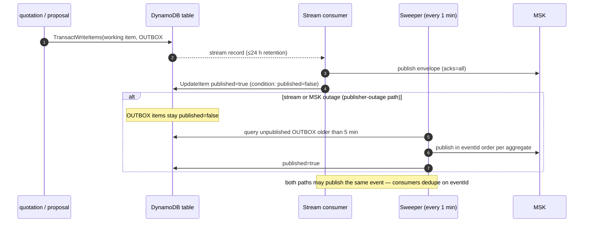

# Event catalogue — envelope, topics, schemas, outbox and consumer rules

**Status:** AI-DRAFTED from accepted [`ADR-025`](../../architecture-review/ADR-025-event-specification-and-publisher.md)
and the owner decisions of 2026-10-21 ([D5, D8](../../architecture-review/DECISIONS-2026-10-21.md)) and 2026-10-22
([E1–E7, C1–C7](../../architecture-review/DECISIONS-2026-10-22.md)). Awaiting Amit (publisher) and Shivanshi (MSK
provisioning, S09) review. Rows marked `NEW (D8)` or `NEW (R2)` give names to facts those decisions made; the owner has
not reviewed those names yet. `AuditRecorded` follows ADR-026, **accepted** by owner decision E2.

This file is the **authoritative list of domain events**. It replaces the table in
[`api-reference/interactions/outbox-and-events.md`](../../api-reference/interactions/outbox-and-events.md), which now
only explains the pattern. Code: [`libs/bank-common-events`](../../../../libs/bank-common-events/build.gradle.kts).

## 1. Envelope

Every message on every topic is one JSON object that follows
[`schemas/event-envelope.v1.json`](./schemas/event-envelope.v1.json) (JSON-Schema 2020-12), as set by ADR-025 §1.
`data` is validated separately against `schemas/<eventType>.v<schemaVersion>.json`.

| Field | Type | Rule |
|---|---|---|
| `eventId` | ULID | Unique. It is the consumer dedupe key and equals the producer's `outbox_id` |
| `eventType` | string | PascalCase, past tense |
| `schemaVersion` | int ≥ 1 | Major version of the `data` schema (see §4) |
| `source` | string | Producing context (`lead`, `consent`, `suitability`, `quotation`, `proposal`, `payment`, `policy`, `journey`, `notification`, `catalogue`, `identity`, `admin-config`). Also used as the `{context}` part of the topic name |
| `aggregateType` / `aggregateId` | string | `UPPER_SNAKE` type; `aggregateId` is the Kafka key |
| `occurredAt` | RFC 3339 UTC, millisecond precision | When the business fact happened |
| `journeyId`, `leadId` | ULID or `null` | Always present, `null` when not known |
| `actor` | `{id, type, actingCapacity, actorInsurerId?, assistedActorId?}` | `INV-ACT-04`. An `INSURER_PARTNER_REP` must carry `actorInsurerId` and `assistedActorId`, and acts only as `ASSIST_ONLY`. Background work uses `type: SYSTEM` |
| `traceId`, `correlationId` | string | Observability |
| `configVersionRef` | string or `null` | Version of the rule set or config that decided the fact (`ADR-024`), e.g. `CONSENT.POLICY@1.0.0` |
| `data` | object | **Ids and states only — never customer PII.** Every data schema is closed (`additionalProperties: false`), so a field that is not declared cannot be published by mistake. Money appears only as a decimal string plus currency, and only where reconciliation needs it |

`customerId` is the platform ULID (D3), not the CIF, so it may appear in `data`. CIF, name, mobile, PAN,
income and answers must never appear.

## 2. Events

Status values: **IMPLEMENTED** means a service writes this event to its outbox today; the payload is still the
service's attribute map and not yet this envelope, and moving to `bank-common-events` is that service's next step.
**CONTRACTED** means designed but not built. **NEW (D8)** means added by the 2026-10-21 decisions; **NEW (R2)** means
added by the 2026-10-22 round (work item `SUG-20261022-rdy`). **SUPERSEDED** means never emitted; the row says by what.
`AuditRecorded` was PROPOSED until ADR-026 was accepted (E2). Every event is also consumed by **Audit** once ADR-026 is accepted; the table lists it where the
older design made it mandatory.

| Event | Producer | Topic `{env}.` | Key | Consumers | Schema | Status | When emitted / notes |
|---|---|---|---|---|---|---|---|
| `LeadCreated` | lead | `lead.lead.v1` | `leadId` | Journey, Audit, Reporting | [v1](./schemas/LeadCreated.v1.json) | IMPLEMENTED (attribute payload; envelope pending) | Lead created at Start Onboarding; replaces the older name `OpportunityCreated` |
| `LeadExceptionEvaluated` | lead | `lead.lead.v1` | `leadId` | Audit, Reporting | [v1](./schemas/LeadExceptionEvaluated.v1.json) | IMPLEMENTED (attribute payload; envelope pending) | `LEAD.EXCEPTION` evaluated (D2); a `BLOCK` with `EH-CONFIG-MISSING` is expected until thresholds are set. The code sends `exceptionReasonCodes` as a CSV string; the envelope form is an array |
| `LeadAssigned` | lead | `lead.lead.v1` | `leadId` | Audit, Reporting | [v1](./schemas/LeadAssigned.v1.json) | IMPLEMENTED (attribute payload; envelope pending) | Lead assigned or reassigned to an RM |
| `LeadQualified` | lead | `lead.lead.v1` | `leadId` | Journey, Audit, Reporting | [v1](./schemas/LeadQualified.v1.json) | CONTRACTED | Lead moves to `QUALIFIED`. The state exists in code, but the event is not emitted yet |
| `LeadClosed` | lead | `lead.lead.v1` | `leadId` | Audit, Reporting | [v1](./schemas/LeadClosed.v1.json) | IMPLEMENTED (attribute payload; envelope pending) | Lead reaches a terminal state |
| `LeadExpired` | lead | `lead.lead.v1` | `leadId` | Journey, Audit, Reporting | [v1](./schemas/LeadExpired.v1.json) | NEW (R2) | `LEAD.POLICY.expiryDays` (per `lob`, E7) passed; `configVersionRef` names the `LEAD.POLICY` version |
| `LeadExceptionApproved` | lead | `lead.lead.v1` | `leadId` | Audit, Reporting | [v1](./schemas/LeadExceptionApproved.v1.json) | NEW (R2) | A bank employee in the SP hierarchy approved an `APPROVAL_REQUIRED` exception (E6, `lead.exception.approve`). The approver is the envelope `actor`; an insurer partner can never be it |
| `LeadExceptionRejected` | lead | `lead.lead.v1` | `leadId` | Audit, Reporting | [v1](./schemas/LeadExceptionRejected.v1.json) | NEW (R2) | The same approver rejected the exception; the lead stays blocked |
| `ConsentGranted` | consent | `consent.consent.v1` | `consentId` | Journey, Audit | [v1](./schemas/ConsentGranted.v1.json) | CONTRACTED | Sent once per purpose at a `CONSENT.POLICY` checkpoint (D5). Includes the new `CNS-QSH` purpose |
| `ConsentWithdrawn` | consent | `consent.consent.v1` | `consentId` | Journey, Audit, Notification | [v1](./schemas/ConsentWithdrawn.v1.json) | CONTRACTED | Customer withdraws consent |
| `SuitabilityCompleted` | suitability | `suitability.suitability-evaluation.v1` | `evaluationId` | Journey, Quotation (gate), Audit, Reporting | [v1](./schemas/SuitabilityCompleted.v1.json) | CONTRACTED | Outcome per product class (D4). `configVersionRef` = the rule-set version |
| `SuitabilityOverridden` | suitability | `suitability.suitability-evaluation.v1` | `evaluationId` | Journey, Audit, Reporting | [v1](./schemas/SuitabilityOverridden.v1.json) | CONTRACTED | An authorised override of the outcome for one product class |
| `QuoteRequested` | quotation | `quotation.quote.v1` | `quoteId` | Journey, Audit, Reporting | [v1](./schemas/QuoteRequested.v1.json) | IMPLEMENTED (DynamoDB OUTBOX item; envelope pending) | Multi-quote started (after the consent check, D5) |
| `QuoteCompleted` | quotation | `quotation.quote.v1` | `quoteId` | Journey, Audit, Reporting | [v1](./schemas/QuoteCompleted.v1.json) | IMPLEMENTED (DynamoDB OUTBOX item; envelope pending) | Offers recorded and at least one is valid |
| `QuoteFailed` | quotation | `quotation.quote.v1` | `quoteId` | Journey, Audit, Reporting | [v1](./schemas/QuoteFailed.v1.json) | IMPLEMENTED (DynamoDB OUTBOX item; envelope pending) | No valid offer. The code emits this instead of `QuoteCompleted` |
| `QuoteExpired` | quotation | `quotation.quote.v1` | `quoteId` | Journey, Audit, Reporting | [v1](./schemas/QuoteExpired.v1.json) | NEW (R2) | Validity window passed without conversion (`INV-QUO-04`) |
| `QuoteRejectedNoSuitability` | quotation | `quotation.quote.v1` | `quoteId` | **Audit (mandatory)**, Reporting | [v1](./schemas/QuoteRejectedNoSuitability.v1.json) | CONTRACTED | Suitability gate refused the quote (`INV-QUO-01`) |
| `OfferSelected` | quotation | `quotation.quote.v1` | `quoteId` | Journey, Audit | [v1](./schemas/OfferSelected.v1.json) | IMPLEMENTED (DynamoDB OUTBOX item; envelope pending) | Customer selected an offer. Premium was dropped from the payload because it is not needed for reconciliation |
| `QuoteConverted` | quotation | `quotation.quote.v1` | `quoteId` | Journey, Audit, Reporting | [v1](./schemas/QuoteConverted.v1.json) | NEW (D8) | Materialised on `PaymentReconciled`; the quote moves `SELECTED → CONVERTED` (D8) |
| `ProposalCreated` | proposal | `proposal.proposal.v1` | `proposalId` | Journey, Audit | [v1](./schemas/ProposalCreated.v1.json) | IMPLEMENTED (DynamoDB OUTBOX item; envelope pending) | Draft proposal created |
| `ProposalSubmitted` | proposal | `proposal.proposal.v1` | `proposalId` | Journey, Audit | [v1](./schemas/ProposalSubmitted.v1.json) | IMPLEMENTED (DynamoDB OUTBOX item; envelope pending) | Proposal submitted to the insurer through 1SB |
| `ProposalAcknowledged` | proposal | `proposal.proposal.v1` | `proposalId` | Journey, Payment, Audit | [v1](./schemas/ProposalAcknowledged.v1.json) | IMPLEMENTED (DynamoDB OUTBOX item; envelope pending) | Insurer application number received |
| `UnderwritingDecision` | proposal | `proposal.proposal.v1` | `proposalId` | Journey, Audit, Notification | [v1](./schemas/UnderwritingDecision.v1.json) | IMPLEMENTED (DynamoDB OUTBOX item; envelope pending) | Underwriting outcome or requirements received |
| `ProposalWithdrawn` | proposal | `proposal.proposal.v1` | `proposalId` | Journey, Audit | [v1](./schemas/ProposalWithdrawn.v1.json) | IMPLEMENTED (DynamoDB OUTBOX item; envelope pending) | Proposal withdrawn before payment |
| `ProposalStatusChanged` | proposal | `proposal.proposal.v1` | `proposalId` | Journey, Audit, Reporting | [v1](./schemas/ProposalStatusChanged.v1.json) | NEW (R2) | Any transition without a more specific event (e.g. `UW_APPROVED → AWAITING_PAYMENT`, E1) |
| `ProposalBlockedNoConsent` | proposal | `proposal.proposal.v1` | `proposalId` | **Audit (mandatory)**, Journey | [v1](./schemas/ProposalBlockedNoConsent.v1.json) | NEW (R2) | Submit refused at `BEFORE_PROPOSAL_SUBMIT` (`CONSENT_REQUIRED` / `_EXPIRED` / `_SCOPE_MISMATCH` / `_SUBJECT_MISMATCH` / `CONSENT_STATEMENT_NOT_APPROVED`, C7) |
| `ProposalExpired` | proposal | `proposal.proposal.v1` | `proposalId` | Journey, Quotation, Audit | [v1](./schemas/ProposalExpired.v1.json) | NEW (R2) | Proposal can no longer proceed (quote expired or abandoned before payment) |
| `ProposalMaterialised` | proposal | `proposal.proposal.v1` | `proposalId` | Journey (→ `PAID`), Policy, Audit | [v1](./schemas/ProposalMaterialised.v1.json) | NEW (D8) | Structured proposal and `proposal_answer` rows written (D8) |
| `PaymentLinkIssued` | payment | `payment.payment.v1` | `paymentId` | Journey, Audit, **Notification** | [v1](./schemas/PaymentLinkIssued.v1.json) | CONTRACTED | Payment session created |
| `PaymentAuthorised` | payment | `payment.payment.v1` | `paymentId` | Journey, Audit | [v1](./schemas/PaymentAuthorised.v1.json) | CONTRACTED | Gateway authorised the payment |
| `PaymentCaptured` | payment | `payment.payment.v1` | `paymentId` | Journey, Audit | [v1](./schemas/PaymentCaptured.v1.json) | CONTRACTED | Funds captured |
| `PaymentDeclined` | payment | `payment.payment.v1` | `paymentId` | Quotation, Proposal (end payment-in-flight), Journey, Audit | [v1](./schemas/PaymentDeclined.v1.json) | CONTRACTED | Named in the quotation and proposal code (`paymentEnded`) |
| `PaymentExpired` | payment | `payment.payment.v1` | `paymentId` | Quotation, Proposal (end payment-in-flight), Journey, Audit | [v1](./schemas/PaymentExpired.v1.json) | CONTRACTED | Payment link expired |
| `PaymentRejected` | payment | `payment.payment.v1` | `paymentId` | Journey, Audit | [v1](./schemas/PaymentRejected.v1.json) | NEW (R2) | Platform refused to start the payment before calling the gateway (`PREMIUM_MISMATCH`, `PROPOSAL_NOT_PAYABLE`); `PaymentDeclined` is the gateway's refusal |
| `PaymentUncertain` | payment | `payment.payment.v1` | `paymentId` | Journey, Operations alert, Audit | [v1](./schemas/PaymentUncertain.v1.json) | NEW (R2) | Gateway outcome unknown; no new attempt until reconciliation (`INV-PAY-04`, `PAYMENT_STATE_UNCERTAIN`) |
| `RefundInitiated` | payment | `payment.payment.v1` | `paymentId` | Journey, Notification, Audit, Reporting | [v1](./schemas/RefundInitiated.v1.json) | NEW (R2) | Refund requested at the gateway — normally on `PolicyIssuanceFailed` with `refundRequired=true` |
| `PaymentRefunded` | payment | `payment.payment.v1` | `paymentId` | Journey, Notification, Audit, Reporting | [v1](./schemas/PaymentRefunded.v1.json) | NEW (R2) | Gateway confirmed the refund |
| `PaymentReconciled` | payment | `payment.payment.v1` | `paymentId` | Journey, **Quotation, Proposal (materialise)**, Policy (start TAT clock), Audit, Reporting | [v1](./schemas/PaymentReconciled.v1.json) | CONTRACTED (payload changed by D8) | **D8 payload:** paymentId, quoteId, proposalId, journeyId, applicationNumber |
| `PaymentReconciliationBreak` | payment | `payment.payment.v1` | `paymentId` | **Audit, Operations alert** | [v1](./schemas/PaymentReconciliationBreak.v1.json) | CONTRACTED | Settlement does not match the captured amount |
| `IssuanceTrackingStarted` | policy | `policy.policy.v1` | `policyId` | Journey, Operations, Audit | [v1](./schemas/IssuanceTrackingStarted.v1.json) | NEW (R2) | `policyId` minted on `PaymentReconciled`; the `PROPOSAL.TAT` clock (7 calendar days from `PROPOSAL_RECEIVED`, C4) and 4-hourly polling start |
| `PolicyStatusChanged` | policy | `policy.policy.v1` | `policyId` | Journey, Notification, Audit, Reporting | [v1](./schemas/PolicyStatusChanged.v1.json) | NEW (D8) | One `policy_status_history` row is appended (D8). Sent by polling (S-16) or by callback |
| `PolicyIssued` | policy | `policy.policy.v1` | `policyId` | Journey, Audit, Notification, Reporting | [v1](./schemas/PolicyIssued.v1.json) | CONTRACTED | Insurer issued the policy |
| `ProposalDeclined` | policy | — | — | — | [v1](./schemas/ProposalDeclined.v1.json) | **SUPERSEDED** (R2) | Never emitted. Replaced by `PolicyIssuanceFailed` with `failureKind=INSURER_DECLINED` — see §2.1 |
| `PolicyIssuanceFailed` | policy | `policy.policy.v1` | `policyId` | **Journey (→ COMPENSATING)**, **Payment (refund)**, Notification, Audit, Operations | [v1](./schemas/PolicyIssuanceFailed.v1.json) | CONTRACTED (payload extended, R2) | No policy after payment: `failureKind` = `INSURER_DECLINED`, `ISSUANCE_ERROR` or `TAT_EXHAUSTED`; `refundRequired` drives the refund. The one post-payment non-issuance event (§2.1) |
| `PolicyClosed` | policy | `policy.policy.v1` | `policyId` | Journey, Audit, Reporting | [v1](./schemas/PolicyClosed.v1.json) | NEW (R2) | Tracking aggregate terminal (`ISSUED`, `ISSUANCE_FAILED`, `REFUNDED`, `CANCELLED`); polling stops |
| `IssuanceTatEscalated` | policy | `policy.policy.v1` | `policyId` | Operations alert, Notification, Audit | [v1](./schemas/IssuanceTatEscalated.v1.json) | NEW (D8) | `PROPOSAL.TAT` warning point reached, or the deadline breached (default 7 days; Shailja to confirm) |
| `JourneySold` | journey | `journey.journey.v1` | `journeyId` | **Lead (convert/archive)**, Audit, Reporting | [v1](./schemas/JourneySold.v1.json) | CONTRACTED | Only after the mandatory audit sequence lands (`INV-JRN-05`) |
| `JourneyCompensating` | journey | `journey.journey.v1` | `journeyId` | Operations alert, Audit | [v1](./schemas/JourneyCompensating.v1.json) | CONTRACTED | Journey entered `COMPENSATING` |
| `RuleSetPublished` | admin-config | `admin-config.rule-set.v1` | `ruleSetId` | **Every deciding service** (L1 cache invalidation, ADR-024 §5.4), Audit | [v1](./schemas/RuleSetPublished.v1.json) | IMPLEMENTED (envelope) | `RuleSetPublishedEvent` in administration-config-service. Deviation: the code sends `aggregateType` `RuleSet`, not `RULE_SET` |
| `ProductVersionPublished` | catalogue | `catalogue.product.v1` | `productId` | Quotation, Audit, Reporting | [v1](./schemas/ProductVersionPublished.v1.json) | NEW (R2) | A product version becomes quotable (effective-dated) |
| `NotificationSent` | notification | `notification.notification.v1` | `notificationId` | Audit, Reporting | [v1](./schemas/NotificationSent.v1.json) | NEW (R2) | Provider accepted the message (E3 `SENT`). Never carries the recipient or the text |
| `NotificationFailed` | notification | `notification.notification.v1` | `notificationId` | Operations alert (when `terminal`), Audit | [v1](./schemas/NotificationFailed.v1.json) | NEW (R2) | Provider refused or timed out (E3 `FAILED`) |
| `PartnerUserCreated` | identity | `identity.partner-user.v1` | `partnerUserId` | Audit | [v1](./schemas/PartnerUserCreated.v1.json) | NEW (R2) | Bank admin created an insurer partner user (E5; no approval step unless `identity.partner-onboarding.approval-required`). Never carries name, email or mobile |
| `AuditRecorded` | every service | producer's aggregate topic | `aggregateId` | audit-compliance-service | [v1](./schemas/AuditRecorded.v1.json) | CONTRACTED (ADR-026 accepted, E2) | Sent on the producer's own aggregate topic so it keeps ordering with the business event |

**Not on the bus:** `IDENTITY_PROVISIONING_REQUESTED` in `identity.outbox_event` is an internal work queue. It is
drained by identity's own `ProvisioningOutboxDispatcher` into the IdP adapter, never published to MSK, and so it
does not follow the naming rules. If it is ever published, it becomes `IdentityProvisioningRequested` with a schema here.

### 2.1 One post-payment non-issuance event (`PolicyIssuanceFailed`, not `ProposalDeclined`)

Round 1 named two events for "paid, but no policy": `ProposalDeclined` (insurer declined after payment, D8) and
`PolicyIssuanceFailed` (issuance could not complete). Owner decision
[E1](../../architecture-review/DECISIONS-2026-10-22.md#owner-decisions) puts payment **after** the insurer's
underwriting approval, so an underwriting decline now arrives before payment as `UnderwritingDecision` (proposal).
What remains after payment is one fact — *no policy was issued* — with different causes. Two events for one fact
would give journey and payment two triggers for one compensation. **Kept:** `PolicyIssuanceFailed`, extended
additively with `failureKind` (`INSURER_DECLINED`, `ISSUANCE_ERROR`, `TAT_EXHAUSTED`), `applicationNumber` and
`refundRequired` (same `schemaVersion` 1, §4). **Superseded:** `ProposalDeclined` — never emitted; its schema stays
so a consumer built against the D8 draft is caught in review. *Owner to confirm (§8).*

### 2.2 Lead event names follow the code

The lead-service code emits `LeadCreated`, `LeadExceptionEvaluated`, `LeadAssigned` and `LeadClosed`
(`LeadApplicationService`). Those are the catalogue names; older names (`OpportunityCreated`, `LeadException…`
variants in the BRD) are not used. `LeadQualified`, `LeadExpired`, `LeadExceptionApproved` and
`LeadExceptionRejected` are contracted and not emitted yet.

**Payload changes from the older table:**

- `PaymentReconciled` gains `quoteId`, `proposalId`, `journeyId` and `applicationNumber` (D8, `D-025`).
- Consent events carry `purpose` (now including `CNS-QSH`) and `checkpoint` (D5).
- Suitability carries an outcome per product class (D4).
- `OfferSelected` no longer carries `premium`.
- The policy status, decline and TAT events are added (D8).
- `PolicyIssuanceFailed` gains optional `failureKind`, `applicationNumber`, `refundRequired`; `ProposalDeclined` is superseded (§2.1).

## 3. Topics

Topic names follow `{env}.{context}.{aggregate}.v{n}` (ADR-025 §2), e.g. `prod.payment.payment.v1`. There is one
topic per aggregate, and the key is `aggregateId`, which preserves order within an aggregate. Defaults at R0:
**6 partitions, retention 7 days, replication 3, `min.insync.replicas=2`**. Shivanshi provisions these in S09.

| Topic (`{env}.` prefix) | Producer | Aggregate | Main consumer groups |
|---|---|---|---|
| `lead.lead.v1` | lead-service | `LEAD` | `journey.stage`, `audit.ingest`, `reporting.mis` |
| `consent.consent.v1` | consent-service | `CONSENT` | `journey.stage`, `audit.ingest`, `notification.dispatch` |
| `suitability.suitability-evaluation.v1` | suitability-service | `SUITABILITY_EVALUATION` | `journey.stage`, `audit.ingest`, `reporting.mis` |
| `quotation.quote.v1` | quotation-service | `QUOTE` | `journey.stage`, `audit.ingest`, `reporting.mis` |
| `proposal.proposal.v1` | proposal-service | `PROPOSAL` | `journey.stage`, `policy.tracker`, `audit.ingest` |
| `payment.payment.v1` | payment-service | `PAYMENT` | `quotation.materialiser`, `proposal.materialiser`, `policy.tracker`, `journey.stage`, `notification.dispatch`, `audit.ingest`, `reporting.mis` |
| `policy.policy.v1` | policy-issuance-service | `POLICY` | `journey.stage`, `notification.dispatch`, `payment.refund`, `audit.ingest`, `reporting.mis` |
| `journey.journey.v1` | journey-orchestration-service | `JOURNEY` | `lead.journey-outcome`, `audit.ingest`, `reporting.mis` |
| `admin-config.rule-set.v1` | administration-config-service | `RULE_SET` (code: `RuleSet`) | `{service}.rule-cache` per deciding service, `audit.ingest` |
| `catalogue.product.v1` | product-catalogue-service | `PRODUCT` | `quotation.catalogue`, `audit.ingest`, `reporting.mis` |
| `notification.notification.v1` | notification-service | `NOTIFICATION` | `audit.ingest`, `reporting.mis` |
| `identity.partner-user.v1` | identity-authorization-service | `PARTNER_USER` | `audit.ingest` |

`v{n}` in a topic name is the **topic** major version. It changes only if the envelope or the keying changes, and
`TopicResolver` takes an override map for that case. A breaking change to one event's `data` does not create a new
topic (§4).

`POLICY` is keyed by `policyId`, which policy-issuance mints when it starts tracking an application (on
`PaymentReconciled`). The ordering of status → issued/declined therefore holds per application. *Open item: this is
a catalogue choice; the policy LLD must confirm it.*

### 3.1 Retry and DLQ

| Topic | Name | Rule |
|---|---|---|
| Retry | `{env}.retry.{consumerGroup}` | A failed message is re-sent here with backoff **1 s, 10 s, 60 s** (ADR-025 §2) |
| DLQ | `{env}.dlq.{consumerGroup}` | Reached after the third retry fails, or at once for a message that fails `event-envelope/v1` (`EventCodecException`). **Each DLQ message is an operations task** |

Consumer groups are named `{service}.{purpose}`, lower case and dotted, e.g. `proposal.materialiser` and
`audit.ingest`. ADR-025 does not set retention for retry and DLQ topics; S09 (Shivanshi) must set it, and it should
be at least 7 days so the DLQ outlives a long weekend.

## 4. Versioning

| Change | Kind | What happens |
|---|---|---|
| Add an optional field; add an enum value consumers may ignore; relax a constraint | **Additive** | The same `schemaVersion`. Edit `schemas/<Event>.v<n>.json` in the same change as the producer |
| Remove or rename a field, change a type or meaning, make an optional field required, narrow an enum | **Breaking** | New `schemaVersion` (`<Event>.v<n+1>.json`). The producer emits **both versions in parallel**, on the same topic, until every consumer group has migrated. The catalogue lists both |
| Change the envelope or the partition key | **Breaking for the topic** | New topic `…v{n+1}`, run in parallel |

Consumers **ignore fields they do not know** and filter on `eventType` + `schemaVersion`. Producers never send a
field that is not in the schema (the schemas are closed).

## 5. Consumer rules (ADR-025 §4)

1. Delivery is **at-least-once**. Every consumer is **idempotent on `eventId`**:
   [`IdempotentEventHandler`](../../../../libs/bank-common-events/src/main/java/com/bank/common/events/IdempotentEventHandler.java)
   claims `(eventId, consumer)` in `processed_event` **inside the same database transaction as the consumer's own
   writes**. A duplicate is acknowledged without being processed. If the handler throws, the claim rolls back with
   the work. An owning store's own idempotency record can stand in for `processed_event`, as quotation and proposal
   already do for `PaymentReconciled`.
2. Commit the Kafka offset only after the database commit.
3. Failures get bounded retry through the retry topic, then go to the DLQ. A consumer never blocks its partition
   indefinitely.
4. A consumer must not assume one aggregate's events arrive in order relative to another aggregate's events.

```sql
-- per consuming schema
CREATE TABLE <schema>.processed_event (
    event_id      CHAR(26)                 NOT NULL,
    consumer      VARCHAR(96)              NOT NULL,
    processed_at  TIMESTAMP WITH TIME ZONE NOT NULL,
    PRIMARY KEY (event_id, consumer)
);
```

The brief named `event_id` alone as the primary key. That is safe only when **one** consumer group writes the table.
The composite key above supports several consumers in one schema. On PostgreSQL the claim is
`INSERT … ON CONFLICT DO NOTHING`, because a plain duplicate insert would abort the transaction. Rows may be deleted
after the topic retention (7 days) plus a margin.

## 6. Producers — the two outbox patterns (ADR-025 §3)

A request never sends an event directly. The event is written in the **same transaction** as the business change and
relayed afterwards.

### 6.1 Postgres outbox (every Aurora-owning service)

```sql
CREATE TABLE <schema>.outbox_event (
    outbox_id       CHAR(26)                 PRIMARY KEY,   -- = envelope eventId (ULID)
    aggregate_type  VARCHAR(64)              NOT NULL,
    aggregate_id    VARCHAR(64)              NOT NULL,
    event_type      VARCHAR(96)              NOT NULL,
    payload         JSONB                    NOT NULL,      -- the whole event-envelope/v1 JSON
    created_at      TIMESTAMP WITH TIME ZONE NOT NULL,
    published_at    TIMESTAMP WITH TIME ZONE,
    attempts        INTEGER                  NOT NULL DEFAULT 0,
    last_error      VARCHAR(1000),
    parked_at       TIMESTAMP WITH TIME ZONE
);
CREATE INDEX ix_outbox_pending   ON <schema>.outbox_event (created_at, outbox_id)
    WHERE published_at IS NULL AND parked_at IS NULL;
CREATE INDEX ix_outbox_aggregate ON <schema>.outbox_event (aggregate_type, aggregate_id, created_at, outbox_id)
    WHERE published_at IS NULL;
```

`payload` may be `TEXT` or `VARCHAR` instead of JSONB. The writer binds it as `CAST(? AS jsonb)` on PostgreSQL, and
that cast also assigns to text columns. Ids are ULID (ADR-025 §6), not `uuid`.

**Relay** ([`JdbcOutboxRelay`](../../../../libs/bank-common-events/src/main/java/com/bank/common/events/jdbc/JdbcOutboxRelay.java)).
Each cycle is one transaction:

1. **Claim heads.** Lock up to 100 rows that are the *oldest unpublished row of their aggregate*:
   `… WHERE published_at IS NULL AND parked_at IS NULL AND NOT EXISTS (earlier unpublished row of the same
   aggregate) ORDER BY created_at, outbox_id LIMIT 100 FOR UPDATE SKIP LOCKED`.
2. **Read the claimed aggregates.** Lock and read their pending rows, oldest first.
3. **Publish each row** through `EventPublisher`, which returns only after the broker acks (`acks=all`).
   - On success, set `published_at`.
   - On failure, set `attempts + 1` and `last_error`, and hold back the later rows of that aggregate until the next
     cycle.
   - At `attempts = 10` (configurable), set `parked_at` and log ERROR. That log line is the alert hook. Nothing is
     ever dropped silently.

Ordering and replicas:

- Only heads can be claimed. While one replica holds an aggregate's head, no other replica can take a later event of
  that aggregate, so **several replicas are safe and keep per-aggregate order**.
- **A parked row blocks its aggregate** until operations re-drive it with
  `UPDATE … SET parked_at = NULL, attempts = 0 WHERE outbox_id = …`. Order is never broken silently.
- If the relay publishes and then crashes before commit, the row is republished. Consumers dedupe it.

Dialect: `SqlDialect.detect` reads `DatabaseMetaData.getDatabaseProductName()`. On **PostgreSQL** it uses
`FOR UPDATE SKIP LOCKED`, so replicas run in parallel. Anywhere else (H2 in unit tests) it uses plain `FOR UPDATE`:
a second relay waits for the first, and step 2's re-read then sees the committed `published_at`, so it never
double-publishes, but the relays do not run in parallel. **`SKIP LOCKED` behaviour is proven only on PostgreSQL.**
No PostgreSQL integration test runs in this repository yet because there is no Docker daemon for Testcontainers.

Monitoring: `JdbcOutboxRelay.backlog()` returns the pending count, the parked count and the oldest pending
`created_at`. Alert on outbox age (`NFR-DAT-05`) and on any parked row.

```mermaid
sequenceDiagram
    autonumber
    participant API as Service (request)
    participant DB as Aurora schema
    participant R as JdbcOutboxRelay (n replicas)
    participant K as MSK
    participant OPS as Operations
    API->>DB: BEGIN; business rows; INSERT outbox_event; COMMIT
    loop every poll interval
        R->>DB: claim head rows FOR UPDATE SKIP LOCKED (≤100)
        R->>DB: lock + read pending rows of claimed aggregates
        R->>K: send(topic, key=aggregateId, envelope) — wait for acks=all
        alt broker acks
            R->>DB: SET published_at = now()
        else MSK outage / timeout (publisher-outage path)
            R->>DB: attempts+1, last_error; later rows of the aggregate wait
            Note over DB,R: rows accumulate; nothing is lost — the table is the replay log
            opt attempts reaches 10
                R->>DB: SET parked_at = now()
                R-->>OPS: ERROR log → alert (outbox age / parked count)
                OPS->>DB: after fix: SET parked_at = NULL, attempts = 0
            end
        end
        R->>DB: COMMIT
    end
```

### 6.2 DynamoDB outbox (quotation, proposal — `DB-DEC-0005`)

The `OUTBOX#{eventId}` item is written in the same `TransactWriteItems` call as the working item. It carries the
envelope and `published=false`.

- A **stream consumer** (Lambda or in-service, `NEW_AND_OLD_IMAGES`) publishes each new OUTBOX item and then sets
  `published=true` with a conditional update.
- A **sweeper** republishes items still `published=false` more than **5 minutes** after they were written, so a
  stream outage longer than the 24-hour stream retention loses nothing.
- Per-aggregate order: the stream is ordered per partition key (`QUOTE#…`/`PROPOSAL#…`). The sweeper must publish
  one aggregate's unpublished items in `eventId` order.



Deviations in the code as built:

- The OUTBOX items written by quotation and proposal do **not** yet carry `published` or the envelope.
- Their `ttl` is *write + 7 days*. If the publisher were down for 7 days, items would expire unpublished.
- The fix: write `published=false` with no `ttl`, and set `ttl` when `published=true` is set. This is an open item
  for the quotation and proposal owners (schemas/20 §6).

### 6.3 Consumer failure and DLQ replay

```mermaid
sequenceDiagram
    autonumber
    participant K as domain topic
    participant C as Consumer group G
    participant DB as Consumer schema
    participant RT as {env}.retry.G
    participant DLQ as {env}.dlq.G
    participant OPS as Operations
    K->>C: message
    C->>DB: BEGIN; claim processed_event(eventId, G)
    alt first delivery
        C->>DB: do the work; COMMIT
        C->>K: commit offset
    else duplicate
        C->>DB: ROLLBACK (nothing to do)
        C->>K: commit offset
    else handler fails
        C->>DB: ROLLBACK (claim undone)
        C->>RT: re-send (backoff 1 s → 10 s → 60 s)
        RT->>C: redeliver
        C->>DLQ: after the 3rd failure, or invalid envelope at once
        DLQ-->>OPS: alert = operations task
        OPS->>K: after fix: replay the DLQ message to the retry topic (same eventId)
        Note over C,DB: replay is safe — a message already processed is a DUPLICATE
    end
```

## 7. Library map (`libs/bank-common-events`)

| Need | Class | Package |
|---|---|---|
| Envelope and builder (ULID `eventId`) | `EventEnvelope`, `Actor`, `Ulid` (monotonic) | core |
| JSON | `EventJsonCodec` | core (Jackson) |
| Transport port | `EventPublisher`, `InMemoryEventPublisher` (tests) | core |
| MSK adapter | `KafkaEventPublisher` (`kafka-clients`, `acks=all`, idempotence; `mskIamProducerProperties`) | `kafka` — the service adds `org.apache.kafka:kafka-clients` (+ `aws-msk-iam-auth`) |
| Topic names | `TopicResolver` (domain, retry, DLQ) | core |
| Outbox write | `OutboxWriter` (caller's `Connection` or a `ConnectionProvider`) | `jdbc` |
| Relay | `JdbcOutboxRelay`, `OutboxRelaySettings` (100 / 10), `RelayResult`, `OutboxBacklog` | `jdbc` |
| Consumer dedupe | `IdempotentEventHandler`, `ProcessedEventStore`, `JdbcProcessedEventStore` | core + `jdbc` |
| Spring transaction join | `SpringConnectionProvider`, which refuses to write outside a transaction | `spring` — the service already has `spring-jdbc` |

The core package imports no Spring, JDBC or Kafka classes; a test enforces this. The service schedules the relay
itself, e.g. `@Scheduled` calling `relay.drain(10)`. The library adds no scheduler.

## 8. Open items

| Item | Owner |
|---|---|
| Confirm the event names introduced for D8 (`QuoteConverted`, `ProposalMaterialised`, `PolicyStatusChanged`, `IssuanceTatEscalated`) and R2 (the `NEW (R2)` rows) | Mahesh |
| Confirm `ProposalDeclined` superseded by `PolicyIssuanceFailed.failureKind=INSURER_DECLINED` (§2.1) | Mahesh |
| `RuleSetPublished` `aggregateType` is `RuleSet` in code; align to `RULE_SET` with the envelope move | administration-config owner |
| `POLICY` aggregate keyed by `policyId`, minted at tracking start | policy-issuance LLD |
| Retry and DLQ topic retention | Shivanshi (S09) |
| DDL alignment: `payment.outbox_event` uses `event_id` + `payment_id`, and no DDL has `parked_at` yet. Align to §6.1 | Aarti / DDL owner |
| Move lead, quotation and proposal from attribute-map payloads to the envelope | service owners |
| DynamoDB OUTBOX `published` flag and TTL-at-publish (§6.2) | quotation / proposal owners |
| `AuditRecorded` payload review now that ADR-026 is accepted (E2) | Shailja, Deepali review |
| PostgreSQL `SKIP LOCKED` integration test (needs Testcontainers or a CI database) | Amit |
