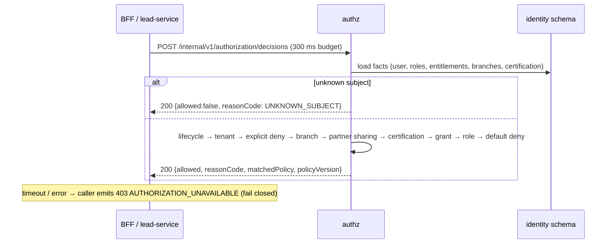
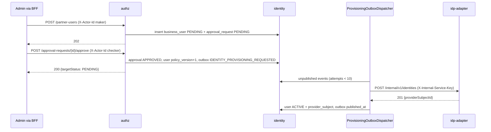

# identity-authorization-service — low-level design

**Status:** AI-DRAFTED from code (ADR-027), awaiting Deepali (security) and engineering review.

[Contract (authoritative)](./openapi.yaml) · [API portal page](../../api-reference/services/identity-authorization-service.md) ·
[BFF to PDP interaction](../../api-reference/interactions/bff-to-identity-authorization.md) ·
[ADR-027](../../architecture-review/ADR-027-openapi-contract-authority.md) ·
[Readiness review §3.7](../../api-reference/READINESS-REVIEW.md#37-architecture--used-at-its-best)

## 1. Purpose and ownership

The source of truth for **business authorization**. It maps a provider login (bank AD, Keycloak) to
a platform `businessUserId`, answers *"may this subject do this action on this resource, now?"*
(Policy Decision Point, default-deny, fail closed at the caller), and runs maker-checker for
partner-user creation with provisioning into the IdP through an outbox.

| Item | Value |
|---|---|
| Module | `services/identity-authorization-service`, port 8083, `service-id: authz`, layer L5, INTERNAL |
| Owns data | Aurora schema `identity` (Flyway V1 schema, V2 role/permission seed), role `app_identity` |
| Callers | BFF (resolve at login; decisions before lead create/assign), lead-service (own re-check, `INV-ACT-01`), admin surface via BFF (partner users) |
| Calls out | identity-provider-adapter `POST /internal/v1/identities` (provisioning, with `X-Internal-Service-Key`) |

Source: `services/identity-authorization-service/src/main/java/com/bank/identity/authz/**`.

## 2. API summary

| Method | Path | Purpose | Success |
|---|---|---|---|
| POST | `/internal/v1/identities/resolve` | Provider identity → business user (JIT create for bank employees) | 200 |
| POST | `/internal/v1/authorization/decisions` | PDP decision (a deny is `200 allowed:false`) | 200 |
| POST | `/internal/v1/partner-users` | Maker submits a partner user | 202 |
| POST | `/internal/v1/approval-requests/{approvalId}/approve` | Checker approves; queues provisioning | 200 (`targetStatus: PENDING`) |

The HLD name `POST /internal/v1/authorize` is **superseded** by `/authorization/decisions`
(ADR-027: the contract follows the code path; the HLD is amended, not the code).

**Caller authentication — fix-pending (change in progress).** Every call must carry
`X-Internal-Service-Key`; there is one key per calling service (`identity.internal-auth.callers`:
`workforce-access-bff`, `lead-service`), so the key identifies the caller (`InternalServiceAuthFilter`,
request attribute `identity.internal-caller`). Missing / unknown → `401 UNAUTHORIZED`
(readiness review §3.7).

**Maker / checker from the authenticated principal.** `ActorPrincipalResolver` believes
`X-Actor-Id` only from an *actor-caller* (`identity.internal-auth.actor-callers`: the BFF, which
takes it from a vault-resolved session). Another caller asserting an actor → `403 FORBIDDEN`;
missing / non-UUID actor → `401 UNAUTHORIZED`. A service key alone can therefore never approve a
partner. Maker and checker are additionally PDP-checked (`partner_user.create`,
`partner_user.approve`, scoped to the partner's insurer).

## 3. Operation flows

### 3.1 Resolve

1. Bean validation (`provider`, `providerSubject`, `username` not blank; `userType` not null).
2. `findByProviderAndProviderSubject` (unique pair).
3. Found → `refreshProfile(username, email, employeeId)`; status unchanged.
4. Not found + `BANK_EMPLOYEE` → insert `ACTIVE`, `policy_version = 1`, `valid_from = now`
   (no roles: all decisions `DEFAULT_DENY` until roles are granted — local helper
   `scripts/local/grant-local-rm.sql`).
5. Not found + `INSURER_REPRESENTATIVE` → `403 FORBIDDEN`.

### 3.2 Decide

1. Bean validation (`subjectId`, `resource` not null; `action` not blank).
2. `AuthorizationFactsRepository.load(subjectId, now)` — subject, role permissions, entitlements,
   branch codes, mandatory-certification validity (all validity-windowed).
3. Absent → `allowed:false, UNKNOWN_SUBJECT, default-deny, 0`.
4. `AuthorizationPolicyEvaluator.evaluate` — ordered checks (contract table); first match wins.

### 3.3 Partner maker-checker and provisioning

1. **Submit** (maker = authenticated actor): PDP `partner_user.create` (insurer scope; deny →
   `ACCOUNT_SUSPENDED` / `CROSS_INSURER_DENIED` / `EXPLICIT_DENY` / `DEFAULT_DENY`) → username unique (else `409 CONFLICT`) → insert user
   `INSURER_REPRESENTATIVE`/`PENDING` → insert `approval_request` `PARTNER_USER_CREATE`/`PENDING`.
   `202 {userId, approvalId, status: PENDING}`.
2. **Approve** (checker = authenticated actor), one transaction: lock approval (`404` if unknown) →
   must be `PENDING` (`409 ILLEGAL_TRANSITION`) → checker ≠ maker (`403 FORBIDDEN`) → target user
   exists (`404`) → PDP `partner_user.approve` on the user, insurer-scoped (mapped `403`) →
   `user.approve()` (**policy_version + 1 only; status stays `PENDING`**) →
   approval `APPROVED` → outbox `IDENTITY_PROVISIONING_REQUESTED`. Returns
   `{approvalId, targetStatus: "PENDING"}`.
3. **Provision** (async, `ProvisioningOutboxDispatcher`, `identity.provisioning.enabled=true`,
   every 5 s): rows are **claimed** in a short transaction (`FOR UPDATE SKIP LOCKED` on
   PostgreSQL) and leased (`claimed_until`) so replicas do not double-provision; after
   `max-attempts` a row is parked (`dead_lettered_at`, ERROR log). `ProvisioningOutboxProcessor` →
   `POST {idp}/internal/v1/identities` → `markProvisioned(providerSubject)` sets **`ACTIVE`** and
   `policy_version + 1` → `published_at`. Failure → `attempts + 1`, `last_error` (class name only).

## 4. Validation rules

| Field | Rule | Error code |
|---|---|---|
| resolve `provider`, `providerSubject`, `username` | `@NotBlank` | `422 VALIDATION_ERROR` |
| resolve `userType` | `@NotNull`, enum | `422 VALIDATION_ERROR` / `422 INVALID_REQUEST` (unknown value) |
| decision `subjectId` | `@NotNull` UUID | `422 VALIDATION_ERROR` / `422 INVALID_REQUEST` (not a UUID) |
| decision `action` | `@NotBlank` | `422 VALIDATION_ERROR` |
| decision `resource` | `@NotNull` (nested fields not validated) | `422 VALIDATION_ERROR` |
| partner `username`, `insurerCode` | `@NotBlank` | `422 VALIDATION_ERROR` |
| partner `email` | `@Email @NotBlank` | `422 VALIDATION_ERROR` |
| partner `username` | unique | `409 CONFLICT` |
| `X-Internal-Service-Key` | a configured caller key | `401 UNAUTHORIZED` (**fix-pending**) |
| `X-Actor-Id` (partner ops) | asserted by an actor-caller; present; UUID | `403 FORBIDDEN` / `401 UNAUTHORIZED` (**fix-pending**) |
| maker / checker permission | `partner_user.create` / `partner_user.approve` | mapped PDP deny `403` |
| approve `approvalId` | UUID, exists, `PENDING` | Spring `400` / `404 RESOURCE_NOT_FOUND` / `409 ILLEGAL_TRANSITION` |
| approve checker | ≠ maker | `403 FORBIDDEN` |

Rule-engine usage: none. Authorization policy is data (roles, entitlements, certifications) in
schema `identity`, evaluated in code; it is not a `ADR-024` rule set.

## 5. DTO → domain → table mapping

| DTO | Domain | Table / column |
|---|---|---|
| `ResolveIdentityRequest.provider`, `providerSubject` | `BusinessUserEntity` | `business_user.provider`, `provider_subject` (unique pair) |
| `username`, `email`, `employeeId` | refreshed profile | `business_user.username`, `email`, `employee_id` |
| `userType` | `UserType` | `business_user.user_type` |
| `ResolvedIdentityResponse.status`, `policyVersion`, `insurerCode` | entity | `status`, `policy_version`, `insurer_code` |
| `DecisionRequest.subjectId` | `Facts.subject` | `business_user.id` + `user_role`, `role_permission`, `entitlement`, `user_branch_assignment`, `certification` |
| `CreatePartnerUserRequest.*` | `pendingPartner(...)` | `business_user` (`PENDING`, `INSURER_REPRESENTATIVE`) |
| maker (authenticated actor UUID) | – | `approval_request.maker_id` |
| checker (authenticated actor UUID) | – | `approval_request.checker_id`, `decided_at` |
| approval → provisioning | outbox payload `{businessUserId}` | `outbox_event` (`IDENTITY_PROVISIONING_REQUESTED`) |

## 6. Invariants and where they are enforced

| Invariant | Where |
|---|---|
| Default deny; first match wins | `AuthorizationPolicyEvaluator` |
| An IdP group or claim is never a permission | facts come only from schema `identity` |
| Partners never self-create on first login | `IdentityResolutionService.createBankEmployee` |
| Maker ≠ checker | `PartnerUserAdministrationService.approve` |
| Approval is single-use | `FOR UPDATE` + `status = PENDING` check |
| A partner is `ACTIVE` only once the IdP account exists | `markProvisioned` (not `approve`) |
| Caller is an authenticated service (**fix-pending**) | `InternalServiceAuthFilter` |
| Only the BFF may assert a human actor (**fix-pending**) | `ActorPrincipalResolver` |

## 7. Events, idempotency, timeouts, failure modes

- **Events produced:** `IDENTITY_PROVISIONING_REQUESTED` on the local `outbox_event`, consumed
  only by this service's dispatcher (not published to MSK). When the `ADR-025` relay is adopted the
  name becomes `IdentityProvisioningRequested` (`PascalCase`, envelope v1) — catalogue entry to be
  added by the events owner. Consumed: none.
- **Idempotency:** resolve is naturally idempotent (same pair → same user). Decide is read-only.
  Submit is guarded by unique username. Approve is guarded by the `PENDING` check. Provisioning is
  idempotent at the adapter (an existing Keycloak user with the same `business_user_id` attribute is
  returned).
- **Timeouts:** callers budget 300 ms for decisions (S-02) and 2 s for resolve. Provisioning
  client: connect 1 s / read 3 s (`identity.provider-adapter.*-timeout`, in progress).
- **Failure modes:** DB unavailable → `500 INTERNAL_ERROR` (callers fail closed). Provisioning
  failures retry under a lease and are parked after the attempt limit.

## 8. Deviations and open items

| # | Item | Owner |
|---|---|---|
| 1 | **fix-pending** — per-caller `X-Internal-Service-Key`, actor-caller rule, maker/checker PDP checks | Engineering (in progress) |
| 2 | Portal page says approve sets the user `ACTIVE` and returns `targetStatus: ACTIVE`; the code returns `PENDING` until provisioning — this contract documents the code | Done here; portal to follow |
| 3 | HLD `/internal/v1/authorize` superseded by `/authorization/decisions` | HLD owner |
| 4 | A non-UUID `approvalId` path answers Spring's default 400 without the platform envelope | Engineering |
| 5 | BFF and lead-service must send their own authz key once the filter lands | Engineering |
| 6 | Role seeding / HR sync for JIT bank employees is open WS-2 work | Aarti / Deepali |
| 7 | No ArchUnit test in this module (readiness review §3.7) | Engineering |
