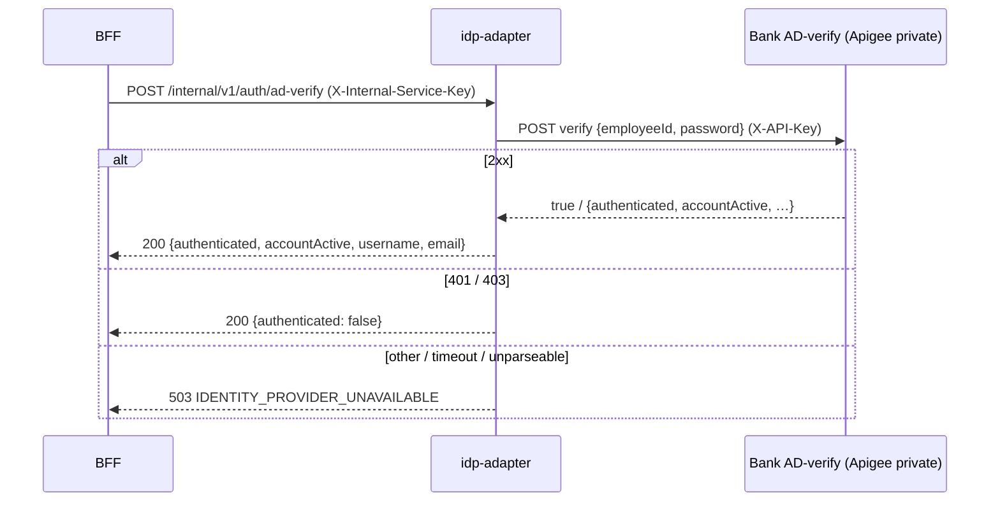

# identity-provider-adapter-service — low-level design

**Status:** AI-DRAFTED from code (ADR-027), awaiting Deepali (security) and engineering review.

[Contract (authoritative)](./openapi.yaml) · [API portal page](../../api-reference/services/identity-provider-adapter-service.md) ·
[BFF to IdP adapter interaction](../../api-reference/interactions/bff-to-identity-provider-adapter.md) ·
[Headers and service auth](../../api-reference/conventions/headers-session-and-auth.md) ·
[ADR-027](../../architecture-review/ADR-027-openapi-contract-authority.md)

## 1. Purpose and ownership

Puts every identity provider behind one internal API so the BFF never knows which IdP it talks to:
bank **AD-verify** for bank RMs, **Keycloak** for partner users and provisioning. Swapping Keycloak
changes only this service (`ADR-015`). It owns no data.

| Item | Value |
|---|---|
| Module | `services/identity-provider-adapter-service`, port 8082, `service-id: idp-adapter`, L5, INTERNAL |
| Callers | `workforce-access-bff` (login, logout), `identity-authorization-service` (provisioning) |
| Calls out | Bank AD-verify (UAT/prod via Apigee private target), Keycloak OIDC + admin REST |
| Secrets | `IDENTITY_ADAPTER_INTERNAL_SHARED_SECRET`, `BANK_AD_VERIFY_API_KEY`, `KEYCLOAK_BFF_CLIENT_SECRET`, `KEYCLOAK_ADMIN_CLIENT_SECRET` |

Source: `services/identity-provider-adapter-service/src/main/java/com/bank/identity/provider/**`.

## 2. API summary

| Method | Path | Port used | Success |
|---|---|---|---|
| POST | `/internal/v1/auth/ad-verify` | `WorkforceCredentialVerifier` → `BankAdVerifyAdapter` | 200 (verdict) |
| POST | `/internal/v1/auth/authorization-uri` | `IdentityProviderPort.beginAuthorization` | 200 |
| POST | `/internal/v1/auth/token-exchange` | `exchangeCode` | 200 |
| POST | `/internal/v1/auth/refresh` | `refresh` | 200 |
| POST | `/internal/v1/auth/revoke` | `revoke` | 204 |
| POST | `/internal/v1/identities` | `provision` | 201 |
| PATCH | `/internal/v1/identities/{providerSubjectId}/status` | `setEnabled` | 204 |

Every path requires `X-Internal-Service-Key` (`InternalServiceAuthFilter`; Spring Security
`/internal/v1/**` authenticated, else `AdapterInternalAuthenticationEntryPoint` →
`401 UNAUTHORIZED`). `/actuator/health/**` and `/error` are open; everything else is denied.

## 3. Operation flows

### 3.1 AD verify

1. Filter authenticates the caller.
2. Bean validation: `employeeId`, `password` not blank.
3. Stub mode (local only — startup refuses `stub` under `prod`) or HTTP:
   `POST {base-url}{path}` with the API-key header.
4. `401`/`403` → `{authenticated:false}`; other error / transport → `503
   IDENTITY_PROVIDER_UNAVAILABLE`; body parsed tolerantly (contract); unparseable → `503`.

### 3.2 OIDC (authorization-uri, token-exchange, refresh, revoke)

1. `authorization-uri`: builds the Keycloak URL (no I/O).
2. `token-exchange`: token endpoint with `code`, `code_verifier`, `redirect_uri`; verify ID token
   audience, nonce, subject; map claims to `ProviderSession`.
3. `refresh`: `grant_type=refresh_token`; same mapping without the nonce check.
4. `revoke`: revocation endpoint with `token_type_hint=refresh_token`.

### 3.3 Provisioning

1. Admin token (client credentials).
2. Search `username` exact. Existing user with the same `business_user_id` → return its id
   (idempotent retry); a different one → failure.
3. Else create (attributes `business_user_id`, `insurer_code`; `UPDATE_PASSWORD` required action)
   and return the new id. `PATCH …/status` toggles `enabled`.

## 4. Validation rules

| Field | Rule | Error code |
|---|---|---|
| `X-Internal-Service-Key` | equals configured secret (≥ 16 chars) | `401 UNAUTHORIZED` |
| ad-verify `employeeId`, `password` | `@NotBlank` | `422 VALIDATION_ERROR` (defensive `400 SCHEMA_INVALID` in the adapter) |
| authorization-uri `state`, `nonce`, `codeChallenge`, `identitySource` | `@NotBlank` | `422 VALIDATION_ERROR` |
| token-exchange `code`, `codeVerifier`, `expectedNonce` | `@NotBlank` | `422 VALIDATION_ERROR` |
| refresh / revoke `refreshToken` | `@NotBlank` | `422 VALIDATION_ERROR` |
| provision `businessUserId`, `username` | `@NotBlank` | `422 VALIDATION_ERROR` |
| provision `email` | `@Email @NotBlank` | `422 VALIDATION_ERROR` |
| status `enabled` | `@NotNull` | `422 VALIDATION_ERROR` |
| ID token audience / nonce / subject | must match | `500` (unmapped — open item 1) |

Rule-engine usage: none.

## 5. DTO → domain → external mapping

| DTO | Port record | Provider |
|---|---|---|
| `AdVerifyRequest` | `AdVerifyCommand` | AD-verify request body |
| `AuthorizationUriRequest` | `AuthorizationCommand` | Keycloak authorize query string |
| `TokenExchangeRequest` | `TokenExchangeCommand` | token endpoint form |
| `ProviderSessionResponse` | `ProviderSession` | token response + verified ID-token claims |
| `ProvisionIdentityRequest` | `ProvisionIdentityCommand` | Keycloak admin `POST /users` (+ attributes) |
| `IdentityStatusRequest` | `setEnabled(id, enabled)` | Keycloak admin `PUT /users/{id}` |

No table — the service owns no data.

## 6. Invariants

| Invariant | Where |
|---|---|
| Only an authenticated internal caller reaches any endpoint | `InternalServiceAuthFilter` + `AdapterSecurityConfig` |
| AD stub never runs in prod | `BankAdVerifyAdapter.rejectStubInProduction` |
| Password never logged | `AdVerifyRequest.toString` redaction |
| ID token audience / nonce / subject verified | `KeycloakIdentityProviderAdapter` |
| One Keycloak user per business user | `business_user_id` attribute check on provision |

## 7. Events, idempotency, timeouts, failure modes

- **Events:** none produced or consumed.
- **Idempotency:** provision is idempotent by `business_user_id`; revoke and status are naturally
  idempotent at Keycloak; the auth calls are not mutating platform state.
- **Timeouts:** AD-verify client per `BankAdVerifyProperties` (the BFF waits up to 6 s, S-26).
  Keycloak clients have **no explicit timeout** (readiness review §3.7).
- **Failure modes:** AD failures → `503 IDENTITY_PROVIDER_UNAVAILABLE`; Keycloak failures →
  generic `500` today.

## 8. Deviations and open items

| # | Item | Owner |
|---|---|---|
| 1 | Keycloak and token-verification failures are unmapped (`IllegalStateException`, `RestClientResponseException` → Spring 500 without the platform envelope). Proposed: `UPSTREAM_UNAVAILABLE` / `UPSTREAM_AUTH_FAILURE` / `AUTHENTICATION_FAILED` by cause — a reviewed contract change | Engineering / Deepali |
| 2 | Keycloak clients lack timeouts | Engineering |
| 3 | Shared-secret caller auth is the interim control; target is Istio STRICT mTLS (`ADR-023`) | Shivanshi (S09/S11) |
| 4 | No ArchUnit test in this module | Engineering |
