# journey-orchestration-service — Low-level design (contract companion)

**Status:** AI-DRAFTED 2026-10-22 from owner decisions D3, D4, D5 (`D-024`), ADR-024/025/027 and
[DECISIONS-2026-10-22](../../architecture-review/DECISIONS-2026-10-22.md) (E1, E4, C1, C2, C5; engineering
decision `ED-R2-01`, nested budgets), awaiting Mahesh (architecture) and Rajal (journey behaviour) review. Wire contract:
[`openapi.yaml`](./openapi.yaml).

Sources: [DECISIONS-2026-10-21](../../architecture-review/DECISIONS-2026-10-21.md) (§D3, §D4, §D5) ·
[ADR-025](../../architecture-review/ADR-025-event-specification-and-publisher.md) ·
[domain model §5 saga](../../ws3-platform/01-domain-model-and-invariants.md) ·
[journey orchestration pattern](../../api-reference/interactions/journey-orchestration-pattern.md) ·
[seam budgets](../../api-reference/conventions/idempotency-timeouts-retries.md) ·
[DDL `12-journey.sql`](../../data-architecture/schemas/12-journey.sql) ·
[API reference page](../../api-reference/services/journey-orchestration-service.md) ·
[R0 HLD](../../../architecture/R0-HLD.md) §2.6, §4, §5.3 ·
contracts: [customer](../customer-service/openapi.yaml), [consent](../consent-service/openapi.yaml),
[suitability](../suitability-service/openapi.yaml).

## 1. Purpose and ownership

journey-orchestration-service (#9, layer L6, port 8095) is the orchestrated saga: it owns the stage
of a sale, the references to every other context's records, the inactivity horizon and the
compensation bookkeeping. **It coordinates, it never decides** (INV-JRN-02): eligibility, consent
validity, suitability outcome, price, UW and payment state are read from their owners at the point
of use and never copied onto the journey row. It calls exactly one owning service per command and
never the Integration Hub or an adapter.

## 2. Stage machine (owner ordering, D5)

```mermaid
stateDiagram-v2
    [*] --> INITIATED
    INITIATED --> INITIATED: checkOrCaptureConsent (BEFORE_SUITABILITY - CNS-DP + CNS-SOL, C1)
    INITIATED --> NEED_ANALYSIS: startNeedAnalysis (party snapshot present; BEFORE_SUITABILITY satisfied)
    NEED_ANALYSIS --> SUITABILITY_COMPLETE: evaluateSuitability
    SUITABILITY_COMPLETE --> NEED_ANALYSIS: correction (INV-SUI-01)
    SUITABILITY_COMPLETE --> CONSENT_CAPTURED: consents — BEFORE_MULTI_QUOTE satisfied
    CONSENT_CAPTURED --> NEED_ANALYSIS: correction
    CONSENT_CAPTURED --> QUOTING: requestQuote (consent re-checked)
    QUOTING --> QUOTING: re-quote
    QUOTING --> QUOTE_SELECTED: selectOffer
    QUOTE_SELECTED --> QUOTING: quote expired (F-03)
    QUOTE_SELECTED --> PROPOSAL_IN_PROGRESS: createProposal
    PROPOSAL_IN_PROGRESS --> UNDERWRITING: submitProposal (BEFORE_PROPOSAL_SUBMIT satisfied)
    UNDERWRITING --> PAYMENT_PENDING: initiatePayment (UW approved)
    UNDERWRITING --> DECLINED: UnderwritingDecision declined
    PAYMENT_PENDING --> PAYMENT_SETTLED: PaymentReconciled
    PAYMENT_SETTLED --> ISSUANCE_PENDING: issuance requested
    ISSUANCE_PENDING --> ISSUED: PolicyIssued
    ISSUED --> SOLD: reconciled + issued + audit complete (INV-JRN-05)
    PAYMENT_SETTLED --> COMPENSATING: PolicyIssuanceFailed
    ISSUANCE_PENDING --> COMPENSATING: PolicyIssuanceFailed
    ISSUED --> COMPENSATING: confirmation / reconciliation broke
    COMPENSATING --> SOLD
    COMPENSATING --> COMPENSATED
    COMPENSATING --> MANUAL_INTERVENTION
    MANUAL_INTERVENTION --> SOLD
    MANUAL_INTERVENTION --> COMPENSATED
    INITIATED --> HALTED_CONSENT_WITHDRAWN: ConsentWithdrawn (DP/SOL)
    NEED_ANALYSIS --> HALTED_CONSENT_WITHDRAWN: ConsentWithdrawn (DP/SOL/QSH)
    SUITABILITY_COMPLETE --> HALTED_CONSENT_WITHDRAWN: ConsentWithdrawn
    CONSENT_CAPTURED --> HALTED_CONSENT_WITHDRAWN: ConsentWithdrawn
    QUOTING --> HALTED_CONSENT_WITHDRAWN: ConsentWithdrawn
    QUOTE_SELECTED --> HALTED_CONSENT_WITHDRAWN: ConsentWithdrawn
    PROPOSAL_IN_PROGRESS --> HALTED_CONSENT_WITHDRAWN: ConsentWithdrawn
```



Every non-terminal stage may also go to `ABANDONED` (inactivity sweep or RM `ABANDON`); omitted
from the diagram for legibility. Terminal: `SOLD`, `ABANDONED`, `DECLINED`, `COMPENSATED`,
`HALTED_CONSENT_WITHDRAWN`.

**What changed from the HLD order** (`… SUITABILITY_COMPLETE (C1) → CONSENT_CAPTURED (C2) …`):
the stage names and order are the same. Two things changed:

- **C1 (compliance-strict, 2026-10-22):** checkpoint `BEFORE_SUITABILITY` is **non-empty** in the
  seed `CONSENT.POLICY` — `CNS-DP` + `CNS-SOL` must be held before `startNeedAnalysis`, because
  suitability collects income, dependants and liabilities. The capture runs through
  `checkOrCaptureConsent` while the journey is still `INITIATED` (no new stage).
- **`CONSENT_CAPTURED` means "checkpoint `BEFORE_MULTI_QUOTE` is satisfied"** — `CNS-QSH` plus a
  re-check that `CNS-DP`/`CNS-SOL` are still valid (90-day reuse); only missing purposes are
  captured (the owner's D5 flow). `CNS-SHR` has its own checkpoint before proposal submit.

If Compliance confirms the owner's order (consent after the questionnaire), the relaxation is a
`CONSENT.POLICY` version that empties `BEFORE_SUITABILITY` — `startNeedAnalysis` then finds it
satisfied; no code or stage change.

Stage `HALTED_CONSENT_WITHDRAWN` implements CNS-R29 and is **accepted (E4)** with error
`JOURNEY_HALTED_CONSENT_WITHDRAWN` (registered; DDL change §8). Under E1 payment follows the
insurer's UW approval, so `UNDERWRITING → PAYMENT_PENDING` is the only way into payment.

### 2.1 Transition table (commands)

| Command (endpoint) | Allowed from | Owning call (seam) | Ref written | To |
|---|---|---|---|---|
| `startJourney` | — | Lead read (S-20), Customer snapshot (S-04) | `party_snapshot_ref` column | `INITIATED` |
| `retryPartySnapshot` **(202)** | `INITIATED` with null snapshot | Customer snapshot (S-04) | `party_snapshot_ref` | `INITIATED` |
| `checkOrCaptureConsent` **(202)** at `BEFORE_SUITABILITY` | `INITIATED` (snapshot present) | Consent check; capture `CNS-DP`/`CNS-SOL` if missing (S-06) | `consent:CNS-DP`, `consent:CNS-SOL`, `consentChallengeId` | `INITIATED` (`nextAction = START_NEED_ANALYSIS` when satisfied) |
| `startNeedAnalysis` **(202)** | `INITIATED` (snapshot present) | Consent check `BEFORE_SUITABILITY` (S-06) — not satisfied → `403 CONSENT_REQUIRED`; Suitability create (S-07) | `suitabilityId` | `NEED_ANALYSIS` |
| `saveNeedAnalysisAnswers` | `NEED_ANALYSIS` | Suitability save | — | same |
| `evaluateSuitability` **(202)** | `NEED_ANALYSIS` | Suitability evaluate + usages (S-07) | `evaluationId` | `SUITABILITY_COMPLETE` |
| `evaluateSuitability {correction}` | `SUITABILITY_COMPLETE`, `CONSENT_CAPTURED` | Suitability create (supersedes) | `suitabilityId` | `NEED_ANALYSIS` |
| `acknowledgeSuitabilityDisclosure` | `SUITABILITY_COMPLETE`, `CONSENT_CAPTURED` | Suitability acknowledgements | — | same |
| `checkOrCaptureConsent` **(202)** | `SUITABILITY_COMPLETE`, `PROPOSAL_IN_PROGRESS` | Consent check; capture if missing (S-06) | `consent:<purpose>`, `consentChallengeId` | `CONSENT_CAPTURED` (from `SUITABILITY_COMPLETE` when satisfied) / same |
| `verifyConsentRelayed` | same as above | Consent verify — **refused `403 FORBIDDEN` under C2** (`verificationModes = [CUSTOMER_DEVICE]`) | — | — |
| `requestQuote` **(202)** | `CONSENT_CAPTURED`, `QUOTING`, `QUOTE_SELECTED` (expired) | Consent re-check (S-06), Quotation create (S-09 path) | `quoteId` | `QUOTING` |
| `selectOffer` | `QUOTING` | Quotation select | `offerId` | `QUOTE_SELECTED` |
| `createProposal` | `QUOTE_SELECTED` | Proposal create | `proposalId` | `PROPOSAL_IN_PROGRESS` |
| `submitProposal` **(202)** | `PROPOSAL_IN_PROGRESS` | Consent check `BEFORE_PROPOSAL_SUBMIT`, Proposal submit (S-12 path) | `applicationNumber` (on ack) | `UNDERWRITING` |
| `initiatePayment` **(202)** | `UNDERWRITING` after `UnderwritingDecision` approved (E1) | Payment initiate (S-13 path) | `paymentId` | `PAYMENT_PENDING` |
| `ABANDON` (`transitions`) | any non-terminal except `PAYMENT_*`, `ISSUANCE_PENDING`, `ISSUED`, `COMPENSATING`, `MANUAL_INTERVENTION` | — | — | `ABANDONED` |

Any other (stage, command) pair → `409 ILLEGAL_TRANSITION` + integrity alert (INV-JRN-01). Any
command on a `HALTED_CONSENT_WITHDRAWN` journey → `403 JOURNEY_HALTED_CONSENT_WITHDRAWN` (E4).
**(202)** marks a chained command answered `202 Accepted` + `JourneyCommand` (§4).

## 3. Operation flows

### 3.1 Start — and the party snapshot when Customer is down

**Decision: create the journey, do not reject.** R0-HLD §4 (S-04/S-05 row: "Hold at `INITIATED`")
and the seam table (S-04: "Journey holds at `INITIATED`") both say the journey exists and holds.
Rejecting would lose the RM's process-further action and push the retry to the BFF. A new stage
(`INITIATED_PENDING_CUSTOMER`) was considered and not chosen: the HLD names `INITIATED` as the
holding stage, and `nextAction = RETRY_PARTY_SNAPSHOT` with `party_snapshot_ref IS NULL` carries the
same information without widening the stage vocabulary.

1. Validate (§5). `X-Actor-Id` = RM.
2. PDP (S-02, 300 ms, fail closed) `journey.start` on the lead.
3. Lead read (S-20, 2 s): lead visible to actor, assigned, exception cleared, `accountableSpId`
   certified (INV-LED-10), `lead.customerId == body.customerId`, take `productClass`. Failures
   propagate (`404`, `409 CONFLICT`, `403 SP_CERTIFICATION_REQUIRED`).
4. Open journey for the lead exists → `200` with it (`ux_journey_lead_open`).
5. Mint `journeyId`.
6. One transaction: `INSERT journey` (`INITIATED`, `party_snapshot_ref` **NULL**, `INSERT journey_command`
   `partySnapshot` `PENDING`,
   `next_action_due_at` from `JOURNEY.POLICY.inactivityHours.INITIATED`, `config_version_ref`);
   `INSERT journey_transition` (`—` → `INITIATED`, `COMMAND`, `startJourney`); outbox
   `JourneyStarted`; idempotency record.
7. `201` with `nextAction = AWAIT_PARTY_SNAPSHOT` and `pendingCommandId` (`ED-R2-01`: the snapshot
   chain — Customer → CBS, up to 6.2 s — is outside the S-03 budget).
7a. Worker: Customer `POST /customers/{customerId}/snapshots` (S-04, **7 s, no retry at journey**, key
   `journey:{journeyId}:snapshot`); success → `party_snapshot_ref` set (`version` check), command
   `SUCCEEDED`, `nextAction = CAPTURE_CONSENT` (C1, `BEFORE_SUITABILITY`) or `START_NEED_ANALYSIS`
   when already satisfied; failure → command `FAILED`, `nextAction = RETRY_PARTY_SNAPSHOT`.
8. Lead's journey placeholder is updated by Lead consuming `JourneyStarted` (not a sync call).

`startNeedAnalysis` with a null snapshot → `409 ILLEGAL_TRANSITION` (reason
`PARTY_SNAPSHOT_MISSING`). `retryPartySnapshot` repeats step 5 and updates the column with
`version` check (transition row `INITIATED → INITIATED`, trigger `partySnapshotAttached`).

### 3.2 Consent checkpoint (S-06)

```mermaid
sequenceDiagram
    participant BFF
    participant JO as journey
    participant CN as consent-service
    participant DEV as customer device
    BFF->>JO: POST /journeys/{id}/consents
    BFF->>JO: (202 + commandId; worker continues — ED-R2-01)
    JO->>JO: lock journey; INITIATED → BEFORE_SUITABILITY · SUITABILITY_COMPLETE → BEFORE_MULTI_QUOTE
    JO->>CN: GET /consents:check?customerId&checkpoint&lob&journeyId (2 s)
    alt satisfied
        JO->>JO: BEGIN; UPSERT journey_ref consent:CNS-DP/SOL/QSH; stage CONSENT_CAPTURED; transition; outbox; COMMIT
        JO->>JO: command SUCCEEDED {stage: CONSENT_CAPTURED}
    else missing purposes
        JO->>CN: POST /consents {purposes: missing only} (key journey:{id}:consent:BEFORE_MULTI_QUOTE:{hash})
        CN-->>JO: 201 challenge (OTP sent to CBS mobile)
        JO->>JO: UPSERT ref consentChallengeId; nextAction AWAIT_CONSENT_VERIFICATION
        JO->>JO: command SUCCEEDED {ConsentCaptureStarted: challengeId, maskedContact}
        DEV->>CN: customer enters OTP (CUSTOMER_DEVICE)
        CN-->>JO: event ConsentGranted (MSK)
        JO->>CN: GET /consents:check (re-run) → satisfied → stage CONSENT_CAPTURED
    end
```

`captureBlocked` (a missing purpose's statement is not `APPROVED`, C7) → command `FAILED` with
`403 CONSENT_STATEMENT_NOT_APPROVED`; no capture starts. Verification happens only on the customer's
own device (C2); the RM surface shows status only.

The check is repeated **immediately before** the quote call (`requestQuote`) and before proposal
submit, because a consent can expire or be withdrawn between stages; the stage is never trusted as
proof of consent (domain model §5.2 "strong at the point of use"). Consent unreachable → `503`,
stage unchanged (fail closed).

### 3.3 Suitability (S-07)

`startNeedAnalysis` passes `leadId`, `journeyId`, `customerId`, `lob`, `productClass` (from the
lead) and `partySnapshotRef`. `evaluateSuitability` calls evaluate, then `usages` (SUIT-R37), stores
refs `suitabilityId`/`evaluationId` only. `nextAction` is derived from the response
(`ACKNOWLEDGE_DISCLOSURE` if the journey's class needs an acknowledgement; `REVISE_NEED_ANALYSIS`
if its class outcome is `NOT_SUITABLE`/`INSUFFICIENT_DATA`; else `CAPTURE_CONSENT`) and not stored.

### 3.4 Quote and onwards

`requestQuote` forwards the body with `evaluationId` and the `consent:*` refs from `journey_ref`.
Quotation enforces the suitability gate (`SUITABILITY.GATE`): `403 SUITABILITY_REQUIRED` (no
usable evaluation) or `422 SUITABILITY_INCOMPLETE` (`INSUFFICIENT_DATA` — incl. the C6 Savings/ULIP
gaps — or `SUITABLE_WITH_CAUTION` without the customer's own-device acknowledgement, C5) propagated
in the command's `error`, stage unchanged; `503` when Suitability is unavailable. Selection, proposal, submit and payment follow §2.1; async outcomes
(quote completion, UW decision, payment, issuance) arrive as events (§7).

## 4. Command pattern, idempotency, timeouts

Every command (journey-orchestration pattern §2):

1. `SELECT … FOR UPDATE` journey; check stage (→ `409 ILLEGAL_TRANSITION`).
2. PDP re-check of the actor; SP certification for regulated steps; partner reps are
   `ASSIST_ONLY` (`403 ASSIST_ONLY_ACTOR`).
3. Call the owning service with key `journey:{journeyId}:{command}[:{n}]` (`n` = attempt sequence
   for repeatable commands such as re-quote).
4. One local transaction: stage, `next_action_due_at`, `version`; `journey_ref` UPSERT;
   `journey_transition` INSERT; `outbox_event` INSERT; `idempotency_record` INSERT.
5. Callee failure → nothing written; error propagated with origin (error-model §4).
6. Step 4 fails after the callee committed → retry with the same client key; callee replays the
   same id; journey upserts the same ref.

**Nested budgets — engineering decision `ED-R2-01`** ([conventions §2.2](../../api-reference/conventions/idempotency-timeouts-retries.md#22-nested-budgets--engineering-decision-ed-r2-01-2026-10-22)).
The earlier conflicts — S-03 (3 s) shorter than the chains it carries, and S-04 (2 s + retry)
shorter than S-05 (3 s + retry) — are resolved by three rules: an outer budget covers its inner
worst case plus 10 %; only the owner of an external dependency retries; a human-facing synchronous
path stays inside S-01 (5 s), anything longer is a `202` command.

| Seam / step | Budget | Retry | On failure |
|---|---|---|---|
| S-03 BFF → Journey | **4 s** read; journey synchronous deadline **3.5 s** | client retries with same key | stage unchanged |
| S-02 PDP | 300 ms | none | deny |
| S-20 Lead (sync, in `startJourney`) | 2 s | none | fail closed |
| S-04 Customer snapshot (command) | **7 s** (> S-05 worst case 2 × 3 s + 0.2 s) | **none at journey** (customer retries CBS once) | command `FAILED`; journey held at `INITIATED` |
| S-06 Consent check / capture (command) | 2 s / 3 s | none | fail closed, command `FAILED` |
| S-07 Suitability (command) | 3 s | none | fail closed, stage unchanged |
| Quotation / Proposal create, submit (command) | 3 s; **no retry on submit** | — | stage unchanged |
| Payment initiate (command) | 19 s (S-13 3 s / 15 s inside) | none | stage unchanged |
| S-21 Configuration (`JOURNEY.POLICY`, `CONSENT.POLICY` version pin) | 300 ms | none | fail closed |
| Command deadline `journey.command.deadline.<command>` | 8 s (consent, need analysis, suitability, quote, submit, snapshot); 20 s (`initiatePayment`) | — | `FAILED` with `UPSTREAM_TIMEOUT`, stage unchanged |

Chained commands are persisted as `journey_command` rows (`command_id` ULID, `idempotency_key`
unique, `status`, `deadline_at`, `result_ref`, `error_code`) inserted with the `202`; a worker
(`SKIP LOCKED`) runs them. Same `Idempotency-Key` → same `commandId`. A worker crash re-runs the
command with the same downstream keys, which the callees replay.

## 5. Validation rules

| Field | Rule | Error code |
|---|---|---|
| `leadId`, `customerId`, path ids | ULID | `422 VALIDATION_ERROR` |
| `customerId` | equals the lead's `customerId` (D3) | `422 VALIDATION_ERROR` |
| `lob` | `LIFE` | `422 UNSUPPORTED_LOB` |
| `channel` | `RM_ASSISTED` \| `SELF_SERVICE` \| `HYBRID` (DDL); R0 accepts `RM_ASSISTED` only; the earlier `ASSISTED` is rejected | `422 VALIDATION_ERROR` |
| `rmId` / actor | from `X-Actor-Id` only — never a body field (the api-reference `rmId` body field is removed) | `422 MISSING_REQUIRED_FIELD` |
| `expectedVersion` (transitions) | equals current | `409 CONFLICT` |
| stage vs command | §2.1 | `409 ILLEGAL_TRANSITION` |
| halted journey, any command | — | `403 JOURNEY_HALTED_CONSENT_WITHDRAWN` (E4, registered) |
| `startNeedAnalysis` without `BEFORE_SUITABILITY` consents | C1 | `403 CONSENT_REQUIRED` / `CONSENT_EXPIRED` |
| consent purpose with an unapproved statement | C7 | `403 CONSENT_STATEMENT_NOT_APPROVED` |
| `verifyConsentRelayed` | C2 — `RM_RELAYED` not in `verificationModes` | `403 FORBIDDEN` |
| quote / proposal body | owned by quotation / proposal contracts; journey only checks it is an object | `422 VALIDATION_ERROR` |

## 6. Saga, timeouts and compensation

| Mechanism | Design |
|---|---|
| Inactivity horizon (INV-JRN-03) | `next_action_due_at` from `JOURNEY.POLICY.inactivityHours.<stage>` (ADR-024 parameters; **values not in any source — unset, O-4**); a sweeper (`SKIP LOCKED`, ShedLock) moves due journeys to `ABANDONED` with trigger `inactivityTimeout` (never for `PAYMENT_*`, `ISSUANCE_PENDING`, `ISSUED`, `COMPENSATING`, `MANUAL_INTERVENTION`) |
| F-01 suitability unavailable at quote | fail closed; stage stays `CONSENT_CAPTURED` |
| F-02 consent captured, journey abandoned | consent untouched (reusable within validity) |
| F-03 quote expired mid-proposal | `QuoteExpired`/select refused → `QUOTING`; proposal values retained by Proposal |
| F-05 paid, not issued | `PolicyIssuanceFailed` → `COMPENSATING`, `compensation = {failurePoint, attempts, ownerTaskId}`; bounded issuance retry is Policy's; refund is maker-checked (Payment) → `COMPENSATED`; exhausted → `MANUAL_INTERVENTION` |
| F-07 reconciliation break | stays out of `SOLD`; no timeout resolves it |
| F-10 audit not persisted | `SOLD` only after audit confirmations (INV-JRN-05) |
| CNS-R29 | `ConsentWithdrawn` for `CNS-DP`/`CNS-SOL`/`CNS-QSH` before proposal submission → `HALTED_CONSENT_WITHDRAWN` (E4); every later command → `403 JOURNEY_HALTED_CONSENT_WITHDRAWN` |
| CNS-R30 | `CNS-SHR` withdrawn after submission → no stage change; ops task `CONSENT_WITHDRAWN_POST_SUBMISSION` |

Compensation is never a write into another schema; it is a command to the owning service or an ops task.

## 7. Events

Produced (topic `{env}.journey.journey.v1`, key `journeyId`, ADR-025 envelope with `journeyId`,
`leadId`, `configVersionRef`):

| Event | `data` |
|---|---|
| `JourneyStarted` | `journeyId`, `leadId`, `customerId`, `lob`, `productClass`, `partySnapshotPresent` |
| `JourneyStageChanged` | `journeyId`, `fromStage`, `toStage`, `triggerType` |
| `JourneyHalted` | `journeyId`, `reason` (`CONSENT_WITHDRAWN`), `consentId` |
| `JourneyAbandoned` | `journeyId`, `fromStage`, `reason` |
| `JourneyCompensating` | `journeyId`, `failurePoint` |
| `JourneySold` | `journeyId`, `leadId`, `policyId`, `paymentId` |
| `JourneyVisibleToPartner`, `PartnerAssistanceRecorded` | as domain model §7 |

Consumed (idempotent by `eventId`, `processed_event`; retry → DLQ per ADR-025):

| Event | Effect |
|---|---|
| `ConsentGranted` | if a challenge for this journey is pending: re-run the checkpoint check; advance if satisfied |
| `ConsentWithdrawn` | §6 CNS-R29/R30 |
| `ConsentExpired` | none (next check catches it) |
| `SuitabilitySuperseded` / `SuitabilityInvalidated` | `nextAction = REVISE_NEED_ANALYSIS` if it is this journey's `evaluationId` |
| `QuoteCompleted` / `QuoteFailed` | `nextAction` only |
| `ProposalSubmitted` / `ProposalAcknowledged` | ref `applicationNumber` |
| `UnderwritingDecision` | declined → `DECLINED`; approved → `nextAction = INITIATE_PAYMENT` |
| `PaymentCaptured` | transition row only; stage stays `PAYMENT_PENDING` |
| `PaymentReconciled` | → `PAYMENT_SETTLED` (D8 payload carries `journeyId`) |
| `PolicyIssued` | → `ISSUED`, refs `policyId`, `policyNumber` |
| `PolicyIssuanceFailed` | → `COMPENSATING` (any `failureKind`; `ProposalDeclined` is superseded — events catalogue §2.1) |
| `AuditRecorded` | completeness for `SOLD` (ADR-026 **accepted**, E2) |

## 8. DTO → domain → table mapping

| DTO field | Domain | Table.column |
|---|---|---|
| `journeyId` | `Journey.id` | `journey.journey_id` |
| `leadId`, `customerId` (ULID, D3), `lob` | | `lead_id`, `customer_id`, `lob` |
| `productClass` | routing attribute copied from lead | **new** `product_class` (`TERM`/`SAVINGS`/`ULIP`) — a routing key, not a decision |
| `channel` | | `channel` (CHECK already `RM_ASSISTED`/`SELF_SERVICE`/`HYBRID`) |
| `X-Actor-Id` at start | RM | `rm_id`; `accountable_sp_id` from the lead |
| `stage` | `Stage` | `stage` (CHECK **add** `HALTED_CONSENT_WITHDRAWN`) |
| `nextAction` | derived | **not stored** (computed from stage + refs) |
| `nextActionDueAt` | | `next_action_due_at` |
| `partySnapshotRef` | | `party_snapshot_ref` **→ nullable**, with CHECK `party_snapshot_ref IS NOT NULL OR stage IN ('INITIATED','ABANDONED')` |
| `refs.*` | `JourneyRef` | `journey_ref (ref_type, ref_value)`; CHECK `ck_journey_ref_type` **add** `evaluationId`, `consentChallengeId`, `consent:CNS-DP`, `consent:CNS-SOL`, `consent:CNS-QSH`, `consent:CNS-SHR`, `consent:CNS-COM` (and keep `consentId` only for migration) |
| `compensation` | | `compensation` JSONB |
| `version` | optimistic lock | `version` |
| transitions | | `journey_transition` (INSERT-only) |
| config pin | | `config_version_ref` (now `JOURNEY.POLICY@v;CONSENT.POLICY@v` — **widen to `VARCHAR(128)`** or add `journey_config_pin` table) |
| events | | `outbox_event` — **add** ADR-025 `parked_at`, `schema_version`; `event_id` stays ULID |
| consumed events | | **new** `journey.processed_event (event_id PK, processed_at)` |
| `commandId`, command status (`ED-R2-01`) | `JourneyCommand` | **new** `journey.journey_command (command_id PK, journey_id, command, idempotency_key UNIQUE, status, accepted_at, deadline_at, completed_at, result_ref, error_code)` |

## 9. Invariants

| Invariant | Enforced at |
|---|---|
| INV-JRN-01 legal transitions only | `Journey.apply(command)` transition table §2.1 |
| INV-JRN-02 no decision columns | Schema (no outcome/price columns; `product_class` is a routing key) + ArchUnit |
| INV-JRN-03 horizon on every non-terminal stage | `next_action_due_at NOT NULL` + domain factory |
| INV-JRN-04 `COMPENSATING` never silently closed | transition table (exits only `SOLD`/`COMPENSATED`/`MANUAL_INTERVENTION`) |
| INV-JRN-05 `SOLD` only with reconciled + issued + audit complete | event-driven guard |
| INV-IDM-01 | `idempotency_record` in the same transaction |
| One open journey per lead | `ux_journey_lead_open` (add `HALTED_CONSENT_WITHDRAWN` to its excluded stages) |

## 10. Open items

| # | Item | Owner |
|---|---|---|
| O-1 | **Decided strict (C1)**: `CNS-DP`/`CNS-SOL` at `BEFORE_SUITABILITY`. Compliance may confirm the owner's order to relax it (configuration only) | Shailja (relaxation only) |
| O-2 | ~~`HALTED_CONSENT_WITHDRAWN` stage + code~~ — **accepted (E4)**, code registered | closed |
| O-3 | S-03 vs chained calls — **resolved by `ED-R2-01`** (202 commands, S-03 4 s); owner to confirm the engineering decision | Mahesh |
| O-4 | Inactivity horizons per stage (`JOURNEY.POLICY`) — no source value; unset | Rajal |
| O-5 | S-04 vs S-05 — **resolved by `ED-R2-01`** (S-04 7 s, no journey retry) | Mahesh (confirm) |
| O-6 | RM-relayed OTP — **decided strict (C2)**: refused; endpoint kept for a Compliance-approved relaxation | Shailja (relaxation only) |
| O-7 | BFF must call Journey with a 4 s read timeout and poll `202` commands; workforce-access-bff contract to follow | BFF owner |
