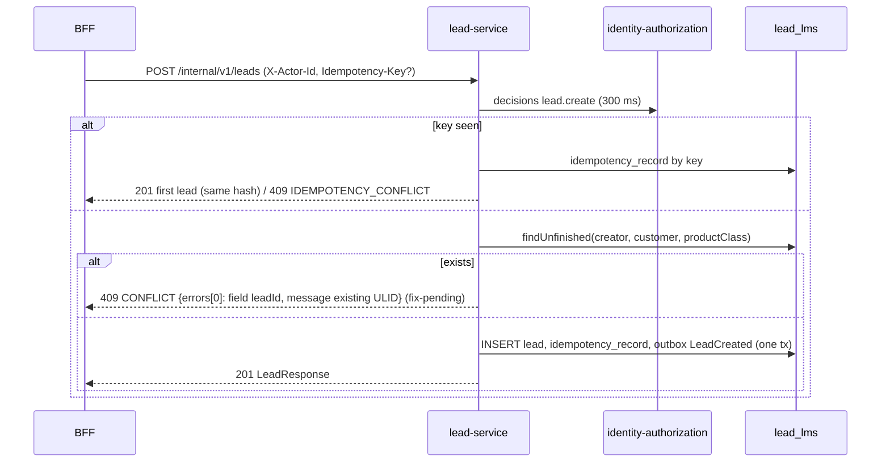

# lead-service — low-level design

**Status:** AI-DRAFTED from code (ADR-027), awaiting Rajal (product), Deepali (security) and engineering review; `LEAD.EXCEPTION` thresholds await the Exception Handling BRD owner (`D2`).

[Contract (authoritative)](./openapi.yaml) · [API portal page](../../api-reference/services/lead-service.md) ·
[BFF to lead interaction](../../api-reference/interactions/bff-to-lead.md) ·
[Owner decisions — D2](../../architecture-review/DECISIONS-2026-10-21.md#d2--lead-exception-engine) ·
[ADR-024 rule engine](../../architecture-review/ADR-024-configuration-driven-rule-engine.md) ·
[ADR-027](../../architecture-review/ADR-027-openapi-contract-authority.md) ·
[Scenario 05](../../api-reference/scenarios/05-lead-creation-and-dedupe.md) ·
[Scenario 06](../../api-reference/scenarios/06-lead-onboarding-and-assignment.md)

## 1. Purpose and ownership

The single on-platform way in to a sale. A lead records why we contact this customer, for which
`lob` / product class, who created it and who the **accountable Specified Person** is. It owns the
pre-BI working states, the exception-hold state and assignment / meeting / follow-up history. It is
not a customer directory (no PAN / CIF) and never stores an insurer status.

| Item | Value |
|---|---|
| Module | `services/lead-service`, port 8091, `service-id: lead`, layer L5, INTERNAL |
| Owns data | Aurora schema `lead_lms`: `lead` (V2), `lead_assignment`, `lead_meeting`, `lead_follow_up`, `idempotency_record`, `outbox_event` (V3); role `app_lead_lms` |
| Callers | BFF (all RM actions). Target: Quotation (BI generated), Journey (`JourneySold` → convert), AUBIMA exception approval |
| Calls out | identity-authorization PDP (create, assign), `SpCertificationPort` (fixture), target: `LEAD.EXCEPTION` rule engine via `ExceptionRulesPort` |

Source: `services/lead-service/src/main/java/com/bank/platform/lead/**`.

## 2. API summary

| Method | Path | PDP | Success | Main refusals |
|---|---|---|---|---|
| POST | `/internal/v1/leads` | `lead.create` | 201 | 409 `CONFLICT` (dedupe; existing lead id in `errors[0]`, fix-pending) / `IDEMPOTENCY_CONFLICT`; 422 `UNSUPPORTED_LOB` |
| GET | `/internal/v1/leads?owner=me&customerId&productClass&unfinished` | – | 200 | 422 `INVALID_REQUEST` (owner ≠ me) |
| GET | `/internal/v1/leads/{leadId}` | – | 200 | 404 absent |
| POST | `/internal/v1/leads/{leadId}/onboarding` | – | 200 | 409 `ILLEGAL_TRANSITION` (BLOCK) |
| POST | `/internal/v1/leads/{leadId}/assignments` | `lead.assign` | 200 | 403 `SP_CERTIFICATION_REQUIRED`; 409 `ILLEGAL_TRANSITION` / `CONFLICT` |
| POST | `/internal/v1/leads/{leadId}/close` | – | 200 | 409 `ILLEGAL_TRANSITION` |
| GET | `/internal/v1/lead/info` | – | 200 | – |

Every lead endpoint requires `X-Actor-Id`; a lead outside the actor's book is `404`.

## 3. Operation flows

### 3.1 Create

1. Bean validation; `customerId`, actor non-blank (`422 MISSING_REQUIRED_FIELD`).
2. PDP `lead.create` (300 ms, fail closed; non-UUID actor → `DEFAULT_DENY` without a call).
3. Idempotency replay check when a key is present (hash of `customerId|lob|productClass|branchId|actor`).
4. `lob = LIFE`, `productClass ∈ {TERM, SAVINGS, ULIP}` (`422 UNSUPPORTED_LOB`).
5. Dedupe — unfinished lead for creator + customer + product class → `409 CONFLICT`;
   **fix-pending:** `errors[0] = {code: CONFLICT, field: "leadId", message: "<existing ULID>"}`.
6. Mint ULID; insert `lead`; insert `idempotency_record` (24 h); outbox `LeadCreated`. Commit.

### 3.2 Start Onboarding — `LEAD.EXCEPTION` (fix-pending, replaces the stub)

1. Load visible lead (`404`).
2. **Guards (fix-pending), before any rule runs** (`Lead.requireEvaluable`): terminal lead, a
   lead on an `APPROVAL_REQUIRED` hold (only AUBIMA approval releases it) or an already `BLOCK`ed
   lead → `409 ILLEGAL_TRANSITION`.
3. `ExceptionRulesPort.evaluate(Subject{leadId, customerId, lob, productClass})` → the adapter
   resolves the **published** `LEAD.EXCEPTION` version and evaluates it on the engine
   (`ADR-024`): `hitPolicy: PRIORITY`, `outcomeRank: [BLOCK, APPROVAL_REQUIRED, PASS]`. Facts
   behind `EH-INT-001…005` (CBS, Equifax, DWH, insurer policy data) are fetched by the adapter.
   A rule with an unset threshold → `BLOCK`, reason `EH-CONFIG-MISSING`. Unresolvable rule set →
   `422 CONFIGURATION_UNRESOLVABLE` (fail closed).
4. Persist outcome; `exception_hold = APPROVAL_REQUIRED`; outbox `LeadExceptionEvaluated`
   (outcome, reason codes, `ruleSetRef`).
5. `BLOCK` → commit (`noRollbackFor`), then `409 ILLEGAL_TRANSITION`; else `200`.

Default: `lead.exception-rules=engine` wires `EngineExceptionRules` over `bank-rule-engine`
(classpath seeds locally; HTTP resolve from administration-config under prod/uat).
`StubExceptionRules` lives in **test sources** only (`lead.exception-rules=stub`; customer id
contains "BLOCK" → `BLOCK`, "HOLD" → `APPROVAL_REQUIRED`, else `PASS`; reason `STUB-NOT-A-RULE`).
`ProductionSafetyGuard` refuses anything but `engine` under prod/uat.

Rules `EH-BR-RULE-012…013` are re-evaluated at premium capture (owned by the premium-capture
caller; not a lead endpoint yet). Remarks are mandatory on approval / rejection (BRD §24.3 col. J) —
the approval endpoint is CONTRACTED, not built.

### 3.3 Assign

1. Visible (`404`) → PDP `lead.assign` → not BI-generated (`409 ILLEGAL_TRANSITION`) →
   **fix-pending** not terminal (`DISQUALIFIED`, `CONVERTED`, `EXPIRED`, `ARCHIVED` →
   `409 ILLEGAL_TRANSITION`) → onboarded (`NOT_EVALUATED` → `409 ILLEGAL_TRANSITION`) → not
   blocked / held (`409 CONFLICT`).
2. `assignedRmId` certified (`403 SP_CERTIFICATION_REQUIRED`); `note` ≤ 250; meeting valid.
3. `lead.assign(rm, sp)` → `ASSIGNED`, `accountableSpId` once; insert assignment
   (`CREATE_ASSIGN` first time, else `REASSIGN`), meeting, follow-up; outbox `LeadAssigned`.

### 3.4 Close

Visible → not terminal, not `QUALIFIED`, not BI-generated (`409 ILLEGAL_TRANSITION`) →
`DISQUALIFIED`; outbox `LeadClosed`.

### 3.5 Expiry

When `lead.expiry-days` is configured, create sets `expires_at = now + expiry` (once). The value is
open (`OPEN-D4`); the expiry sweep that moves a lead to `EXPIRED` is not built.

## 4. Validation rules

| Field | Rule | Error code |
|---|---|---|
| `X-Actor-Id` | required header | Spring `400` (no platform envelope — open item) |
| `customerId`, `lob`, `productClass` | `@NotBlank` | `422 VALIDATION_ERROR` |
| `lob` | `= LIFE` | `422 UNSUPPORTED_LOB` |
| `productClass` | TERM / SAVINGS / ULIP | `422 UNSUPPORTED_LOB` |
| dedupe (creator, customer, product class, unfinished) | none exists | `409 CONFLICT` (+ `errors[0]` field `leadId` = existing ULID, fix-pending) |
| `Idempotency-Key` | same key ⇒ same request hash | `409 IDEMPOTENCY_CONFLICT`; concurrent same key `409 CONFLICT` |
| list `owner` | `me` | `422 INVALID_REQUEST` |
| `assignedRmId` | `@NotBlank`, certified SP | `422 VALIDATION_ERROR` / `403 SP_CERTIFICATION_REQUIRED` |
| `note` | ≤ 250 chars | `422 VALIDATION_ERROR` |
| `meeting.type`, `date`, `time` | `@NotNull` / `@NotBlank` | `422 VALIDATION_ERROR` |
| `meeting.date` / `time` | `yyyy-MM-dd` / `HH:mm`; 08:00–20:00 Asia/Kolkata; not in the past | `422 VALIDATION_ERROR` |
| `meeting.link` | required for `ONLINE`; absent for `IN_PERSON` | `422 VALIDATION_ERROR` |
| state for assign | not BI, onboarded, not terminal (fix-pending), not held | `409 ILLEGAL_TRANSITION` / `409 CONFLICT` |
| state for close | not terminal, not `QUALIFIED`, not BI | `409 ILLEGAL_TRANSITION` |
| state for onboarding | not terminal, not held, not blocked (fix-pending) | `409 ILLEGAL_TRANSITION` |

## 5. Rule-engine usage

| Rule set | Hit policy | Outcome rank | Evaluated at | Missing threshold |
|---|---|---|---|---|
| `LEAD.EXCEPTION` (owned by lead-service, `D2`) | `PRIORITY` | `BLOCK > APPROVAL_REQUIRED > PASS` | Start Onboarding; rules 012–013 again at premium capture | `BLOCK`, reason `EH-CONFIG-MISSING` |

Seed thresholds (max age, min Equifax score, lapse window, cooling periods, CASA age, active-policy
count, high-premium limit) ship **unset** — every lead routes to `BLOCK` until the BRD owner enters
values. Values are configuration, never code.

## 6. DTO → domain → table mapping

| DTO field | Domain (`Lead`) | Column |
|---|---|---|
| `leadId` | `leadId` (ULID) | `lead.lead_id CHAR(26)` |
| `customerId` | `customerId` | `lead.customer_id VARCHAR(64)` (D3: `CHAR(26)` target) |
| `lob`, `productClass`, `branchId` | same | `lob`, `product_class`, `branch_id` |
| `X-Actor-Id` (create) | `createdByPrincipalId` | `created_by_principal_id` |
| – (configured expiry) | `expiresAt` | `expires_at` (in-progress migration) |
| `state`, `dashboardStage` | `LeadState`, derived | `state` (dashboard not stored) |
| `assignedRmId`, `assignedSpId`, `accountableSpId` | same | `assigned_rm_id`, `assigned_sp_id`, `accountable_sp_id` |
| `exceptionOutcome`, `exceptionHold` | same | `exception_outcome`, `exception_hold` |
| `exceptionRequired` | derived | – |
| `biGenerated`, `reportingClass`, `journeyId` | same | `bi_generated`, `reporting_class`, `journey_id` |
| – | optimistic lock | `version` (lost race → `409 CONFLICT`) |
| assign (rm, sp, actor) | `Assignment` | `lead_assignment` (`assignment_kind`) |
| `meeting` | `Meeting` | `lead_meeting` (`meeting_link_enc` + `encryption_key_id`) |
| `note` | `FollowUp` | `lead_follow_up.note_enc` |
| `Idempotency-Key` | `IdempotencyRecord` | `idempotency_record` (`request_hash`, `response_ref`, `expires_at`) |
| events | `LeadEvent` | `outbox_event` |

## 7. Invariants and where they are enforced

| Invariant | Where |
|---|---|
| Book visibility; absent not forbidden (`INV-LED-07`) | `Lead.visibleTo`, `getVisible` |
| PDP re-check on create / assign (`INV-ACT-01`) | `LeadApplicationService.authorize` |
| One unfinished lead per creator + customer + product class | `findUnfinished` (partial unique index `ux_lead_dedupe_open` is design-only) |
| Save never evaluates exceptions; assign requires onboarding (`D-019`) | `create`, `assign` |
| Certified assignee (`INV-ACT-01`) | `SpCertificationPort` |
| No reassignment after BI | `assign` |
| `QUALIFIED ⇒ bi_generated`; progressing ⇒ `accountable_sp_id` | DDL checks `ck_lead_qualified`, `ck_lead_sp_when_progressing` |
| Terminal lead cannot be assigned (**fix-pending**) | `Lead.assign` guard |
| A hold is not cleared by re-running onboarding (**fix-pending**) | `applyExceptionOutcome` guard |

## 8. Events, idempotency, timeouts, failure modes

- **Events produced** (outbox rows in the same transaction; no relay yet — `ADR-025` relay to be
  adopted): `LeadCreated`, `LeadExceptionEvaluated`, `LeadAssigned`, `LeadClosed`; data carries
  state, product class, exception outcome, assigned RM, journey id — ids and states only. The
  portal catalogue's `OpportunityCreated` / `LeadQualified` names
  ([outbox and events](../../api-reference/interactions/outbox-and-events.md)) are not emitted yet;
  reconciling names belongs to the events catalogue owner. **Consumed:** none today (target:
  `JourneySold`, BI generated).
- **Idempotency:** create only (24 h record). Assign / onboarding / close have no key; they are
  state-guarded.
- **Timeouts:** PDP 300 ms, no retry, fail closed (`403 AUTHORIZATION_UNAVAILABLE`). BFF → lead
  budget 2 s (S-20).
- **Failure modes:** optimistic-lock loss → `409 CONFLICT` (re-read and retry); DB down → `500`.

## 9. Deviations from older documents and open items

| # | Item | Owner |
|---|---|---|
| 1 | Old internal OpenAPI used `/{leadId}:start-onboarding`, `422 VALIDATION_BLOCKED`, `409 LEAD_DUPLICATE_UNFINISHED`, a close body — superseded; code wins | done (banner) |
| 2 | **fix-pending** existing lead id in the dedupe `409` (`errors[0]`, field `leadId`, message = ULID) — older docs named it `existingLeadId` | Engineering |
| 3 | **fix-pending** `LEAD.EXCEPTION` via `ExceptionRulesPort` replaces the stub; thresholds unset → `BLOCK` | Engineering; thresholds: BRD owner |
| 4 | **fix-pending** assign state guard; onboarding re-run must not clear a hold | Engineering |
| 5 | Lead LLD codes (`ORIGINATION_ACTOR_DENIED`, `LEAD_DUPLICATE_UNFINISHED`, …) not registered; nearest registered codes used | Engineering / Rajal |
| 6 | Close reason / remarks (VAL-017…019) not captured | Rajal |
| 7 | Missing `X-Actor-Id` → Spring 400 without the envelope | Engineering |
| 8 | `lead_lms` DDL drift vs design (`expires_at`, `ux_lead_dedupe_open`, `customer_id CHAR(26)`, …) | DBA |
| 9 | Exception approval / hold endpoint, BI, convert, archive are CONTRACTED, not built | Rajal / Engineering |
