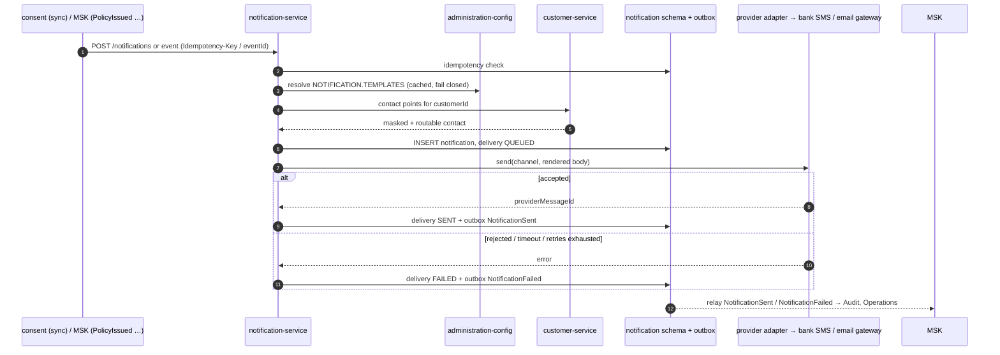

# notification-service — Low-level design

**Status:** AI-DRAFTED 2026-10-21, awaiting Mahesh (architecture) review. Customer-facing template
text and channels await Shailja / bank Compliance; the SMS / email gateway is a bank dependency.

[OpenAPI](./openapi.yaml) · [API reference page](../../api-reference/services/notification-service.md) ·
[Decisions 2026-10-21 (D5, D8)](../../architecture-review/DECISIONS-2026-10-21.md) ·
[ADR-025 events](../../architecture-review/ADR-025-event-specification-and-publisher.md)

## 1. Purpose and ownership

Delivers configured messages to the **customer's own** device through the bank's SMS / email
gateways, behind a provider adapter port. A delivery failure never blocks a journey; it raises an
operations task (S-18).

| | |
|---|---|
| Module | `services/notification-service` · port 8102 · `service-id: notification` · L5 INTERNAL |
| Callers | consent-service (OTP, synchronous); events `PaymentLinkIssued`, `PolicyIssued`, `ProposalDeclined`; operations (re-send) |
| Calls out | customer-service (contact points), administration-config (templates), bank SMS / email gateway (via the adapter port; Apigee where the bank exposes it) |
| Owns (proposed) | Aurora schema `notification`: `notification`, `delivery`, `processed_event`, `outbox_event` — **DDL addition required** (§7) |

### 1.1 R0 scope — conflict resolved

The service page said "OTP and payment link only"; the event catalogue routes `PolicyIssued` and
`UnderwritingDecision` to Notification; D8 ends with "`PolicyIssued` / `ProposalDeclined` → inform
the customer". **D8 wins:** R0 sends four templates.

| Template | Trigger | Channels (seed, configurable) | Content approver |
|---|---|---|---|
| `CONSENT_OTP` | consent-service `POST /notifications` (D5 checkpoints) | SMS | Shailja |
| `PAYMENT_LINK` | `PaymentLinkIssued` (payment-service, D8) | SMS + EMAIL | Shailja |
| `POLICY_ISSUED` | `PolicyIssued` (policy-issuance, D8) | SMS + EMAIL | Shailja |
| `PROPOSAL_DECLINED` | `ProposalDeclined` (policy-issuance, D8) | SMS + EMAIL | Shailja |

Everything else (UW requirements, reminders, renewal) is R1.

## 2. API summary

| Method | Path | Purpose |
|---|---|---|
| `POST` | `/internal/v1/notifications` | OTP (sync attempt → `200 SENT` or error) or queued send (`202 QUEUED`) |
| `GET` | `/internal/v1/notifications/{notificationId}` | Status, masked contact, attempts — never content |
| (consumer) | `PaymentLinkIssued`, `PolicyIssued`, `ProposalDeclined` | Event-driven sends |

## 3. Templates are configuration

Template set `NOTIFICATION.TEMPLATES` in administration-config (versioned, maker-checker,
classification `COMPLIANCE`): per template id → `channels`, per channel `body` with `@placeholders`,
`requiredParameters`, `sensitiveParameters` (never persisted / logged), `maxAttempts`, `retryBackoff`,
`language`. **No seed text is written here** — wording awaits Shailja; until a version is published
every send fails closed with `422 CONFIGURATION_UNRESOLVABLE` (N-1).

| Template | Required parameters (from the producing event / caller) |
|---|---|
| `CONSENT_OTP` | `otp` (sensitive), `expiresInSeconds` |
| `PAYMENT_LINK` | `url` (sensitive), `expiresAt`, `amount`, `currency` (resolved from payment-service by `paymentId`, never carried in the event — ADR-025 no-PII rule) |
| `POLICY_ISSUED` | `policyNumber`, `insurerName`, `productName` |
| `PROPOSAL_DECLINED` | `applicationNumber`, `insurerName` |

## 4. Flows

### 4.1 `CONSENT_OTP` (synchronous)

1. Validate; idempotency on `Idempotency-Key` (`notification.notification.idempotency_key UNIQUE`).
2. Resolve template version (S-21, 300 ms, fail closed).
3. Resolve contact points by `customerId` from customer-service (1 s, no retry); none for the
   channel → `404 RESOURCE_NOT_FOUND`.
4. INSERT `notification` + `delivery` (status `QUEUED`; `otp` not stored).
5. Provider adapter `send` (connect 1 s / read 3 s, **no retry** — a duplicate OTP SMS is a customer
   problem and the consent flow can re-challenge).
6. Accepted → `SENT`, outbox `NotificationSent` → `200`. Rejected / timeout → `FAILED`, outbox
   `NotificationFailed` → `503 UPSTREAM_UNAVAILABLE` / `504 UPSTREAM_TIMEOUT`. Consent stays
   `OTP_PENDING` and may request a new OTP (new key).

Consent → notification budget: 5 s read (> 1 s + 3 s inner).

### 4.2 Event-driven send (`PAYMENT_LINK`, `POLICY_ISSUED`, `PROPOSAL_DECLINED`)

1. Consume; dedupe on `eventId` (`processed_event`).
2. Build parameters: fetch what the event does not carry (payment URL from payment-service,
   policy number / insurer from policy-issuance) — events carry ids only.
3. Same steps 2–4 as §4.1 with `Idempotency-Key = eventId`; sensitive `url` is stored encrypted in
   `delivery.parameters_enc` until the delivery is terminal, then nulled.
4. Worker sends each channel; retries per template (`maxAttempts`, backoff) on retryable provider
   failures only.
5. Terminal: all channels `SENT` → `NotificationSent`; any channel exhausted → `NotificationFailed`
   + operations task. Commit offset after step 3 (the durable row is the hand-off).

### 4.3 Sequence — send → SENT / FAILED

## 5. Provider adapter port

`NotificationGateway.send(channel, contact, renderedBody, messageRef) → {providerMessageId | error}`
in `application`; adapters `BankSmsGatewayAdapter`, `BankEmailGatewayAdapter` in `adapter`, and an
in-memory one for tests. Provider status callbacks (delivery receipts) are R1; R0 `SENT` means
"accepted by the gateway". Error mapping: gateway 4xx → `FAILED` non-retryable; 5xx / timeout →
retryable.

## 6. Validation rules

| Field | Rule | Error code |
|---|---|---|
| `Idempotency-Key` | present | `MISSING_IDEMPOTENCY_KEY` |
| `template` | one of the four; published | `VALIDATION_ERROR` / `CONFIGURATION_UNRESOLVABLE` |
| `lob` | `LIFE` | `UNSUPPORTED_LOB` |
| `recipient` | only `customerId`; any phone / email / device field | `PAYMENT_DEVICE_ISOLATION` (C4) |
| `parameters` | every `requiredParameters` present | `VALIDATION_ERROR` |
| `channels` | subset of the template's channels | `VALIDATION_ERROR` |
| customer | exists, has a contact for the channel | `RESOURCE_NOT_FOUND` |

## 7. DTO → domain → table (PROPOSED DDL, new schema `notification`)

The old page said "no data at R0"; idempotency must live in the owning store
([idempotency convention §1.1](../../api-reference/conventions/idempotency-timeouts-retries.md#11-the-platform-standard-inv-idm-01-03-52)),
and SENT/FAILED needs a state, so a minimal store is required. It holds **no message body and no
contact data**.

| DTO | Domain | Column |
|---|---|---|
| `notificationId` | `Notification.id` | `notification.notification.notification_id CHAR(26)` |
| `Idempotency-Key` + body hash | | `idempotency_key UNIQUE`, `request_hash` |
| `template`, `templateVersion` | `TemplateRef` | `template_id`, `template_version` |
| `recipient.customerId` | | `customer_id CHAR(26)` |
| `sourceRef` | | `source_context`, `source_aggregate_id`, `source_event_id` |
| `status` | | `status` (`QUEUED`/`SENT`/`FAILED`) |
| `deliveries[]` | `Delivery` | `notification.delivery (delivery_id, notification_id, channel, status, attempts, failure_code, provider_message_id, parameters_enc, sent_at)` |
| `maskedContact` | | computed at read from customer-service; not stored |
| consumed events | | `notification.processed_event (event_id PK)` |

## 8. Events

| Direction | Event | Notes |
|---|---|---|
| Consumed | `PaymentLinkIssued`, `PolicyIssued`, `ProposalDeclined` | `ProposalDeclined` is named by D8; catalogue entry needed if absent |
| Produced | `NotificationSent` `{notificationId, template, channel[], sourceRef}` | **NEW** catalogue entry; consumers Audit, Journey (optional) |
| Produced | `NotificationFailed` `{notificationId, template, failedChannels, failureCode}` | **NEW**; consumers Audit, Operations |
| Produced | `AuditRecorded` | ADR-026 (Proposed) |

## 9. Failure modes

| Failure | Behaviour |
|---|---|
| Template unpublished | Fail closed, `422 CONFIGURATION_UNRESOLVABLE`; event path → `FAILED` + ops task |
| Customer-service down | OTP: `503`; events: retry topic then DLQ |
| Gateway down | OTP: `503`, no retry; events: template retries, then `FAILED` |
| Journey impact | None — never blocks; `NotificationFailed` → ops task |

## 10. Open items

| # | Item | Owner |
|---|---|---|
| N-1 | Approve template wording, languages and channels | Shailja |
| N-2 | DDL for schema `notification` and role `app_notification` | DBA |
| N-3 | customer-service needs a service-restricted contact-point read (e.g. `GET /internal/v1/customers/{customerId}/contact-points`, callable only by notification) | customer-service owner |
| N-4 | Bank SMS / email gateway API and Apigee exposure | Bank |
| N-5 | Add `NotificationSent`, `NotificationFailed`, `ProposalDeclined` to the event catalogue | Events owner |
