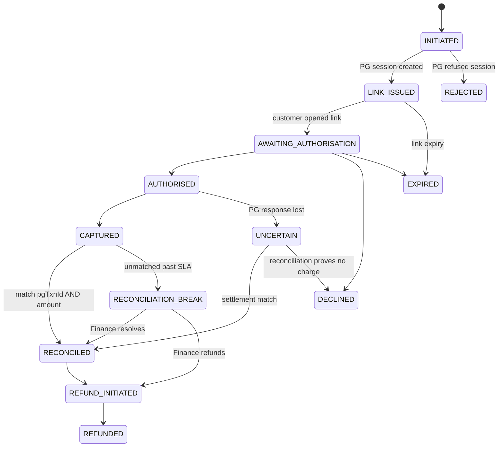
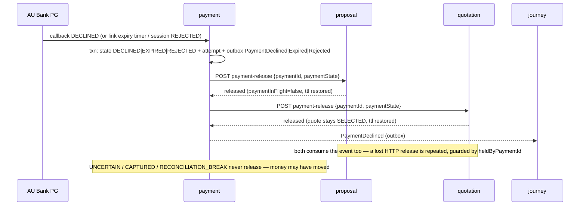

# payment-service — LLD (contract companion)

**Status:** AI-DRAFTED 2026-10-21, awaiting Amit (engineering), Mahesh (architecture), Finance
(refund maker-checker threshold) and the S10 AU Bank PG contract (wire details).

[OpenAPI](./openapi.yaml) · [API reference page](../../api-reference/services/payment-service.md) ·
[Decision D8](../../architecture-review/DECISIONS-2026-10-21.md#d8--payment-issuance-tracking-and-the-long-term-record-d-025) ·
[`10-payment.sql`](../../data-architecture/schemas/10-payment.sql) ·
[PG interaction](../../api-reference/interactions/payment-to-payment-gateway.md) ·
[quotation contract](../quotation-service/LLD.md) · [proposal contract](../proposal-service/LLD.md)

## 1. Purpose and ownership

Owns money movement for the premium: payment session at the AU Bank PG, link to the customer's own
device (C4), PG callback ingestion, settlement reconciliation, `UNCERTAIN` / break handling and
maker-checked refunds. `RECONCILED` — not `CAPTURED` — permits issuance and materialisation.
Port 8098, `service-id: payment`. Aurora schema `payment` (`app_payment`), always structured.
Payment has **no DynamoDB permission**: it reads the premium only through quotation's
`payment-hold` and the payable proposal only through proposal's `payment-hold`.

## 2. API summary

| Operation | Path | Caller |
|---|---|---|
| `createPaymentSession` | `POST /internal/v1/payments` | Journey |
| `listPayments` | `GET /internal/v1/payments?state&since` | quotation / proposal / policy repair sweeps |
| `getPayment` | `GET /internal/v1/payments/{paymentId}` | BFF, Journey, policy-issuance |
| `receivePgCallback` | `POST /internal/v1/payments/pg-callbacks` | AU Bank PG via `/callbacks/pg/*` |
| `startReconciliation` / `getReconciliationRun` | `POST/GET /internal/v1/payments/reconciliations…` | settlement job, Finance |
| `requestRefund` / `approveRefund` | `POST …/{paymentId}/refunds`, `POST …/refunds/{refundId}/approve` | Ops maker / checker |

All operations are PLANNED (service is a skeleton).

## 3. States and what each does to the quote / proposal holds

| State | Quote hold / proposal hold | Event | Downstream |
|---|---|---|---|
| `INITIATED` | taken (both) | — | — |
| `LINK_ISSUED`, `AWAITING_AUTHORISATION`, `AUTHORISED`, `CAPTURED` | kept | `PaymentLinkIssued`, `PaymentAuthorised`, `PaymentCaptured` | Journey, Audit, Notification (link) |
| `UNCERTAIN` | **kept** — money may have moved | `PaymentUncertain` | Journey (waits), ops |
| `RECONCILIATION_BREAK` | **kept** — money captured, unmatched | `PaymentReconciliationBreak` | Audit, ops alert, Finance (F-07) |
| `RECONCILED` | consumed by materialise | **`PaymentReconciled`** | Quotation + Proposal materialise; policy-issuance starts the TAT clock; Journey `PAYMENT_SETTLED`; Audit; Reporting |
| `DECLINED` | **released**, TTL restored | `PaymentDeclined` | release + Journey (retry allowed) |
| `EXPIRED` | **released**, TTL restored | `PaymentExpired` | same |
| `REJECTED` | **released**, TTL restored | `PaymentRejected` | same |
| `REFUND_INITIATED` | unchanged | `RefundInitiated` | Audit |
| `REFUNDED` from break | **released**, TTL restored | `PaymentRefunded` | release; Audit |
| `REFUNDED` after `RECONCILED` | n/a (materialised) | `PaymentRefunded` | policy history `REFUNDED`, `closed_at` |

`PaymentReconciled.data` (D8, ADR-025 envelope, [schema](../events/schemas/PaymentReconciled.v1.json)):
`paymentId`, `quoteId`, `proposalId`, `journeyId`, `applicationNumber`, `settlementRef`, `method`,
`paidAt`, `reconciledAt`, `amount`, `currency`.

## 4. Operation flows

### 4.1 Create payment session

1. Idempotency (`proposal:{proposalId}:payment:{attempt}`); bean validation.
2. Mint `paymentId`. `POST proposal /internal/v1/proposals/{proposalId}/payment-hold {paymentId}` →
   `quoteId`, `offerId`, `applicationNumber`, `journeyId`, `leadId`, `customerId`, `lob`
   (`409 PROPOSAL_NOT_PAYABLE`, `409 PAYMENT_ALREADY_IN_PROGRESS` propagate).
3. `POST quotation /internal/v1/quotes/{quoteId}/payment-hold {paymentId, proposalId, offerId}` →
   premium, tax, sum assured. Amount = `premiumAmount + taxAmount`, to the paise (`INV-PAY-03`).
4. Guards in one Aurora transaction: no other non-terminal payment (`ux_payment_active_per_proposal`,
   `INV-PAY-02`); no prior `AUTHORISED`/`UNCERTAIN` attempt (`INV-PAY-04`). INSERT `payment`
   (`INITIATED`, `quote_id`, `proposal_id`, `application_number`, amount) + `payment_attempt` +
   `idempotency_record`.
5. Destination: the customer's registered contact from customer-service for `deviceChannel`
   (never an RM/employee contact → `403 PAYMENT_DEVICE_ISOLATION`, security event).
6. PG session create (S-13, 3 s / 15 s, **no retry**, server key from `paymentId`). PG refuses →
   `REJECTED` + outbox `PaymentRejected` → release both holds → answer `422`/`503` per cause.
7. `LINK_ISSUED` (+ `link_issued_to_enc`, `link_expires_at`) + outbox `PaymentLinkIssued` in one
   transaction; Notification sends the link (S-18, async; failure is an ops task).
8. `201` — no URL in the body.

If step 3 fails after step 2 succeeded, Payment releases the proposal hold before answering.

### 4.2 PG callback (S-14)

1. Edge: source IP allowlist (Istio). 2. Verify PG signature → `401 UNAUTHORIZED` + security event.
3. Replay window on the PG timestamp → `401`. 4. **Dedupe:** INSERT `pg_callback_receipt
   (pg_txn_id, callback_type)` UNIQUE — conflict → return the stored result, `duplicate=true`.
5. Apply `AUTHORISED` / `CAPTURED` / `DECLINED` (`method`, `paid_at` on capture), append
   `payment_attempt`, outbox event — one transaction. `DECLINED` then releases both holds.
6. A callback that never arrives does not decide anything: past the authorisation window an
   `AUTHORISED` payment becomes `UNCERTAIN` (holds kept); only reconciliation resolves it (F-08).

### 4.3 Reconciliation (S-15)

Match each settlement record on **`pgTxnId` AND amount** (`INV-PAY-05`). Match → `RECONCILED`,
`reconciled_at`, `settlement_ref`, outbox **`PaymentReconciled`** (one transaction). `UNCERTAIN` with
a match → `RECONCILED`; with PG confirmation of no charge → `DECLINED` (holds released). `CAPTURED`
unmatched inside SLA → unchanged; past SLA → `RECONCILIATION_BREAK` + `PaymentReconciliationBreak`.
**No timeout ever resolves a money question.** The reconciliation SLA is configuration (value not
in any source — Finance to set; until set, breaks are raised only by Finance manually).

### 4.4 Payment ending without `RECONCILED` — hold release and TTL restore

### 4.5 Refunds

Maker (`X-Actor-Id`) requests from `RECONCILED` or `RECONCILIATION_BREAK` → `refund`
`PENDING_APPROVAL`; checker ≠ maker approves (`403 FORBIDDEN` otherwise, `INV-PAY-06`); approved →
PG refund → `REFUNDED` + `PaymentRefunded`. The auto-approval threshold is configuration with **no
seed value** in any source; until Finance sets it every refund needs a checker (fail closed).
`ProposalDeclined` (policy-issuance) opens a refund **task** for ops; Payment never auto-refunds.

### 4.6 List for repair sweeps

`GET /internal/v1/payments?state=RECONCILED&since=…` pages over index
`(state, reconciled_at, payment_id)`; returns ids only (no contact, no PG data). Consumers keep
their own watermark and overlap by one day.

## 5. Validation rules

| Field / condition | Rule | Error code |
|---|---|---|
| `Idempotency-Key` | required | `MISSING_IDEMPOTENCY_KEY` |
| body amount / destination | must not be present | `VALIDATION_ERROR` (unknown field) |
| `deviceChannel` | `SMS_LINK|EMAIL_LINK|QR_SCAN`; customer contact | `PAYMENT_DEVICE_ISOLATION` (403) |
| proposal | `AWAITING_PAYMENT` | `PROPOSAL_NOT_PAYABLE` (409) |
| active payment | none non-terminal | `PAYMENT_ALREADY_IN_PROGRESS` (409) |
| prior attempt | not `AUTHORISED`/`UNCERTAIN` | `PAYMENT_STATE_UNCERTAIN` (409) |
| amount | = premium + tax | `PREMIUM_MISMATCH` (422) |
| quote | `SELECTED`, in window | `QUOTE_EXPIRED` (409), `INVALID_OFFER_REFERENCE` (422) |
| callback | signature + window | `UNAUTHORIZED` (401) |
| refund | refundable state; amount ≤ paid; checker ≠ maker | `ILLEGAL_TRANSITION`, `VALIDATION_ERROR`, `FORBIDDEN` |

## 6. Mapping — DTO → table

| Field | Column | Note |
|---|---|---|
| `paymentId` | `payment.payment_id` | |
| `leadId`, `journeyId`, `proposalId` | `lead_id`, `journey_id`, `proposal_id` | |
| (proposal hold) `quoteId` | **DDL** `quote_id` (D8) | |
| (proposal hold) `applicationNumber` | **DDL** `application_number` | carried on `PaymentReconciled` |
| (quote hold) premium + tax | `amount`, `currency` | |
| `deviceChannel` | `device_channel` | |
| destination | `link_issued_to_enc` | encrypted; masked in responses |
| PG `method` | **DDL** `method` (D8 "payment type") | |
| capture time | `captured_at`; **DDL** `paid_at` (D8) | `paid_at` = PG-reported payment time |
| `reconciledAt` | `reconciled_at` | |
| callback | **DDL** `pg_callback_receipt` | dedupe |
| refund | `refund` + **DDL** `state`, `reason_code`, `remarks` | |

## 7. Invariants

`INV-PAY-01` (create step 5), `-02` (partial unique index), `-03` (amount from quotation hold),
`-04` (create guard), `-05` (reconciliation), `-06` (refund approval). Holds: released only on the
four no-money outcomes in §3.

## 8. Events

Produced (outbox `payment.outbox_event`, ADR-025, topic `{env}.payment.payment.v1`):
`PaymentLinkIssued`, `PaymentAuthorised`, `PaymentCaptured`, `PaymentUncertain` (new),
`PaymentDeclined` (new), `PaymentExpired` (new), `PaymentRejected` (new), **`PaymentReconciled`**
(D8 ids), `PaymentReconciliationBreak`, `RefundInitiated` (new), `PaymentRefunded` (new).
Consumed: `ProposalDeclined` (refund task), idempotent by `eventId` (`processed_event`).
Catalogue to live at `docs/platform/contracts/events/CATALOGUE.md`.

## 9. Idempotency, timeouts, failures

PG session: no retry. Holds: idempotent by `paymentId`. Callbacks: at-least-once, deduped. Outbox
relay: `JdbcOutboxRelay` (`SKIP LOCKED`, park after 10 failures). A failed release call never
blocks the payment's state change; the event consumers repair it.

## 10. Required DDL changes (not edited here)

| Target | Change |
|---|---|
| `payment.payment` | ADD `quote_id CHAR(26) NOT NULL` (D8), `application_number VARCHAR(50)`, `method VARCHAR(24)`, `paid_at TIMESTAMPTZ`; INDEX `(state, reconciled_at, payment_id)`, INDEX `(state, updated_at, payment_id)` |
| NEW `payment.pg_callback_receipt` | `receipt_id CHAR(26) PK`, `payment_id FK`, `pg_txn_id`, `callback_type`, `body_hash`, `result_state`, `received_at`; UNIQUE `(pg_txn_id, callback_type)`; INSERT-only |
| `payment.refund` | ADD `state` (CHECK `PENDING_APPROVAL, APPROVED, REJECTED, EXECUTED, FAILED`), `reason_code`, `remarks`, `pg_refund_ref` |
| `payment.outbox_event` | ADR-025 columns: `aggregate_type`, `aggregate_id`, `parked_at`; ULID id |
| NEW `payment.processed_event` | consumer dedupe |
| `91-grants.sql` | `app_payment`: SELECT, INSERT on `pg_callback_receipt` (REVOKE UPDATE, DELETE); SELECT, INSERT on `processed_event` |

## 11. Open items

| # | Item | Owner |
|---|---|---|
| PY1 | PG signature scheme, callback body, settlement file format (S10) | Bank PG team, Amit |
| PY2 | Refund auto-approval threshold; reconciliation SLA | Finance |
| PY3 | Authorisation window after which `AUTHORISED` → `UNCERTAIN` | Finance, Amit |
