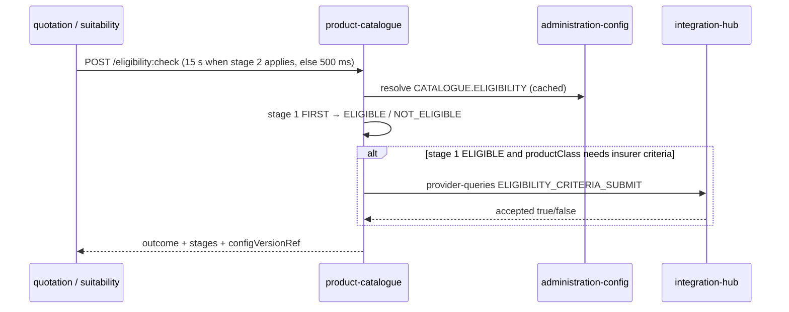

# product-catalogue-service — Low-level design

**Status:** AI-DRAFTED 2026-10-21, awaiting Rajal (product behaviour) and Mahesh (architecture)
review. Eligibility **threshold values** are unset and await Rajal — none are invented here.

[OpenAPI](./openapi.yaml) · [API reference page](../../api-reference/services/product-catalogue-service.md) ·
[ADR-024 rule engine](../../architecture-review/ADR-024-configuration-driven-rule-engine.md) ·
[Integration Hub LLD](../integration-hub-service/LLD.md) ·
[DDL `07-catalogue.sql`](../../data-architecture/schemas/07-catalogue.sql)

## 1. Purpose and ownership

The bank-controlled answer to *what may we sell, to whom, from which insurer*: insurers (Group A/B),
products per LOB and product class, effective-dated; and product eligibility. Suitability and
Quotation read the same answers. It is bank configuration — not 1SB's product list leaking in.

| | |
|---|---|
| Module | `services/product-catalogue-service` · port 8094 · `service-id: catalogue` · L5 INTERNAL |
| Callers | BFF (`/catalogue/*`), suitability-service, quotation-service |
| Calls out | administration-config (`rule-sets:resolve`), integration-hub (`ELIGIBILITY_CRITERIA_GET/SUBMIT`), Valkey `catalogue:` L2 |
| Owns | Aurora schema `catalogue` (`insurer`, `product`; `eligibility_band` superseded — §5.4) + `outbox_event` (ADR-025) |
| Owner | Rajal (product content); Mahesh (architecture) |

## 2. API summary

| Method | Path | Status | Purpose |
|---|---|---|---|
| `GET` | `/internal/v1/offerings?lob&productClass&insurerId&at` | CONTRACTED | Offerings in force |
| `GET` | `/internal/v1/product-classes?lob` | PROPOSED | Replaces the BFF static list (`SUG-20261007-srp`) |
| `GET` | `/internal/v1/products/{productCode}?insurerId&at` | PROPOSED | One product version + the eligibility rule-set version in force |
| `GET` | `/internal/v1/products/{productCode}/insurer-criteria?insurerId` | PROPOSED | Insurer criteria form via the Hub |
| `POST` | `/internal/v1/eligibility:check` | PROPOSED | Two-stage eligibility (§5) |

## 3. Read flows

1. Validate `lob` (`LIFE`) and `productClass`; else `422 UNSUPPORTED_LOB`.
2. Resolve: in-process L1 → Valkey L2 (S-25, 50 ms, a miss is a read) → Aurora
   (`product` joined to `insurer`, `effective_from ≤ at < coalesce(effective_to, ∞)`, `active`).
3. Partner reps: the BFF passes `insurerId`; only that insurer's rows return (`(lob, insurerId)` scope).
4. Group B insurers are returned with `insurerGroup: B` but are not quotable in R0 (redirect is R1).

Budgets: caller → catalogue 500 ms, 1 retry, breaker; degraded mode serves L1/L2 for display reads
only — **never** past TTL for a regulated decision (`eligibility:check` fails instead).

## 4. Product-class list

`GET /product-classes?lob=LIFE` returns the distinct `product_class` values of products in force for
the LOB, with labels from configuration. Seed R0: `TERM`, `SAVINGS`, `ULIP`.

## 5. Eligibility — two sources, one precedence

The [readiness review](../../api-reference/READINESS-REVIEW.md) found two sources with no
precedence: `catalogue.eligibility_band` and the insurer criteria the 1SB adapter exposes
(`ELIGIBILITY_CRITERIA_GET`). Resolution:

| Stage | Source | What it decides | Where it lives |
|---|---|---|---|
| 1 | **Catalogue** — rule set `CATALOGUE.ELIGIBILITY` | Whether the **bank** sells this product to this applicant (age, sum assured, income, occupation band, term) | Configuration (ADR-024), approved by Rajal (`PRODUCT` classification) |
| 2 | **Insurer criteria** — through the Hub | The insurer's own gate questions (Savings/ULIP gate forms) | Insurer, fetched live via `integration-hub` `ELIGIBILITY_CRITERIA_GET` / `_SUBMIT` |

**Precedence:** catalogue first; **both must pass**. A catalogue `NOT_ELIGIBLE` stops the check and
the insurer is not called (no customer data leaves the bank for a product the bank would not sell).
Precedence, and which product classes need stage 2, are **parameters** of the rule set — changing
them is a new rule-set version, not code:

```json
"parameters": {
  "precedence": { "order": ["CATALOGUE", "INSURER"], "requireAll": true, "stopOnFirstFailure": true },
  "insurerCriteria": { "productClasses": ["SAVINGS", "ULIP"] }
}
```

Seed for `insurerCriteria.productClasses` is from the 1SB adapter page (gate criteria are
"for Savings/ULIP-style products",
[§3.3](../../api-reference/services/1sb-integration-service.md#33-get--post-v1quotescriteria)).

### 5.1 Rule set `CATALOGUE.ELIGIBILITY` (hit policy `FIRST`)

ADR-024 §4 lists `FIRST` for eligibility bands. Rules run in ascending `priority`; the refusals come
first and a final catch-all yields `ELIGIBLE`.

| Element | Value |
|---|---|
| `ruleSetId` / scope | `CATALOGUE.ELIGIBILITY`, scope `{lob, productClass}`; one table per product keyed by `productCode` |
| Inputs | `productCode`, `insurerId`, `ageNextBirthday`, `sumAssured`, `annualIncome`, `occupationBand`, `policyTerm` |
| `tables` | Per-product EXACT/RANGE bands (`minAge`, `maxAge`, `minSumAssured`, `maxSumAssured`, …) — **omitted from the seed** until Rajal publishes (engine schema requires ≥1 row per table) |
| `decision` | `hitPolicy: FIRST`, `noMatchOutcome: NOT_ELIGIBLE`, `missingInputOutcome: NOT_ELIGIBLE` |
| Fail-closed rule | `CAT-ELIG-000` (priority 1): `parameters.bandsPublished` is null → `NOT_ELIGIBLE`, reason `CAT_CONFIG_MISSING` (same pattern as `LEAD.EXCEPTION` `EH-CONFIG-MISSING`, D2) |
| Refusals (when bands published) | `CAT-ELIG-010` age outside band → `AGE_OUT_OF_BAND`; `-020` sum assured outside band → `SUM_ASSURED_OUT_OF_BAND`; `-030` occupation not allowed → `OCCUPATION_NOT_ALLOWED` |
| Catch-all | `CAT-ELIG-999` → `ELIGIBLE` (unreachable while `CAT-ELIG-000` fires) |

Seed file: [`CATALOGUE.ELIGIBILITY.json`](../../../../libs/bank-rule-engine/src/main/resources/rulesets/CATALOGUE.ELIGIBILITY.json).
Because the band rows ship unset, **every product is `NOT_ELIGIBLE` until Rajal publishes values**
([MISSING-PRICES.md](../MISSING-PRICES.md) item 2).

### 5.2 `POST /eligibility:check` flow

1. Validate body; resolve product in force (`404 RESOURCE_NOT_FOUND` if none).
2. Resolve `CATALOGUE.ELIGIBILITY` for (lob, productClass, at) — failure → `422
   CONFIGURATION_UNRESOLVABLE` (fail closed, no cached past-TTL version).
3. Evaluate stage 1. `NOT_ELIGIBLE` → return; stage 2 `NOT_EVALUATED`.
4. If `productClass ∉ insurerCriteria.productClasses` → `ELIGIBLE`.
5. If no `insurerCriteriaValues` → `INSURER_CRITERIA_REQUIRED`.
6. Hub `POST /provider-queries {ELIGIBILITY_CRITERIA_SUBMIT, insurerCode = insurerId, productCode, values}`
   (catalogue → Hub 14 s; Hub → adapter 12 s). `accepted = false` → `NOT_ELIGIBLE` reason
   `INSURER_CRITERIA_NOT_MET`.
7. Return both stages and `configVersionRef`; the caller persists the result (catalogue stores no
   per-customer evaluation and no applicant data).



### 5.3 Validation rules

| Field | Rule | Error code |
|---|---|---|
| `lob`, `productClass` | `LIFE`; `TERM`/`SAVINGS`/`ULIP` | `UNSUPPORTED_LOB` |
| `insurerId`, `productCode` | product in force at `at` | `RESOURCE_NOT_FOUND` |
| `applicant.ageNextBirthday` | present, 0–120 | `VALIDATION_ERROR` |
| rule set | resolvable | `CONFIGURATION_UNRESOLVABLE` |
| Hub | reachable | `UPSTREAM_UNAVAILABLE` / `UPSTREAM_BAD_RESPONSE` |

### 5.4 Consequence for the DDL

`catalogue.eligibility_band` duplicates what is now configuration. It is **superseded**: no service
reads it; DDL owner to drop it from `07-catalogue.sql` (or keep it only as a read projection of the
published rule set). Open item C-2.

## 6. DTO → domain → table

| DTO | Domain | Table / column |
|---|---|---|
| `Offering.insurerId`, `insurerName`, `insurerGroup` | `Insurer` | `catalogue.insurer.insurer_id`, `name`, `group_class` |
| `Offering.productCode`, `productName`, `lob`, `productClass`, `version` | `Product` | `catalogue.product.product_code`, `product_name`, `lob`, `product_class`, `version` |
| `effectiveFrom` / `effectiveTo` | `EffectiveWindow` | `effective_from` / `effective_to` |
| `Product.productId`, `attributes` | `Product` | `product_id`, `payload` |
| `eligibilityRuleSet` | `RuleSetRef` | administration-config (not stored here) |

## 7. Invariants

| Invariant | Enforced where |
|---|---|
| Active rows are never updated in place; a change is a new version | Repository (INSERT-only for published rows) + `ux_product_version` |
| `INV-LOB-02` lob ≠ product class | `ck_product_lob` |
| No eligibility thresholds in code | ADR-024 review checklist; thresholds only in `CATALOGUE.ELIGIBILITY` |
| Insurer called only after the bank says yes | §5.2 step 3 |

## 8. Events

| Direction | Event | Notes |
|---|---|---|
| Produced | `ProductVersionPublished` (**NEW** — catalogue entry needed) `{productId, productCode, insurerId, version}` | Cache invalidation for Suitability/Quotation L1 |
| Produced | `AuditRecorded` (product publish) | ADR-026, Proposed |
| Consumed | `RuleSetPublished` (`CATALOGUE.ELIGIBILITY`) | Cache invalidation |

## 9. Failure modes

| Failure | Behaviour |
|---|---|
| Aurora down | Display reads from L1/L2 within TTL; `eligibility:check` → `503 UPSTREAM_UNAVAILABLE` |
| Config unresolvable | `422 CONFIGURATION_UNRESOLVABLE` |
| Hub down at stage 2 | `503 UPSTREAM_UNAVAILABLE`; never "eligible by default" |

## 10. Open items

| # | Item | Owner |
|---|---|---|
| C-1 | Add `CATALOGUE.ELIGIBILITY` to ADR-024 §7 (content approver Rajal) | Mahesh |
| C-2 | Drop / repurpose `catalogue.eligibility_band`; add `catalogue.outbox_event` | DBA |
| C-3 | Band values per product (age, sum assured, occupation) | Rajal |
| C-4 | Confirm Savings/ULIP as the classes needing insurer criteria | Rajal |
