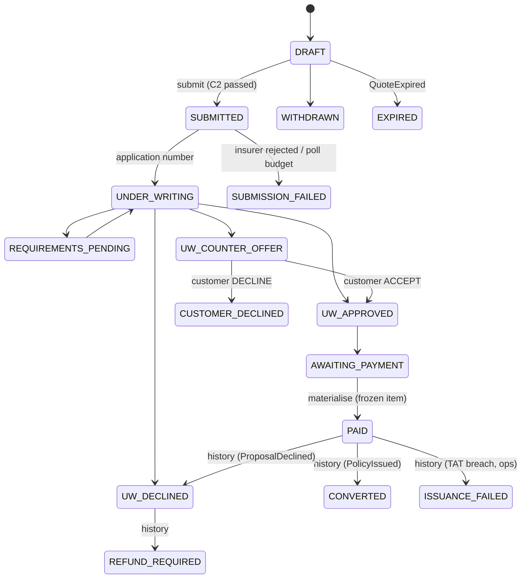
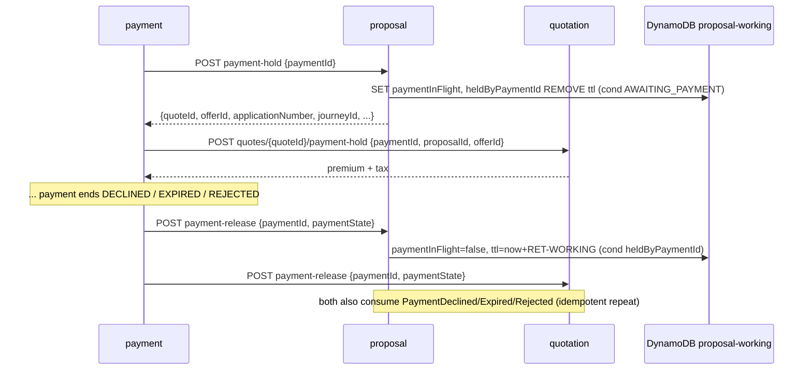

# proposal-service — LLD (contract companion)

**Status:** AI-DRAFTED 2026-10-21, awaiting Amit (engineering), Mahesh (architecture) and Aarti
(DBA, new tables) review; C2 consent content awaits Shailja.

[OpenAPI](./openapi.yaml) · [API reference page](../../api-reference/services/proposal-service.md) ·
[Decisions D5/D8](../../architecture-review/DECISIONS-2026-10-21.md) ·
[`DB-DEC-0005`](../../data-architecture/DB-DEC-0005-dynamodb-working-payload.md) ·
[DynamoDB design](../../data-architecture/schemas/20-dynamodb-working-payload.md) ·
[`09-proposal.sql`](../../data-architecture/schemas/09-proposal.sql) ·
[quotation contract](../quotation-service/LLD.md) · [payment contract](../payment-service/LLD.md) ·
[policy-issuance contract](../policy-issuance-service/LLD.md)

## 1. Purpose and ownership

Owns the application: the insurer's dynamic proposal form for the selected offer, its submission
through the Hub, tracking of the insurer's pre-payment underwriting (requirements, counter-offer,
decision), the payment hold, and the structured record plus post-payment status history after
`PaymentReconciled`. Never decides underwriting (`TI-03`). Port 8097, `service-id: proposal`.

| Store | Content |
|---|---|
| DynamoDB `{env}-proposal-working` | Working proposal (control attributes + encrypted envelope: answers with question text, nominee, UW requirements, documents refs, counter-offer), IDEM, OUTBOX, `OPEN_PROPOSAL` and `APPNO#` markers |
| Aurora schema `proposal` (`app_proposal`) | `proposal`, **`proposal_answer` (new)**, `uw_requirement`, `uw_document_ref` — INSERT-only, at materialise; **`proposal_status_history` (new, append-only)** — post-payment; `idempotency_record` |

## 2. API summary

| Operation | Path | Built? | Caller |
|---|---|---|---|
| `getFormSchema` | `GET /internal/v1/proposals/form-schema` | planned | BFF via journey |
| `createProposal` | `POST /internal/v1/proposals` | planned | Journey |
| `getProposal` | `GET /internal/v1/proposals/{id}` | planned | Journey, BFF, policy-issuance |
| `saveAnswers` | `PUT …/{id}/answers` | planned (domain + store built) | Journey |
| `submitProposal` | `POST …/{id}/submit` | planned (domain built) | Journey |
| `decideCounterOffer` | `POST …/{id}/counter-offer-decision` | planned | Journey |
| `withdrawProposal` | `POST …/{id}/withdraw` | planned (domain built) | Journey |
| `holdProposalForPayment` | `POST …/{id}/payment-hold` | planned (domain built) | payment-service |
| `releaseProposalPaymentHold` | `POST …/{id}/payment-release` | planned (domain built) | payment-service |
| `getProposalStatusHistory` | `GET …/{id}/status-history` | planned | BFF, ops |
| `onPaymentReconciled` | `POST /internal/v1/events/payment-reconciled` | **built** | payment (until MSK) |

## 3. State model



Up to `PAID` the state is the DynamoDB `state` attribute (built domain `WorkingProposal`). From
`PAID` on, the frozen item and the INSERT-only `proposal.state` both say `PAID`; every later state
is a row in **`proposal.proposal_status_history`** (D8) and `getProposal` reports the latest row.

`AWAITING_PAYMENT` is entered only from `UW_APPROVED` (`INV-PRP-03`, as built). D8's sequence draws
the payment link straight after the application number (insurer decision after payment, as the
`PROPOSAL.TAT` clock implies); allowing `UNDER_WRITING → AWAITING_PAYMENT` per insurer/issuance
mode is open item P1 — not contracted until Rajal and Aarti confirm.

## 4. Operation flows

### 4.1 Create

1. Validate; `GET quotation /internal/v1/quotes/{quoteId}` — must be `SELECTED`, `selectedOfferId = offerId`,
   inside `validUntil` (`422 INVALID_OFFER_REFERENCE`, `INV-PRP-02`). The quote is **not** converted
   (D8: `CONVERTED` only at materialise).
2. Resolve `issuanceMode` (`STP|NON_STP|INSTA`, `INV-PRP-06`), form `schemaId/schemaVersion` and
   `configVersionRef` from configuration (fail closed).
3. One `TransactWriteItems`: META `DRAFT`, IDEM, `JOURNEY#…/OPEN_PROPOSAL`, OUTBOX `ProposalCreated`
   (built: `ProposalWorkingStateService.create`).

### 4.2 Form schema and answers

`getFormSchema` → Hub `PROPOSAL_FORM_SCHEMA` (cached per `schemaId@version`). `saveAnswers`
validates each answer against that schema version (type, mandatory, pattern, visibility) and
stores, inside `payloadEnc`, one entry per question: `questionId`, **`questionText` copied from the
schema version shown** (never from the caller), `schemaVersion`, `value`. Nominee likewise
(`INV-PRP-05`). Conditional update on `version`; envelope budget 350 KB → `413 PAYLOAD_TOO_LARGE`.
*Code gap:* the built envelope stores `formValues: Map<questionId, value>`; it must add
`questionText` and `schemaVersion` per answer before `proposal_answer` can be materialised.

### 4.3 Submit (gate C2, no retry)

1. Strongly consistent read; `DRAFT`; mandatory answers complete (`422 VALIDATION_ERROR`).
2. **C2 (D5):** `GET consent /internal/v1/consents:check?customerId&checkpoint=BEFORE_PROPOSAL_SUBMIT&insurerCode`
   — `CONSENT.POLICY` seeds `CNS-SHR`, 30 days, scope `NAMED_INSURER`. Missing → `403 CONSENT_REQUIRED`
   with `missingPurposes`; stays `DRAFT`; OUTBOX `ProposalBlockedNoConsent` (audit). Store `consentId`.
3. Quote still valid (`GET quote`); else `409 QUOTE_EXPIRED`, journey back to QUOTING (F-03).
4. META → `SUBMITTED` + OUTBOX `ProposalSubmitted`, **then** Hub `PROPOSAL_SUBMIT` with
   `Idempotency-Key = proposal:{proposalId}:submit`. **No automatic retry** — a duplicate submission
   is a duplicate insurer application.
5. `202`. A scheduled poll (S-12) of the Hub request: application number → `acknowledge()` claims
   `APPNO#{n}` in the same transaction, `UNDER_WRITING`, OUTBOX `ProposalAcknowledged`; insurer
   rejection → `SUBMISSION_FAILED`; poll budget exhausted → `SUBMISSION_FAILED` + ops task (F-04),
   never a blind re-submit.

### 4.4 Underwriting before payment, counter-offer

Hub status sync (`APPLICATION_STATUS` / `UW_REQUIREMENTS`, normalised `bankStatus`) drives
`recordUnderwriting` (built): `REQUIREMENTS_PENDING` (requirements + S3 document refs in the
envelope), `UW_APPROVED`, `UW_DECLINED`, `UW_COUNTER_OFFER`. A counter-offer is stored in the
envelope (`counterOfferId`, premium, sum assured, reason, expiry) and materialised to `counter_offer`
JSONB; `decideCounterOffer` relays the customer's answer through the Hub and moves to `UW_APPROVED`
or `CUSTOMER_DECLINED`. An accepted counter-offer that changes the premium requires a **re-quote**
before payment (Payment takes the amount only from the quote) — open item P3. *Code gap:* the built
envelope has no counter-offer field.

### 4.5 Payment hold / release

Same pattern as the quote (`heldByPaymentId`; see [quotation LLD §4.4](../quotation-service/LLD.md#44-payment-hold-and-release)).
Hold requires `AWAITING_PAYMENT` (`409 PROPOSAL_NOT_PAYABLE` otherwise); built domain methods
`markPaymentInFlight` / `paymentEnded`. Release is called for `DECLINED`, `EXPIRED`, `REJECTED` and
`REFUNDED`-from-break; never for `UNCERTAIN`, `CAPTURED`, `RECONCILIATION_BREAK`. The proposal stays
`AWAITING_PAYMENT`, so a new payment may be started.



### 4.6 Materialise on `PaymentReconciled`

Built (`ProposalMaterializer`): consistent read → `materialize()` (`AWAITING_PAYMENT → PAID`) → ONE
Aurora transaction → freeze item → delete `OPEN_PROPOSAL`. Contracted additions in the same Aurora
transaction (D8):

- one **`proposal_answer`** row per answered question (`answer_enc` sealed per row, AAD
  `proposal.proposal_answer|{proposalId}|{questionId}`) — replaces `form_values_ref`, which today
  points at the frozen item that expires 30 days later (schemas/20 §6 #4);
- `issuance_mode`, `payment_id` on `proposal`;
- the first **`proposal_status_history`** row `PAID` (`source_event_id` = the event id).

```mermaid
sequenceDiagram
    participant PAY as payment (outbox)
    participant P as proposal
    participant D as DynamoDB proposal-working
    participant A as Aurora proposal
    PAY-->>P: PaymentReconciled {paymentId, quoteId, proposalId, journeyId, applicationNumber}
    P->>D: GetItem META (consistent)
    alt materializedAt set
        P->>A: ensure rows exist (insert if missing)
        P->>D: Delete OPEN_PROPOSAL
        P-->>PAY: ack ALREADY_MATERIALIZED
    else AWAITING_PAYMENT
        P->>P: decrypt envelope, materialize() -> PAID
        P->>A: BEGIN; INSERT proposal; INSERT proposal_answer xN; INSERT uw_requirement, uw_document_ref; INSERT proposal_status_history(PAID); INSERT idempotency_record(eventId); COMMIT
        P->>D: SET materializedAt, ttl=+30d (cond attribute_not_exists(materializedAt)) + OUTBOX ProposalMaterialised
        P->>D: Delete OPEN_PROPOSAL
        P-->>PAY: ack MATERIALIZED
    end
```

### 4.7 Post-payment status history

Consumed events append one row each (dedupe `UNIQUE(source_event_id)`; never UPDATE):

| Event (producer) | History row | Then |
|---|---|---|
| `PaymentReconciled` (payment) | `PAID` | written by materialise |
| `PolicyIssued` (policy-issuance) | `CONVERTED` | journey → `SOLD` path |
| `ProposalDeclined` (policy-issuance) | `UW_DECLINED`, then `REFUND_REQUIRED` | Payment opens refund (maker-checker) |
| `IssuanceTatEscalated` `level=BREACHED` (policy-issuance) | `ISSUANCE_FAILED` only if the rule set says breach is terminal; else no row (ops escalation) | open item P4 |
| `PaymentRefunded` (payment) | none (refund recorded in payment and policy history) | |

An event arriving before materialise (out of order) is retried by the consumer (bounded, then DLQ);
history is never written without the parent `proposal` row.

### 4.8 Read-path switch, expiry, repair

`getProposal`: Aurora `proposal` row first (plus latest history row) → else DynamoDB item → else
`404` (same diagram as [quotation §4.7](../quotation-service/LLD.md#47-read-path-switch)).
`QuoteExpired` for this proposal's quote while `DRAFT…AWAITING_PAYMENT` and not held → `EXPIRED`,
marker released. Repair sweep: as quotation §4.8, keyed by `proposalId` from
`GET payment /internal/v1/payments?state=RECONCILED&since=`.

## 5. Validation rules

| Field / condition | Rule | Error code |
|---|---|---|
| `Idempotency-Key` | required on POST/PUT | `MISSING_IDEMPOTENCY_KEY` |
| ids | ULID | `VALIDATION_ERROR` |
| `quoteId`/`offerId` | quote `SELECTED`, offer = selected, in window | `INVALID_OFFER_REFERENCE` (422) |
| `issuanceMode` | resolved and in `STP|NON_STP|INSTA` | `ISSUANCE_MODE_INVALID` (422, **NEW code**) |
| answers | per form schema version | `VALIDATION_ERROR` (field errors) |
| envelope size | ≤ 350 KB | `PAYLOAD_TOO_LARGE` (413) |
| submit: state | `DRAFT` | `ILLEGAL_TRANSITION` |
| submit: consent | `BEFORE_PROPOSAL_SUBMIT` satisfied | `CONSENT_REQUIRED` (403, `missingPurposes`) |
| submit: quote window | quote valid | `QUOTE_EXPIRED` (409) |
| withdraw | before `AWAITING_PAYMENT` | `WITHDRAWAL_NOT_PERMITTED` (409) |
| hold | `AWAITING_PAYMENT` | `PROPOSAL_NOT_PAYABLE` (409) |
| hold | not held by another payment | `PAYMENT_ALREADY_IN_PROGRESS` (409) |
| application number | unique (`APPNO#` marker; `ux_proposal_application`) | `CONFLICT` (409) |

## 6. Rule-engine usage

`CONSENT.POLICY` (`COLLECT`) through consent-service at `BEFORE_PROPOSAL_SUBMIT`. Issuance-mode and
form-field rules are configuration resolved by `(lob, insurerCode, productCode)` — no proposal rule
set is defined in `ADR-024` §7 yet (open item P5).

## 7. Mapping — DTO → envelope / attribute → Aurora column

| API / source | DynamoDB | Aurora column | Note |
|---|---|---|---|
| `proposalId`, `leadId`, `journeyId`, `customerId`, `quoteId`, `offerId` | attributes | `proposal.*_id` | |
| (C2 result) | `consentId` | `consent_id` | |
| `lob` | `lob` | `lob` | |
| (Hub ack) | `applicationNumber` | `application_number` | unique |
| (configuration) | `schemaId`, `schemaVersion` | `schema_id`, `schema_version` | `schema_version` VARCHAR(20) |
| (configuration) | `issuanceMode` (built) | **missing — DDL** `issuance_mode` | |
| (configuration) | `configVersionRef` (built) | `config_version_ref` | resolves review finding: it is a control attribute in code |
| `state` | `state` | `state` (`PAID`) | later states → history |
| `underwritingState` | `underwritingState` | `underwriting_state` | |
| `answers[].questionId` | envelope | `proposal_answer.question_id` | |
| (schema) question text | envelope | `proposal_answer.question_text` | as shown |
| `schemaVersion` | envelope per answer | `proposal_answer.schema_version` | |
| `answers[].value` | envelope | `proposal_answer.answer_enc` | encrypted per row |
| `nominee` | envelope | `nominee_enc` | |
| requirements | envelope | `uw_requirement` | |
| document refs | envelope | `uw_document_ref` | S3 refs only |
| counter-offer | envelope (to add) | `counter_offer` JSONB | ids, amounts, reason — no PII |
| (event) `paymentId` | — | **DDL** `payment_id` | |
| — | `form_values_ref` (built) | `form_values_ref` | **retire** (D8): nullable, then drop |

## 8. Invariants

| Invariant | Where |
|---|---|
| `INV-PRP-01` (C2) | `submitProposal` step 2 |
| `INV-PRP-02` | `createProposal` step 1 |
| `INV-PRP-03` | `WorkingProposal.awaitPayment` (built) |
| `INV-PRP-04` | `WorkingProposal.withdraw` (built) |
| `INV-PRP-05` | envelope + `answer_enc`/`nominee_enc`; schema assertion test |
| `INV-PRP-06` | `createProposal` step 2 |
| One open proposal per journey; unique application number | markers (built) |
| Post-payment immutability | frozen item; INSERT-only rows; history append-only (grants) |

## 9. Events

Produced: `ProposalCreated`, `ProposalSubmitted`, `ProposalBlockedNoConsent` (audit mandatory),
`ProposalAcknowledged` (applicationNumber, insurerCode), `UnderwritingDecision`, `ProposalWithdrawn`,
`ProposalExpired` (new), `ProposalMaterialised` (catalogue, at materialise), `ProposalStatusChanged`
(new, one per history row). Consumed: `PaymentReconciled`, `PaymentDeclined|Expired|Rejected`, `QuoteExpired`,
`PolicyIssued`, `ProposalDeclined`, `IssuanceTatEscalated`. Envelope/topics per `ADR-025`
(`{env}.proposal.proposal.v1`); catalogue to live at `docs/platform/contracts/events/CATALOGUE.md`.

## 10. Idempotency, timeouts, failures

Hub submit: no retry, `proposal:{id}:submit`. Hub reads (schema, status): bounded retry. Consent
read: 500 ms, fail closed. Materialise and history: idempotent by `eventId`. Lost release: event
consumer repeats it.

## 11. Required DDL / design changes (not edited here)

| Target | Change |
|---|---|
| `09-proposal.sql` NEW `proposal.proposal_answer` | `proposal_id CHAR(26) FK`, `question_id VARCHAR(128)`, `question_text VARCHAR(2000) NOT NULL`, `schema_version VARCHAR(20) NOT NULL`, `answer_enc BYTEA NOT NULL`, `encryption_key_id`, `sequence_no INT`, `created_at`; PK `(proposal_id, question_id)`; INSERT-only |
| `09-proposal.sql` NEW `proposal.proposal_status_history` | `history_id CHAR(26) PK`, `proposal_id FK`, `status` (CHECK `PAID, CONVERTED, UW_DECLINED, ISSUANCE_FAILED, REFUND_REQUIRED`), `reason_code`, `source_event VARCHAR(96)`, `source_event_id CHAR(26) UNIQUE`, `occurred_at`, `recorded_at`; append-only |
| `09-proposal.sql` `proposal.proposal` | ADD `issuance_mode VARCHAR(10) NOT NULL` CHECK (`STP`,`NON_STP`,`INSTA`); ADD `payment_id CHAR(26)`; `form_values_ref` nullable then dropped (D8) |
| `91-grants.sql` | `app_proposal`: SELECT, INSERT on `proposal_answer`, `proposal_status_history`; REVOKE UPDATE, DELETE on both |
| `20-dynamodb-working-payload.md` §2 | ADD `heldByPaymentId`; envelope answers carry `questionText`, `schemaVersion`; counter-offer |

## 12. Open items

| # | Item | Owner |
|---|---|---|
| P1 | Payable before insurer approval (`UNDER_WRITING → AWAITING_PAYMENT`) as D8's sequence draws it? Changes `INV-PRP-03` | Rajal, Aarti |
| P2 | Envelope answer shape (`questionText`, `schemaVersion`) and counter-offer — code change | Amit |
| P3 | Accepted counter-offer with a new premium → re-quote rule | Rajal |
| P4 | Is a TAT breach terminal (`ISSUANCE_FAILED`) or an escalation only | Shailja |
| P5 | Proposal configuration rule set (issuance mode, form rules) in `ADR-024` §7 | Mahesh |
