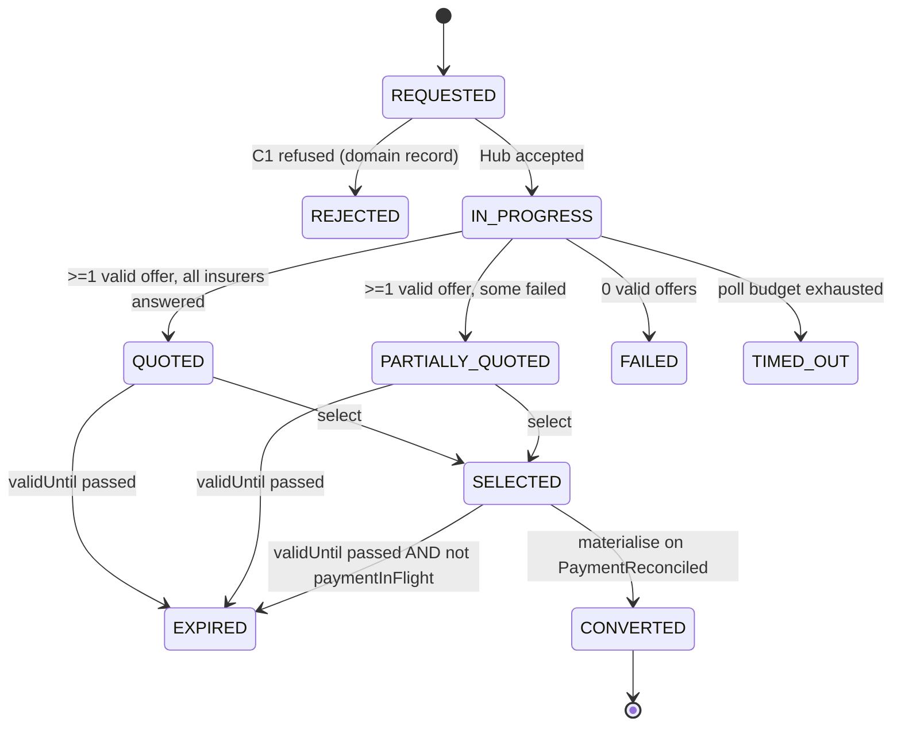
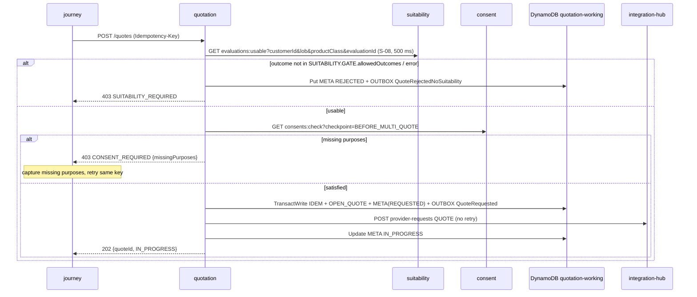
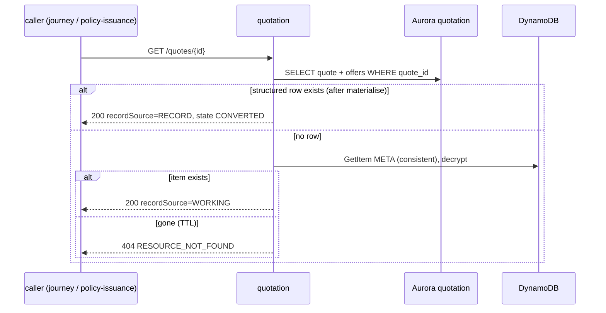
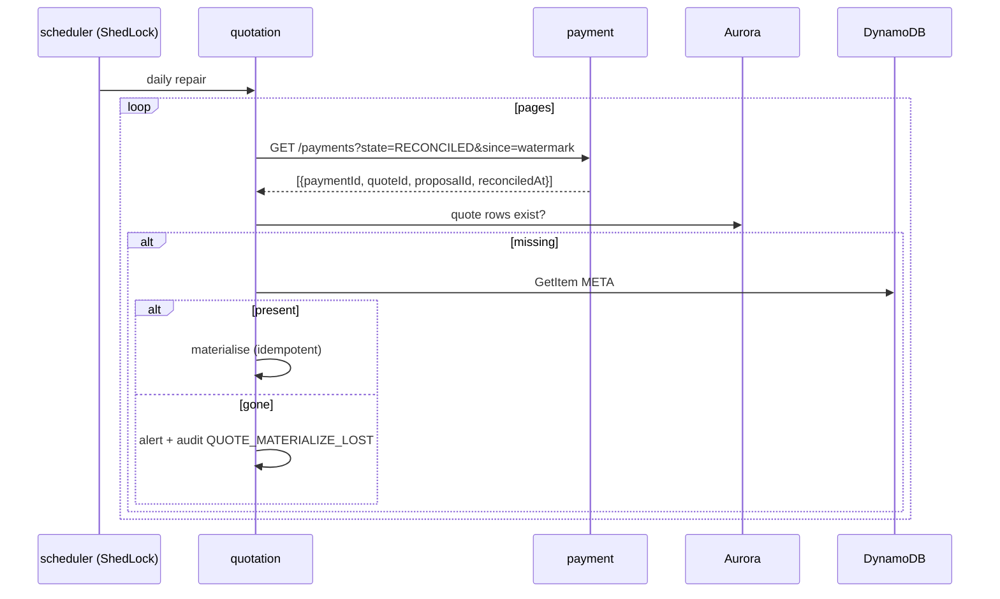

# quotation-service — LLD (contract companion)

**Status:** AI-DRAFTED 2026-10-21, awaiting Amit (engineering) and Mahesh (architecture) review;
D4 gate content awaits Shailja, D5 consent position awaits Shailja (DPDP).

[OpenAPI](./openapi.yaml) · [API reference page](../../api-reference/services/quotation-service.md) ·
[Decisions D4/D5/D8](../../architecture-review/DECISIONS-2026-10-21.md) ·
[`DB-DEC-0005`](../../data-architecture/DB-DEC-0005-dynamodb-working-payload.md) ·
[DynamoDB design](../../data-architecture/schemas/20-dynamodb-working-payload.md) ·
[`ADR-024`](../../architecture-review/ADR-024-configuration-driven-rule-engine.md) ·
[`ADR-025`](../../architecture-review/ADR-025-event-specification-and-publisher.md) ·
[`ADR-027`](../../architecture-review/ADR-027-openapi-contract-authority.md)

## 1. Purpose and ownership

Owns the bank's quote: request, multi-insurer price discovery through the Integration Hub, offer
classification, selection, expiry, the payment hold, and the structured record after payment.
Bounded context #10, port 8096, `service-id: quotation`.

| Store | Owner | Content |
|---|---|---|
| DynamoDB `{env}-quotation-working` | quotation-service only | Working quote (control attributes + encrypted envelope), IDEM, OUTBOX, `JOURNEY#…/OPEN_QUOTE` marker — until materialise |
| Aurora schema `quotation` (`app_quotation`) | quotation-service only | `quote`, `offer` (INSERT-only, written at materialise), `idempotency_record` |

No other service reads either store. Payment gets the premium only through `payment-hold`;
policy-issuance reads the sold quote only through `GET /internal/v1/quotes/{quoteId}`.

## 2. API summary

| Operation | Path | Built? | Caller |
|---|---|---|---|
| `createQuote` | `POST /internal/v1/quotes` | planned | Journey |
| `getQuote` | `GET /internal/v1/quotes/{quoteId}` | planned | Journey, BFF (via journey), policy-issuance |
| `selectOffer` | `POST /internal/v1/quotes/{quoteId}/selection` | planned | Journey |
| `holdForPayment` | `POST /internal/v1/quotes/{quoteId}/payment-hold` | planned | payment-service |
| `releasePaymentHold` | `POST /internal/v1/quotes/{quoteId}/payment-release` | planned | payment-service (and its events) |
| `getSelectedLegacy` | `GET /internal/v1/quotes/{quoteId}/selected` | **built, deprecated** | — (replaced by `payment-hold`) |
| `onPaymentReconciled` | `POST /internal/v1/events/payment-reconciled` | **built** | payment (until MSK) |

## 3. State model



**`CONVERTED` timing (D8):** the quote stays `SELECTED` through proposal creation and payment and
becomes `CONVERTED` only at materialise. Proposal creation no longer converts the quote (this
supersedes the API reference's older "CONVERTED when the proposal is created").

`paymentInFlight` is an orthogonal flag on `SELECTED`, not a state. While it is true the quote
cannot expire and has no `ttl`.

## 4. Operation flows

### 4.1 Create quote

1. Bean validation; reject `distributorId`/agent fields (`ATTRIBUTION_NOT_CALLER_SUPPLIED`, C3).
2. **Gate C1 (D4):** `GET suitability /internal/v1/evaluations:usable?customerId&lob&productClass&evaluationId`
   ([suitability contract](../suitability-service/openapi.yaml); S-08, 500 ms, no retry, fail closed;
   request field `suitabilityId` carries the evaluation id). Suitability applies `SUITABILITY.GATE`
   (allowed outcomes, seed `SUITABLE`, `SUITABLE_WITH_CAUTION` with acknowledgement). `403` →
   `PutItem` META `state = REJECTED` + OUTBOX `QuoteRejectedNoSuitability` (audit mandatory) →
   `403 SUITABILITY_REQUIRED`; timeout / `5xx` → same record, answer `503 UPSTREAM_UNAVAILABLE`. Quotation never evaluates the gate rule itself; it trusts only the
   suitability-service answer read at this instant (`INV-QUO-01` as amended by D4).
3. **Consent checkpoint (D5):** `GET consent /internal/v1/consents:check?customerId&checkpoint=BEFORE_MULTI_QUOTE`.
   `CONSENT.POLICY` seeds purposes `CNS-DP`, `CNS-SOL`, `CNS-QSH`, validity 90 days. Not satisfied →
   `403 CONSENT_REQUIRED` with `checkpoint` and `missingPurposes`; **nothing is written** (this is a
   journey step, not a refusal record). The journey captures only the missing purposes and retries
   with the same `Idempotency-Key`. Satisfied → keep the returned consent id as `consentId`.
4. Resolve quote validity window and product matrix from configuration (fail closed,
   `CONFIGURATION_UNRESOLVABLE`); compose `configVersionRef` from the rule-set versions used.
5. One `TransactWriteItems`: `IDEM`, `JOURNEY#{journeyId}/OPEN_QUOTE` (`attribute_not_exists`),
   META (`REQUESTED`, `ttl`), OUTBOX `QuoteRequested`. If the marker exists, read the quote it names;
   if that quote is expirable (§4.5) expire it and swap the marker in one transaction
   (condition `quoteId = :old`), else `409 CONFLICT`.
6. Hub `POST /internal/v1/provider-requests {operation: QUOTE}` with
   `Idempotency-Key = quote:{quoteId}:submit`, **no automatic retry**. Then META → `IN_PROGRESS`.
7. `202 {quoteId, state}`.



### 4.2 Poll and offers (`getQuote`)

While `IN_PROGRESS`, the read advances the Hub poll (S-11, 1 s → 30 s cap) and ingests offers
(`WorkingQuote.recordOffers`, built): non-positive premium or sum assured → `INVALID` with
`errorSummary` (`INV-QUO-03`); ≥1 valid → `QUOTED` or `PARTIALLY_QUOTED` (`INV-QUO-02`); none →
`FAILED` + `QuoteFailed`; budget exhausted → `TIMED_OUT`. `endsWithoutSale` states delete the
OPEN_QUOTE marker in the same write. First successful BI → lead `bi-generated`, suitability `lock`.
Offers returned carry `offerState ∈ {QUOTED, SELECTED, NOT_SELECTED, INVALID}` — the API never says
`AVAILABLE`; "available to select" means `offerState = QUOTED`.

### 4.3 Select

Strongly consistent read; state `QUOTED|PARTIALLY_QUOTED`; `now < validUntil` (else expire and
`409 QUOTE_EXPIRED`); offer `QUOTED` (else `422 INVALID_OFFER_REFERENCE`). One conditional
`UpdateItem` writes `selected*` attributes and the envelope with the chosen offer `SELECTED`, valid
siblings `NOT_SELECTED`, `INVALID` untouched (`INV-QUO-05`), guard `StoreGuard.SELECTABLE`;
OUTBOX `OfferSelected`. Built in the domain and store.

### 4.4 Payment hold and release

The hold replaces `GET …/selected` (a GET with a side effect, and no payment id to match a
release against). New control attribute `heldByPaymentId`.

| Call | Condition | Write |
|---|---|---|
| `payment-hold {paymentId, proposalId, offerId}` | `state = SELECTED`, not materialised, `offerId = selectedOfferId`, and (`validUntil > now` or already `heldByPaymentId = paymentId`) | `SET paymentInFlight = true, heldByPaymentId = :p REMOVE ttl` (no write if already held by `:p`) |
| same, held by another payment | — | `409 PAYMENT_ALREADY_IN_PROGRESS` |
| `payment-release {paymentId, paymentState}` | `heldByPaymentId = :p` | `SET paymentInFlight = false, ttl = now + RET-WORKING REMOVE heldByPaymentId`; mismatch → no-op `200 released=false` |

What each payment outcome does to the quote hold (payment-service drives it; quotation also
consumes the events so a lost HTTP call is repaired):

| Payment state | Quote hold | Why |
|---|---|---|
| `LINK_ISSUED`, `AWAITING_AUTHORISATION`, `AUTHORISED`, `CAPTURED` | kept | money in flight |
| `UNCERTAIN` | **kept** | PG response lost; money may have moved — only reconciliation decides (F-08) |
| `RECONCILIATION_BREAK` | **kept** | money captured but unmatched; Finance resolves (F-07) |
| `RECONCILED` | consumed — materialise | the sale |
| `DECLINED`, `EXPIRED`, `REJECTED` | **released**, `ttl` restored | no money moved |
| `REFUNDED` reached from `RECONCILIATION_BREAK` | **released**, `ttl` restored | money returned, no sale |
| `REFUNDED` after `RECONCILED` | n/a — already materialised (Aurora) | post-sale refund is recorded by proposal/policy history |

```mermaid
sequenceDiagram
    participant PAY as payment
    participant Q as quotation
    participant D as DynamoDB
    PAY->>Q: POST payment-hold {paymentId, proposalId, offerId}
    Q->>D: Update SET paymentInFlight, heldByPaymentId REMOVE ttl (cond state=SELECTED)
    Q-->>PAY: 200 premium, tax, sumAssured, insurer, product
    Note over PAY: PG declines / link expires / PG rejects
    PAY->>PAY: state DECLINED|EXPIRED|REJECTED + outbox PaymentDeclined|Expired|Rejected
    PAY->>Q: POST payment-release {paymentId, paymentState}
    Q->>D: Update paymentInFlight=false, ttl=now+90d (cond heldByPaymentId=paymentId)
    Q-->>PAY: 200 released=true
    Note over Q,D: event consumer repeats the release idempotently if the HTTP call was lost
    Note over Q: quote stays SELECTED; a new payment may hold it again while validUntil > now
```

### 4.5 Expiry — who sets `EXPIRED`

No `Scan` is permitted (schemas/20 §4), so expiry is **lazy and authoritative at every touch point**,
plus an optional sweep for timeliness:

1. Any `getQuote`, `selectOffer`, `payment-hold` or `createQuote` (via the marker) that finds a quote
   in `QUOTED|PARTIALLY_QUOTED|SELECTED`, `validUntil <= now`, `paymentInFlight = false`, not
   materialised, writes `state = EXPIRED`, deletes `JOURNEY#{journeyId}/OPEN_QUOTE` (condition
   `quoteId = :id`) and puts OUTBOX `QuoteExpired` — one transaction.
2. A held quote never expires; release first, then the next touch expires it.
3. **Optional (DDL):** sparse GSI2 `GSI2PK = EXPIRY#{yyyy-mm-dd}`, `GSI2SK = validUntil#quoteId`,
   projected only while expirable; an hourly job queries today's and yesterday's partitions and
   applies step 1. Without it, `QuoteExpired` is emitted late (at next touch), which is acceptable
   for R0 because nothing downstream waits on it.
4. Item `ttl` (last update + 90 days) eventually deletes the item; the stream `REMOVE` record is
   ignored except to alert if `paymentInFlight` was true (must never happen).

```mermaid
sequenceDiagram
    participant J as journey
    participant Q as quotation
    participant D as DynamoDB
    J->>Q: GET /quotes/{id} (or select / hold / new create)
    Q->>D: GetItem META (consistent)
    alt validUntil <= now AND state in QUOTED/PARTIALLY_QUOTED/SELECTED AND NOT paymentInFlight
        Q->>D: TransactWrite META state=EXPIRED (cond version) + Delete OPEN_QUOTE (cond quoteId) + OUTBOX QuoteExpired
        Q-->>J: 200 state EXPIRED (select/hold: 409 QUOTE_EXPIRED)
        Note over J: journey routes back to QUOTING (F-03); proposal-service consumes QuoteExpired
    else held or still valid
        Q-->>J: current state
    end
```

### 4.6 Materialise on `PaymentReconciled` (built)

`QuoteMaterializer` (schemas/20 §3.4): consistent read → if materialised, ensure the Aurora row,
release marker, ack → else `materialize()` (`SELECTED → CONVERTED`) → ONE Aurora transaction
(`quote`, every `offer`, `idempotency_record` keyed by `eventId`) → `SET materializedAt, state =
CONVERTED, ttl = +30 d` (condition `attribute_not_exists(materializedAt)`) → delete OPEN_QUOTE.
**Planned additions:** OUTBOX `QuoteConverted` in the step-5 write; `INVALID` offers written with
`offer_state = INVALID` (D8 "invalid kept") once the DDL relaxes `ck_offer_positive` — today they
are skipped (schemas/20 §6 #3); `selected_offer_id` and `product_class` columns.

### 4.7 Read-path switch



Aurora is read first because Aurora wins every disagreement (DB-DEC-0005 observation 3); a quote
materialised a moment ago is never served from the frozen item. Support and MIS never read DynamoDB.

### 4.8 Repair sweep (daily; planned)

1. `GET payment /internal/v1/payments?state=RECONCILED&since={lastWatermark - 1 day}` (paged).
2. For each `quoteId` with no `quotation.quote` row → run §4.6 with a synthetic `eventId`
   (`repair:{paymentId}`).
3. Working item gone → page operations (`QUOTE_MATERIALIZE_LOST`, audit) — the sale exists in
   payment but the quote record cannot be built.
4. Advance the watermark only when the page completed.



## 5. Validation rules

| Field / condition | Rule | Error code |
|---|---|---|
| `Idempotency-Key` | present on every POST | `MISSING_IDEMPOTENCY_KEY` (400) |
| ids | ULID `^[0-9A-HJKMNP-TV-Z]{26}$` | `VALIDATION_ERROR` |
| `leadId` | present (`INV-LED-06`) | `OPPORTUNITY_REQUIRED` |
| `lob` / `productClass` | `LIFE`; `TERM\|SAVINGS\|ULIP` | `UNSUPPORTED_LOB` |
| `members` | ≥1, each with `dob`, `gender` | `VALIDATION_ERROR` |
| attribution fields in body | forbidden (C3) | `ATTRIBUTION_NOT_CALLER_SUPPLIED` |
| suitability usable for class | `SUITABILITY.GATE` via suitability-service | `SUITABILITY_REQUIRED` (403) |
| consent `BEFORE_MULTI_QUOTE` | `CONSENT.POLICY` via consent-service | `CONSENT_REQUIRED` (403, `missingPurposes`) |
| configuration | resolvable | `CONFIGURATION_UNRESOLVABLE` |
| select: window | `now < validUntil` | `QUOTE_EXPIRED` (409) |
| select: offer | in quote and `QUOTED` | `INVALID_OFFER_REFERENCE` (422) |
| select / hold: state | `SELECTABLE` / `SELECTED`, not frozen | `ILLEGAL_TRANSITION` (409) |
| hold: owner | not held by another payment | `PAYMENT_ALREADY_IN_PROGRESS` (409) |
| replay with different body | same key | `IDEMPOTENCY_CONFLICT` (409) |

## 6. Rule-engine usage

| Rule set | Evaluated by | Hit policy | Use here |
|---|---|---|---|
| `SUITABILITY.GATE` | suitability-service (`evaluations:usable`) | parameters only | allowed outcomes, caution acknowledgement, validity days |
| `CONSENT.POLICY` | consent-service (`consents:check`) | `COLLECT` | purposes required at `BEFORE_MULTI_QUOTE` |
| `HUB.ROUTING` | integration-hub | `FIRST` | provider per insurer |

Quotation embeds no rule set; it records the versions it relied on in `configVersionRef`.

## 7. Mapping — DTO → envelope / control attribute → Aurora column

| API field | DynamoDB (attribute or envelope v1) | `quotation.quote` / `quotation.offer` column | Note |
|---|---|---|---|
| `quoteId` | `quoteId`, `PK` | `quote.quote_id` | |
| `leadId`, `journeyId`, `customerId` | attributes | `lead_id`, `journey_id`, `customer_id` | `customer_id` CHAR(26) ULID (D3) |
| `suitabilityId` | attribute | `suitability_id` | |
| (consent check result) | `consentId` | `consent_id` | not caller-supplied |
| `lob`, `mode`, `category` | attributes | `lob`, `mode`, `category` | |
| `productClass` | attribute | **missing — DDL** `product_class` | |
| `requestedCover` | envelope `requestedCover` | `requested_cover` | |
| `members[]` | envelope `members` | `members_enc` (sealed separately, AAD `quotation.quote.members_enc\|{quoteId}`) | never plaintext |
| `state` | `state` | `state` | `CONVERTED` at materialise |
| `validUntil` | `validUntil` | `valid_until` | |
| `selectedOfferId` | `selectedOfferId` | **missing — DDL** `selected_offer_id` (D8) | |
| — | `provider`, `providerJobId` | `provider`, `provider_job_id` | |
| `configVersionRef` | `configVersionRef` | `config_version_ref` | |
| `offers[].offerId` | envelope `offers[].offerId` | `offer.offer_id` | |
| `offers[].insurerCode/productCode/productName` | same names | `insurer_code`, `product_code`, `product_name` | |
| `offers[].premiumAmount` | `premiumAmount` | `premium_amount` | nullable for `INVALID` — DDL |
| `offers[].taxAmount` | `taxAmount` | `tax_amount` | null → 0 |
| `offers[].premiumFrequency` | **`frequency`** | **`premium_frequency`** | renamed twice — this row is the rule |
| `offers[].sumAssured` | `sumAssured` | `sum_assured` | nullable for `INVALID` — DDL |
| `offers[].coverTerm` | `coverTerm` | `cover_term` | |
| `offers[].premiumPayingTerm` | **`ppt`** | **`premium_paying_term`** | |
| `offers[].outOfBound` | `outOfBound` | `out_of_bound` | |
| `offers[].offerState` | `offerState` | `offer_state` | at materialise: selected → `SELECTED`, other priced → `NOT_SELECTED`, `INVALID` kept |
| `offers[].errorSummary` | `errorSummary` | `error_summary` | |
| `partialErrors[]` | envelope `partialErrors` | not materialised | evidence via `QuoteCompleted` event + audit |
| — | `paymentInFlight`, `heldByPaymentId`, `materializedAt`, `ttl`, `version` | not materialised (`version` copied) | bookkeeping |

## 8. Invariants and where they are enforced

| Invariant | Where |
|---|---|
| `INV-QUO-01` (amended D4) | `createQuote` step 2 — suitability answer at the instant of the check |
| `INV-QUO-02`, `-03` | `WorkingQuote.recordOffers` |
| `INV-QUO-04` | `WorkingQuote.select` + store guard `validUntil > :now`; lazy expiry |
| `INV-QUO-05` | one `UpdateItem` (envelope + `selected*`); Aurora `ux_offer_selected` |
| One open quote per journey | `OPEN_QUOTE` marker, `attribute_not_exists` |
| Hold never lost to TTL | `ttl` removed while `paymentInFlight` (`WorkingRetention`) |
| Frozen after materialise | `attribute_not_exists(materializedAt)` on every update |

## 9. Events

| Event | When | Data (ids and states only) | Consumers |
|---|---|---|---|
| `QuoteRequested` | create | quoteId, journeyId, lob, productClass | Journey, Audit, Reporting |
| `QuoteRejectedNoSuitability` | C1 refusal | quoteId, customerId, suitabilityId, reason | **Audit (mandatory)**, Reporting |
| `QuoteCompleted` / `QuoteFailed` | offers ingested | quoteId, state, offerCount, invalidCount, partialErrorCount | Journey, Audit, Reporting |
| `OfferSelected` | select | quoteId, offerId, insurerCode, productCode | Journey, Audit |
| `QuoteExpired` (new) | lazy / sweep expiry | quoteId, journeyId | Journey, Proposal, Audit, Reporting |
| `QuoteConverted` (new) | materialise | quoteId, paymentId, selectedOfferId | Journey, Audit, Reporting |

Consumed: `PaymentReconciled` (materialise), `PaymentDeclined` / `PaymentExpired` /
`PaymentRejected` / `PaymentRefunded` (release, idempotent by `eventId`). Envelope and topics per
`ADR-025` (`{env}.quotation.quote.v1`); the event catalogue will live at
`docs/platform/contracts/events/CATALOGUE.md`. Outbox: DynamoDB OUTBOX items, stream publisher
plus a 5-minute sweeper of `published=false` (ADR-025 §3) — not built.

## 10. Idempotency, timeouts, failure modes

| Concern | Rule |
|---|---|
| Create / select / hold / release | `IDEM#{key}` item in the same transaction; same key + body → stored response |
| Hub submit | `Idempotency-Key = quote:{quoteId}:submit`; **no retry**; Hub down → `503`, journey stage unchanged |
| Suitability / consent read | 500 ms, no retry, fail closed |
| Materialise | idempotent; crash between Aurora commit and item mark repaired by re-delivery and the sweep |
| Lost release call | event consumer repeats it; the `heldByPaymentId` condition makes it safe |
| Item lost before materialise | `404` to the consumer, DLQ, repair-sweep alert |

## 11. Required DDL / design changes (owned by the DDL agent — not edited here)

| Target | Change |
|---|---|
| `08-quotation.sql` `quotation.quote` | ADD `product_class VARCHAR(16) NOT NULL`, ADD `selected_offer_id CHAR(26)` (D8) |
| `08-quotation.sql` `quotation.offer` | relax `ck_offer_positive` to `offer_state = 'INVALID' OR (premium_amount > 0 AND sum_assured > 0)`; make `premium_amount`, `sum_assured`, `premium_frequency` nullable for `INVALID` (D8 "invalid kept"; schemas/20 §6 #3) |
| `08-quotation.sql` | `quotation.processed_event` (or reuse `idempotency_record`) for consumed payment events |
| `20-dynamodb-working-payload.md` §1.2 | ADD control attribute `heldByPaymentId`; §3.3 replace `GET …/selected` with `payment-hold` / `payment-release`; optional sparse GSI2 for expiry |
| `20-dynamodb-working-payload.md` §3.4 | step 5 also puts OUTBOX `QuoteConverted` |

## 12. Open items

| # | Item | Owner |
|---|---|---|
| Q1 | Build `payment-hold` / `payment-release`, retire `GET …/selected` after payment switches | Amit |
| Q2 | Event catalogue lacks `QuoteExpired`; add it (schema per ADR-025) | events owner |
| Q3 | `consents:check` response shape (single consent id vs one per purpose) | consent-service owner, Shailja |
| Q4 | Accept the optional GSI2 expiry sweep or live with lazy expiry | Aarti |
| Q5 | `ON CONFLICT DO NOTHING` without target (schemas/20 §6 #1) | Aarti |
| Q6 | DPDP position on consent after suitability (D5) | Shailja |
