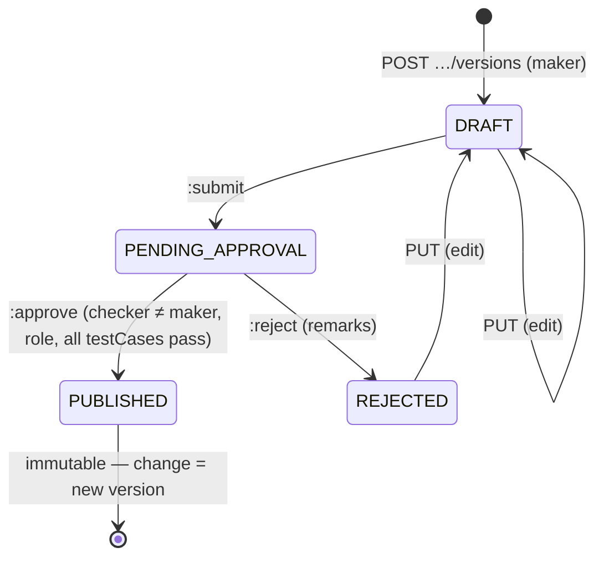

# Rule engine — authoring guide and LLD

**Status:** AI-DRAFTED with the code (`libs/bank-rule-engine`, `SUG-20261021-rul`), awaiting Mahesh
(architecture) review; rule **content** in each seed awaits its content owner (ADR-024 §7).

Specification: [ADR-024](../../architecture-review/ADR-024-configuration-driven-rule-engine.md).
Service that stores and publishes rule sets: [administration-config-service LLD](../administration-config-service/LLD.md)
· [openapi.yaml](../administration-config-service/openapi.yaml).
JSON-Schema: [`rule-set-v1.schema.json`](../../../../libs/bank-rule-engine/src/main/resources/schema/rule-set-v1.schema.json).
Seeds: [`rulesets/`](../../../../libs/bank-rule-engine/src/main/resources/rulesets/index.txt).

## Contents

1. [What the engine is](#1-what-the-engine-is)
2. [Document fields](#2-document-fields)
3. [Expressions and operators](#3-expressions-and-operators)
4. [Hit policies and precedence](#4-hit-policies-and-precedence)
5. [Missing input and missing configuration](#5-missing-input-and-missing-configuration)
6. [Reason codes and messages](#6-reason-codes-and-messages)
7. [Test cases](#7-test-cases)
8. [Evaluation result](#8-evaluation-result)
9. [Lifecycle and how Compliance approves](#9-lifecycle-and-how-compliance-approves)
10. [Changing a rule set on the fly — recipes](#10-changing-a-rule-set-on-the-fly--recipes)
11. [Using the engine from a deciding service](#11-using-the-engine-from-a-deciding-service)
12. [The R0 seed rule sets](#12-the-r0-seed-rule-sets)
13. [Code map and tests](#13-code-map-and-tests)
14. [Open items](#14-open-items)

## 1. What the engine is

A pure Java library (`com.bank.rules.engine`, Jackson only, no Spring) that evaluates a
**rule set** — a versioned JSON document in format `rule-set/v1` — against named inputs and returns
an outcome, the rules that fired, reason codes and rendered messages.

| Property | How it is guaranteed |
|---|---|
| No code in configuration | Conditions are JSON expression trees over a closed operator set; no `eval`, SpEL or scripting ([§3](#3-expressions-and-operators)) |
| Deterministic (`SUIT-R05`) | No clock, I/O or randomness inside the engine; dates arrive as inputs; canonical JSON output. `RuleEngineDeterminismTest` |
| Fail closed | A document with any validation finding is refused whole; missing inputs and unset parameters produce configured fail-closed outcomes ([§5](#5-missing-input-and-missing-configuration)) |
| Reproducible | Every result carries `ruleSetId`, `version`, `engineVersion` and `inputsHash` |

What is **not** configuration: the operator set, hit-policy semantics, the fact that a gate exists
and fails closed (`SUIT-R40`), the immutability of a published version (`SUIT-R07`).

## 2. Document fields

Every field, top to bottom. "Engine" means the engine reads it; "service" means only
administration-config-service reads it.

| Field | Required | Read by | Meaning |
|---|---|---|---|
| `format` | yes | engine | Always `rule-set/v1` |
| `ruleSetId` | yes | both | `UPPER.DOTTED` id, e.g. `SUITABILITY.LIFE.TERM` (pattern `^[A-Z][A-Z0-9_]*(\.[A-Z0-9_]+)*$`) |
| `domain` | yes | service | Resolution key, e.g. `SUITABILITY`, `CONSENT`, `LEAD_EXCEPTION` |
| `scope.lob`, `scope.productClass` | object yes, values nullable | service | Resolution scope; `null` = any. Specific beats wildcard |
| `version` | yes | both | Semver `MAJOR.MINOR.PATCH`; unique per `ruleSetId` |
| `effectiveFrom` / `effectiveTo` | from yes | service | RFC 3339; the version is in force on `[from, to)`. `to` null = open |
| `classification` | yes | service | `COMPLIANCE` → checker needs `COMPLIANCE_APPROVER`; `PRODUCT` → `PRODUCT_APPROVER`; `OPERATIONAL` → `CONFIG_APPROVER` |
| `pinning` | no (`NONE`) | caller | `JOURNEY`: a journey keeps the version it started with (fetch by exact version); `NONE`: version in force at evaluation |
| `scale` | no (6) | engine | Decimal places for `div` (HALF_UP) |
| `description`, `source`, `governance` | `source` by convention | service / humans | `source` cites the rule pack / BRD section; `governance` names the content approver and open items. The engine ignores both |
| `inputs[]` | yes | engine | `{name, type, required, values?, description?, sourceRef?}` — see below |
| `tables{}` | no | engine | Named lookup tables — see below |
| `derive[]` | no | engine | `{name, expr, scale?}` — computed values, evaluated in dependency order |
| `decision` | yes | engine | Hit policy and precedence ([§4](#4-hit-policies-and-precedence)) |
| `rules[]` | yes | engine | `{ruleId, priority, when, then, description?, sourceRef?}` |
| `parameters{}` | no | engine | Policy values (thresholds, lists, validity days). Nested objects allowed; `null` = unset |
| `reasonCodes{}` | yes | engine | `code → {severity, rmText, customerText}` ([§6](#6-reason-codes-and-messages)) |
| `testCases[]` | yes, non-empty | engine + service | Proof the version is right; publish is refused unless all pass ([§7](#7-test-cases)) |

**Input types.**

| `type` | Accepted JSON | Notes |
|---|---|---|
| `INTEGER` | number with no fraction | `3.0` accepted, `3.5` refused |
| `DECIMAL` | number | BigDecimal, never double |
| `STRING` | string | |
| `BOOLEAN` | `true` / `false` | the string `"true"` is refused |
| `DATE` | `yyyy-MM-dd`, or an RFC 3339 date-time taken at **its own offset's** calendar date | The engine has no clock: pass the caller's date as an input (by convention `asOf`) |
| `ENUM` | string in `values` | `values` mandatory |
| `LIST` | array | used with `in` / `notIn` |

An input of the wrong type is treated like a missing input with reason `RULE_INPUT_INVALID`.
Inputs not declared are ignored (and not hashed).

**Tables.** `RANGE` rows `{from, to, value, label?}` are inclusive-lower, exclusive-upper; `to: null`
is open-ended (suitability income bands, rule pack §3.1). `EXACT` rows `{key, value}`. A key that
matches no row returns `null` — e.g. age 17 has no `ageFactor`, so `recommendedCover` is null and
only `SUIT-R08` decides.

## 3. Expressions and operators

An expression is exactly one of:

| Form | Example | Meaning |
|---|---|---|
| `{"var": name}` | `{"var": "annualIncome"}` | An input or a derived value |
| `{"param": "a.b"}` | `{"param": "checkpoints.BEFORE_MULTI_QUOTE.validityDays"}` | A parameter, dotted path into nested objects |
| `{"const": value}` | `{"const": ["YES", "DONT_KNOW"]}` | A literal (numbers become BigDecimal) |
| `{"op": name, "args": [...]}` | see below | An operator |

**Null semantics** — chosen so an absent fact never satisfies a condition by accident:
comparisons with a null operand are `false`; arithmetic with a null operand is `null`; division by
zero is `null`; `all` / `any` treat anything but `true` as false. Test absence explicitly with
`isNull` / `isPresent`.

| Operator | Args | Result | Example |
|---|---|---|---|
| `all` | ≥1 | true when every arg is `true` | `{"op":"all","args":[{"var":"ageEligible"},{"op":"gt","args":[{"var":"protectionGap"},{"const":0}]}]}` |
| `any` | ≥1 | true when any arg is `true` | `{"op":"any","args":[{"op":"isNull","args":[{"var":"dpGrantedOn"}]}, …]}` |
| `not` | 1 | true unless the arg is `true` | `{"op":"not","args":[{"var":"ageEligible"}]}` |
| `eq` / `ne` | 2 | numbers by value (`4` = `4.0`), dates by day, else equals; `ne` with a null is false | `{"op":"eq","args":[{"var":"protectionGap"},{"const":0}]}` |
| `gt` `gte` `lt` `lte` | 2 | numbers, dates, or strings | `{"op":"gt","args":[{"var":"affordabilityRatio"},{"param":"unaffordableRatio"}]}` |
| `in` / `notIn` | 2 | membership of arg 1 in list arg 2 | `{"op":"in","args":[{"var":"investmentHorizon"},{"param":"ulipHorizons"}]}` |
| `between` | 3 | `lo ≤ x ≤ hi` (both inclusive) | `{"op":"between","args":[{"var":"ageNextBirthday"},{"param":"minAge"},{"param":"maxAge"}]}` |
| `isNull` / `isPresent` | 1 | absence test; **null-tolerant** | `{"op":"isPresent","args":[{"param":"warningAtDays"}]}` |
| `add` `mul` | ≥2 | BigDecimal | `{"op":"mul","args":[{"var":"annualIncome"},{"var":"incomeMultiple"},{"var":"ageFactor"}]}` |
| `sub` | 2 | BigDecimal | |
| `div` | 2 | BigDecimal at document `scale`, HALF_UP | `{"op":"div","args":[{"var":"declaredPremium"},{"var":"annualIncome"}]}` |
| `min` / `max` | ≥1 | | `{"op":"max","args":[{"const":0},{"op":"sub","args":[…]}]}` |
| `abs` | 1 | | |
| `roundUpTo` | 2 | next multiple of the unit (`ROUND_UP_TO_LAKH`, `SUIT-R06`) | `roundUpTo(1234567, 100000) = 1300000` |
| `lookup` | 2 | `args[0]` must be `{"const": "<table>"}` | `{"op":"lookup","args":[{"const":"incomeMultiple"},{"var":"annualIncome"}]}` |
| `daysBetween` | 2 | whole days `b − a` (dates) | `{"op":"daysBetween","args":[{"var":"evaluatedAt"},{"var":"asOf"}]}` |
| `ageAt` | 2 | completed years from `dob` to `date` | `{"op":"ageAt","args":[{"var":"dob"},{"var":"asOf"}]}` |
| `coalesce` | ≥1 | first non-null; **null-tolerant** | `{"op":"coalesce","args":[{"var":"bankKnownLiabilities"},{"const":0}]}` |

A derived value may carry `scale` (HALF_UP) — `affordabilityRatio` uses `4`, so `25000 / 1200000 =
0.0208` exactly as rule pack §3.4 prints it; rules compare the rounded value.

A new operator is an engine release (and an `ENGINE_VERSION` bump), never configuration.

## 4. Hit policies and precedence

`decision` fields:

| Field | Meaning |
|---|---|
| `hitPolicy` | `PRIORITY`, `FIRST` or `COLLECT` |
| `outcomeRank` | Outcomes, **most restrictive first**. Required for `PRIORITY`; optional for `COLLECT` (gives a summary outcome) and `FIRST` |
| `noMatchOutcome` / `noMatchReasonCode` | Outcome (and optional reason) when no rule fires |
| `missingInputOutcome` | Outcome when a required input is absent / invalid |
| `missingConfigOutcome` / `missingConfigReasonCode` | Outcome and reason for a rule that reads an unset parameter (`DECISIONS D2`). Required whenever rules read parameters |
| `collectReasonCodes` | `ALL_FIRED` (default) or `WINNING_ONLY` |

Rules are evaluated in ascending `priority`, ties in document order.

| Policy | Outcome | Reason codes | Used by |
|---|---|---|---|
| `PRIORITY` | The fired rule whose outcome ranks highest in `outcomeRank`; ties → lowest `priority` | `ALL_FIRED`: every fired rule's code, in evaluation order, de-duplicated (`SUIT-R19a`). `WINNING_ONLY`: the winner's | Suitability (most restrictive wins), lead exception (`BLOCK` > `APPROVAL_REQUIRED` > `PASS`), gate, TAT |
| `FIRST` | The first rule that fires; evaluation stops | the first rule's | Hub routing |
| `COLLECT` | Every match is returned in `fired[]`; `outcome` = highest-ranked fired outcome if `outcomeRank` is set, else `null` | all fired | Consent checkpoints |

## 5. Missing input and missing configuration

| Situation | What happens |
|---|---|
| A `required` input is absent or `null` | No rule runs. `outcome = missingInputOutcome`, `reasonCodes = [RULE_INPUT_MISSING]`, `missingInputs` lists them; a reason code `RULE_INPUT_MISSING` defined in the document is rendered with `@missing` |
| An input has the wrong type (any input, required or not) | As above with `RULE_INPUT_INVALID` |
| An optional input is absent | It is `null`; see null semantics |
| A rule reads a parameter that is `null` (unset) anywhere in `when`, `then.outcome` or `then.params` — except beneath `isNull` / `isPresent` / `coalesce` | The rule fires **regardless of its condition** with `missingConfigOutcome` and `missingConfigReasonCode` (default reason `RULE_CONFIG_MISSING`), `configMissing` lists the parameters; message params `@ruleId`, `@missingParameters`. Under `FIRST`, evaluation stops there |
| A `derive` reads an unset parameter | The whole evaluation returns `missingConfigOutcome` (one fired entry `ruleId: derive`) |
| The rule set cannot be obtained at all | Not an engine case: the caller's resolver throws `RuleSetUnresolvableException` → `CONFIGURATION_UNRESOLVABLE` ([§11](#11-using-the-engine-from-a-deciding-service)) |

To make a parameter *deliberately optional*, read it through `coalesce` or guard with `isPresent`
(PROPOSAL.TAT `warningAtDays`, CONSENT.POLICY `BEFORE_FIRST_COMMUNICATION.validityDays: null` =
never expires).

## 6. Reason codes and messages

`reasonCodes.<CODE> = {severity, rmText, customerText}`; severity is `INFO`, `CAUTION`, `APPROVAL`
or `BLOCK`. A rule names one code in `then.reasonCode` (or `null`) and may supply `then.params`
(name → expression). Texts use `@name` placeholders, replaced by the firing rule's params
(`[A-Za-z_][A-Za-z0-9_]*`; an unknown placeholder is left as written). Numbers render plain without
trailing zeros; lists join with `, `. Example (LEAD.EXCEPTION, BRD §24.5 verbatim):

```json
"then": { "outcome": { "param": "actions.EH-BR-RULE-001" }, "reasonCode": "EH-ERR-RULE-001",
          "params": { "AGE": { "param": "maxProposerAge" } } }
"EH-ERR-RULE-001": { "severity": "BLOCK", "rmText": "The Proposer's age exceeds the maximum limit of @AGE years." }
```

`then.actions` is a list of opaque strings the caller acts on (`SECURITY_EVENT`,
`REMARKS_MANDATORY_ON_DECISION`, `ESCALATE`). `then.outcome` may itself be a parameter — that is
how "approval / block as configured" is configuration.

## 7. Test cases

```json
{ "name": "SUIT-TC-REF-01", "description": "…", "inputs": { … }, "evaluatedAt": "optional",
  "sample": false,
  "expect": { "outcome": "SUITABLE", "reasonCodes": [], "fired": ["SUIT-R09"],
              "derived": { "recommendedCover": 25600000 }, "messages": ["…rmText…"] } }
```

Only the keys present in `expect` are checked: `outcome` (null allowed), `reasonCodes` and `fired`
(rule ids) as exact ordered lists, `derived` per key (numbers by value; `null` = must be absent),
`messages` as the exact ordered list of rendered `rmText`. `sample: true` marks a case built on
invented values (only in test resources). The runner is `TestCaseRunner.run(ruleSet)`; the
configuration service runs it at approve and at simulate, and the engine build runs it on every seed.

## 8. Evaluation result

`RuleEngine.evaluate(ruleSet, inputs, evaluatedAt)` → `EvaluationResult`, persisted by the caller
whole (ADR-024 §6):

| Field | Meaning |
|---|---|
| `ruleSetId`, `version`, `engineVersion` | What decided (`ENGINE_VERSION = 1.0.0`) |
| `inputsHash` | `sha256:` of the canonical JSON of the declared, typed inputs (key order and `5` vs `5.0` do not matter) |
| `derived` | Every derived value |
| `outcome` | The decision |
| `fired[]` | `{ruleId, outcome, reasonCode, params, actions, configMissing}` in evaluation order |
| `reasonCodes[]`, `messages[]` | Collected per `collectReasonCodes`, messages rendered |
| `missingInputs[]` | On the missing-input path |
| `evaluatedAt` | Passed in by the caller; the engine never reads a clock |

`toCanonicalJson()` is byte-identical for identical (version, inputs, evaluatedAt) — the
`RuleEngineDeterminismTest` fitness function.

## 9. Lifecycle and how Compliance approves



1. An author writes the new version (copy the published one, bump `version`, change content, add or
   update test cases) and `POST`s it — validation findings come back as `422 RULE_SET_INVALID` with
   one `errors[]` entry per JSON path.
2. `:simulate` runs any inputs and every test case without changing anything.
3. `:submit` hands it to the checker.
4. **Compliance signs by approving.** For `classification: COMPLIANCE` the checker must hold
   `COMPLIANCE_APPROVER` (today asserted in `X-Actor-Roles` by the admin BFF; the PDP replaces this).
   Approval runs every test case again; one failure refuses publication (`422 RULE_SET_TEST_FAILED`).
5. Approval publishes: the row becomes immutable (code + PostgreSQL trigger) and `RuleSetPublished`
   goes to the outbox; deciding services drop their L1 entry. Takes effect from `effectiveFrom`
   — which may be in the future (schedule ahead) or already past (immediate).
6. Roll back = publish the previous content as a newer version.

Seeds are imported as `DRAFT` with maker `system:seed-import` and are never auto-submitted or
published: an approval cannot be manufactured.

## 10. Changing a rule set on the fly — recipes

All of these are a new version through §9; none needs a release.

| Change | Edit |
|---|---|
| Re-band an income multiple | `tables.incomeMultiple.rows[*].value`; update the affected test cases |
| Tighten affordability | `parameters.unaffordableRatio` (e.g. `0.30 → 0.25`) |
| **Change precedence** | Reorder `decision.outcomeRank` (e.g. rank `INSUFFICIENT_DATA` above `NOT_SUITABLE`), change a rule's `priority`, or switch `hitPolicy` |
| Report only the decisive reason | `decision.collectReasonCodes: WINNING_ONLY` |
| **Change a reason code** | Rename it in `reasonCodes` and in the rules that use it; callers persist codes verbatim |
| Change wording | `reasonCodes.<CODE>.rmText` / `customerText`, keeping the `@params` the rules supply |
| Add a caution | New rule with outcome `SUITABLE_WITH_CAUTION` and a new reason code, plus a test case |
| Lead exception thresholds | Set `parameters.maxProposerAge`, …, and `parameters.actions.EH-BR-RULE-0nn` to `BLOCK` or `APPROVAL_REQUIRED` |
| Move consent earlier | Add `checkpoints.BEFORE_SUITABILITY` to parameters and the per-purpose rules for it; remove the purpose from `BEFORE_MULTI_QUOTE` |
| Consent validity | `checkpoints.<CP>.validityDays` |
| IRDAI TAT | `PROPOSAL.TAT.parameters.decisionDays`; switch on the warning with `warningAtDays` |
| Allow only `SUITABLE` to quote | `SUITABILITY.GATE.parameters.allowedOutcomes` |
| Add a provider route | New rule in `HUB.ROUTING` with a lower `priority` than `R0-LIFE-ONE_SB` |
| Insurer-grid model for Savings/ULIP (`OPEN-SUIT-06`) | `tables` (EXACT) + `lookup` in `derive`, rules over the looked-up value (DECISIONS D4) |

## 11. Using the engine from a deciding service

```java
RuleSetResolver resolver = new CachingRuleSetResolver(
    new HttpRuleSetResolver(restClientBuilder, adminConfigBaseUrl, Duration.ofMillis(300)),
    Duration.ofSeconds(60));                       // L1, configurable
RuleSet rs = resolver.resolve(new RuleSetQuery("SUITABILITY", "LIFE", "TERM", now));
// pinned journey: resolver.version(ruleSetId, versionRecordedAtJourneyStart)
EvaluationResult r = RuleEngine.evaluate(rs, inputs, now.toString());
// persist r.toJson() with the business record
```

| Concern | Behaviour |
|---|---|
| Ports | `com.bank.rules.client.RuleSetResolver` (pure); HTTP adapter in `com.bank.rules.client.http` (only package touching Spring, `compileOnly spring-web`) |
| Budget | 300 ms connect + read, one attempt, no retry |
| Fail closed | Timeout, error status, non-`PUBLISHED`, invalid document or `documentSha256` mismatch → `RuleSetUnresolvableException`; callers map it to `CONFIGURATION_UNRESOLVABLE`. Never a compiled-in default |
| Cache | Entry serves while younger than TTL **and** `asOf` is in its effective window; failures are never cached or served stale; `invalidate(ruleSetId)` on `RuleSetPublished`; exact versions cached until `invalidateAll()` |

## 12. The R0 seed rule sets

All carry `governance.status: DRAFT-awaiting-approval` and a `source` citation.

| `ruleSetId` | Policy | Source | Content approver | Notes |
|---|---|---|---|---|
| `SUITABILITY.LIFE.TERM` | PRIORITY | [Suitability rule pack](../../../au-bank-insurance-platform/rule-packs/suitability-rule-pack.md) §2.3, §3, §4.2 | Shailja, Rajal | 9-question set; `SUIT-TC-REF-01`; R08–R12 |
| `SUITABILITY.LIFE.SAVINGS` | PRIORITY | same §2.3, §3, §4.3 | Shailja, Rajal | R13–R15; **gap**: ratio > 0.20 or `WEALTH_GROWTH` matches no rule → `INSUFFICIENT_DATA / NO_RULE_MATCHED` |
| `SUITABILITY.LIFE.ULIP` | PRIORITY | same §2.3, §4.4 | Shailja, Rajal | R16–R19; no `protectionGap` (D4); same affordability gap |
| `SUITABILITY.GATE` | PRIORITY, WINNING_ONLY | same §1, §6.1–6.2, §7.2 | Shailja | All seven §6.2 cases + caution acknowledgement; `validityDays 30` |
| `CONSENT.POLICY` | COLLECT | [DECISIONS D5](../../architecture-review/DECISIONS-2026-10-21.md#d5--consent-timing-and-validity-d-024) | Shailja | Parameters exactly D5; day 90 valid, day 91 → capture |
| `LEAD.EXCEPTION` | PRIORITY | [Exception BRD](../../../au-bank-insurance-platform/requirements/brd-detailed/Exception_Handling_BRD_V1.0_CONTEXT.md) §24.3, §24.5 | BRD owner | All 15 rules; every threshold and action **unset** → `BLOCK / EH-CONFIG-MISSING`. Configured behaviour is proven only with SAMPLE values in test resources |
| `PROPOSAL.TAT` | PRIORITY | [DECISIONS D8](../../architecture-review/DECISIONS-2026-10-21.md#d8--payment-issuance-tracking-and-the-long-term-record-d-025) | Shailja | `decisionDays 7`; `warningAtDays` unset; start event to confirm |
| `HUB.ROUTING` | FIRST | [Integration Hub](../../api-reference/services/integration-hub-service.md) §2.1, §3.1 | Mahesh | LIFE TERM/SAVINGS/ULIP → `ONE_SB` |

## 13. Code map and tests

| Class | Role |
|---|---|
| `RuleSetValidator` | Structure + semantics; every finding with its JSON path |
| `RuleSetParser` | Validate-then-build; derives topologically ordered; `documentSha256` |
| `RuleEngine` | Evaluation, hit policies, missing input / config, rendering |
| `TestCaseRunner` | Publish gate and seed check |
| `Values` | Value model, canonical JSON, SHA-256 |
| `RuleSetSeeds` | Loads `rulesets/index.txt` |
| `client.*`, `client.http.*` | Resolver port, L1 cache, HTTP adapter |

Tests: `SeedRuleSetsTest` (all seeds parse, pass, match the JSON-Schema via networknt in test scope),
`LeadExceptionSampleTest`, `RuleEngineDeterminismTest`, `OperatorTest`, `EvaluationSemanticsTest`,
`RuleSetValidatorTest`, `CachingRuleSetResolverTest`, `HttpRuleSetResolverTest`.

## 14. Open items

| # | Item | Owner |
|---|---|---|
| 1 | Lead exception thresholds, per-rule action, data sources (`D2`) | Exception BRD owner |
| 2 | Savings/ULIP affordability > 0.20 and Savings `WEALTH_GROWTH` have no rule in the pack (seed returns `INSUFFICIENT_DATA / NO_RULE_MATCHED`) | Rajal, Shailja |
| 3 | Customer-facing texts are drafts (`OPEN-SUIT-03`) | Shailja + Legal |
| 4 | `CONFIGURATION_UNRESOLVABLE` is registered as 422 in `ErrorCatalogue`; ADR-024 §5 says 503 | Mahesh |
| 5 | Approver roles via `X-Actor-Roles` until the PDP decides `rule-set.approve` | Deepali |
| 6 | `LEAD.EXCEPTION` classification `PRODUCT` is provisional | Mahesh |
