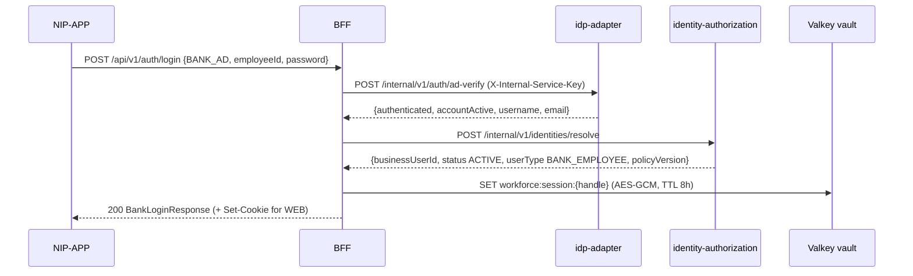
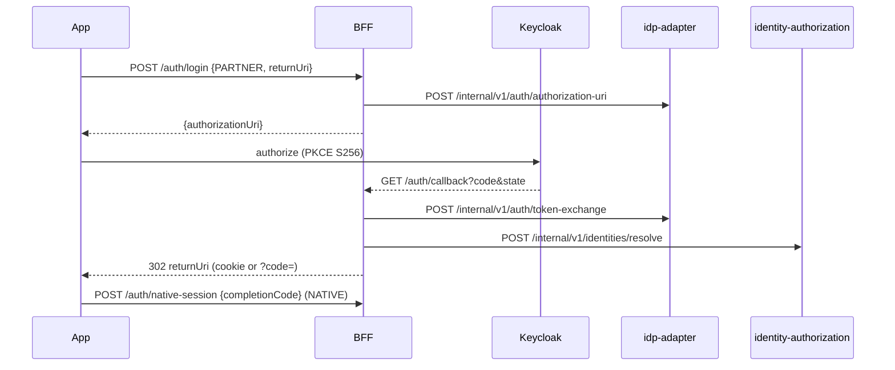
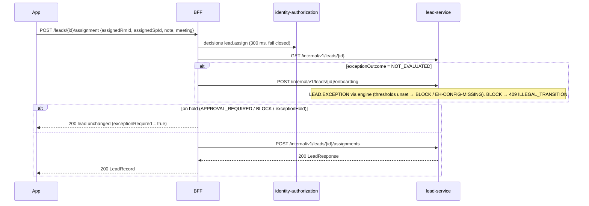

# workforce-access-bff — low-level design

**Status:** AI-DRAFTED from code (ADR-027), awaiting Deepali (security) and engineering review.

[Contract (authoritative)](./openapi.yaml) · [API portal page](../../api-reference/services/workforce-access-bff.md) ·
[ADR-027](../../architecture-review/ADR-027-openapi-contract-authority.md) ·
[Owner decisions 2026-10-21](../../architecture-review/DECISIONS-2026-10-21.md) ·
[Readiness review](../../api-reference/READINESS-REVIEW.md)

## 1. Purpose and ownership

The BFF is the **only** API NIP-APP calls. It authenticates the human (opaque session handle backed
by an encrypted Valkey vault — provider tokens never leave it), asks the PDP before mutating calls,
forwards to domain services with `X-Actor-Id` taken from the session, and is the **error redaction
boundary** (`bank.error.boundary: PUBLIC`): it may hold a diagnostic, it never emits one.

| Item | Value |
|---|---|
| Module | `services/workforce-access-bff`, port 8084, `service-id: bff`, layer L4 |
| Owns data | Valkey session vault only: `workforce:pending:*` (5 min), `workforce:completion:*` (1 min), `workforce:session:*` (8 h). No Aurora, no DynamoDB |
| Calls | identity-provider-adapter (login), identity-authorization (resolve, PDP), lead-service, customer-service |
| Owner | Platform engineering; security review Deepali |

Source: `services/workforce-access-bff/src/main/java/com/bank/workforce/bff/**`.

## 2. API summary

All paths are under `/api/v1`. Full schemas, status and error codes: [openapi.yaml](./openapi.yaml).

| Method | Path | Session | PDP | Downstream | Notes |
|---|---|---|---|---|---|
| GET | `/auth/csrf` | no | – | – | Sets `WORKFORCE-XSRF` |
| POST | `/auth/login` | no | – | idp-adapter `ad-verify` / `authorization-uri`; authz `identities/resolve` | BANK_AD or PARTNER |
| GET | `/auth/callback` | no | – | idp-adapter `token-exchange`; authz `identities/resolve` | `302` |
| POST | `/auth/native-session` | no | – | – | completion code → handle |
| GET | `/auth/session` | handle | – | – | missing/unknown → `400 SCHEMA_INVALID` |
| POST | `/auth/logout` | handle | – | idp-adapter `revoke` (partner) | `204` |
| GET | `/workspace/pipeline` | yes | – | lead `GET /leads?owner=me` | |
| GET | `/customers:search` | yes | – | customer `GET /customers/search` | |
| GET | `/customers/{customerId}` | yes | – | customer `GET /customers/{id}` | |
| GET | `/customers/{customerId}/active-leads` | yes | – | lead `GET /leads?owner=me` + BFF filter | first 20 |
| POST | `/leads` | yes | `lead.create` | lead `POST /leads` | `Idempotency-Key` optional (forwarded) |
| GET | `/leads/{leadId}` | yes | – | lead `GET /leads/{id}` | absent = 404 |
| POST | `/leads/{leadId}/assignment` | yes | `lead.assign` | lead `GET`, `onboarding`, `assignments` | hold → `200` unchanged |
| GET | `/country-codes` | yes | – | in-process | |
| POST | `/mobile-numbers:validate` | yes | – | in-process | `200` even when invalid |
| GET | `/catalogue/product-classes` | yes | – | static | |
| GET | `/branches`, `/branches/{id}/verticals`, `/branches/{id}/specified-persons`, `/verticals/{id}/relationship-managers` | yes | – | in-process fixture | unknown id → 404 |

## 3. Operation flows

### 3.1 Request pipeline (every `/api/v1/**` call)

1. `RequestDiagnosticFilter` seeds `correlationId` in MDC from `X-Correlation-Id`.
2. Spring Security CSRF (`CookieCsrfTokenRepository`, cookie `WORKFORCE-XSRF`, header
   `X-XSRF-TOKEN`) — **skipped** when the request carries `X-Session-Handle` or
   `Authorization: Bearer` (`BffSessionCredentials.skipsCsrf`).
3. `BffSessionAuthenticationFilter` (not for `/api/v1/auth/**`, `/actuator`, `/error`): resolve the
   handle (header → bearer → cookie); unknown → `401 SESSION_EXPIRED`; resolved → bind
   `WorkforceSession` and a Spring `Authentication`.
4. Authorization rules (`BffSecurityConfig`): `/api/v1/auth/**`, `/actuator/health/**`, `/error`
   permitAll; `/api/v1/**` authenticated (no handle → `BffSessionAuthenticationEntryPoint` →
   `401 SESSION_INVALID`); anything else denyAll.
5. `BffSessionInterceptor` (MVC backup bind) repeats the check if the filter did not bind.
6. Controller → `BffExceptionHandler` (extends `PlatformErrorHandler`): `ServiceException` as is;
   `IllegalArgumentException` → `400 SCHEMA_INVALID`; `IllegalStateException` →
   `401 AUTHENTICATION_FAILED`; bean validation → `422 VALIDATION_ERROR`; unreadable body →
   `422 INVALID_REQUEST`. Then `toPublic()` (redaction).

### 3.2 Bank RM login (`POST /auth/login`, `BANK_AD`)

1. Bean validation (`clientType`, `identitySource` not null).
2. Require `employeeId`, `password` non-blank (else `400 SCHEMA_INVALID`).
3. `POST {idp}/internal/v1/auth/ad-verify` with `X-Internal-Service-Key`; read 6 s.
4. Not `accepted` → `401 AUTHENTICATION_FAILED`.
5. `POST {authz}/internal/v1/identities/resolve` (`BANK_AD`, `BANK_EMPLOYEE`, `employeeId`) — first
   login creates the business user.
6. Require `ACTIVE` + `BANK_EMPLOYEE` (else `401 AUTHENTICATION_FAILED`).
7. Mint 32-byte handle; store encrypted `WorkforceSession` (no provider tokens), TTL 8 h.
8. `WEB` → cookie; `NATIVE` → `sessionHandle` in the body.

### 3.3 Partner login (`PARTNER`) and callback

1. `begin`: `returnUri` must be in `workforce.session.allowed-return-uris` (else `400`); mint
   `state`, `nonce`, PKCE verifier; store `PendingLogin` (5 min); adapter builds the authorize URL.
2. Keycloak redirects the browser to `GET /auth/callback?code&state`.
3. `complete`: GETDEL pending (unknown → `400 SCHEMA_INVALID`) → adapter `token-exchange` (nonce,
   audience, subject verified there) → authz `resolve` (`KEYCLOAK`, `INSURER_REPRESENTATIVE`;
   unapproved partner → `403 FORBIDDEN` propagated) → require `ACTIVE` (else revoke refresh token,
   `401`) → store session with encrypted provider tokens.
4. `WEB` → `302 returnUri` + cookie. `NATIVE` → completion code (1 min) → `302 returnUri?code=…`
   → app calls `POST /auth/native-session`.

### 3.4 Logout

Read session (may be absent) → delete vault record → if a refresh token exists, adapter `revoke`
(failure logged, not surfaced) → `204` with an expired cookie.

### 3.5 Create lead (`POST /leads`)

1. Bean validation (`customerId`, `lob`, `productClass` not blank).
2. `PolicyDecisionClient.require(session, "lead.create", "lead", null, branchId, false)` —
   own HTTP client, 300 ms connect + read, no retry; transport error / empty answer →
   `403 AUTHORIZATION_UNAVAILABLE`; deny → mapped code (§5).
3. `POST {lead}/internal/v1/leads` with `X-Actor-Id` and `Idempotency-Key` (when the app sent it).
4. Lead refusal → `ErrorPropagation` (same code, same `incidentId`); no HTTP answer →
   `503 UPSTREAM_UNAVAILABLE`.
5. `201` with `LeadRecord`.

### 3.6 Assign lead (`POST /leads/{leadId}/assignment`)

### 3.7 Reads and reference data

Pipeline / get / active-leads rely on lead-service book scoping (`X-Actor-Id`); there is no PDP
call on reads today. Active-leads filters in the BFF (customer, product class, non-terminal state)
and caps at 20. Organisation and country-code data are in-process fixtures.

## 4. Validation rules

| Field | Rule | Error code |
|---|---|---|
| login `clientType`, `identitySource` | `@NotNull`, enum | `422 VALIDATION_ERROR` (field `MISSING_REQUIRED_FIELD`); unknown enum value → `422 INVALID_REQUEST` |
| login `employeeId`, `password` (BANK_AD) | non-blank | `400 SCHEMA_INVALID` |
| login `returnUri` (PARTNER) | exact member of allow-list | `400 SCHEMA_INVALID` |
| callback `state` | live pending login, single use | `400 SCHEMA_INVALID` |
| native-session `completionCode` | `@NotBlank`; live, single use | `422 VALIDATION_ERROR` / `400 SCHEMA_INVALID` |
| session handle on `/auth/session`, `/auth/logout` | present (and resolvable for session) | `400 SCHEMA_INVALID` |
| session handle on `/api/v1/**` | present / resolvable | `401 SESSION_INVALID` / `401 SESSION_EXPIRED` |
| `X-XSRF-TOKEN` (cookie transport, mutations) | matches `WORKFORCE-XSRF` | `403 CSRF_REJECTED` (fix-pending: today a bare Spring 403) |
| create `customerId`, `lob`, `productClass` | `@NotBlank` | `422 VALIDATION_ERROR` |
| assign `assignedRmId` | `@NotBlank` | `422 VALIDATION_ERROR` |
| assign `note` | `@Size(max=250)` | `422 VALIDATION_ERROR` |
| assign `meeting` | not validated in the BFF (passed through; lead-service validates) | lead-service `422 VALIDATION_ERROR` |
| mobile `countryCode`, `nationalNumber` | `@NotBlank` | `422 VALIDATION_ERROR` |
| `active-leads?productClass`, `customers:search?by&q`, `callback?code&state` | required query params | Spring `400` (not a platform envelope — open item §9) |
| branch / vertical path ids | known in directory | `404 RESOURCE_NOT_FOUND` |

## 5. PDP reason → error code (`PolicyDecisionClient.errorCodeFor`)

| PDP `reasonCode` | Code to the app |
|---|---|
| `ACCOUNT_NOT_ACTIVE` | `403 ACCOUNT_SUSPENDED` |
| `CROSS_INSURER_ACCESS` | `403 CROSS_INSURER_DENIED` |
| `EXPLICIT_DENY` | `403 EXPLICIT_DENY` |
| `BRANCH_OUT_OF_SCOPE` | `403 OUT_OF_BRANCH_SCOPE` |
| `RESOURCE_NOT_SHARED_WITH_PARTNER` | `404 RESOURCE_NOT_FOUND` (do not confirm existence) |
| `MANDATORY_CERTIFICATION_INVALID` | `403 SP_CERTIFICATION_REQUIRED` |
| `DEFAULT_DENY`, `UNKNOWN_SUBJECT`, other | `403 DEFAULT_DENY` |
| no answer / timeout / empty body | `403 AUTHORIZATION_UNAVAILABLE` |

Rule-engine usage: none in the BFF. Lead exception rules (`LEAD.EXCEPTION`, `ADR-024`, `D2`) are
evaluated by lead-service.

## 6. DTO → domain → store mapping

| DTO field | Domain | Store |
|---|---|---|
| login result `businessUserId`, `userType`, `status`, `policyVersion`, `insurerCode` | `WorkforceSession` | Valkey `workforce:session:{handle}` (AES-256-GCM, `TokenVaultCipher`) |
| provider `accessToken`, `refreshToken`, `idToken` (partner) | `WorkforceSession` | same record, encrypted; never returned |
| `state`, `nonce`, `codeVerifier`, `clientType`, `identitySource`, `returnUri` | `PendingLogin` | `workforce:pending:{state}` (5 min, GETDEL) |
| `completionCode` | `NativeCompletion(sessionId)` | `workforce:completion:{code}` (1 min, GETDEL) |
| `CreateLeadRequest` + session actor + `Idempotency-Key` | `LeadGateway.CreateLeadCommand` | lead-service (`lead_lms.lead`) |
| `AssignLeadRequest` (`note`, `meeting`) | `AssignLeadCommand`, `Meeting` | lead-service (`lead_assignment`, `lead_meeting`, `lead_follow_up`) |

## 7. Invariants enforced here

| Invariant | Where |
|---|---|
| Actor never from a body — `X-Actor-Id` = `session.businessUserId` (fallback `username`) | `LeadModuleController.actorId` |
| Provider tokens never leave the BFF | `WorkforceSession` stored encrypted; responses carry only the handle |
| Fail closed on PDP | `PolicyDecisionClient` |
| Exception rules precede assignment (`D-019`) | `LeadFacade.assign` |
| Redaction boundary — no `origin` / `diagnostic` outward | `PlatformErrorHandler.emit` with `boundary: PUBLIC` |
| `distributorId` is never accepted | absent from every request schema |

## 8. Events, idempotency, timeouts, failure modes

- **Events:** the BFF produces and consumes none. Login and denial evidence is audit (target
  `ADR-026`, **proposed**), not an event of this service.
- **Idempotency:** `POST /leads` forwards `Idempotency-Key` when present; lead-service enforces it.
  The contract target is **required** on every mutation (`INV-IDM-01`); the app does not send it
  yet, so it stays optional in this version. Other mutations carry no key today.
- **Timeouts** (`DownstreamTimeouts`, `03 §5`): lead 500 ms / 2 s (S-20); customer 500 ms / 4 s;
  authz resolve 500 ms / 2 s; idp-adapter 1 s / **4.5 s** (`WORKFORCE_IDP_CONNECT_TIMEOUT` /
  `WORKFORCE_IDP_READ_TIMEOUT`; above the adapter's 3 s AD-verify / Keycloak read, E8); PDP 300 ms
  (S-02). No retries.
- **Failure modes:** downstream problem+json → propagated code with original `incidentId`; no HTTP
  answer → `503 UPSTREAM_UNAVAILABLE` (lead, customer) or `503 IDENTITY_PROVIDER_UNAVAILABLE`
  (identity clients); PDP silence → `403 AUTHORIZATION_UNAVAILABLE`.

## 9. Deviations from older documents and open items

| # | Item | Owner |
|---|---|---|
| 1 | Old `nip-bff-lead-phase.openapi.yaml` named cookie `NIPSESSION`, header `X-CSRF-Token`, had no `/auth/**` paths — superseded by this contract (code names win) | done (banner) |
| 2 | **fix-pending** — CSRF rejection is a bare Spring 403; decided `403 CSRF_REJECTED` problem+json (configure an `accessDeniedHandler`) | Engineering |
| 3 | Lead `409 CONFLICT` for a duplicate will carry the existing lead's ULID in `errors[0]` (`field: leadId`) (**fix-pending** in lead-service); the BFF propagates it unchanged | Engineering |
| 4 | Auth paths raise `SCHEMA_INVALID`; the registry already holds `INVALID_STATE`, `CODE_ALREADY_CONSUMED`, `RETURN_LOCATION_NOT_ALLOWED` — switching is a reviewed contract change | Deepali / Engineering |
| 5 | Missing required query params and enum type mismatches answer Spring's default 400 (no platform envelope) | Engineering |
| 6 | `Idempotency-Key` optional on `POST /leads` until NIP-APP sends it | Flutter team |
| 7 | Reads (pipeline, get, active-leads) have no PDP call; book scoping is lead-service's | Deepali |
| 8 | Product classes static; organisation directory a fixture (bank HR mapping is the system of record) | Rajal / Aarti |
| 9 | `X-Correlation-Id` optional in code, required by contract 09 | Engineering |
