# 05 — E2E ER diagrams, fields and relationship map

**Workstream:** WS-3 · **Work item:** [`DATA-004`](./DATA-004.work-item.yaml) · origin [`SUG-20261012-erd`](../../governance/registers/SUGGESTION-REGISTER.md#sug-20261012-erd--e2e-er-diagrams-and-field-map)
**Companion:** store / credential / roadmap in [`04-store-segregation-and-roadmap.md`](./04-store-segregation-and-roadmap.md)
**DDL source:** [`schemas/`](./schemas/) — this document is a projection of that DDL, not a second SoT
**Owner:** Aarti — Principal Insurance Data & Database Architect
**Status:** `AI-DRAFTED` · design only · not Flyway

Freshness: `04-STAGE_GATES.md` is past its 14-day limit (WARN). No stage field is edited.

Every transactional **system of record** is on **Aurora PostgreSQL**. DynamoDB holds exactly two tables — **pre-payment** quote and proposal working state (`{env}-quotation-working`, `{env}-proposal-working`, [`DB-DEC-0005`](./DB-DEC-0005-dynamodb-working-payload.md)); they are key-value items, not relational entities, so they appear below only as a *working store* box and are designed in [`schemas/20-dynamodb-working-payload.md`](./schemas/20-dynamodb-working-payload.md). Journey, audit and sessions are **not** in DynamoDB. Valkey, S3, Keycloak and MSK are not relational schemas.

**2026-10-21 decisions reflected here:** `customer_id` ULID (`D-023`), lead exception vocabulary (D2), append-only `consent_record` (`D-024`), per-class suitability `evaluation` / `evaluation_outcome` (D4), `proposal_answer` / `proposal_status_history` / `policy_status_history` and payment `quote_id` (`D-025`), `rule_set_version` (ADR-024), ADR-025 outbox shape, and the **proposed** audit schema (ADR-026).

Lead physical name on this stacked pack is schema `lead_lms` / table `lead` (`DATA-003`). Identifiers stay `lead_id`. Working quote/proposal envelopes (`DATA-005`) are owned by quotation / proposal in DynamoDB (`DB-DEC-0005`), never on journey.

---


> **Superseded in part by [`DB-DEC-0005`](./DB-DEC-0005-dynamodb-working-payload.md) (2026-10-21, owner HUMAN ratification).**
> Pre-payment quote and proposal working state now lives in **DynamoDB** (`{env}-quotation-working`,
> `{env}-proposal-working`), not in Aurora `quote_working` / `proposal_working`. Wherever this document says
> `quote_working` or `proposal_working`, read the DynamoDB item `QUOTE#{id}/META` / `PROPOSAL#{id}/META`
> ([table design](./schemas/20-dynamodb-working-payload.md)). Ownership, JSON-until-payment, materialise on
> `RECONCILED`, and everything about Journey and Payment are **unchanged**.

## 1. How to read the diagrams

| Mark | Meaning |
|---|---|
| Solid `\|\|--o{` | **Physical FK** — same schema only (`DR-OWN-08`) |
| Dashed / `LOGICAL` | Cross-schema id. Owning service validates via API. No SQL `FOREIGN KEY` |
| `PK` | Primary key. New aggregates: ULID `CHAR(26)`. Identity / bank_persistence keep shipping types |
| `⚑` / `*_enc` | Encrypted payload. Never plaintext, never an index key (`DR-PII-01`) |
| `lob` | `LIFE` \| `HEALTH` \| `GENERAL` on journey-scoped and config rows (`INV-LOB-01`) |
| `version` | Optimistic lock on mutable aggregates |

Repeated satellite (not redrawn on every schema ER):

```text
<schema>.idempotency_record (PK idempotency_key, request_hash, response_ref, created_at, expires_at)
<schema>.outbox_event (PK outbox_id ULID, aggregate_type, aggregate_id, event_type, schema_version,
                       payload event-envelope/v1, created_at, published_at, attempts, last_error, parked_at)   -- ADR-025
```

`idempotency_record` present on: `customer`, `lead_lms`, `consent`, `suitability`, `quotation`, `proposal`, `payment`, `policy`, `journey`, `administration`. `outbox_event` (ADR-025 shape) on: `customer`, `lead_lms`, `consent`, `suitability`, `catalogue`, `payment`, `policy`, `journey`, `administration`; quotation / proposal use DynamoDB `OUTBOX#` items (`DB-DEC-0005`). Identity keeps its shipping `identity.outbox_event`. `bank_persistence` uses `integration_job.idempotency_key`.

---

## 2. E2E sale path — logical ER

Solid lines are physical FKs inside one schema. All arrows that cross a box are **logical**. `DYNAMO_*` boxes are DynamoDB working items (`DB-DEC-0005`), not tables; `BANK_audit_event` moves to schema `audit` only if [`ADR-026`](../architecture-review/ADR-026-audit-store-and-transport.md) (proposed) is accepted.

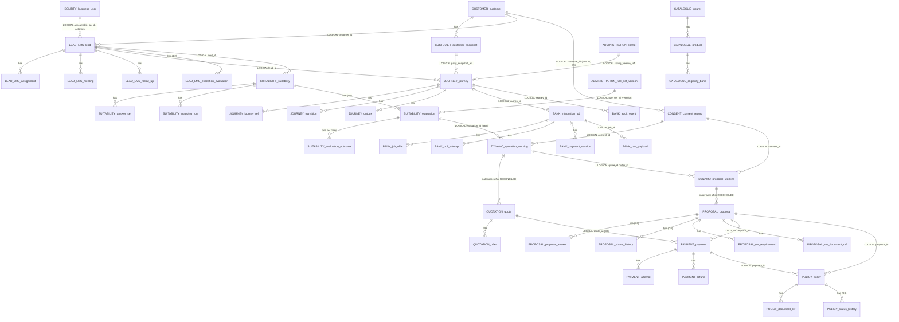

---

## 3. Relationship map (complete)

### 3.1 Physical FK — same schema only

| From | To | Card. | Rule |
|---|---|---|---|
| `identity.business_user.insurer_code` | `identity.insurer.code` | N:1 | Partner user scoped to insurer |
| `identity.user_branch_assignment.user_id` | `identity.business_user.id` | N:1 | Temporal branch seat |
| `identity.user_branch_assignment.branch_code` | `identity.branch.code` | N:1 | |
| `identity.organization_relationship.manager_user_id` | `identity.business_user.id` | N:1 | `manager <> subordinate` |
| `identity.organization_relationship.subordinate_user_id` | `identity.business_user.id` | N:1 | |
| `identity.certification.user_id` | `identity.business_user.id` | N:1 | INV-ACT-01 |
| `identity.user_role.user_id` | `identity.business_user.id` | N:1 | |
| `identity.user_role.role_code` | `identity.role.code` | N:1 | |
| `identity.role_permission.role_code` | `identity.role.code` | N:1 | |
| `identity.role_permission.permission_code` | `identity.permission.code` | N:1 | |
| `identity.entitlement.user_id` | `identity.business_user.id` | N:1 | GRANT/DENY overlay |
| `identity.bulk_import.insurer_code` | `identity.insurer.code` | N:1 | nullable |
| `identity.bulk_import_row.import_id` | `identity.bulk_import.id` | N:1 | |
| `bank_persistence.integration_job_offer.job_id` | `integration_job.job_id` | N:1 | Adapter offers |
| `bank_persistence.job_poll_attempt.job_id` | `integration_job.job_id` | N:1 | |
| `bank_persistence.payment_session.job_id` | `integration_job.job_id` | N:1 | nullable; **not** Payment SoR |
| `customer.customer_snapshot.customer_id` | `customer.customer.customer_id` | N:1 | Write-once freeze |
| `lead_lms.lead_assignment.lead_id` | `lead_lms.lead.lead_id` | N:1 | |
| `lead_lms.lead_meeting.lead_id` | `lead_lms.lead.lead_id` | N:1 | ⚑ online link |
| `lead_lms.lead_follow_up.lead_id` | `lead_lms.lead.lead_id` | N:1 | ⚑ note |
| `journey.journey_transition.journey_id` | `journey.journey.journey_id` | N:1 | INSERT-only |
| `journey.outbox_event.aggregate_id` | `journey.journey.journey_id` | N:1 | ADR-012 / ADR-025 shape |
| `lead_lms.lead_exception_evaluation.lead_id` | `lead_lms.lead.lead_id` | N:1 | D2, INSERT-only |
| `lead_lms.lead_exception_decision.evaluation_id` | `lead_lms.lead_exception_evaluation.evaluation_id` | 1:0..1 | D2, remarks mandatory |
| `suitability.evaluation.suitability_id` | `suitability.suitability.suitability_id` | N:1 | D4, INSERT-only |
| `suitability.evaluation_outcome.evaluation_id` | `suitability.evaluation.evaluation_id` | N:1 | PK `(evaluation_id, product_class)` |
| `suitability.caution_ack.(evaluation_id, product_class)` | `suitability.evaluation_outcome` | 1:0..1 | `SUIT-R41…R43` |
| `suitability.suitability_usage.evaluation_id` | `suitability.evaluation.evaluation_id` | N:1 | `SUIT-R37` |
| `consent.consent_record.supersedes_consent_id` | `consent.consent_record.consent_id` | 1:0..1 | `D-024` append-only chain |
| `proposal.proposal_answer.proposal_id` | `proposal.proposal.proposal_id` | N:1 | D8 |
| `proposal.proposal_status_history.proposal_id` | `proposal.proposal.proposal_id` | N:1 | D8, append-only |
| `policy.policy_status_history.policy_id` | `policy.policy.policy_id` | N:1 | D8, append-only |
| `suitability.suitability_answer_set.suitability_id` | `suitability.suitability.suitability_id` | N:1 | ⚑ answers, INSERT-only |
| `suitability.suitability_mapping_run.suitability_id` | `suitability.suitability.suitability_id` | N:1 | INSERT-only |
| `catalogue.product.insurer_id` | `catalogue.insurer.insurer_id` | N:1 | |
| `catalogue.eligibility_band.product_id` | `catalogue.product.product_id` | N:1 | |
| `quotation.offer.quote_id` | `quotation.quote.quote_id` | N:1 | one SELECTED (`INV-QUO-05`) |
| `proposal.uw_requirement.proposal_id` | `proposal.proposal.proposal_id` | N:1 | |
| `proposal.uw_document_ref.proposal_id` | `proposal.proposal.proposal_id` | N:1 | S3 ref |
| `payment.payment_attempt.payment_id` | `payment.payment.payment_id` | N:1 | append-only |
| `payment.refund.payment_id` | `payment.payment.payment_id` | N:1 | |
| `policy.policy_document_ref.policy_id` | `policy.policy.policy_id` | N:1 | S3 PDF |
| `journey.journey_ref.journey_id` | `journey.journey.journey_id` | N:1 | PK `(journey_id, ref_type)` |

`raw_payload.job_id` is **not** a FK (immutable evidence must survive a job-row change). Correlate by id.

### 3.2 Logical references — no SQL FK

| From | To | Why logical |
|---|---|---|
| `lead_lms.lead.customer_id` | `customer.customer` | Cross-schema |
| `lead_lms.lead.converted_journey_id` | `journey.journey` | Unique when set |
| `lead_lms.lead.accountable_sp_id` / actor ids | `identity.business_user.id` as varchar | Identity uses UUID; Lead stores opaque actor id |
| `customer_snapshot.journey_id` / `lead_id` | `journey` / `lead_lms.lead` | Frozen copy keyed by journey |
| DynamoDB `QUOTE#{id}/META` control attributes `*Id` | owning aggregates | Encrypted envelope until Payment `RECONCILED` (`DB-DEC-0005`) |
| DynamoDB `PROPOSAL#{id}/META` control attributes `*Id` | owning aggregates | Same |
| `consent.consent_record.{lead,journey,customer}_id` | owning aggregates | Evidence must outlive a deleted transactional join; bound to `customer_id` (D5) |
| `suitability.{lead,journey,customer}_id` | owning aggregates | Same |
| `quotation.{lead,journey,customer,suitability,evaluation,consent}_id` | owning aggregates | Quote gate (`INV-QUO-01` as amended by D4) |
| `quotation.provider_job_id` | `bank_persistence.integration_job` | Adapter correlation |
| `proposal.{lead,journey,quote,offer,consent,customer}_id` | owning aggregates | |
| `payment.{lead,journey,customer,quote,proposal}_id` | owning aggregates | `quote_id` added (D8) so materialise can find the working items |
| `policy.{lead,journey,customer,proposal,payment}_id` | owning aggregates | Issuance gate is `payment.RECONCILED` |
| `journey.{lead,customer}_id` | owning aggregates | Stage + refs only (`INV-JRN-02`) |
| `journey.party_snapshot_ref` | `customer.customer_snapshot` | |
| `journey.journey_ref.ref_value` | id named by `ref_type` | suitability/consent/quote/offer/proposal/payment/policy/application/policyNumber/provider |
| `integration_job.journey_id` | `journey` | Adapter correlation |
| `audit_event.{journey_id,consent_ref,suitability_ref,resource_id}` | owning aggregates | Reconstruction without assuming the row still exists |
| `*.config_version_ref` | `administration.configuration_record` | Version in force (`INV-CFG-03`) |
| `*.rule_set_id` + `rule_set_version` | `administration.rule_set_version` | Rule-set version that decided (ADR-024 §6) |
| `quotation.offer.{insurer_code,product_code}` / `policy.{insurer_code,product_code}` | `catalogue` | Catalogue is effective-dated; offer/policy freeze codes |

Actor ids (`rm_id`, `created_by`, `override_actor_id`, …) are **never** joined to `identity` from another schema.

---

## 4. `identity` — already shipping

DDL: [`01-identity.sql`](./schemas/01-identity.sql). Runtime: identity-authorization Flyway V1/V2.

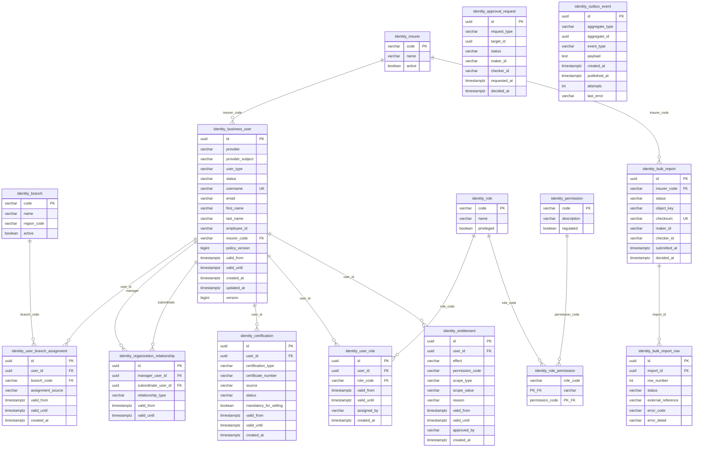

| CHECK / uniqueness | Values |
|---|---|
| `user_type` | `BANK_EMPLOYEE` \| `INSURER_REPRESENTATIVE` |
| `business_user.status` | `PENDING` \| `ACTIVE` \| `SUSPENDED` \| `DISABLED` \| `EXPIRED` |
| `entitlement.effect` | `GRANT` \| `DENY` |
| `entitlement.scope_type` | `GLOBAL` \| `BRANCH` \| `INSURER` \| `RESOURCE` |
| `approval.status` | `PENDING` \| `APPROVED` \| `REJECTED` |
| Unique | `(provider, provider_subject)` · `(user_id, branch_code, valid_from)` · `(user_id, role_code, valid_from)` · `username` · `bulk_import.checksum` |

S09 add (not in V1): `ix_certification_user_validity (user_id, status, valid_until)`.

---

## 5. `bank_persistence` — already shipping

DDL: [`02-bank_persistence.sql`](./schemas/02-bank_persistence.sql) + delta [`14-audit_event_delta.sql`](./schemas/14-audit_event_delta.sql).

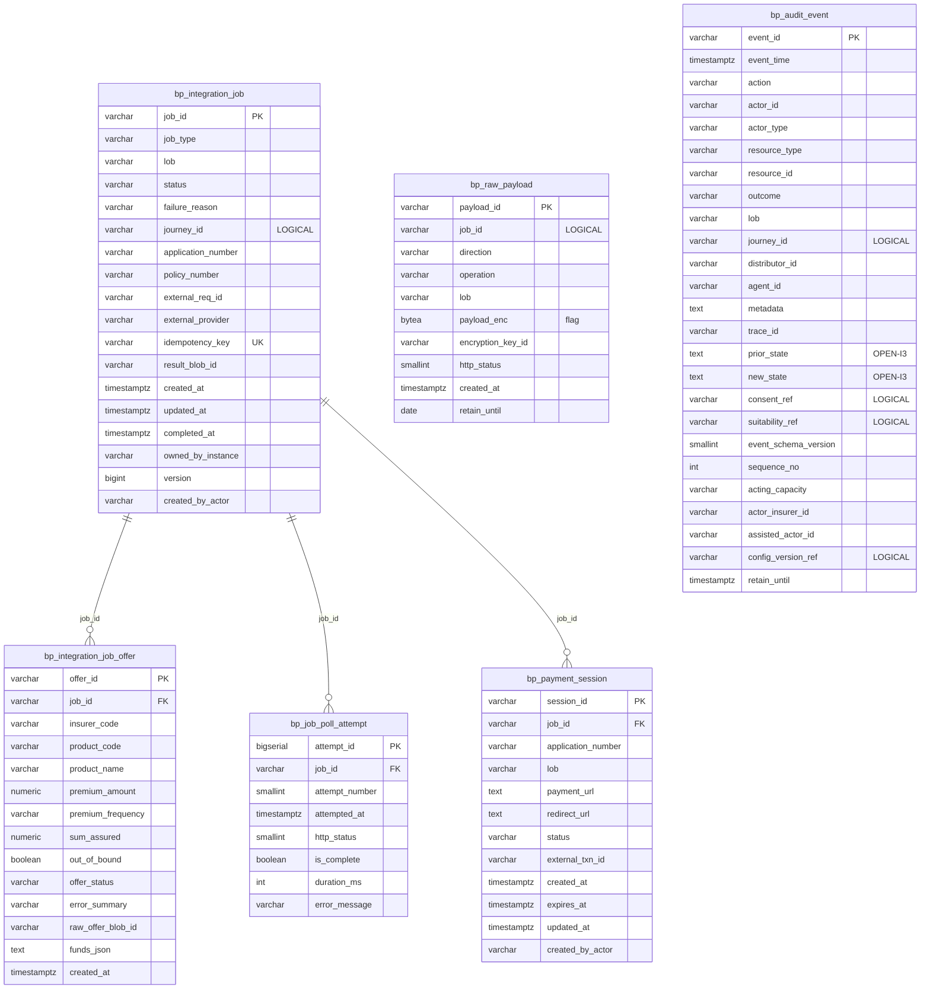

| Notes | |
|---|---|
| `raw_payload.direction` | `REQ` \| `RES` · INSERT-only |
| `audit_event` | INSERT-only. Delta columns are expand-only, not in V1 |
| `acting_capacity` | `SP_ACCOUNTABLE` \| `ASSIST_ONLY` |
| `ux_audit_journey_sequence` | `(journey_id, sequence_no)` when both set |
| `payment_session` | Adapter link session. Payment SoR is schema `payment` |

---

## 6. `customer`

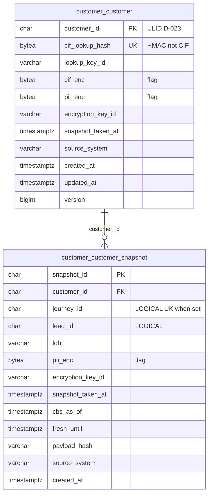

`source_system` = `CBS`. Snapshot `lob` ∈ `LIFE|HEALTH|GENERAL`. Living `customer` has **no** `lob` (DB-DEC-0001 obs. 2). `customer_id` is the platform ULID; the CIF exists only here, encrypted and as a UNIQUE HMAC (`D-023`). A snapshot is reused while `now() < fresh_until` (window from configuration); otherwise a new snapshot row is written. Customer also has `idempotency_record` and an ADR-025 `outbox_event`. `pii_enc` bundle: fullName, dob, gender, mobile, email, address, annualIncome, tobaccoUse, pan, aadhaarRef.

---

## 7. `lead_lms` (Lead)

Spoken name **Lead**. Schema `lead_lms`, aggregate table `lead` (`DATA-003`). Column sheet: [`03-lead-suitability-e2e.md`](./03-lead-suitability-e2e.md).

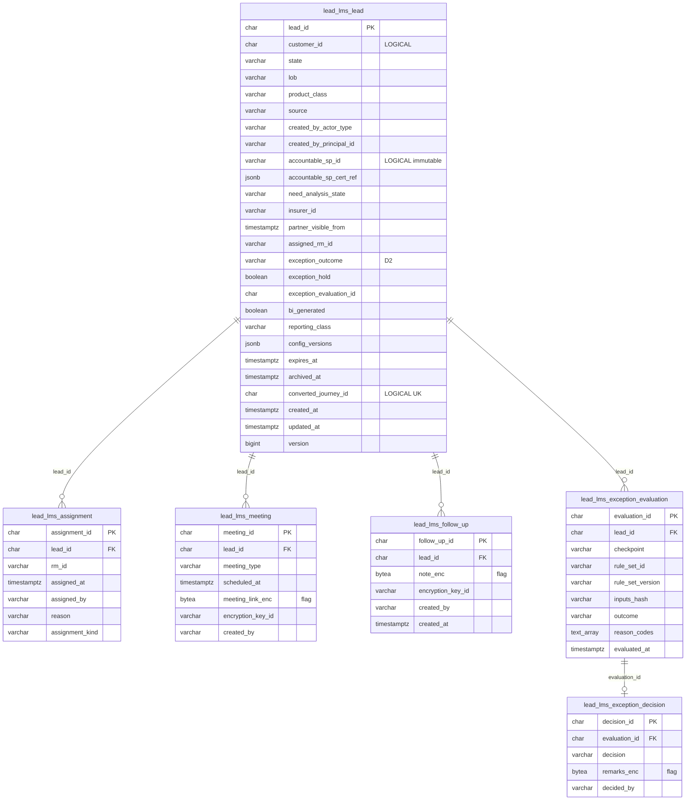

| Column | CHECK / rule |
|---|---|
| `state` | `NEW` \| `ASSIGNED` \| `CONTACTED` \| `QUALIFIED` \| `CONVERTED` \| `DISQUALIFIED` \| `EXPIRED` \| `ARCHIVED` |
| `created_by_actor_type` | `BANK_RM` \| `INSURER_PARTNER_REP` (INV-LED-04 / D-018) |
| `source` | `RM` \| `IPR` |
| `need_analysis_state` | `NOT_STARTED` \| `IN_PROGRESS` \| `COMPLETED` |
| `exception_outcome` | `NOT_EVALUATED` \| `PASS` \| `BLOCK` \| `APPROVAL_REQUIRED` (D2; replaces `exception_state`) — reconciliation with Flyway in [`03` §4.6](./03-lead-suitability-e2e.md#46-design-ddl-vs-as-built-flyway-v2v3--reconciliation-2026-10-21) |
| `accountable_sp_id` | Immutable after first write (INV-ACT-03) |
| Partner visibility | `insurer_id IS NOT NULL AND partner_visible_from IS NOT NULL AND need_analysis_state = 'COMPLETED'` |

---

## 8. `consent`

Append-only since `D-024` (2026-10-21): a state change is a **new row** chained by
`supersedes_consent_id`; withdrawal is a new `WITHDRAWN` row. `REQUESTED` rows carry no capture
evidence yet. The old mutable `consent.consent` table is retired.

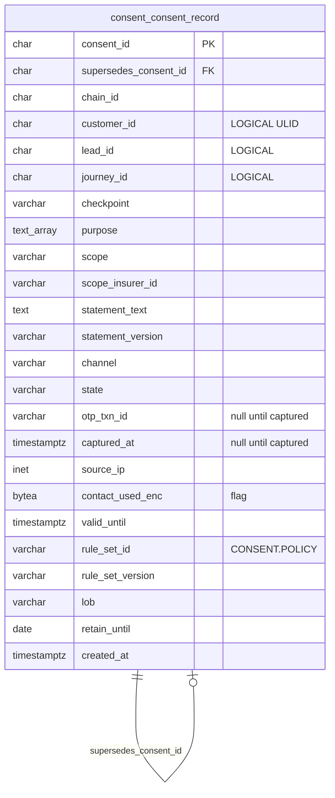

| | |
|---|---|
| `state` | `REQUESTED` \| `OTP_PENDING` \| `GRANTED` \| `WITHDRAWN` \| `EXPIRED` \| `ABANDONED` |
| `checkpoint` | `BEFORE_SUITABILITY` \| `BEFORE_MULTI_QUOTE` \| `BEFORE_PROPOSAL_SUBMIT` \| `BEFORE_FIRST_COMMUNICATION` (rule set `CONSENT.POLICY`, D5) |
| `purpose` | ⊆ `CNS-DP`, `CNS-SOL`, `CNS-QSH` (new, D5), `CNS-SHR`, `CNS-COM` |
| `channel` | `RM_ASSISTED` \| `SELF_SERVICE` |
| Evidence | Whole row write-once; UPDATE / DELETE refused by trigger and grant. `GRANTED` requires OTP txn, capture time, IP, contact |
| Validity | `valid_until` = capture + checkpoint `validityDays` (seed 90 / 30 / none) — configuration, not code |

Also: `consent.idempotency_record`, `consent.outbox_event` (ADR-025).

---

## 9. `suitability`

Per-product-class question sets (`D-022`): Term protection set, Savings set, ULIP set; every class writes a row. Column sheet: [`03-lead-suitability-e2e.md`](./03-lead-suitability-e2e.md).

```mermaid
erDiagram
    suitability_suitability {
        char suitability_id PK
        char lead_id "LOGICAL"
        char journey_id "LOGICAL"
        char customer_id "LOGICAL"
        varchar lob
        varchar product_class
        varchar questionnaire_id
        varchar questionnaire_version
        varchar mapping_rule_version
        char current_evaluation_id "D4"
        varchar state
        int current_answer_set_version
        char current_mapping_run_id
        varchar selected_product_code
        timestamptz bi_locked_at
        char locked_quote_id
        varchar override_actor_id
        varchar override_reason
        timestamptz override_at
        varchar evidence_document_ref
        varchar config_version_ref "LOGICAL"
        timestamptz created_at
        timestamptz updated_at
        bigint version
    }
    suitability_answer_set {
        char answer_set_id PK
        char suitability_id FK
        int answer_set_version
        bytea answers_enc "flag"
        varchar encryption_key_id
        varchar last_screen_id
        varchar created_by
        timestamptz created_at
    }
    suitability_mapping_run {
        char mapping_run_id PK
        char suitability_id FK
        int answer_set_version
        varchar mapping_rule_version
        varchar mapping_result
        text_array recommended_products
        varchar run_state
        timestamptz evaluated_at
    }
    suitability_evaluation {
        char evaluation_id PK "gate id"
        char suitability_id FK
        int answer_set_version
        char customer_id "LOGICAL ULID"
        varchar rule_set_id
        varchar rule_set_version
        varchar engine_version
        varchar inputs_hash
        jsonb derived_values
        char consent_id "LOGICAL nullable D5"
        varchar pdf_artefact_ref
        timestamptz evaluated_at
        timestamptz valid_until
        date retain_until
    }
    suitability_evaluation_outcome {
        char evaluation_id PK_FK
        varchar product_class PK
        varchar outcome
        text_array reason_codes
        jsonb derived_values "optional per class"
        varchar rule_set_version
        boolean caution_ack_required
    }
    suitability_evaluation_status_event {
        char status_event_id PK
        char evaluation_id FK
        varchar status
        varchar reason
    }
    suitability_caution_ack {
        char caution_ack_id PK
        char evaluation_id FK
        varchar product_class
        varchar otp_txn_id
    }
    suitability_usage {
        char usage_id PK
        char evaluation_id FK
        char journey_id "LOGICAL"
        varchar used_for
    }
    suitability_suitability ||--o{ suitability_answer_set : "suitability_id"
    suitability_suitability ||--o{ suitability_mapping_run : "suitability_id"
    suitability_suitability ||--o{ suitability_evaluation : "suitability_id"
    suitability_evaluation ||--o{ suitability_evaluation_outcome : "evaluation_id"
    suitability_evaluation ||--o{ suitability_evaluation_status_event : "evaluation_id"
    suitability_evaluation_outcome ||--o| suitability_caution_ack : "evaluation_id, product_class"
    suitability_evaluation ||--o{ suitability_usage : "evaluation_id"
```

| | |
|---|---|
| `state` | `IN_PROGRESS` \| `COMPLETED` \| `NO_PRODUCT_FOUND` \| `LOCKED` \| `OVERRIDDEN` \| `SUPERSEDED` \| `EXPIRED` \| `ABANDONED` |
| `evaluation_outcome.outcome` | `SUITABLE` \| `SUITABLE_WITH_CAUTION` \| `NOT_SUITABLE` \| `INSUFFICIENT_DATA` per product class (D4). The header `ELIGIBLE` / `NOT_ELIGIBLE` outcome is retired |
| `product_class` | `TERM` \| `SAVINGS` \| `ULIP` — every class has a row (`D-022`) |
| Gate | `INV-QUO-01`: outcome for the quoted class ∈ `SUITABILITY.GATE.allowedOutcomes` (configured); caution needs `caution_ack` |
| Answers | `suitability_answer_set.answers_enc` INSERT-only ⚑ JSON ciphertext |
| Mapping | `suitability_mapping_run` INSERT-only; one `CURRENT` per assessment |
| Override | `OVERRIDDEN` requires actor + reason + timestamp |

---

## 10. `catalogue`

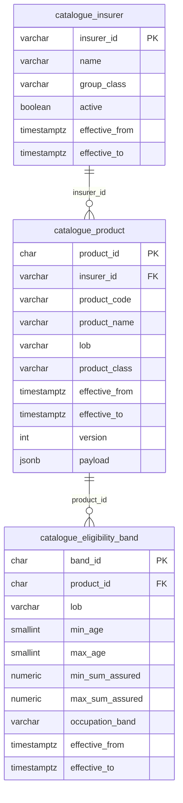

`group_class` ∈ `A|B`. Unique `(insurer_id, product_code, version)`. Active versions are not updated in place. Read cache is Valkey, not a table.

---

## 11. `quotation`

Pre-payment state is the DynamoDB item `QUOTE#{quoteId}/META` in `{env}-quotation-working`
([`DB-DEC-0005`](./DB-DEC-0005-dynamodb-working-payload.md), [table design](./schemas/20-dynamodb-working-payload.md));
there is no Aurora `quote_working`. Structured `quote` + **every** `offer` are INSERT-only after
Payment `RECONCILED` (`D-025`): selected = `SELECTED`, others `NOT_SELECTED`, invalid kept as `INVALID`;
the quote is inserted `CONVERTED` with `selected_offer_id`.

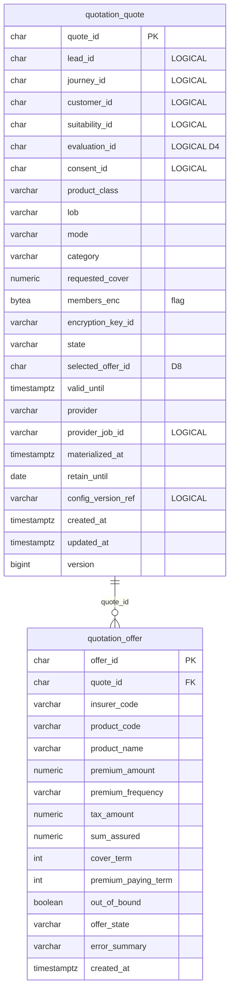

| | |
|---|---|
| `mode` | `SINGLE` \| `MULTI` |
| `quote.state` (and the DynamoDB item `state`) | `REQUESTED` \| `IN_PROGRESS` \| `QUOTED` \| `PARTIALLY_QUOTED` \| `SELECTED` \| `CONVERTED` \| `EXPIRED` \| `FAILED` \| `TIMED_OUT` \| `REJECTED` |
| `offer_state` | `QUOTED` \| `SELECTED` \| `NOT_SELECTED` \| `INVALID` |
| `ux_offer_selected` | at most one `SELECTED` per `quote_id` |
| Positive | `offer_state = 'INVALID' OR (premium_amount > 0 AND sum_assured > 0)` — invalid offers are kept (D8) |
| API `AVAILABLE` | Presentation value; stored as `QUOTED` (never a legal `offer_state`) |
| Names | `premium_frequency` / `premium_paying_term` / `cover_term` are canonical; envelope/API `frequency` / `ppt` / `term` map onto them |
| Envelope | DynamoDB `payloadEnc` (client-side encrypted) — never a Postgres column |

Adapter poll rows stay in `bank_persistence`, not here.

---

## 12. `proposal`

Pre-payment state is the DynamoDB item `PROPOSAL#{proposalId}/META` in `{env}-proposal-working`
(`DB-DEC-0005`); there is no Aurora `proposal_working`. Structured rows are INSERT-only after Payment
`RECONCILED`; every question and answer goes to `proposal_answer` and later changes to
`proposal_status_history` (`D-025`).

```mermaid
erDiagram
    proposal_proposal {
        char proposal_id PK
        char lead_id "LOGICAL"
        char journey_id "LOGICAL"
        char quote_id "LOGICAL"
        char offer_id "LOGICAL"
        char consent_id "LOGICAL"
        char customer_id "LOGICAL"
        varchar application_number UK
        varchar schema_id
        varchar schema_version
        varchar state "PAID at materialise"
        varchar issuance_mode
        timestamptz submitted_at
        char payment_id "LOGICAL"
        bytea nominee_enc "flag"
        varchar encryption_key_id
        varchar underwriting_state
        jsonb counter_offer
        varchar lob
        varchar config_version_ref "LOGICAL"
        timestamptz created_at
        timestamptz updated_at
        bigint version
    }
    proposal_uw_requirement {
        char requirement_id PK
        char proposal_id FK
        varchar requirement_type
        varchar sub_type
        varchar description
        varchar status
        date due_date
        timestamptz created_at
    }
    proposal_uw_document_ref {
        char document_id PK
        char proposal_id FK
        varchar object_ref
        varchar document_class
        timestamptz created_at
    }
    proposal_proposal_answer {
        char proposal_id PK_FK
        varchar question_id PK
        int question_seq
        text question_text "as shown"
        varchar schema_version
        bytea answer_enc "flag"
    }
    proposal_proposal_status_history {
        char status_id PK
        char proposal_id FK
        varchar from_state
        varchar to_state
        char source_event_id
        timestamptz occurred_at
    }
    proposal_proposal ||--o{ proposal_proposal_answer : "proposal_id"
    proposal_proposal ||--o{ proposal_proposal_status_history : "proposal_id"
    proposal_proposal ||--o{ proposal_uw_requirement : "proposal_id"
    proposal_proposal ||--o{ proposal_uw_document_ref : "proposal_id"
```

`state`: `DRAFT` \| `SUBMITTED` \| `SUBMISSION_FAILED` \| `UNDER_WRITING` \| `REQUIREMENTS_PENDING` \| `UW_APPROVED` \| `UW_COUNTER_OFFER` \| `UW_DECLINED` \| `CUSTOMER_DECLINED` \| `AWAITING_PAYMENT` \| `PAID` \| `CONVERTED` \| `ISSUANCE_FAILED` \| `REFUND_REQUIRED` \| `WITHDRAWN` \| `EXPIRED` \| `ABANDONED`.

The DynamoDB `payloadEnc` holds form values until materialise (`INV-PRP-05`). At materialise each question becomes a `proposal_answer` row with the encrypted answer; `form_values_ref` is removed (it pointed at the frozen item that expires). `issuance_mode` ∈ `STP` \| `NON_STP` \| `INSTA` (`INV-PRP-06`). Form JSON is never a plaintext column.

---

## 13. `payment`

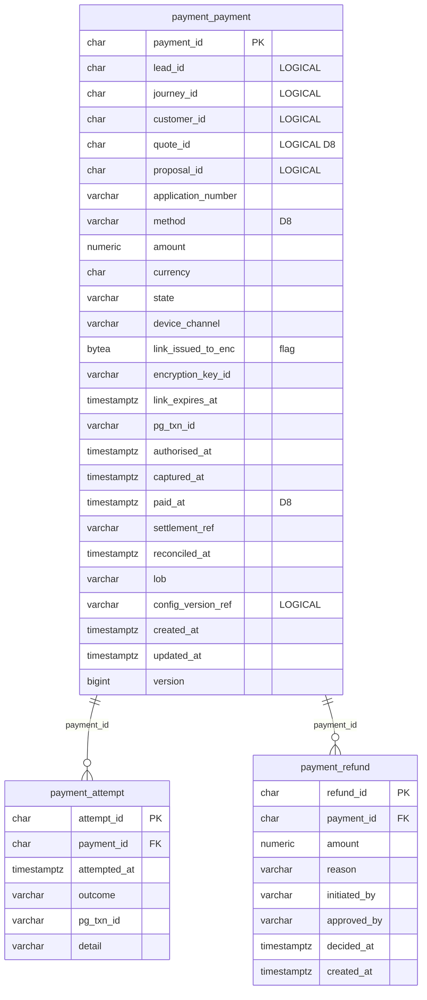

| | |
|---|---|
| `device_channel` | `SMS_LINK` \| `EMAIL_LINK` \| `QR_SCAN` |
| `state` | `INITIATED` \| `LINK_ISSUED` \| `AWAITING_AUTHORISATION` \| `AUTHORISED` \| `CAPTURED` \| `UNCERTAIN` \| `RECONCILED` \| `RECONCILIATION_BREAK` \| `REFUND_INITIATED` \| `REFUNDED` \| `DECLINED` \| `EXPIRED` \| `REJECTED` |
| `ux_payment_active_per_proposal` | one non-terminal payment per proposal (`INV-PAY-02`) |
| Card data | Never stored (`DR-PII-06`) |
| `PaymentReconciled` | carries `paymentId`, `quoteId`, `proposalId`, `journeyId`, `applicationNumber` (`D-025`) |
| Outbox | ADR-025 shape (`outbox_id`, `aggregate_*`, `schema_version`, `parked_at`) |

---

## 14. `policy`

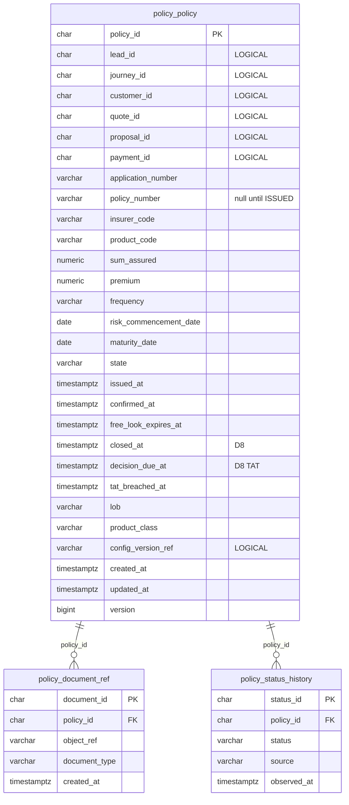

`state`: `PENDING_ISSUANCE` \| `ISSUED` \| `CONFIRMED` \| `CONFIRMATION_OVERDUE` \| `ACTIVE` \| `ISSUANCE_REJECTED` \| `ISSUANCE_DISPUTED` \| `FREE_LOOK_CANCELLED` \| `LAPSED` \| `SURRENDERED` \| `MATURED`.

Unique `(insurer_code, policy_number)` when set — immutable (`INV-POL-02`). PDF bytes in S3 via `object_ref`. `policy_status_history.status` ∈ `APPLICATION_RECEIVED` \| `UNDER_REVIEW` \| `REQUIREMENT_RAISED` \| `ISSUED` \| `DECLINED` \| `REFUNDED` (append-only, `D-025`). Insurer decision TAT: `decision_due_at` from rule set `PROPOSAL.TAT` (seed 7 days, Shailja to confirm). Also `policy.outbox_event`, `processed_event`.

---

## 15. `journey`

```mermaid
erDiagram
    journey_journey {
        char journey_id PK
        char lead_id "LOGICAL"
        char customer_id "LOGICAL"
        varchar rm_id "LOGICAL"
        varchar accountable_sp_id "LOGICAL"
        varchar stage
        varchar channel
        varchar lob
        varchar current_assisting_actor_id
        varchar current_assisting_actor_type
        varchar partner_insurer_id
        timestamptz partner_visible_from
        char party_snapshot_ref "LOGICAL null at INITIATED"
        timestamptz next_action_due_at
        jsonb compensation
        varchar config_version_ref "LOGICAL"
        timestamptz created_at
        timestamptz updated_at
        bigint version
    }
    journey_journey_ref {
        char journey_id PK_FK
        varchar ref_type PK
        varchar ref_value
    }
    journey_journey_transition {
        char transition_id PK
        char journey_id FK
        varchar from_stage
        varchar to_stage
        varchar trigger_kind
        varchar trigger_type
        timestamptz occurred_at
    }
    journey_outbox_event {
        char outbox_id PK
        char aggregate_id FK
        varchar event_type
        smallint schema_version
        jsonb payload
        timestamptz published_at
        timestamptz parked_at
    }
    journey_journey ||--o{ journey_journey_ref : "journey_id"
    journey_journey ||--o{ journey_journey_transition : "journey_id"
    journey_journey ||--o{ journey_outbox_event : "aggregate_id"
```

| | |
|---|---|
| `channel` | `RM_ASSISTED` \| `SELF_SERVICE` \| `HYBRID` |
| `stage` | `INITIATED` \| `NEED_ANALYSIS` \| `SUITABILITY_COMPLETE` \| `CONSENT_CAPTURED` \| `QUOTING` \| `QUOTE_SELECTED` \| `PROPOSAL_IN_PROGRESS` \| `UNDERWRITING` \| `PAYMENT_PENDING` \| `PAYMENT_SETTLED` \| `ISSUANCE_PENDING` \| `ISSUED` \| `SOLD` \| `ABANDONED` \| `DECLINED` \| `COMPENSATING` \| `COMPENSATED` \| `MANUAL_INTERVENTION` |
| `ref_type` | `suitabilityId` \| `consentId` \| `quoteId` \| `offerId` \| `proposalId` \| `paymentId` \| `policyId` \| `applicationNumber` \| `policyNumber` \| `provider` |
| Open lead | unique `lead_id` while stage not terminal |
| `trigger_kind` | `COMMAND` \| `EVENT` — INSERT-only `journey_transition` |
| Absent columns | eligibility, premium, UW decision, quote JSON (`INV-JRN-02`) |

---

## 16. `administration`

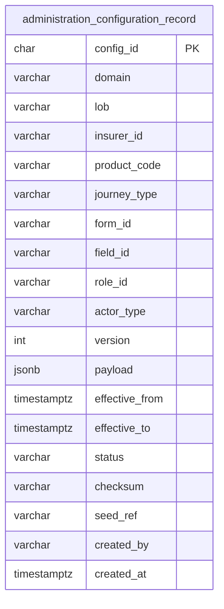

Rule sets (ADR-024) live in `administration.rule_set_version`: `rule_set_id`, semver `version`,
`document` (`rule-set/v1` JSONB), `checksum`, `status` ∈ `DRAFT|PENDING_APPROVAL|PUBLISHED|REJECTED|SUPERSEDED|WITHDRAWN`,
`effective_from/to`, maker ≠ checker, `test_run_passed` required to publish; a published document is
immutable (trigger). Also `administration.outbox_event` (`RuleSetPublished`).

`configuration_record.status` ∈ `DRAFT|ACTIVE|SUPERSEDED|WITHDRAWN`. INSERT-only (`INV-CFG-02`). Unique partition + `version` (COALESCE blanks). A different checksum at the same version is an error.

---

## 17. What has no ER

| Store | Why no entity diagram |
|---|---|
| DynamoDB | Two working tables, quote and proposal **pre-payment only** (`DB-DEC-0005`); key-value items, designed in [`schemas/20-dynamodb-working-payload.md`](./schemas/20-dynamodb-working-payload.md). Journey, audit, sessions are not in DynamoDB |
| Valkey | Session / cache keys, TTL, not an SoR |
| S3 | Bytes addressed by `object_ref` / `payload_id` |
| Keycloak vendor DB | Out of this pack |
| MSK | Events in flight |
| MIS / Athena | Isolated reader, not this cluster |

---

## 18. Cardinality along one R0 sale

```text
1 customer ──1 open lead── 1 journey ──1 snapshot
                │
                ├── 1..n consent_record rows per chain (bound to customer; reused while valid — D5)
                ├── 1 suitability ── 1..n evaluation ── 1 outcome per class (every class, Term included)
                ├── 1 DynamoDB working quote ──(after RECONCILED)── 1 quote ── 1..n offer (exactly one SELECTED)
                ├── 1 DynamoDB working proposal ──(after RECONCILED)── 1 proposal ── 1..n answer · 0..n status history · UW
                ├── 1 active payment ── 0..n attempt ── 0..1 refund
                └── 1 policy ── 0..n document_ref · 1..n status history (D8)
```

Cross-context integrity is the owning service’s contract plus events. A broken logical id is an application defect, not a database cascade.
