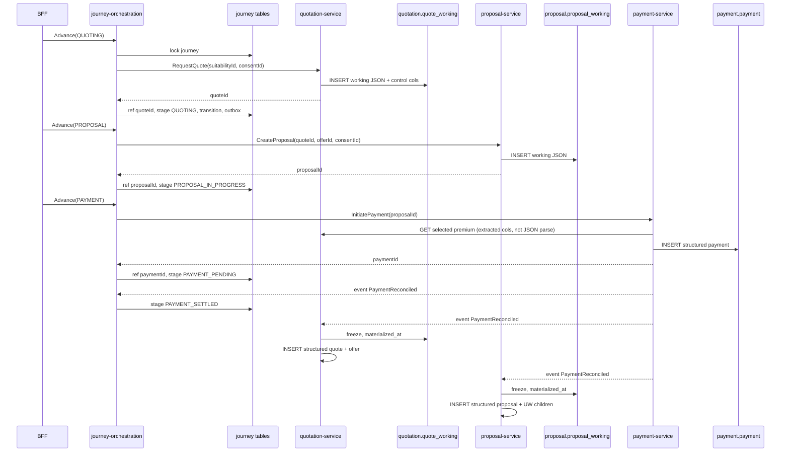
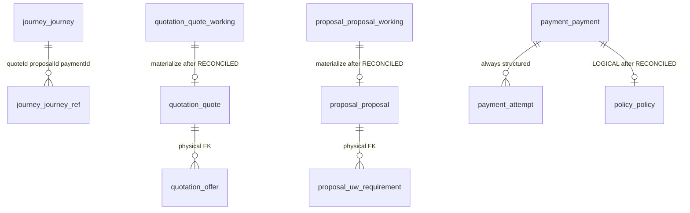

# 06 — Journey orchestrator structure and JSON-until-payment

**Workstream:** WS-3 · **Work item:** [`DATA-005`](./DATA-005.work-item.yaml) · origin [`SUG-20261019-jwp`](../../governance/registers/SUGGESTION-REGISTER.md#sug-20261019-jwp--journey-orchestrator-and-json-until-payment)
**Decision:** [`DB-DEC-0004`](./DB-DEC-0004-working-payload-until-payment.md)
**Owner:** Aarti — Principal Insurance Data & Database Architect
**Joint review:** Mahesh (orchestrator boundary, INV-JRN-02) · Deepali (encrypted working payloads)
**Status:** `AI-DRAFTED` · design only · not Flyway · not a T4 signature
**Stage:** S08 design delta. Apply stays S09 / S11 owning-service Flyway.

Freshness: `state_as_of` 19d · `04-STAGE_GATES.md` 26d · suggestion register 10d (WARN). No stage field is edited.

This pack answers:

1. The **complete structure** of the Journey Orchestration service and the tables it may touch.
2. How the **orchestrator layer** interacts with those tables — and what it must never write.
3. How **quotes and proposals stay unstructured JSON** until payment is `RECONCILED`, then **materialize** into the existing structured tables.

Cite: [`INV-JRN-02`](../ws3-platform/01-domain-model-and-invariants.md) · [`OR-01`](../../context/roles/mahesh-principal-insurance-platform-architect/13-orchestration-doctrine.md) (orchestrator coordinates, never decides) · [`SC-W3-6`](../ws3-platform/00-WS3-ARCHITECTURE-REGISTRATION.md) · [`03-solution-architecture-r0.md` §5](../ws3-platform/03-solution-architecture-r0.md) · [`12-journey.sql`](./schemas/12-journey.sql) · [`08-quotation.sql`](./schemas/08-quotation.sql) · [`09-proposal.sql`](./schemas/09-proposal.sql) · Aarti card joint-review list ([`aarti-database.card.md`](../../context/personas/aarti-database.card.md)).

---

## 1. Aarti verdict (draft)

| | |
|---|---|
| **Decision** | `APPROVED_WITH_OBSERVATIONS` — working-payload pattern **inside Quotation and Proposal**, not on Journey |
| **Severity** | `D1` — SoT *timing* changes; ownership does not |
| **Orchestrator store** | Schema `journey` only: `journey`, `journey_ref`, `journey_transition`, `outbox_event`, `idempotency_record`. Role `app_journey`. |
| **Quote / proposal before payment** | Encrypted JSON envelope in `quotation.quote_working` / `proposal.proposal_working`. Structured `quote` / `offer` / `proposal` / UW children are **empty** until materialize. |
| **Materialize trigger** | `Payment` reaches `RECONCILED`. Owning services consume that event and INSERT structured rows in their own schema. Journey only updates stage + `paymentId` / later `policyId`. |
| **Never** | Quote or proposal JSON on `journey.journey`. Journey opening `quotation` or `proposal`. Orchestrator calling 1SB or a database it does not own. |

Observation: this does **not** move Suitability, Consent, Payment or Policy onto JSON. Those stay structured from the first write — they are evidence or money.

---

## 2. Journey service structure

`journey-orchestration-service` is a skeleton today (`JourneyOrchestrationApplication`). The target internal shape is the same hexagon every WS-3 service uses ([`03` §6](../ws3-platform/03-solution-architecture-r0.md#6-internal-architecture-pattern--s07-e01-s03)):

```text
api/            HTTP from workforce-access-bff only (S-03)
application/    advance, resume, compensate — one use-case per command
domain/         Journey aggregate: stage machine INV-JRN-01, refs, nextActionDueAt
adapter/
  persistence/  JourneyRepository → schema journey (app_journey)
  clients/      sync ports to owning services (no Hub, no 1SB, no foreign DataSource)
  messaging/    outbox publisher; consumers for PaymentReconciled, PolicyActivated, …
```

| Layer | May do | Must not |
|---|---|---|
| API | Accept BFF command + idempotency key | Expose 1SB codes; talk to Flutter |
| Application | Call one owning-service port, then write own tables | Call two writers in one “transaction”; open another schema |
| Domain | Decide the next legal stage | Store premium, eligibility, UW, form JSON |
| Persistence | `journey` schema only | JPA entities for quote/proposal/payment |
| Clients | HTTP to Customer, Lead, Consent, Suitability, Catalogue, Quotation, Proposal, Payment, Policy, Administration | HTTP to Hub or `1sb-integration-service` |

There is **one** journey deployable at R0. Quotation and Proposal are not “journey services”; they are callees.

---

## 3. Tables the orchestrator may touch

```mermaid
erDiagram
    journey_journey {
        char journey_id PK
        char lead_id
        char customer_id
        varchar rm_id
        varchar accountable_sp_id
        varchar stage
        varchar channel
        varchar lob
        varchar current_assisting_actor_id
        varchar current_assisting_actor_type
        varchar partner_insurer_id
        timestamptz partner_visible_from
        char party_snapshot_ref
        timestamptz next_action_due_at
        jsonb compensation
        varchar config_version_ref
        bigint version
    }
    journey_journey_ref {
        char journey_id PK_FK
        varchar ref_type PK
        varchar ref_value
    }
    journey_journey_transition {
        char transition_id PK
        char journey_id FK
        varchar from_stage
        varchar to_stage
        varchar trigger_kind
        varchar trigger_type
        varchar actor_id
        timestamptz occurred_at
        varchar correlation_id
    }
    journey_outbox_event {
        char event_id PK
        char journey_id
        varchar event_type
        jsonb payload
        timestamptz created_at
        timestamptz published_at
    }
    journey_journey ||--o{ journey_journey_ref : "has"
    journey_journey ||--o{ journey_journey_transition : "history"
    journey_journey ||--o{ journey_outbox_event : "publish"
```

| Table | Orchestrator write | Purpose |
|---|---|---|
| `journey.journey` | INSERT on start; UPDATE `stage`, `next_action_due_at`, assist fields, `compensation`, `version` | Saga header. No decision columns (`INV-JRN-02`) |
| `journey.journey_ref` | UPSERT `(journey_id, ref_type)` when a callee returns an id | The only place Journey remembers quote/proposal/payment/policy |
| `journey.journey_transition` | INSERT-only on every legal stage move | Reconstruction. Not a decision store |
| `journey.outbox_event` | INSERT in the **same transaction** as the stage write | `ADR-012` |
| `journey.idempotency_record` | Same transaction as the command | `INV-IDM-01` |

`ref_type` stays: `suitabilityId` · `consentId` · `quoteId` · `offerId` · `proposalId` · `paymentId` · `policyId` · `applicationNumber` · `policyNumber` · `provider`.

`compensation` JSONB on the header is **saga bookkeeping** (`failurePoint`, `attempts`, `ownerTaskId`), not a premium or UW outcome.

---

## 4. How the orchestrator interacts (never a cross-schema write)

Pattern for every advancing command:

```text
1. Load journey + refs with app_journey (SELECT … FOR UPDATE / version)
2. Reject illegal stage (INV-JRN-01)
3. HTTP call to the owning service (S-04 … S-16 as applicable)
4. Owning service writes ITS store (working JSON or structured money/evidence)
5. On success, Journey in ONE local transaction:
      UPDATE journey.stage + next_action_due_at + version
      UPSERT journey_ref
      INSERT journey_transition
      INSERT outbox_event
      INSERT/hit idempotency_record
6. On callee failure: stage unchanged (S-03). No compensating write into the callee's schema.
```

There is no 2PC. If step 5 fails after step 4 succeeded, retry of the command is idempotent: the callee returns the same id; Journey upserts the same ref.



Journey **subscribes** to `PaymentReconciled` only to move stage. It does not materialize quote or proposal.

---

## 5. JSON until payment — owning schemas, not Journey

### 5.1 What stays structured from the first write

| Schema | Why not JSON |
|---|---|
| `journey` | Stage + refs only |
| `lead_lms` / `customer` / `consent` / `suitability` | Regulatory evidence, uniqueness, IPR predicates |
| `payment` | Money path; `RECONCILED` is the issuance gate |
| `policy` | Created only after `RECONCILED` (`INV-POL-01`) — already “after payment” |
| `catalogue` / `identity` / `administration` / `bank_persistence` | Reference, PDP, jobs, audit |

### 5.2 What is a working JSON envelope

| Table | Owner | Until | Then |
|---|---|---|---|
| `quotation.quote_working` | `quotation-service` / `app_quotation` | `materialized_at IS NULL` | INSERT `quotation.quote` + `quotation.offer` |
| `proposal.proposal_working` | `proposal-service` / `app_proposal` | `materialized_at IS NULL` | INSERT `proposal.proposal` + UW children |

The envelope is `payload_enc BYTEA` (⚑). Plaintext JSONB is refused — members, nominee and form PII must not be queryable (`DR-PII-01`, `INV-PRP-05`).

**Control columns** sit beside the envelope so gates and payment do not decrypt:

| Extracted on `quote_working` | Why |
|---|---|
| `suitability_id`, `consent_id` | `INV-QUO-01` / proposal consent gate — checked before INSERT |
| `state`, `valid_until` | Quote state machine + `INV-QUO-04` |
| `selected_offer_id`, `selected_premium_amount`, `selected_tax_amount`, `selected_sum_assured`, `selected_insurer_code`, `selected_product_code` | Written **atomically** on select (`INV-QUO-05` in the service). Payment reads these via Quotation API (`INV-PAY-03`) |
| `provider_job_id` | Correlate adapter job |

| Extracted on `proposal_working` | Why |
|---|---|
| `quote_id`, `offer_id`, `consent_id` | `INV-PRP-01/02` |
| `application_number`, `state`, `underwriting_state` | Status without opening the envelope |
| `schema_id`, `schema_version` | Form contract |

Selection still happens in **one Quotation transaction**: update extracted selected_* + rewrite `payload_enc` so the JSON and the columns cannot disagree.

### 5.3 Materialize (after `RECONCILED`)

1. Payment service writes structured `payment` (always) and emits `PaymentReconciled`.
2. `quotation-service` (idempotent consumer):
   - lock `quote_working` where `quote_id` = ref and `materialized_at IS NULL`
   - INSERT `quotation.quote` and one `quotation.offer` per offer in the envelope (selected offer `SELECTED`, others `NOT_SELECTED`)
   - set `materialized_at = now()`
3. `proposal-service` does the same into `proposal.proposal`, `uw_requirement`, `uw_document_ref`.
4. Structured tables remain INSERT-only after that; working rows become frozen (`fn_freeze_working_payload` rejects `UPDATE` of `payload_enc` and extracted control columns when `materialized_at IS NOT NULL`).

Abandoned / expired / declined journeys **never materialize**. Working rows age out via `retain_until` + `job_retention`. They are not a sold-policy record.

### 5.4 What the JSON may contain (schema versioned)

`payload_schema_version` is mandatory. v1 quote envelope (illustrative, not a second SoT):

```text
{
  requestedCover, mode, category,
  members: <inside enc only>,
  offers: [{ offerId, insurerCode, productCode, productName,
             premiumAmount, taxAmount, sumAssured, frequency,
             coverTerm, ppt, outOfBound, offerState, errorSummary }],
  selectedOfferId
}
```

v1 proposal envelope: form answers, UW requirement list, document refs, counter-offer. Nominee stays inside `payload_enc`.

---

## 6. Stage × callee × table

| Journey stage after success | Callee | Callee store | Journey write |
|---|---|---|---|
| `INITIATED` | Customer (snapshot) | `customer.customer_snapshot` | journey + `party_snapshot_ref` |
| `NEED_ANALYSIS` / `SUITABILITY_COMPLETE` | Suitability | `suitability.*` structured | ref `suitabilityId` |
| `CONSENT_CAPTURED` | Consent | `consent.consent` structured | ref `consentId` |
| `QUOTING` | Quotation | **`quote_working` only** | ref `quoteId` |
| `QUOTE_SELECTED` | Quotation (select) | update `quote_working` selected_* | ref `offerId` |
| `PROPOSAL_IN_PROGRESS` / `UNDERWRITING` | Proposal | **`proposal_working` only** | ref `proposalId` / `applicationNumber` |
| `PAYMENT_PENDING` | Payment | `payment.payment` structured | ref `paymentId` |
| `PAYMENT_SETTLED` | (event) | Quotation + Proposal **materialize** | stage only |
| `ISSUANCE_PENDING` / `ISSUED` / `SOLD` | Policy | `policy.policy` structured | ref `policyId` / `policyNumber` |

---

## 7. Credentials

Unchanged rule: one role per schema. New tables inherit the owning role.

| Service | Role | New objects |
|---|---|---|
| `journey-orchestration-service` | `app_journey` | `journey_transition` INSERT; `outbox_event` INSERT/UPDATE published_at |
| `quotation-service` | `app_quotation` | `quote_working` DML until freeze; structured `quote`/`offer` INSERT after materialize |
| `proposal-service` | `app_proposal` | same pattern |
| `payment-service` | `app_payment` | no change — never reads `*_working` directly; calls Quotation/Proposal API |

`1sb-integration-service` still has no datasource. Adapter job rows stay in `bank_persistence` (already structured; they are not the bank quote SoR).

---

## 8. ER — working vs structured



Dashed ownership: Journey holds ids only. Working and structured quote/proposal live in their schemas.

---

## 9. What this pack will not do

- Put working JSON on `journey` or in DynamoDB.
- Let Journey materialize another context’s rows.
- Store quote/proposal PII as plaintext JSONB.
- Apply Flyway or implement the skeleton service.
- Edit `CURRENT-STATE.yaml` stage fields.
- Mark `S07-G5` passed.

DDL: [`12-journey.sql`](./schemas/12-journey.sql) (transition + outbox) · [`08-quotation.sql`](./schemas/08-quotation.sql) (`quote_working`) · [`09-proposal.sql`](./schemas/09-proposal.sql) (`proposal_working`) · [`91-grants.sql`](./schemas/91-grants.sql).
