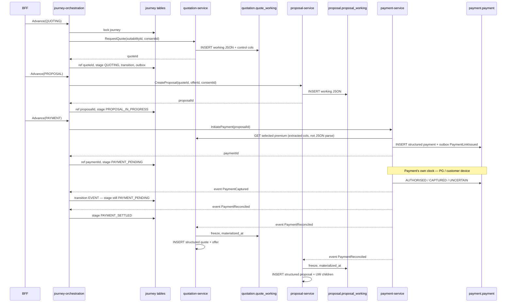
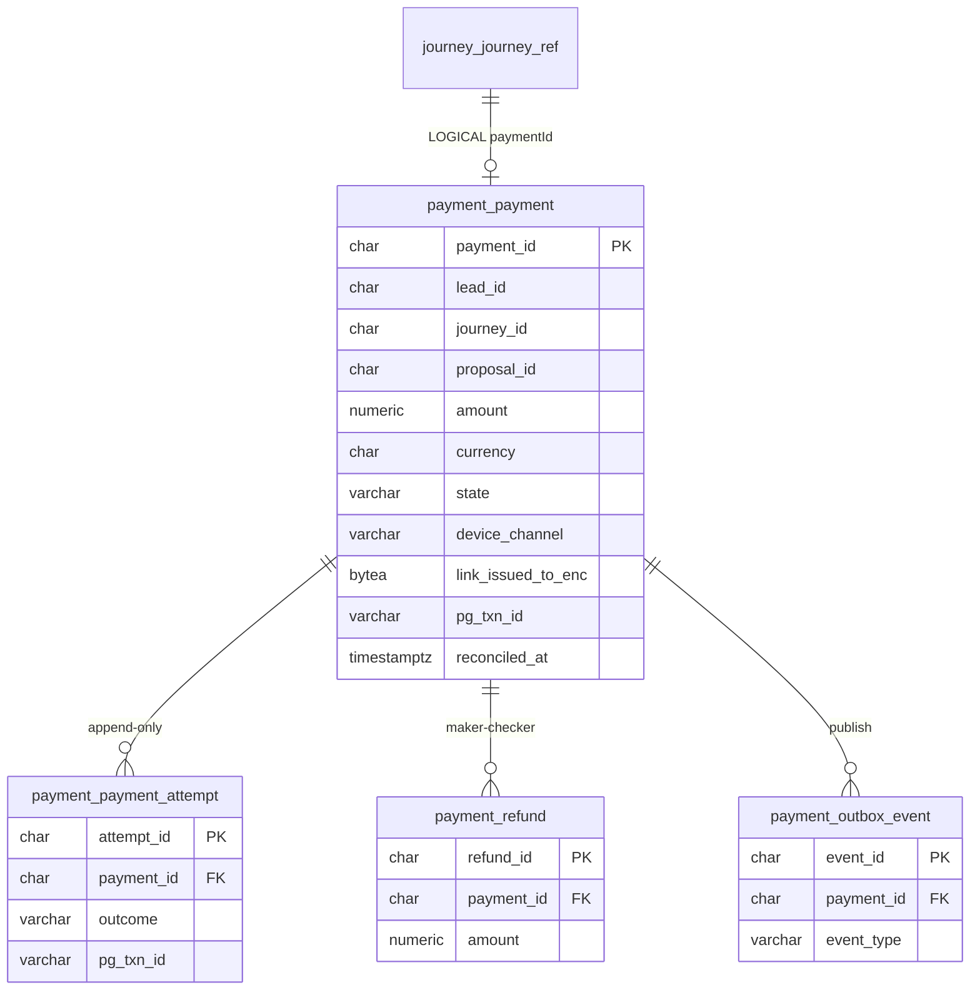
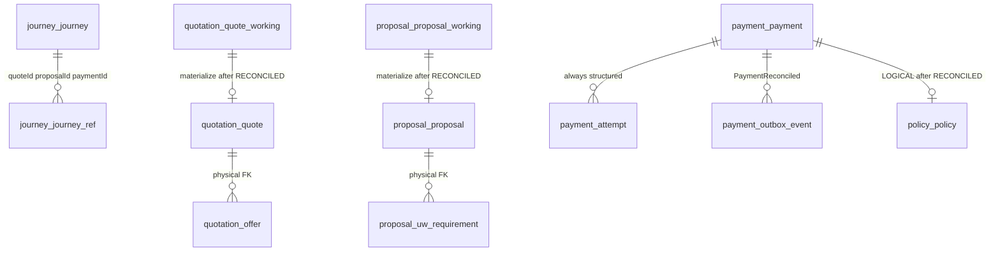

# 06 — Journey orchestrator structure and JSON-until-payment

**Workstream:** WS-3 · **Work item:** [`DATA-005`](./DATA-005.work-item.yaml) · origin [`SUG-20261019-jwp`](../../governance/registers/SUGGESTION-REGISTER.md#sug-20261019-jwp--journey-orchestrator-and-json-until-payment)
**Decision:** [`DB-DEC-0004`](./DB-DEC-0004-working-payload-until-payment.md)
**Owner:** Aarti — Principal Insurance Data & Database Architect
**Joint review:** Mahesh (orchestrator boundary, INV-JRN-02) · Deepali (encrypted working payloads) · Shailja (retention class of unconverted vs paid)
**Status:** `AI-DRAFTED` · design only · not Flyway · not a T4 signature
**Stage:** S08 design delta. Apply stays S09 / S11 owning-service Flyway.

Freshness: `state_as_of` 19d · `04-STAGE_GATES.md` 26d · suggestion register 10d (WARN). No stage field is edited.

This pack answers:

1. The **complete structure** of the Journey Orchestration service and the tables it may touch.
2. How the **orchestrator layer** interacts with those tables — and what it must never write.
3. How **quotes and proposals stay unstructured JSON** until payment is `RECONCILED`, then **materialize** into the existing structured tables.
4. Where **Payment** sits: on the journey as a stage and a ref, and **independent** as its own structured SoR (not JSON, not a journey table).
5. How **transactions** run on the working envelopes, why the store is **Postgres not DynamoDB**, and why only **payment-converted** rows stay as 7-year OLTP evidence.

Cite: [`INV-JRN-02`](../ws3-platform/01-domain-model-and-invariants.md) · [`OR-01`](../../context/roles/mahesh-principal-insurance-platform-architect/13-orchestration-doctrine.md) (orchestrator coordinates, never decides) · [`SC-W3-6`](../ws3-platform/00-WS3-ARCHITECTURE-REGISTRATION.md) · [`03-solution-architecture-r0.md` §5](../ws3-platform/03-solution-architecture-r0.md) · [`12-journey.sql`](./schemas/12-journey.sql) · [`08-quotation.sql`](./schemas/08-quotation.sql) · [`09-proposal.sql`](./schemas/09-proposal.sql) · Aarti card joint-review list ([`aarti-database.card.md`](../../context/personas/aarti-database.card.md)).

---

## 1. Aarti verdict (draft)

| | |
|---|---|
| **Decision** | `APPROVED_WITH_OBSERVATIONS` — working-payload pattern **inside Quotation and Proposal**, not on Journey |
| **Severity** | `D1` — SoT *timing* changes; ownership does not |
| **Orchestrator store** | Schema `journey` only: `journey`, `journey_ref`, `journey_transition`, `outbox_event`, `idempotency_record`. Role `app_journey`. |
| **Quote / proposal before payment** | Encrypted JSON envelope in `quotation.quote_working` / `proposal.proposal_working`. Structured `quote` / `offer` / `proposal` / UW children are **empty** until materialize. |
| **Payment** | On the journey (`PAYMENT_PENDING` → `PAYMENT_SETTLED`, `journey_ref.paymentId`) and **independent** (schema `payment`, `app_payment`, own outbox). Always structured. |
| **Materialize trigger** | `Payment` reaches `RECONCILED`. Owning services consume that event and INSERT structured rows in their own schema. Journey only updates stage + `paymentId` / later `policyId`. |
| **Store** | Aurora PostgreSQL. Encrypted `BYTEA` working envelopes — **not** DynamoDB, **not** plaintext JSONB. One working row per open journey (offers live inside the envelope). |
| **Retention** | `RET-WORKING` until Payment `RECONCILED`, then archive/purge from OLTP. `RET-7Y` / `RET-7Y-IMMUTABLE` only on the converted path (structured quote/proposal + payment + policy). |
| **Never** | Quote or proposal JSON on `journey.journey`. Journey opening `quotation`, `proposal` or `payment`. Orchestrator calling 1SB or a database it does not own. Dynamo as a second SoR. |

Observation: this does **not** move Suitability, Consent, Payment or Policy onto JSON. Those stay structured from the first write — they are evidence or money.

---

## 2. Journey service structure

`journey-orchestration-service` is a skeleton today (`JourneyOrchestrationApplication`). The target internal shape is the same hexagon every WS-3 service uses ([`03` §6](../ws3-platform/03-solution-architecture-r0.md#6-internal-architecture-pattern--s07-e01-s03)):

```text
api/            HTTP from workforce-access-bff only (S-03)
application/    advance, resume, compensate — one use-case per command
domain/         Journey aggregate: stage machine INV-JRN-01, refs, nextActionDueAt
adapter/
  persistence/  JourneyRepository → schema journey (app_journey)
  clients/      sync ports to owning services (no Hub, no 1SB, no foreign DataSource)
  messaging/    outbox publisher; consumers for PaymentReconciled, PolicyActivated, …
```

| Layer | May do | Must not |
|---|---|---|
| API | Accept BFF command + idempotency key | Expose 1SB codes; talk to Flutter |
| Application | Call one owning-service port, then write own tables | Call two writers in one “transaction”; open another schema |
| Domain | Decide the next legal stage | Store premium, eligibility, UW, form JSON |
| Persistence | `journey` schema only | JPA entities for quote/proposal/payment |
| Clients | HTTP to Customer, Lead, Consent, Suitability, Catalogue, Quotation, Proposal, Payment, Policy, Administration | HTTP to Hub or `1sb-integration-service` |

There is **one** journey deployable at R0. Quotation and Proposal are not “journey services”; they are callees.

---

## 3. Tables the orchestrator may touch

```mermaid
erDiagram
    journey_journey {
        char journey_id PK
        char lead_id
        char customer_id
        varchar rm_id
        varchar accountable_sp_id
        varchar stage
        varchar channel
        varchar lob
        varchar current_assisting_actor_id
        varchar current_assisting_actor_type
        varchar partner_insurer_id
        timestamptz partner_visible_from
        char party_snapshot_ref
        timestamptz next_action_due_at
        jsonb compensation
        varchar config_version_ref
        bigint version
    }
    journey_journey_ref {
        char journey_id PK_FK
        varchar ref_type PK
        varchar ref_value
    }
    journey_journey_transition {
        char transition_id PK
        char journey_id FK
        varchar from_stage
        varchar to_stage
        varchar trigger_kind
        varchar trigger_type
        varchar actor_id
        timestamptz occurred_at
        varchar correlation_id
    }
    journey_outbox_event {
        char event_id PK
        char journey_id
        varchar event_type
        jsonb payload
        timestamptz created_at
        timestamptz published_at
    }
    journey_journey ||--o{ journey_journey_ref : "has"
    journey_journey ||--o{ journey_journey_transition : "history"
    journey_journey ||--o{ journey_outbox_event : "publish"
```

| Table | Orchestrator write | Purpose |
|---|---|---|
| `journey.journey` | INSERT on start; UPDATE `stage`, `next_action_due_at`, assist fields, `compensation`, `version` | Saga header. No decision columns (`INV-JRN-02`) |
| `journey.journey_ref` | UPSERT `(journey_id, ref_type)` when a callee returns an id | The only place Journey remembers quote/proposal/payment/policy |
| `journey.journey_transition` | INSERT-only on every legal stage move | Reconstruction. Not a decision store |
| `journey.outbox_event` | INSERT in the **same transaction** as the stage write | `ADR-012` |
| `journey.idempotency_record` | Same transaction as the command | `INV-IDM-01` |

`ref_type` stays: `suitabilityId` · `consentId` · `quoteId` · `offerId` · `proposalId` · `paymentId` · `policyId` · `applicationNumber` · `policyNumber` · `provider`.

`compensation` JSONB on the header is **saga bookkeeping** (`failurePoint`, `attempts`, `ownerTaskId`), not a premium or UW outcome.

---

## 4. How the orchestrator interacts (never a cross-schema write)

Pattern for every advancing command:

```text
1. Load journey + refs with app_journey (SELECT … FOR UPDATE / version)
2. Reject illegal stage (INV-JRN-01)
3. HTTP call to the owning service (S-04 … S-16 as applicable)
4. Owning service writes ITS store (working JSON or structured money/evidence)
5. On success, Journey in ONE local transaction:
      UPDATE journey.stage + next_action_due_at + version
      UPSERT journey_ref
      INSERT journey_transition
      INSERT outbox_event
      INSERT/hit idempotency_record
6. On callee failure: stage unchanged (S-03). No compensating write into the callee's schema.
```

There is no 2PC. If step 5 fails after step 4 succeeded, retry of the command is idempotent: the callee returns the same id; Journey upserts the same ref.



Journey **subscribes** to `PaymentReconciled` only to move stage. It does not materialize quote or proposal.

---

## 5. JSON until payment — owning schemas, not Journey

### 5.1 What stays structured from the first write

| Schema | Why not JSON |
|---|---|
| `journey` | Stage + refs only |
| `lead_lms` / `customer` / `consent` / `suitability` | Regulatory evidence, uniqueness, IPR predicates |
| `payment` | Money path; `RECONCILED` is the issuance gate |
| `policy` | Created only after `RECONCILED` (`INV-POL-01`) — already “after payment” |
| `catalogue` / `identity` / `administration` / `bank_persistence` | Reference, PDP, jobs, audit |

### 5.2 What is a working JSON envelope

| Table | Owner | Until | Then |
|---|---|---|---|
| `quotation.quote_working` | `quotation-service` / `app_quotation` | `materialized_at IS NULL` | INSERT `quotation.quote` + `quotation.offer` |
| `proposal.proposal_working` | `proposal-service` / `app_proposal` | `materialized_at IS NULL` | INSERT `proposal.proposal` + UW children |

The envelope is `payload_enc BYTEA` (⚑). Plaintext JSONB is refused — members, nominee and form PII must not be queryable (`DR-PII-01`, `INV-PRP-05`).

**Control columns** sit beside the envelope so gates and payment do not decrypt:

| Extracted on `quote_working` | Why |
|---|---|
| `suitability_id`, `consent_id` | `INV-QUO-01` / proposal consent gate — checked before INSERT |
| `state`, `valid_until` | Quote state machine + `INV-QUO-04` |
| `selected_offer_id`, `selected_premium_amount`, `selected_tax_amount`, `selected_sum_assured`, `selected_insurer_code`, `selected_product_code` | Written **atomically** on select (`INV-QUO-05` in the service). Payment reads these via Quotation API (`INV-PAY-03`) |
| `provider_job_id` | Correlate adapter job |

| Extracted on `proposal_working` | Why |
|---|---|
| `quote_id`, `offer_id`, `consent_id` | `INV-PRP-01/02` |
| `application_number`, `state`, `underwriting_state` | Status without opening the envelope |
| `schema_id`, `schema_version` | Form contract |

Selection still happens in **one Quotation transaction**: update extracted selected_* + rewrite `payload_enc` so the JSON and the columns cannot disagree.

### 5.3 Materialize (after `RECONCILED`)

1. Payment service writes structured `payment` (always) and emits `PaymentReconciled`.
2. `quotation-service` (idempotent consumer):
   - lock `quote_working` where `quote_id` = ref and `materialized_at IS NULL`
   - INSERT `quotation.quote` and one `quotation.offer` per offer in the envelope (selected offer `SELECTED`, others `NOT_SELECTED`)
   - set `materialized_at = now()`
3. `proposal-service` does the same into `proposal.proposal`, `uw_requirement`, `uw_document_ref`.
4. Structured tables remain INSERT-only after that; working rows become frozen (`fn_freeze_working_payload` rejects `UPDATE` of `payload_enc` and extracted control columns when `materialized_at IS NOT NULL`).

Abandoned / expired / declined journeys **never materialize**. Working rows age out via `retain_until` + `job_retention`. They are not a sold-policy record.

### 5.4 What the JSON may contain (schema versioned)

`payload_schema_version` is mandatory. v1 quote envelope (illustrative, not a second SoT):

```text
{
  requestedCover, mode, category,
  members: <inside enc only>,
  offers: [{ offerId, insurerCode, productCode, productName,
             premiumAmount, taxAmount, sumAssured, frequency,
             coverTerm, ppt, outOfBound, offerState, errorSummary }],
  selectedOfferId
}
```

v1 proposal envelope: form answers, UW requirement list, document refs, counter-offer. Nominee stays inside `payload_enc`.

---

## 6. Payment — on the journey, and independent

Payment **is** a journey step. It is **not** a journey table.

The sale cannot finish without it (`INV-JRN-05`: `SOLD` requires payment `RECONCILED`). The orchestrator advances `PAYMENT_PENDING` → `PAYMENT_SETTLED` and stores `paymentId` on `journey_ref`. Money, device isolation, attempts and reconciliation live in schema `payment`, written only by `payment-service` / `app_payment`.

That is the same ownership rule as Quotation and Proposal. The difference: Payment is **always structured**. There is no `payment_working` JSON envelope. Amount, state, `pg_txn_id` and `RECONCILED` are queryable from the first write because they are the issuance gate (`INV-PAY-05`, `INV-POL-01`), not a draft form.

### 6.1 Independence (what “independent” means here)

| Rule | Binding |
|---|---|
| Own schema, own credential | `payment` / `app_payment`. No grant to `app_journey` |
| Own state machine | `INITIATED` → `LINK_ISSUED` → … → `RECONCILED` ([`01` §4.6](../ws3-platform/01-domain-model-and-invariants.md)) — not a journey stage |
| Own outbox | `payment.outbox_event` in the same transaction as the payment write (`ADR-012`) |
| Journey holds an id only | `journey_ref (paymentId)` + logical `payment.journey_id` / `proposal_id`. No cross-schema FK |
| Journey does not write money | Advance calls `payment-service` HTTP. `app_journey` cannot INSERT `payment.payment` |
| Payment does not write the saga | Payment never UPDATE `journey.*`. It emits `PaymentLinkIssued`, `PaymentAuthorised` / `PaymentCaptured`, `PaymentReconciled`, `PaymentReconciliationBreak` |
| Amount comes from Quotation, not from Journey | `INV-PAY-03` via Quotation API `selected_*`. Payment never decrypts `quote_working` |
| Device isolation | `INV-PAY-01`: `device_channel` is `SMS_LINK` \| `EMAIL_LINK` \| `QR_SCAN`. No API path issues a link into an RM session |
| Adapter session is not this SoR | `bank_persistence.payment_session` is the 1SB link-session. Correlate on `application_number` / job id — not a FK |

`R-10` already forbids coupling Payment directly to Policy. Journey is the saga; Payment stays a callee.

### 6.2 Tables Payment owns



| Table | Kind | Why structured from first write |
|---|---|---|
| `payment.payment` | transactional SoR | Amount, uniqueness (`INV-PAY-02`), device channel, `RECONCILED` gate |
| `payment.payment_attempt` | append-only | Lost-PG-response / `UNCERTAIN` (`INV-PAY-04`) |
| `payment.refund` | transactional | `INV-PAY-06` maker-checker; never auto above threshold |
| `payment.outbox_event` | reliability | Payment publishes; Journey and Quotation/Proposal consume |
| `payment.idempotency_record` | reliability | `INV-IDM-01` on initiate / reconcile |

No cardholder data. `link_issued_to_enc` is the customer contact the link was sent to (⚑), not a PAN/CVV.

### 6.3 How the orchestrator talks to Payment

```text
BFF → JO Advance(PAYMENT)
  JO locks journey; requires proposalId (and selected offer via that proposal)
  JO → payment-service InitiatePayment(proposalId, journeyId, leadId)
    PAY → quotation-service GET selected premium (selected_* columns)
    PAY rejects PREMIUM_MISMATCH (INV-PAY-03) or PAYMENT_ALREADY_IN_PROGRESS (INV-PAY-02)
    PAY INSERT payment + outbox PaymentLinkIssued + idempotency
    PAY issues the link on the customer-device channel (INV-PAY-01)
  PAY → JO paymentId
  JO local txn: ref paymentId, stage PAYMENT_PENDING, transition COMMAND, outbox

later, Payment's own clock (not a BFF click):
  PAY updates payment.state (AUTHORISED / CAPTURED / UNCERTAIN / …)
  PAY outbox PaymentAuthorised / PaymentCaptured
  JO may record the event on journey_transition; stage stays PAYMENT_PENDING
    until RECONCILED — CAPTURED is not enough (INV-PAY-05 / INV-POL-01)

  PAY matches pg_txn_id + amount → RECONCILED
  PAY outbox PaymentReconciled
  JO: stage PAYMENT_SETTLED, transition EVENT
  QS / PS: materialize structured quote / proposal (section 5.3)
```

Journey **waits** on Payment. It does not reconcile, does not talk to the PG, and does not issue the link. If Payment is `UNCERTAIN`, Journey stays `PAYMENT_PENDING` — re-initiation is Payment's rejection (`INV-PAY-04`), not a Journey overwrite.

### 6.4 Why Payment is not a working JSON

| If Payment were JSON-until-issuance | What breaks |
|---|---|
| Amount only inside an envelope | `INV-PAY-03` / reconciliation cannot match paise without decrypt |
| One open payment per proposal | `ux_payment_active_per_proposal` needs a column, not a blob |
| `UNCERTAIN` vs `CAPTURED` vs `RECONCILED` | Issuance gate must be a CHECK-able state |
| Device channel | `INV-PAY-01` is an access-control fact, not a form field |

Quote and proposal can stay envelopes because they are **not** the issuance gate. Payment **is**.

---

## 7. Stage × callee × table

| Journey stage after success | Callee | Callee store | Journey write |
|---|---|---|---|
| `INITIATED` | Customer (snapshot) | `customer.customer_snapshot` | journey + `party_snapshot_ref` |
| `NEED_ANALYSIS` / `SUITABILITY_COMPLETE` | Suitability | `suitability.*` structured | ref `suitabilityId` |
| `CONSENT_CAPTURED` | Consent | `consent.consent` structured | ref `consentId` |
| `QUOTING` | Quotation | **`quote_working` only** | ref `quoteId` |
| `QUOTE_SELECTED` | Quotation (select) | update `quote_working` selected_* | ref `offerId` |
| `PROPOSAL_IN_PROGRESS` / `UNDERWRITING` | Proposal | **`proposal_working` only** | ref `proposalId` / `applicationNumber` |
| `PAYMENT_PENDING` | Payment (HTTP initiate) | **`payment.payment` structured** + outbox `PaymentLinkIssued` | ref `paymentId` |
| `PAYMENT_PENDING` (still) | Payment events `Authorised` / `Captured` / `UNCERTAIN` | Payment updates its own row | transition EVENT; **stage unchanged** |
| `PAYMENT_SETTLED` | Payment event `PaymentReconciled` | Quotation + Proposal **materialize** | stage only |
| `ISSUANCE_PENDING` / `ISSUED` / `SOLD` | Policy | `policy.policy` structured | ref `policyId` / `policyNumber` |

---

## 8. Credentials

Unchanged rule: one role per schema. New tables inherit the owning role.

| Service | Role | New objects |
|---|---|---|
| `journey-orchestration-service` | `app_journey` | `journey_transition` INSERT; `outbox_event` INSERT/UPDATE published_at |
| `quotation-service` | `app_quotation` | `quote_working` DML until freeze; structured `quote`/`offer` INSERT after materialize |
| `proposal-service` | `app_proposal` | same pattern |
| `payment-service` | `app_payment` | `payment` / attempt / refund / outbox. Never reads `*_working`; never writes `journey.*`. Calls Quotation API for `selected_*` |

`1sb-integration-service` still has no datasource. Adapter job rows stay in `bank_persistence` (already structured; they are not the bank quote SoR).

---

## 9. ER — working vs structured



Dashed ownership: Journey holds ids only. Working and structured quote/proposal live in their schemas. Payment is a first-class independent SoR on the same saga.

---

## 10. Transactions, store, bulk, and archive-unless-paid

Owner follow-up [`SUG-20261019-txn`](../../governance/registers/SUGGESTION-REGISTER.md#sug-20261019-txn--postgres-transactions-not-dynamo-archive-unless-paid): how a transaction works on the unstructured quote/proposal; Dynamo vs Postgres JSON; bulk; do not keep every lead/journey for 7–10 years — only the payment-converted path.

Cite: [`DB-DEC-0001`](./DB-DEC-0001-r0-physical-model.md) (Dynamo rejected at R0) · [`02` §4](./02-operations-and-troubleshooting.md#4-retention-and-purge-s07-e04-s06) · [`DR-REC-05`](./00-design-rules.md) · `C-RET-1` / `OPEN-I4` · Aarti cannot waive Shailja's retention class.

### 10.1 Transaction — Postgres ACID on the envelope row, not on the JSON

The working payload is **not** a document database and is **not** queried with `JSONB` operators. The unit of transaction is the **row**.

```text
Quotation-service — ONE local Postgres transaction (schema quotation, app_quotation)
  INSERT or UPDATE quote_working
      control columns  (state, selected_*, suitability_id, …)
      payload_enc      (BYTEA ciphertext of the whole quote + offers)
  INSERT/hit idempotency_record
  COMMIT
  -- then return quoteId to Journey

Journey-service — a LATER, separate transaction (schema journey)
  UPDATE journey.stage + version
  UPSERT journey_ref.quoteId
  INSERT journey_transition
  INSERT outbox_event
  COMMIT
```

Same shape for Proposal. Same shape for Payment (structured `payment` + outbox).

| Property | How it is true |
|---|---|
| Atomic select | `selected_*` and `payload_enc` update in **one** quotation transaction (`INV-QUO-05`) |
| No 2PC | Journey commits after the callee has committed. Retry is idempotent |
| No decrypt in SQL | Gates and Payment read control columns / Quotation API. `payload_enc` is opaque |
| Isolation | `SELECT … FOR UPDATE` / `version` on the working row. Partial unique `ux_qwork_open_journey` |
| Bulk offers | N insurer offers sit **inside** one envelope. Not N quote rows, not N Dynamo items |
| After `RECONCILED` | A later quotation transaction INSERTs structured `quote` + `offer` and freezes the envelope |

There is no transaction that “opens the JSON”, edits one offer, and writes it back as a SQL `jsonb_set`. The service decrypts in process, applies the change, encrypts, writes the row.

### 10.2 Store — Postgres, not DynamoDB, not plaintext JSONB

| Option | Verdict | Why |
|---|---|---|
| **Aurora PostgreSQL `BYTEA` + control columns** | **Taken** | Same cluster, same credential model, same-transaction idempotency, TOAST for large envelopes. `DB-DEC-0001` / `DB-DEC-0004` |
| DynamoDB document per quote/proposal | **Rejected** | Second SoR, no FK/CHECK/`INV-PAY-02` uniqueness, splits the already-shipping audit/job store, no R0 volume evidence. Revisit only on a **measured** access pattern |
| Postgres `JSONB` (plaintext) | **Rejected** | Members / nominee / form become queryable (`DR-PII-01`, `INV-PRP-05`) |
| JSON on `journey` | **Rejected** | `INV-JRN-02` / `OR-01` |

**Bulk.** R0 write amplification is one working row per open journey, not one row per insurer. Offers fan out to structured `offer` rows only after `RECONCILED`. Abandoned bulk never materializes. The next limit is still provider latency, not Aurora (`01` §7). Partitioning stays deferred (`OPEN-I6`).

### 10.3 Retention — only payment-converted stays as 7-year OLTP evidence

The information model marks quote/journey attributes `RET-7Y`. That class applies to the **sold** record. Keeping every abandoned lead and working envelope in Aurora for 7–10 years is refused.

| Path | What stays in Aurora | Class | What happens at `retain_until` |
|---|---|---|---|
| **Never reached payment** (no `journey_ref.paymentId`) | Nothing after archive | `RET-WORKING` (operational window, default 90 days — config, `OPEN-I4` may move the number) | Owning job sets `archived_at`, optional S3 dump, then `sp_purge_operational` deletes working envelopes and the journey tree |
| **Reached payment, not `RECONCILED`** (declined / expired / `UNCERTAIN` resolved to no capture) | `payment.payment` + attempts | Payment is `RET-7Y-IMMUTABLE` (money). Working quote/proposal and the journey header follow `RET-WORKING` | Working envelopes and unconverted journey archive; the payment row stays |
| **`RECONCILED`** | Structured `quote` / `offer` / `proposal` / UW, `payment`, later `policy`, journey header | `RET-7Y` / `RET-7Y-IMMUTABLE` / `RET-POLICY+7Y` | Working envelope may still age out (structured copy is the record). Structured rows are **not** in the purge |

```text
retain_until is set by the owning service from configuration (not a hardcoded 7 in a CHECK).
  quote_working / proposal_working : valid_until or operational window at INSERT
  journey                         : operational window at INSERT;
                                    on PaymentReconciled → RET-7Y close date (OPEN-I4)
  payment                         : always RET-7Y-IMMUTABLE from INSERT
```

**Lead inbox.** `lead_lms.lead` already has `ARCHIVED` + `archived_at` (`DATA-003`). An unconverted lead leaves the working inbox. **`C-RET-1` attribution columns** (`lead_id`, `accountable_sp_id`, cert ref, `lob`, `converted_journey_id`) stay `RET-7Y` until Shailja says otherwise — that is a thin stub, not the full journey. Named `OPEN-RET-LEAD-STUB`.

**Consent / suitability** on an unconverted path stay `RET-7Y` / `RET-7Y-IMMUTABLE` in the information model (they are regulatory evidence even if no sale). This pack does **not** purge them. Named `OPEN-RET-UNCONVERTED-EVIDENCE` for Shailja. Aarti will not delete consent to save disk.

Archive is **out of OLTP**, not “keep the hot row and flip a flag for seven years”. Mechanism (S3 dump vs archive table vs partition) stays the joint Aarti/Mahesh item already open on Lead W1 (`DEC-20260825-01` §12). Until that lands, `archived_at` + `retain_until` + purge of unconverted working/journey rows is the contract.

---

## 11. What this pack will not do

- Put working JSON on `journey` or in DynamoDB.
- Use plaintext Postgres `JSONB` for quote/proposal envelopes.
- Fold Payment into the journey schema, or give `app_journey` a grant on `payment`.
- Store Payment as a working JSON envelope.
- Let Journey materialize another context’s rows.
- Keep every unconverted lead/journey working envelope in Aurora for 7–10 years.
- Purge `C-RET-1` lead attribution or consent evidence without Shailja.
- Apply Flyway or implement the skeleton service.
- Edit `CURRENT-STATE.yaml` stage fields.
- Mark `S07-G5` passed.

DDL: [`12-journey.sql`](./schemas/12-journey.sql) (transition + outbox + `retain_until` / `archived_at`) · [`08-quotation.sql`](./schemas/08-quotation.sql) (`quote_working`) · [`09-proposal.sql`](./schemas/09-proposal.sql) (`proposal_working`) · [`10-payment.sql`](./schemas/10-payment.sql) (structured + outbox) · [`90-routines.sql`](./schemas/90-routines.sql) (purge skips paid journeys) · [`91-grants.sql`](./schemas/91-grants.sql).
